<p align="center">
  <picture>
    <source media="(prefers-color-scheme: dark)" srcset="assets/brand/openstitch-wordmark-dark.svg">
    
  </picture>
</p>

# OpenStitch

An independent, cross-platform (macOS, Windows, Linux) embroidery design application written in
Rust. It aims to work like Brother PE-DESIGN 11 and to read and write the same files, so designs
move between the two and onto Brother machines.

OpenStitch is an **alpha**: good for trying out and testing, not for production work. Do a test
sew-out on scrap fabric first.

**Try it in your browser, nothing to install:** https://cristianonescu.github.io/OpenStitch/
It runs the desktop editor on designs from your own disk and saves and exports them as downloads
(nothing is uploaded); the Assistant, printing and sending to a machine are still desktop-only.

Not affiliated with Brother Industries. No Brother code or assets are included; see
[docs/LEGAL_AND_LICENSING.md](docs/LEGAL_AND_LICENSING.md).

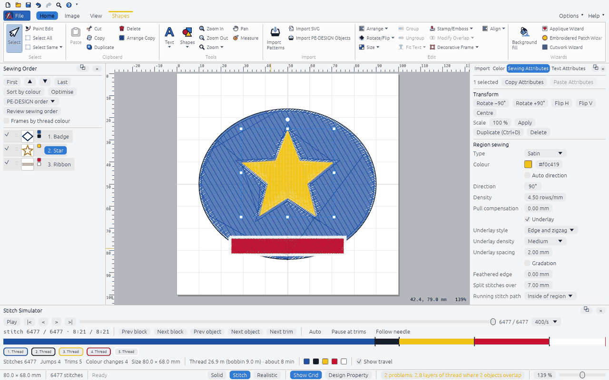

## Contents

- [Highlights](#highlights)
- [New: the Assistant](#new-the-assistant)
- [Status at a glance](#status-at-a-glance)
- [Screenshots](#screenshots)
- [From image to embroidery](#from-image-to-embroidery)
- [Ready-to-sew designs](#ready-to-sew-designs)
- [Features](#features)
- [Not yet implemented](#not-yet-implemented)
- [Known issues](#known-issues)
- [Planned](#planned)
- [Download a build](#download-a-build)
- [Build from source](#build-from-source)
- [MCP server](#mcp-server-claude-code-and-other-mcp-clients)
- [Contributing](#contributing)
- [Releases](#releases)
- [Documents](#documents)
- [License](#license)

## Highlights

The strongest features; the full list is under [Features](#features). **(+)** marks what goes
beyond PE-DESIGN 11.

- **PE-DESIGN 11 files both ways:** every PES version is read, and designs saved as "PE-DESIGN 11"
  open in PE-DESIGN 11.50 with their shapes and text still editable. An opened PES you have not
  changed is written back byte for byte.
- **PE-DESIGN 11's tools, checked against its output:** the region and line sew types, lettering
  with Text Transform and Fit Text to Outline, Manual Punch, and the appliqué, patch, cutwork and
  split-design wizards, compared spec by spec with designs made in PE-DESIGN 11.50.
- **(+) AI Assistant:** a chat that makes and changes designs through OpenStitch's own commands,
  with the Claude API, a local model or a coding agent; it asks before touching files or the
  machine, and each message is one undo step.
- **Image to embroidery, two ways:** OpenStitch's PE-DESIGN-compatible mode, and (+) OpenStitch
  mode, which picks threads by how colours look, from the charts or the threads you own.
- **(+) Checks before you sew:** Check Design, a density map, a review of the sewing order, and
  every exported file read back and compared.
- **(+) Production aids:** basting, machine stops, knockdown fill, hidden stitching left out,
  travel hidden under fills, and test swatches with a fabric calibration card.
- **(+) Editing beyond PE-DESIGN:** knife, shape builder, align and distribute, snap to objects,
  a precision bar, a command palette, autosave with recovery and your own shortcuts.
- **(+) Lettering beyond PE-DESIGN:** multi-line arcs, free envelopes, small text and pixel fonts,
  bundled fonts with size ranges, and Ink/Stitch font folders.
- **(+) More formats:** VP3, Tajima, Barudan and more beside PE-DESIGN's own, thread lists,
  G-code, pictures, stitch-out animations and ZIP bundles.
- **(+) Scripting:** a Python package, `stitchtool` one-line commands, an MCP server and a socket
  to the running editor.
- **Everywhere:** macOS, Windows and Linux with self-update,
  (+) [a first browser version](https://cristianonescu.github.io/OpenStitch/), and file-manager
  thumbnails in Finder (Quick Look), Windows Explorer and on Linux.
- **Ready-to-sew kit:** designs for every feature and calibration cards, ready to copy to a
  machine.

## New: the Assistant

**Alpha 12 adds an AI chat that can drive the whole editor.** Ask it for a design ("a 70 mm round
badge with a navy satin border and ANNA in gold"), to change what is open ("make the lettering
satin and 10 % bigger"), to explain or check a design, or drop in a picture and ask for embroidery.
It works through OpenStitch's own commands, so what it makes is an ordinary design you keep
editing by hand, and everything one message changes is a single undo step.


*A real run, not a mock-up: Claude Code (on the user's own account) turning a dropped picture
into a 50 × 63 mm strawberry, correcting its own first attempt, then checking the result.*

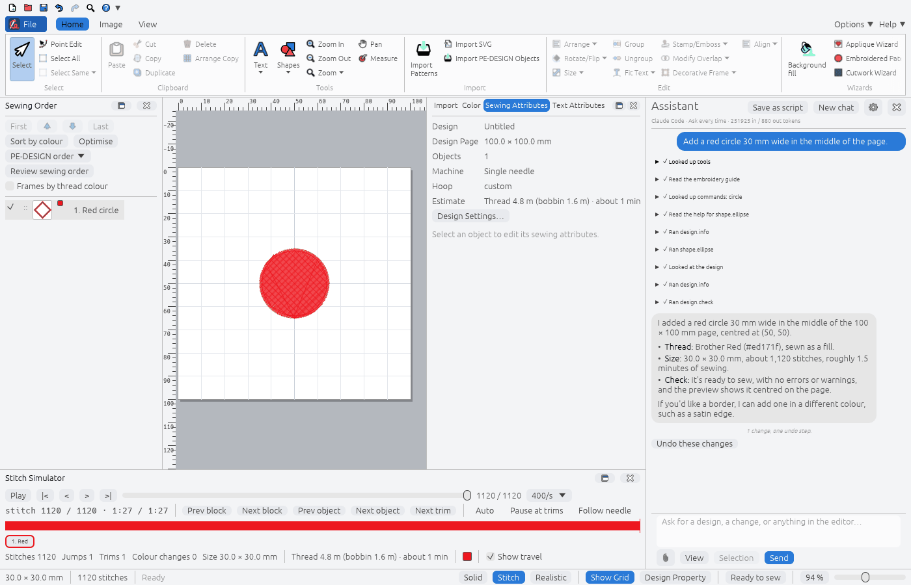

*The same on Windows (2026-11-06): Claude Code asked before its edit, drew and checked the
circle, and the whole message is one undo step.*

- **Your choice of AI:** the Claude API with your own key (kept in the system keychain), a model
  on your computer through Ollama or LM Studio (no key, works offline), OpenRouter or any
  OpenAI- or Anthropic-compatible service, or a coding agent you already use (Claude Code, Codex,
  OpenCode).
- **You stay in control:** design changes run at once; saving, exporting, opening files, sending
  to the machine and quitting ask first (**Allow once**, **Always allow** or **Deny**).
- **Private:** your messages and design go only to the AI you chose; OpenStitch has no server and
  no telemetry. **Options ▸ Show AI features** hides it completely.
- **Open it:** it opens beside the design; **View ▸ Show/Hide ▸ Assistant** or Ctrl+Shift+A
  (Cmd+Shift+A) brings it back.
- **It remembers you:** tell it your machine, the threads you own or how you like your satin, and
  it keeps a short note for later conversations, asking first each time. The notes stay on your
  computer, you can read, edit or clear them in its settings, or turn memory off.

Benchmark on 12 embroidery tasks: Claude Code 12/12, Ollama gpt-oss:20b 8/12. It has been tested
on macOS and Windows (12/12 there too); on Linux, CI runs its tests and the keychain round trip
([#401](https://github.com/cristianonescu/OpenStitch/issues/401)). Details in the
[alpha 12 notes](docs/releases/v0.1.0-alpha.12.md).

## Status at a glance

Current release: **v0.1.0-alpha.12** ([notes](docs/releases/v0.1.0-alpha.12.md)).

OpenStitch is checked against PE-DESIGN 11.50 itself. Simple test designs made in a licensed copy
through its normal interface are committed under `compat/reference/`. The compatibility harness
(`stitchtool compat`) compares OpenStitch's output with them spec by spec.

<!-- status:glance -->
| | |
|---|---|
| Feature matrix rows | 330: 281 implemented (4 of them partially compatible), 0 documented only, 9 blocked, 15 partial beyond PE-DESIGN, 25 planned beyond PE-DESIGN |
| Compatibility specs | 505: 504 pass, 0 fail ([status](docs/COMPATIBILITY_STATUS.md)) |
| Matrix rows covered by specs | 41: 31 at the reference tier, 7 at the internal-regression tier, 2 at the oracle tier, 1 at the reference (partly) tier |
| Open audit differences | 9 ([audit](docs/COMPATIBILITY_AUDIT.md#summary)) |
| Open GitHub issues | 74 ([list](https://github.com/cristianonescu/OpenStitch/issues)) |
<!-- /status:glance -->

Tiers, weakest first: *internal regression* (our own earlier output), *oracle* (an independent
implementation), *reference* (PE-DESIGN 11.50's own output), *machine* (a recorded sew-out; no
spec has reached it yet). Every feature and its evidence is in [docs/FEATURE_MATRIX.md](docs/FEATURE_MATRIX.md).

## Screenshots

| | |
|---|---|
| 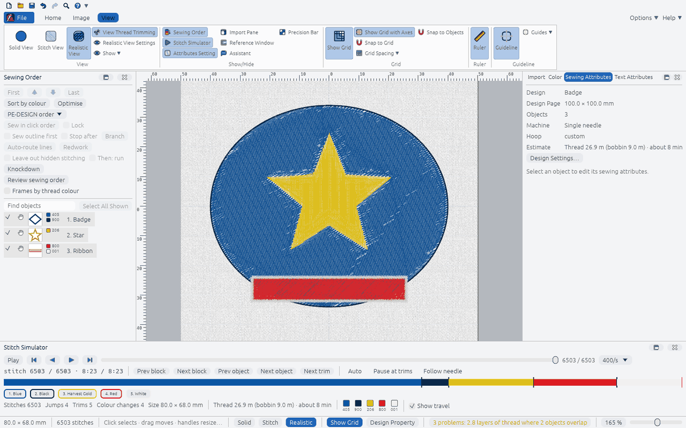 | 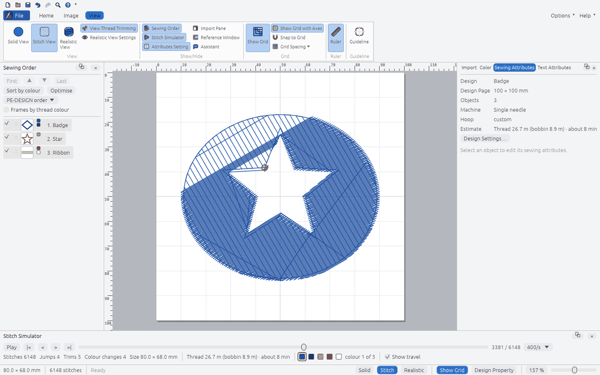 |
| **Realistic view:** see how the stitches will look on fabric; thread is drawn as wide as it covers at its row density, measured on real sew-outs. | **Stitch simulator:** play the design back stitch by stitch, with jumps and trims. |
| 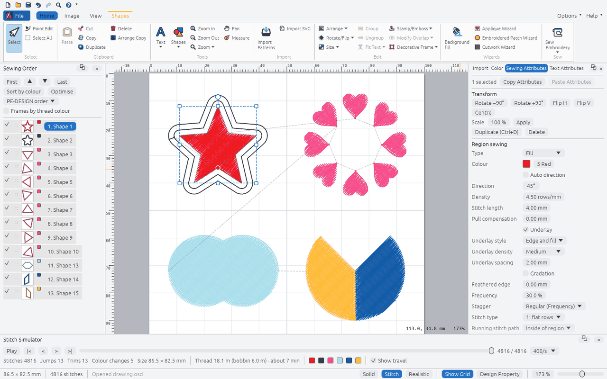 | 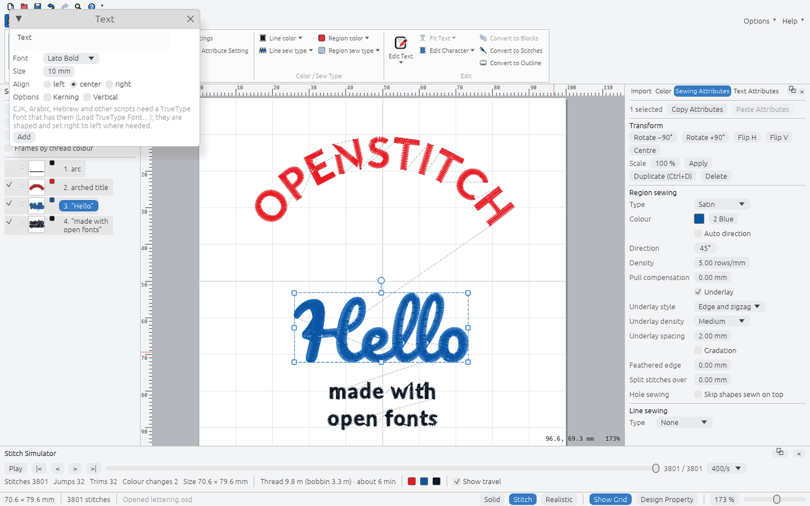 |
| **Drawing and editing:** shapes, Bézier outlines, arranged copies and shape operations. | **Lettering:** TrueType text with PE-DESIGN's size, spacing and transforms. |
| 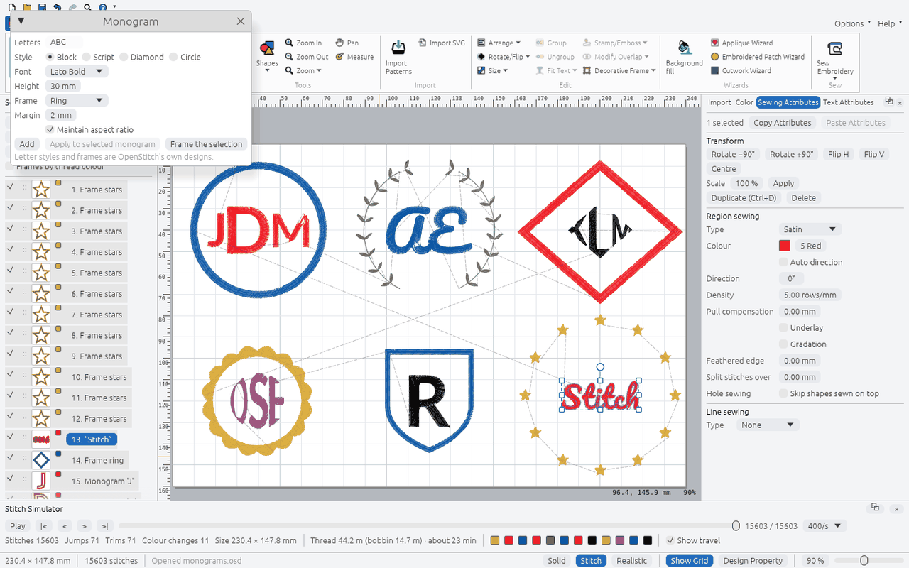 | 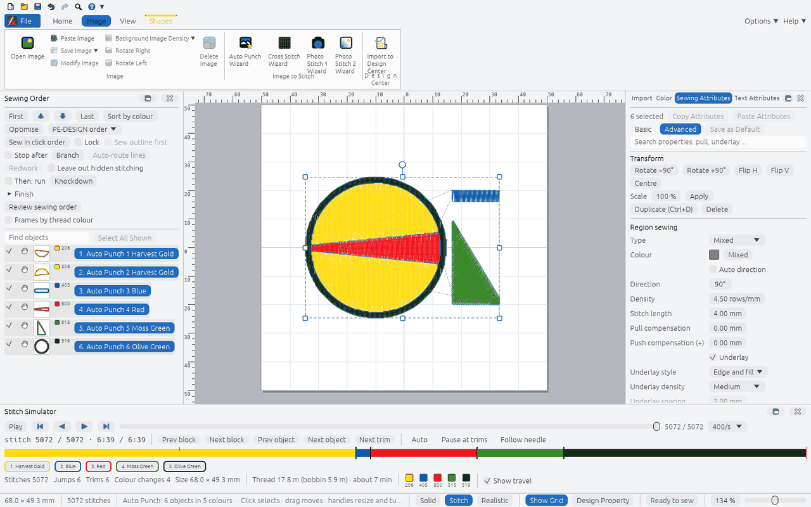 |
| **Monograms:** letters in a frame, kept editable. | **Image to embroidery:** Auto Punch, Cross Stitch and Photo Stitch-style conversion. |
| 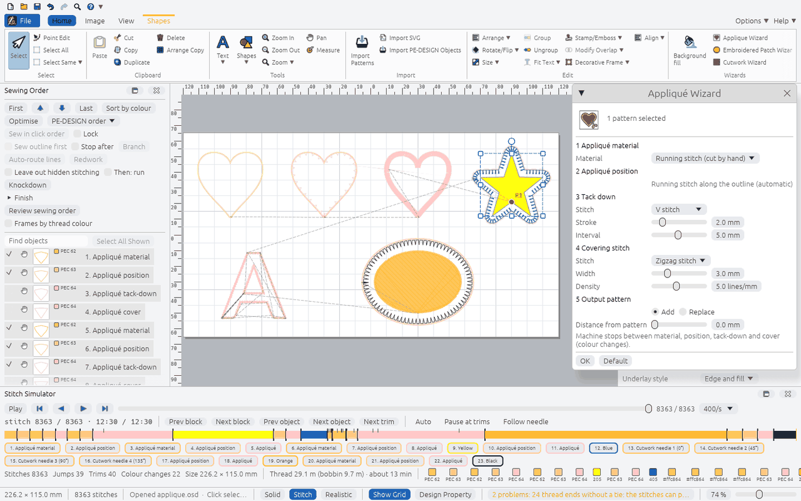 | 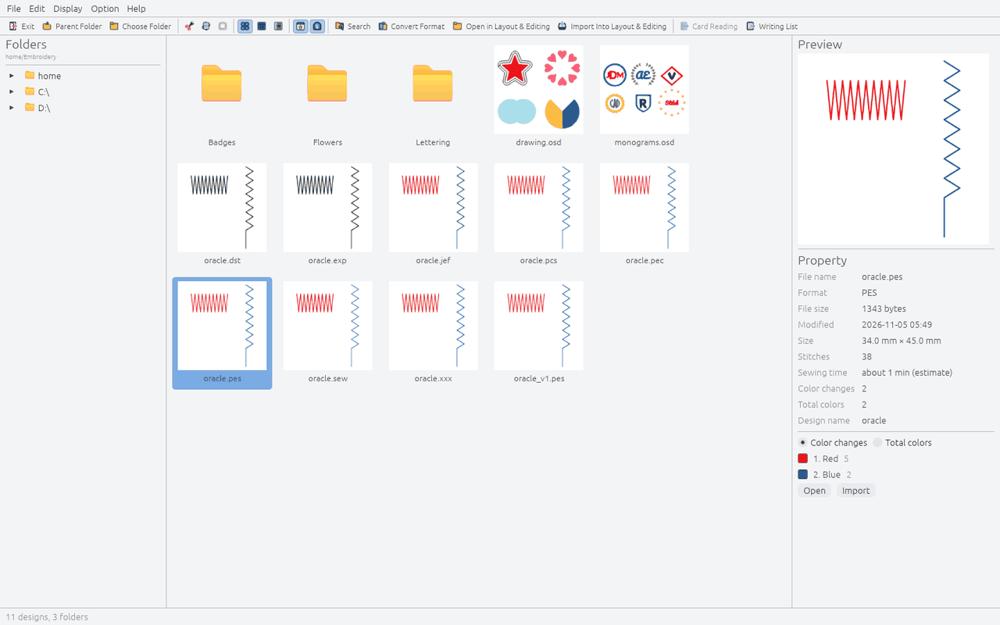 |
| **Wizards:** appliqué, patch, cutwork, background fill and split designs. | **Design Database:** browse, search, organise and convert your design files. |
| 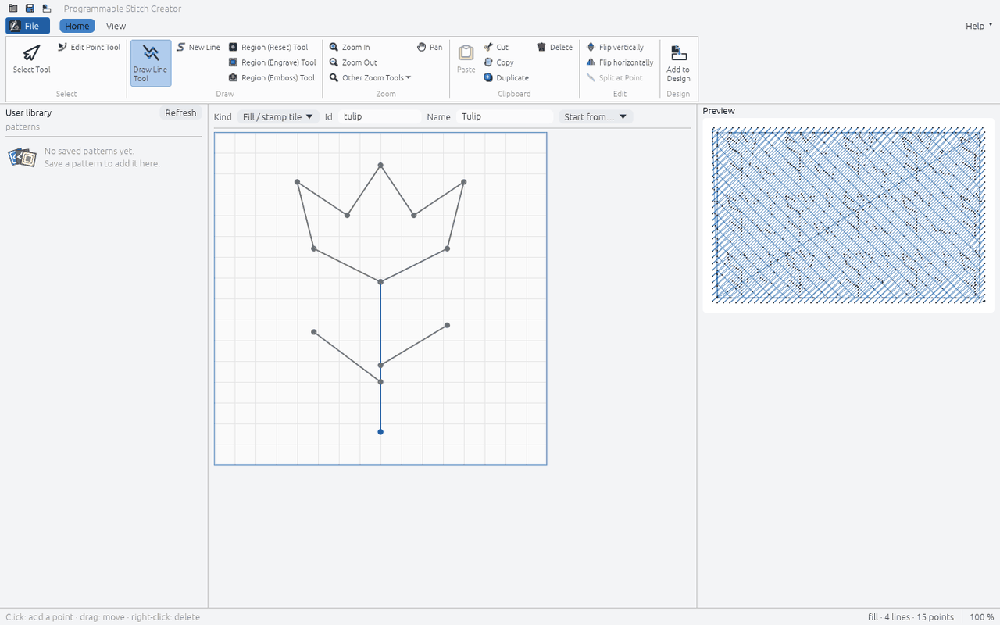 | 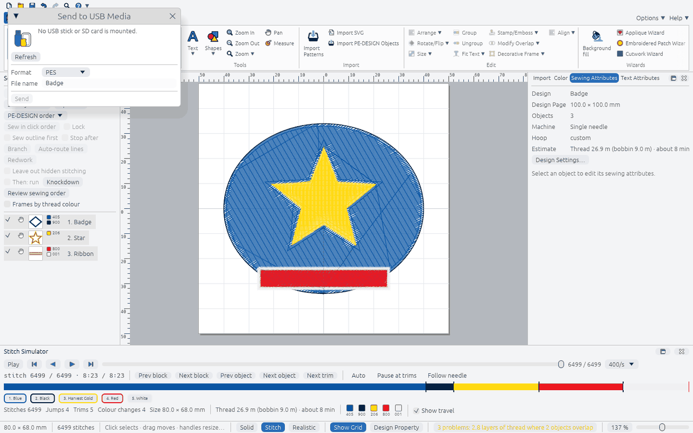 |
| **Programmable Stitch Creator:** draw your own fill and motif stitch patterns. | **Machine transfer:** write the design to a USB stick or SD card. |
| 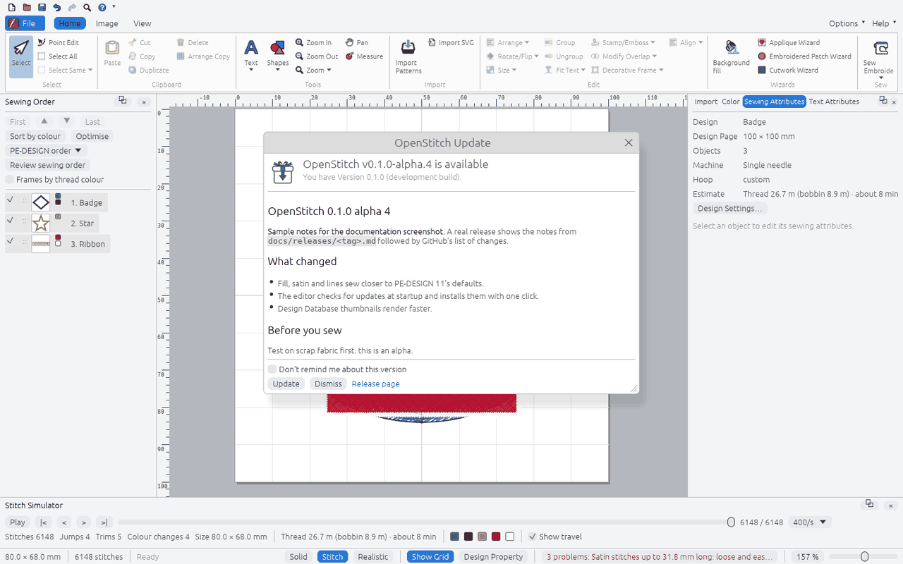 | 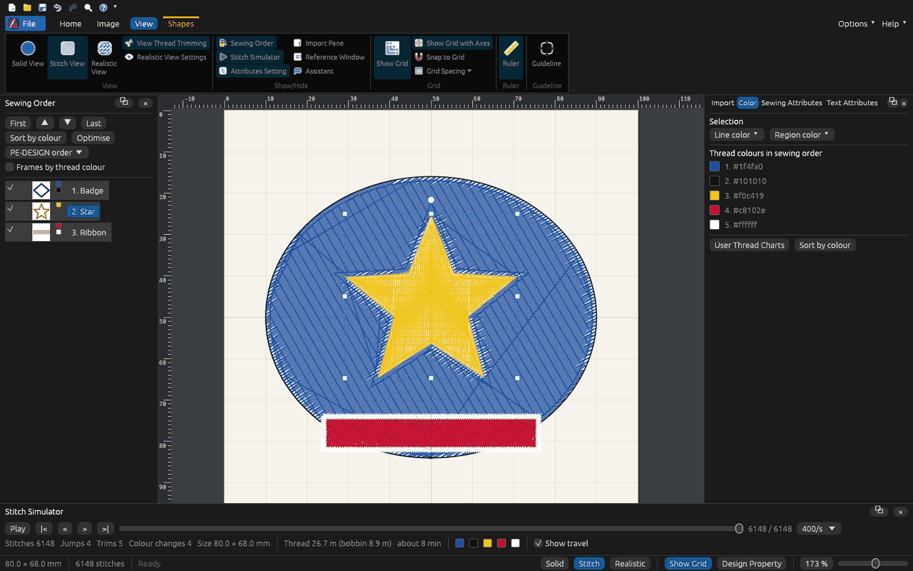 |
| **Updates:** the editor updates itself from GitHub releases. | **Light or dark** theme. |

## From image to embroidery

Test images from [examples/images](examples/images), generated for OpenStitch (see their
[provenance](examples/images/PROVENANCE.md)), converted by the image wizards and shown in the
editor's Realistic view. **Every picture here is OpenStitch's own output, none is
PE-DESIGN's.** They use OpenStitch's PE-DESIGN-compatible mode (the default): OpenStitch's own
reimplementation of PE-DESIGN 11's method, at the settings named. `python3 tools/gallery.py`
regenerates them.

<!-- gallery:start -->
| Image | OpenStitch (Realistic view) | Wizard and result |
|---|---|---|
|  | 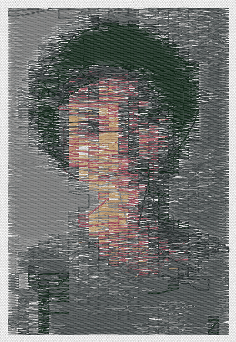 | **Photo Stitch 1, colour, defaults**<br>13,590 stitches, 33 trims, 7 colours |
|  | 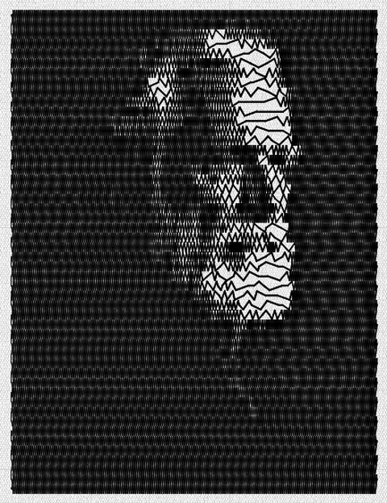 | **Photo Stitch 2, mono, defaults**<br>19,995 stitches, 1 trims, 1 colour |
|  | 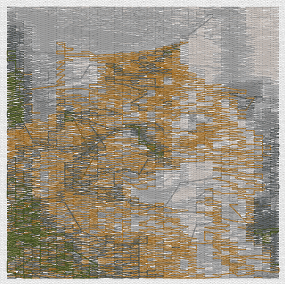 | **Photo Stitch 1, colour, defaults**<br>23,141 stitches, 63 trims, 8 colours |
|  | 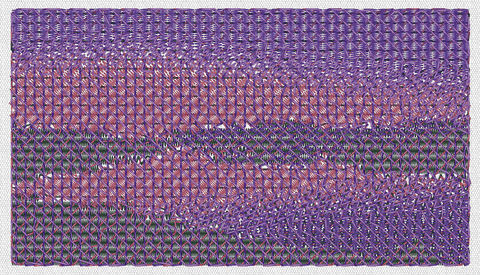 | **Photo Stitch 2, Auto Select**<br>18,526 stitches, 4 trims, 4 colours |
|  | 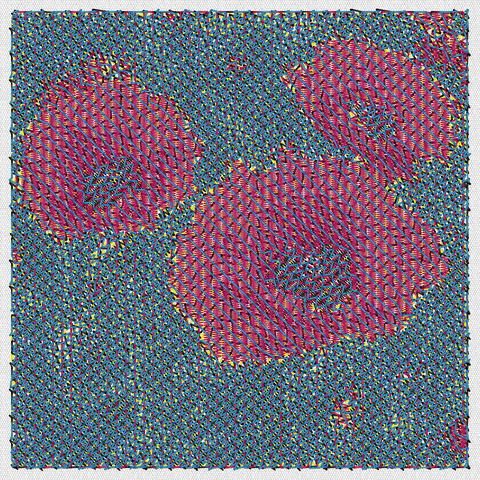 | **Photo Stitch 2, Color Set CMYK**<br>35,734 stitches, 4 trims, 4 colours |
|  | 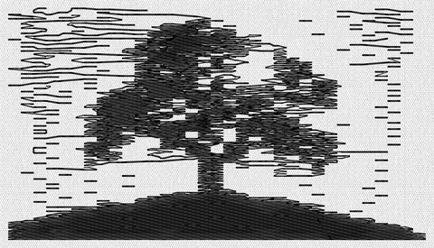 | **Photo Stitch 1, mono, defaults**<br>4,233 stitches, 104 trims, 1 colour |
|  | 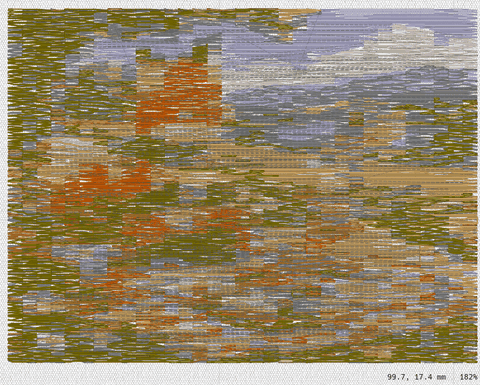 | **Photo Stitch 1, colour, defaults**<br>18,130 stitches, 47 trims, 8 colours |
|  |  | **Auto Punch, defaults**<br>10,791 stitches, 10 trims, 3 colours |
|  | 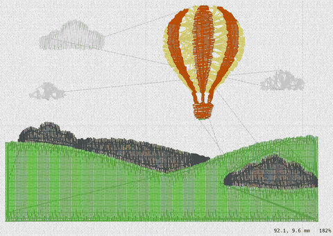 | **Auto Punch, defaults**<br>7,722 stitches, 12 trims, 5 colours |
|  |  | **Auto Punch, defaults**<br>12,164 stitches, 232 trims, 6 colours |
|  | 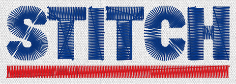 | **Auto Punch, defaults**<br>1,211 stitches, 11 trims, 2 colours |
|  | 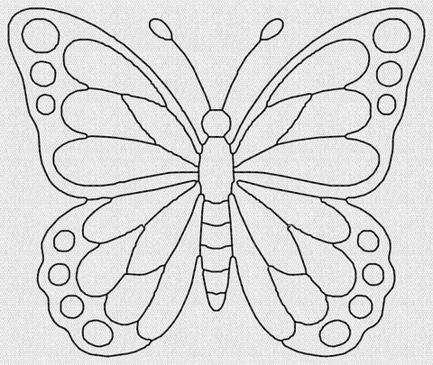 | **Design Center, running line**<br>1,917 stitches, 15 trims, 1 colour |
|  |  | **Cross Stitch, defaults**<br>4,691 stitches, 190 trims, 6 colours |
|  | 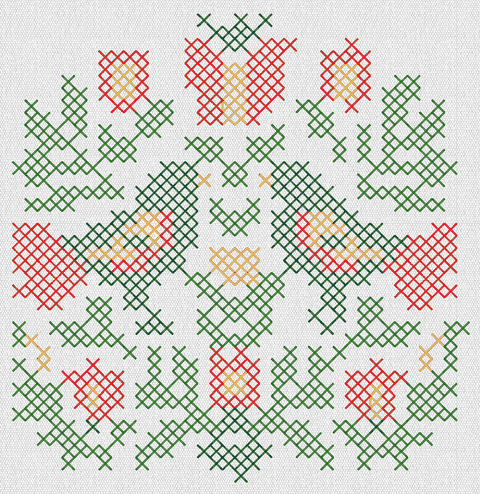 | **Cross Stitch, defaults**<br>5,679 stitches, 303 trims, 4 colours |
<!-- gallery:end -->

Auto Punch, Photo Stitch 1 and 2, Cross Stitch and Design Center have two methods, both run by
OpenStitch (the image dialog's Method choice):

- **PE-DESIGN-compatible** (the default, labelled "PE-DESIGN" in the dialog): OpenStitch's own
  reimplementation of PE-DESIGN 11's method, so a design converts the way it would in
  PE-DESIGN. It is not PE-DESIGN's output, and it does not sew PE-DESIGN's exact stitches.
- **OpenStitch** ((+)): colours are reduced, matched to threads and mixed by how they look, and
  Auto Punch merges specks under 3 mm² ([research](docs/research/beyond/image-digitizing.md)).
  Since B16.1 ([plan](docs/research/beyond/image-similarity-plan.md)) the threads are chosen
  for the image as a whole, Photo Stitch 1 dithers only where the image is tonal, a Fidelity
  choice (Standard / High) trades colours for likeness, Cross Stitch takes each cell's mean
  colour, and Design Center finds its line threshold from the image (Otsu). Photo Stitch 1 samples
  the image every 0.25 mm in rows that stay within 2.1 needle points per mm² (no 10 × 10 mm area
  above 3.0), with a Trims choice (fewer trims or the best likeness). Auto Punch sews the
  background and sews dark outlines as satin on top, in one covering layer; it can instead
  isolate the subject by a graph cut and leave out everything around it, with strokes you
  brush on the image for parts it should keep or drop. Threads can come from several brands'
  charts (Brother, Madeira Polyneon, Isacord, Sulky, Robison-Anton) or only those you own. Every
  OpenStitch mode sews the same stitches on macOS, Windows and Linux.

The table below shows both modes, both from OpenStitch. OpenStitch mode measures better on
average, not on every image, so try both. On the eight Photo Stitch 1 test photos its likeness
score (`tools/image_similarity.py`, Brother threads) averages 72.3 against 58.5 and is higher
on every photo (the night street 67.0 against 45.6, the bright high-key photo 76.1 against
75.5), with more trims; Photo Stitch 2 averages 43.3 against 41.7, and the test portrait sews
truer in its PE-DESIGN-compatible mode, whose three threads suit its skin and background.

<!-- gallery-modes:start -->
| Image | OpenStitch, PE-DESIGN-compatible mode (default) | OpenStitch, OpenStitch mode ➕ |
|---|---|---|
| <br>Auto Punch | 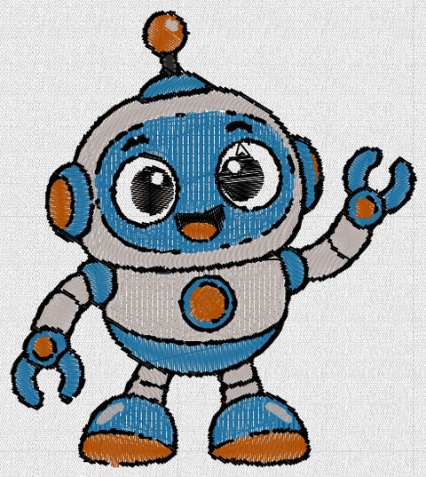<br>12,164 stitches, 232 trims, 6 colours | 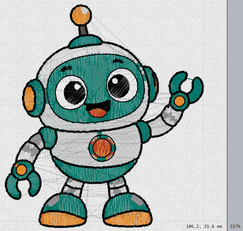<br>10,657 stitches, 127 trims, 8 colours |
| <br>Auto Punch | 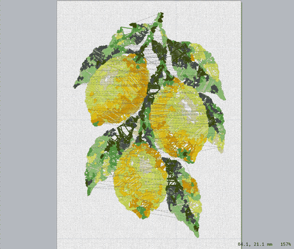<br>14,622 stitches, 285 trims, 9 colours | 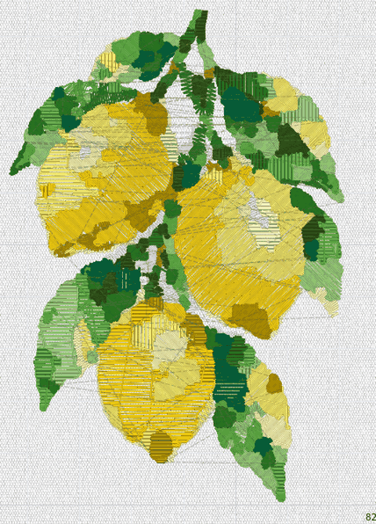<br>14,802 stitches, 189 trims, 10 colours |
| <br>Auto Punch | 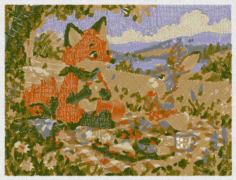<br>37,590 stitches, 832 trims, 10 colours | 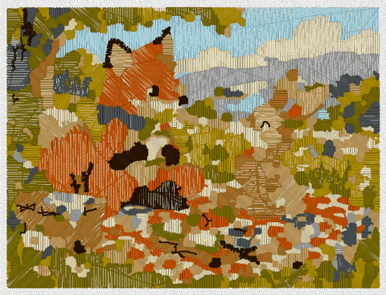<br>29,550 stitches, 371 trims, 10 colours |
| <br>Photo Stitch 1 | 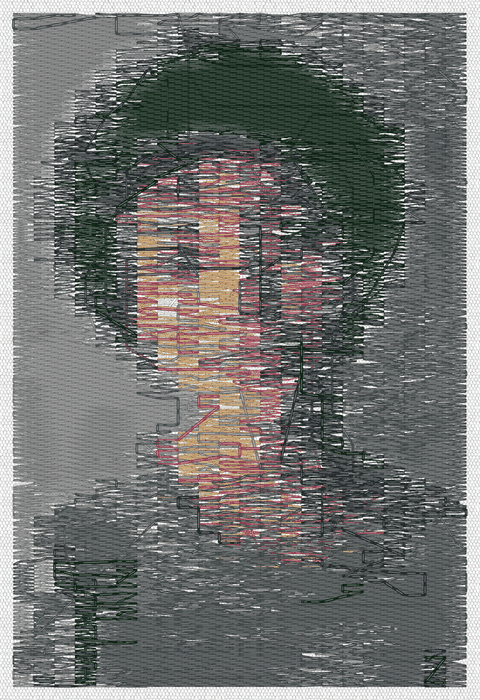<br>13,590 stitches, 33 trims, 7 colours | 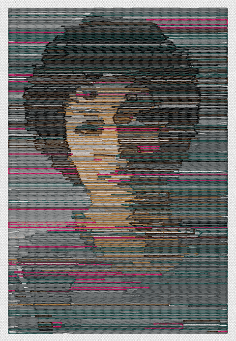<br>12,452 stitches, 283 trims, 11 colours |
| <br>Photo Stitch 1 | 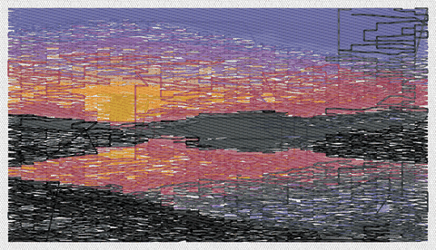<br>12,214 stitches, 28 trims, 11 colours | 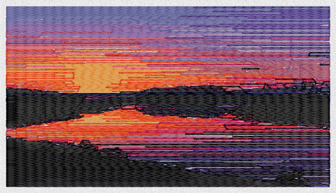<br>9,810 stitches, 108 trims, 11 colours |
| <br>Photo Stitch 1 | 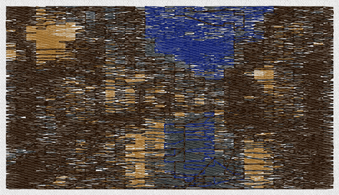<br>12,724 stitches, 28 trims, 7 colours | 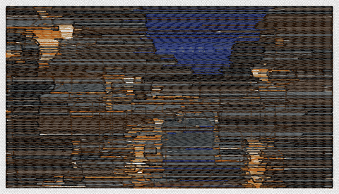<br>10,059 stitches, 182 trims, 9 colours |
| <br>Photo Stitch 2 | 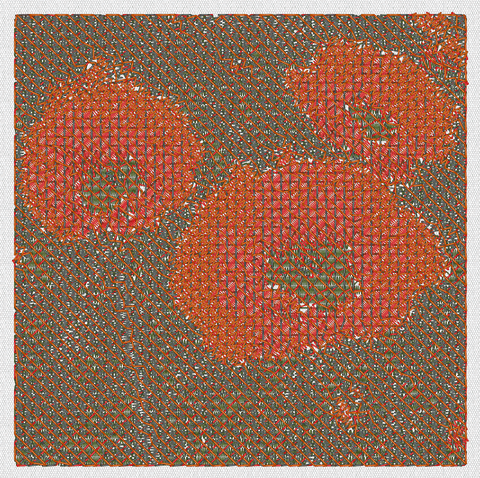<br>32,934 stitches, 4 trims, 4 colours | 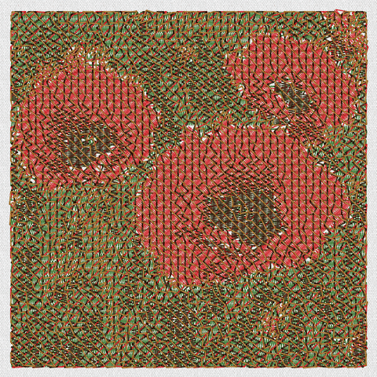<br>31,312 stitches, 4 trims, 4 colours |
| <br>Photo Stitch 2 | 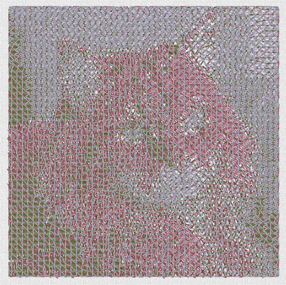<br>28,028 stitches, 4 trims, 4 colours | 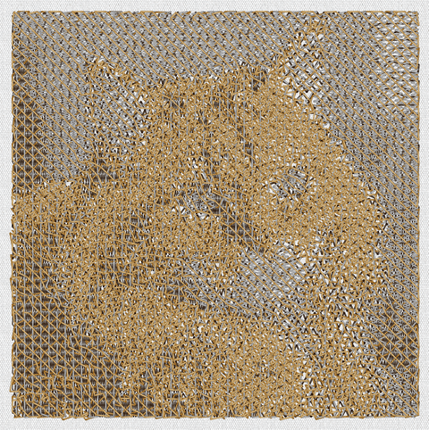<br>27,471 stitches, 4 trims, 4 colours |
| <br>Cross Stitch | 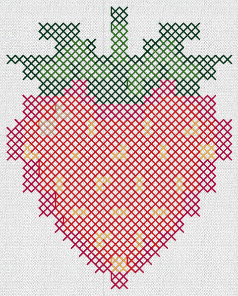<br>4,691 stitches, 190 trims, 6 colours | 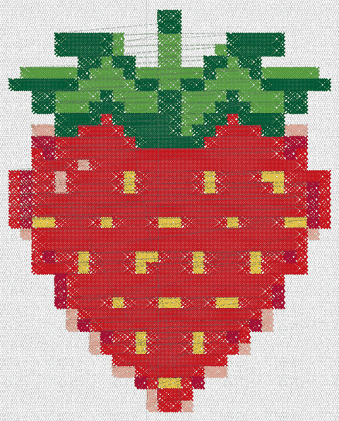<br>9,552 stitches, 192 trims, 6 colours |
| <br>Design Center | <br>1,917 stitches, 15 trims, 1 colour | 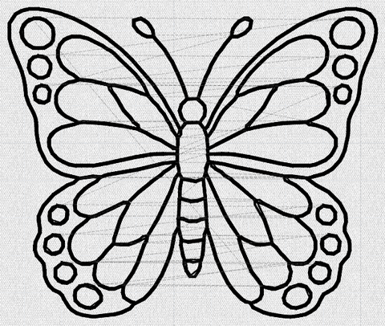<br>7,267 stitches, 67 trims, 1 colour |
<!-- gallery-modes:end -->

## Ready-to-sew designs

[**examples/sew**](examples/sew) holds embroidery files made by OpenStitch, ready to copy to a
machine: a design for each feature (every region and line sew type, fill, satin and underlay
options, shapes and frames, lettering and monograms, the appliqué, patch, cutwork and background
fill wizards, and each image tool in both modes), calibration designs, and the compatibility
checks that need a sew-out. They are PES files sized for a Brother NV880E's 100 × 100, 150 × 150
and 260 × 160 mm hoops, each with a preview, its threads and how to sew it. Sewing the calibration
designs and [sending the photos](examples/sew/README.md#sending-results) helps tune OpenStitch to
real thread and fabric. In the editor, **Help ▸ Ready-to-Sew Designs** opens them.
The first calibration results, from a Brother NV880E with New Brothread thread, are in the kit's
[Calibration results](examples/sew/README.md#calibration-results); they will change as OpenStitch
improves.

**Help test on your machine.** So far the kit has been sewn on one machine, a Brother NV880E. Results
from other Brother, Babylock, Bernette, Janome and Singer machines (PES and the other machine
formats), other threads and other fabrics are very welcome: sew a few designs from the kit and send
them with the [Sew-out / calibration report](https://github.com/cristianonescu/OpenStitch/issues/new?template=sew-out-report.yml)
form. [TESTING.md](TESTING.md) says what to sew per machine and format, and the kit's
[Sending results](examples/sew/README.md#sending-results) says what to include.

## Features

Every implemented row of [docs/FEATURE_MATRIX.md](docs/FEATURE_MATRIX.md), in plain words.
Features marked **(+)** go beyond PE-DESIGN 11. Those that change stitches are off unless you
choose them, so PE-DESIGN-compatible output stays the default. *(partial)* means part of the
feature is done and the rest is under [Planned](#planned).

### Editing

**Window and workspace**

- **Editor laid out like PE-DESIGN 11's Layout & Editing window:** Application menu, ribbon with
  contextual tabs and ScreenTips, Quick Access Toolbar, panes you can float or dock
  ([docs/UI_LAYOUT.md](docs/UI_LAYOUT.md)).
- **Light, dark or system theme**, (+) with an accent colour of your choice ([#559]).
- **Design Page and hoops:** Brother hoop list, custom page size, your own hoops, rotate 90°,
  single- or multi-needle machine; the sewing area shown against the page.
- (+) **Hoops of other brands:** Baby Lock, Bernina, Elna, Husqvarna Viking, Janome, Pfaff and
  Singer, plus round commercial hoops, each from the maker's published sizes ([#514]).
- (+) **Smallest hoop that fits and Fit to hoop:** one click switches to the smallest hoop of your
  machine that holds the design (its real field, round hoops included), or scales the design to
  fill the current hoop ([#879]).
- **Rulers, grid and guides:** rulers that count from the page's centre or its top-left corner
  ([#799]), snap to grid, guidelines dragged out of the rulers (shown and snapped to by default,
  with their distance from 0 while you drag them; select, delete, turn, lock, type a position,
  line up a selection, lay out columns and rows, right-click menus, your own colour), the
  measure tool (distance and angle) and the
  Reference window to jump around a large design.
- (+) **Millimetres or inches** everywhere in the editor, from one setting ([#519]).
- (+) **Zoom box and true real size:** drag a box to zoom, and calibrate 100 % to your monitor
  with a ruler ([#518]).
- **Undo and redo**, one step per gesture.
- **Unsaved changes** are flagged in the title and asked about before closing, New or Open.
- (+) **Autosave and recovery:** snapshots of every open design, offered back after a crash; your
  own file is never overwritten ([#549]).
- (+) **Crash reports and Report a Problem:** after an internal error a short report (version,
  system, the error, the last command names, no paths from your computer) is kept beside the
  snapshots; *Help ▸ Report a Problem* opens a GitHub issue with the version filled in, and
  *Copy diagnostics* copies the version and system. Nothing is sent from OpenStitch ([#878]).
- (+) **Large files open in the background** with progress and Cancel, so the window never
  freezes ([#558]).
- (+) **Several designs as tabs** in one window, each with its own undo, selection and zoom
  ([#552]).
- (+) **Thumbnails in Windows Explorer:** designs and machine files show their stitches in
  Explorer, as they do in the macOS Finder ([#669]).
- (+) **Stitch Table:** every needle point of a stitch pattern, or of a live fill, satin or
  line, with its exact position; type coordinates, insert and delete points, each one undo
  step; hand edits on a live object last until a sewing setting changes ([#501]).
- (+) **Keyboard-only drawing:** arrow keys move a drawing cursor, Space places points, Return
  finishes; `[` and `]` or the scroll wheel set a satin line's width while drawing ([#499],
  [#707]).
- (+) **Picture pickers with a live preview:** sewing types, fill patterns and motifs shown as
  pictures of their stitches; hovering one shows it on the selection before you choose ([#656]).
- (+) **Accessibility:** every control named for screen readers, WCAG AA contrast in both
  themes, a visible keyboard focus and Options ▸ Text size up to 200 % ([#499],
  [docs/ACCESSIBILITY.md](docs/ACCESSIBILITY.md)).
- (+) **Command palette** (Ctrl+K / Cmd+K) to find any command, a hints line for the current tool,
  and a search box over the sewing attributes ([#550]).
- (+) **Your own keyboard shortcuts**, panes docked on either side and saved window layouts
  ([#551]).
- (+) **Getting started:** start cards on an empty design, File ▸ Open Sample and an in-app
  first-steps page ([#554]).
- (+) **New-object defaults** (fill angle, density, underlay and more) and a Basic / Advanced
  switch for the sewing attributes ([#553]).
- **Font Filter:** choose which fonts the font lists show.

**Drawing and shapes**

- **Drawing tools:** rectangle (rounded corners), ellipse and circle, polygon, open straight
  line, Pencil (freehand), Bézier pen, arcs and fans, and preset shapes (stars, hearts, arrows,
  crescents and more).
- **Point editing:** move, insert and delete points; make a segment curved or straight.
- **Manual Punch:** columns built from direction lines, Curved Block, Running and Feed tools, and
  Reverse Direction Line.
- (+) **Manual Punch rung editing:** insert, delete and drag rungs, swap sides, untangle crossed
  pairs, on the canvas with the Point tool ([#525]).
- (+) **Continue digitizing** from either end of a line, path or column ([#479]).
- **Shape operations:** merge, remove overlap, combine (union, subtract, intersect, exclude),
  split along an outline, offset lines. Curves stay curves, and cut pieces keep their sewing
  angle and attributes ([#652]).
- (+) **Knife:** one cut line splits every object it crosses, in one undo step ([#477]).
- (+) **More shape tools:** band frames, a radius per corner, spiral lines, Divide, the shape
  builder, and a turning gap in a closed line for in-the-hoop pieces ([#497]).
- (+) **Smooth Shape and Smooth Stitches:** fewer points and fewer, cleaner curves within a
  tolerance ([#478]).
- **Ornaments:** floral patterns, decorative frames, stamps, embossing and engraving, all
  OpenStitch's own designs.
- **Conversions:** between stitch, text and shape patterns; text to outlines; a region to a line.

**Arranging and selecting**

- **Move, scale, rotate, flip, centre, duplicate and nudge;** group and ungroup.
- **Cut, Copy and Paste,** (+) through the system clipboard, so objects move between windows and
  survive a restart ([#500]).
- **Arrange Copies:** mirror, circle and matrix copies, (+) and copies along a line, scattered
  inside a shape or as a kaleidoscope ([#476]).
- (+) **Align and distribute** to each other, the last-selected object or the Design Page
  ([#472]).
- (+) **Snap to objects:** edges and centres of other objects, the page and the guides ([#473]).
- (+) **Precision bar:** type exact position, size, rotation and skew ([#474]).
- (+) **Select Same:** every object with the same thread colour or stitch type ([#475]).

**Sewing attributes and order**

- **Sewing Attributes pane:** region and line type, thread colour, direction, density, stitch
  length, pull compensation and under sewing, with mixed values across a selection.
- **Entry and exit points**, centre points for concentric and radial fills, and reference points
  for patterned fills.
- **Copy Sewing Attributes** and saved attribute sets.
- **Fabric Selector:** eight fabric types set density, stitch length, compensation and underlay
  in one step.
- **Hole sewing:** an outer region sews around the inner one.
- **Sewing Order list:** drag to reorder, show or hide, (+) rename, lock, sew in click order and sew
  an outline before its fill ([#502]).
- (+) **Find objects** above the Sewing Order list: type a name, stitch type, "text" or a thread
  ("satin", "brother 017") to show only those rows, then select them all at once ([#745]).
- **Sewing order commands:** sort by colour or optimise as PE-DESIGN does, (+) or by the shortest
  jumps (`minJump`).
- **Jump trimming:** a minimum jump length and per-object trimming on multi-needle machines.
- **Stitch pattern editing:** move, insert and delete needle points, split by colour, change a
  block's colour.

**Viewing**

- **Stitch Simulator:** play the design stitch by stitch, with jumps, trims and statistics.
- (+) **Stitch-out player:** a lane per colour block, machine time at the needle, and buttons to jump
  to a block, object or trim ([#516]).
- **Realistic view** (thread width measured on real sew-outs) and **Solid view**.
- (+) **View toggles:** needle points, underlay only, trim marks, hide unselected, colour by sewing
  order and solo colour ([#517]).
- **Design information:** size, stitches, colours, thread length per colour and bobbin, and
  sewing time.

### Stitch types and satin

PE-DESIGN 11.50's defaults, tie-in and lock, measured from its own files. Every run that ends in
a trim ties in and locks, as PE-DESIGN sews them, the image tools included.

- **Satin:** PE-DESIGN's satin with manual or Auto direction, Half Stitch on bends, density,
  pull compensation and the six under sewing types.
- (+) **Skeleton satin:** a satin column sewn along a derived centre line.
- (+) **Branching shapes to satin:** a Y, K, star, letter or stick figure becomes one satin
  column per arm, joined into each other (Shapes ▸ Convert ▸ Satin Columns per Branch); Auto
  Punch does the same for long branching strokes ([#526]).
- (+) **Satin line with variable width** on any path: width keys, width set while drawing,
  handles anywhere along the line, tapered ends and per-side widths ([#524]).
- (+) **Satin corners:** turn, mitre or cap at sharp corners (*partial*: Manual Punch columns,
  zigzag lines, skeleton and Auto satin) ([#520]).
- (+) **Short stitches on inner curves** so the inside of a bend does not pile up (*partial*)
  ([#521]).
- (+) **Pull compensation per side or as a percentage of width** ([#522]).
- (+) **Automatic underlay by column width,** centre-walk underlay and a second underlay layer
  ([#523]).
- (+) **Satin styles:** S-stitch, open zigzag, double satin and a jagged edge (*partial*)
  ([#528]).
- (+) **Raised satin:** padding lanes under the satin for a 3D look without foam (*partial*)
  ([#531]).
- **Running and triple lines** with run times, curves followed closely at any size.
- **Zigzag lines** with width, density, under sewing and half stitch.
- **Zigzag Sharp Corners and Miter Limit**: PE-DESIGN's two corner buttons and how far a sharp corner's point may reach ([#373](https://github.com/cristianonescu/OpenStitch/issues/373)).
- **Motif, stem, candlewicking, E and V, and chain lines,** evenly spaced along curves.
- **Cutting lines** for cutwork needles, with uncut bridges.
- (+) **Back stitch and brush-stroke running lines:** two forward, one back; or a running line
  sewn more times where a thickness profile swells ([#542]).
- (+) **Ripple lines:** a line repeated smaller towards a target you drag, a closed shape
  spiralling in as one unbroken run ([#541]).
- (+) **Motif lines in groups and motif bands:** motifs in groups with gaps, motif-free ends,
  motifs used in turn, five more bundled motifs, and a motif repeated along a satin column,
  stretched to its width as it tapers (*partial*) ([#544]).
- (+) **Decorative hand-embroidery lines:** chevron, Cretan, feather, overlock, alternating
  triangles, double zigzag, lattice and stripes along any line, and slanted E stitch prongs
  ([#543]).
- (+) **Hand-stitch look and scribble lines:** seeded, uneven hand-sewn stitches on lines and on
  one side of a satin, and a sketchy scribble ([#540]).
- **Start/End Feed or Run** and line entry and exit points, as PE-DESIGN sews them.

### Fills

- **Fill (tatami):** angle or auto direction, density, stitch length, Frequency, PE-DESIGN's two
  Stitch Types (*Stitch Type 2: partially compatible*), under sewing, gradation, feathered edge
  and the Running Stitch Path choice.
- (+) **Random stagger:** seeded and reproducible, beside PE-DESIGN's Frequency brick.
- (+) **Tatami textures:** 13 named needle-hole patterns beside PE-DESIGN's smooth brick (ribs,
  diagonals, steps, blocks, waves, zigzag, chevron, scallops and more), or your own steps and
  wave, triangle or arc shifts ([#537]).
- (+) **Wave fill:** a fill's rows ripple as a sine with a set height and length ([#538]).
- (+) **Flow fill:** a fill's rows radiate from its centre, circle it, or follow a grid of
  angles, evenly spaced and never crossing; Auto Punch can take the angles from the picture's
  own strokes ([#538]).
- (+) **Travel hidden under later parts:** a fill that branches (leaves on a stem, a tail off a
  body) sews the part joining the others last, so the travel between them is covered; Auto
  Punch does this in OpenStitch mode ([#469]).
- (+) **Colour blends and gradient fills:** a fill fades from one thread into another, or through up
  to 8 colours, linear or radial, sewn as one even layer with rows, ordered, noise or band
  dithering ([#532]).
- (+) **Gradation shapes and SVG gradients as blends:** convex, concave, centre, edge and wave density
  profiles beside PE-DESIGN's straight gradation, and SVG gradients imported as gradient fills
  ([#532]).
- (+) **Gradient tool:** drag across a gradient fill to set where its colours start and end ([#532]).
- **Fill Angle tool:** drag across fills and satins to turn their rows to the drag's direction, as
  PE-DESIGN sets the sewing direction on the canvas ([#534]).
- (+) **Push compensation and a second underlay on fills:** a fill's sides along its rows move in by a
  set amount, and a second under sewing layer at its own angle (crossed tatami by default)
  ([#522], [#523]).
- (+) **Tartan fill:** a plaid from a sett such as "R8 G24 W4", one colour block per thread, its warp
  and weft stripes woven in one shape ([#539]).
- (+) **Stitch angle lines:** lines across one fill, drawn with the Angle Lines tool, turn its rows
  round a U, Z or ring bend with no seam ([#534]).
- **Curved sewing direction** (round fill) for fill, programmable fill, piping and motif fill
  ([#471]).
- **Programmable fill and motif fill** from OpenStitch's own pattern library, (+) with long gaps
  split evenly if you choose ([#459]).
- **Concentric circle, radial and spiral** as PE-DESIGN 11.50 sews them ([#138]).
- **Stippling, net fill, zigzag net fill, piping and cross stitch regions.**
- **Cross stitch Times** (Single, Double, Triple) as PE-DESIGN 11.50 sews it, with no Direction,
  and (+) half, upright and Smyrna crosses ([#614]).
- (+) **Contour fill:** rows that follow the outline as rings, a single or double spiral, or echo
  lines ([#461]).
- (+) **Maze fill:** one path of straight corridors and square turns that never crosses itself
  ([#533]).
- (+) **Meander fill:** 12 own quilting tiles (vermicelli, ribbon candy, clamshell, switchback,
  Hilbert and more) chained into rows that never cross, or your own from the Stitch Creator
  ([#533]).
- (+) **No piled-up tiny stitches in fill slivers:** stitches under 0.5 mm in a thin sliver are
  joined ([#303]).
- **Programmable Stitch Creator:** draw your own fill and stamp tiles, motifs and decorative-fill
  patterns, (+) or import the `.pas`, `.pmf` and `.plf` files you saved yourself (*partially
  compatible*).

### Lettering

- **Text:** multi-line text with PE-DESIGN's size, character and line spacing and alignment,
  sewn as satin or fill, stroke by stroke.
- **Bundled fonts:** Lato Bold and Pacifico (open licence), (+) OpenStitch Line and OpenStitch
  Pixel, each with a recommended size range and a warning outside it ([#527]).
- **Your own TrueType and OpenType fonts,** embedded in the design. Complex scripts (Arabic,
  Indic, right-to-left) are shaped; vertical text, kerning and CJK characters work.
- **Fit Text to Outline** and all 26 **Text Transform** presets, checked against PE-DESIGN.
- (+) **Per-object finish:** trim after, ties and trims between letters, words or lines, set per
  object ([#548]).
- (+) **Free envelopes** (bridge, pennant, perspective, diamond) shaped with handles on the canvas
  ([#535]).
- (+) **Arched text over several lines** as rings around one centre ([#456]).
- (+) **Small Text:** single-line fonts for 3–6 mm labels ([#530]).
- (+) **Pixel fonts** sewn as short runs or cross stitches per pixel ([#536]).
- (+) **Ink/Stitch font folders** read from your own font folder ([#529]).
- **Monograms:** one to three letters in four OpenStitch styles and eight original frames
  ([#458]).
- **Templates and the Template Wizard:** badges, labels, monograms and baby designs with text
  slots, and your own templates.
- **Name Drop:** one design, a list of names, one file per name.
- **User-mapped text and Font Creator:** turn stitch designs, TrueType glyphs, drawn shapes or an
  image into your own embroidery font.
- **Convert text to outline shapes.**

### Image digitizing

The image tools have two methods, both OpenStitch's own: OpenStitch's PE-DESIGN-compatible mode
(the default) and (+) OpenStitch mode. See [From image to embroidery](#from-image-to-embroidery).

- **Image to Embroidery wizard** with **Auto Punch** (regions), **Cross Stitch**, **Photo Stitch
  1 and 2** (photo-style rows or lines) and **Design Center** (image → outline → figure → sew
  settings).
- **Design Center joins lines that meet** into one path, with far fewer trims ([#627]).
- (+) **OpenStitch mode:** colours reduced and matched to threads by how they look (CIELAB,
  CIEDE2000), specks merged, line art kept ([#263]).
- (+) **Fidelity Standard or High:** more colours for a closer likeness.
- (+) **Thread sources:** New Brothread, Brother, Madeira Polyneon, Isacord, Sulky, Robison-Anton or only the
  threads you own, with a list of threads to buy.
- (+) **Auto Punch background:** the background is sewn unless it is the fabric's colour or paper
  ([#445]).
- (+) **Auto Punch subject isolation:** keep the subject and leave the rest out, with strokes to
  correct it ([#127]).
- (+) **Photo Stitch 1 fine rows** for detail within a needle-density limit ([#298]).
- (+) **Photo Stitch 2 within a needle-density limit** while keeping its line look.
- (+) **Image wizard extras:** purpose presets, a region table with reasons and overrides,
  click-to-fix on the picture, colour order, fill angles and outline SVG export ([#489]).
- (+) **Picture helpers on your computer:** one-click subject cut-out and line drawings from photos,
  with no model and nothing sent anywhere ([#490]).
- **Background image** (PNG, JPEG, BMP or the clipboard): place, rotate, crop, adjust, save and
  trace over, (+) with handles on the canvas ([#518]).

### Wizards and production aids

- **Appliqué wizard:** material, position and tack-down lines and the covering stitch, in
  PE-DESIGN's appliqué colours.
- **Embroidered patch wizard:** satin border and cutting line.
- (+) **Job sheets:** a client approval sheet and an operator worksheet with the colour sequence,
  sewing time and job fields ([#513]).
- **Cutwork wizard:** cutting lines for cutwork needles, stabilising runs, net fill and covering
  satin.
- **Background fill:** echo, stippling, decorative fill, crosshatch or stripes around the
  patterns.
- **Split designs** over several hoopings with alignment stitching, (+) or hoopings placed freely
  so no letter or satin is cut ([#515]).
- **Multi-position hoops** and the **jumbo frame**.
- **Printing:** actual size (tiled), reduced size, positioning sheets and Print and Stitch, as PDF
  or to the system printer.
- (+) **Check Design:** finds long stitches, too-wide satins, tiny objects, stitches outside the
  hoop and more, with one-click fixes ([#503]).
- (+) **Density map:** where the design is too dense for the chosen fabric ([#504]).
- (+) **Review Sewing Order:** every move, trim and colour change in order, with warnings ([#505]).
- (+) **Basting box or outline** sewn first to hold the fabric ([#509]).
- (+) **Machine stops** after an object, or before every long jump for machines without a cutter
  ([#512]).
- (+) **Knockdown fill** sewn first to flatten towels and fleece ([#510]).
- (+) **Leave out hidden stitching** under later fills, without cutting the shapes ([#511]).
- (+) **Travel under later fills and running connectors** instead of jumps and trims ([#545]).
- (+) **Auto-route and Redwork** for touching running lines, sewn in one walk, and **branching**
  of touching shapes, sewn in one go without trims ([#546]).
- (+) **Nearest start per object** and a before/after report from Optimize ([#547]).
- (+) **Test swatch of the selection,** centred in the smallest hoop it fits ([#452]).
- (+) **Fabric calibration card:** sew graded densities and compensation, save the best as a fabric
  ([#453]).
- (+) **Parameter test swatches:** copies of one object with a setting stepped, each labelled
  ([#507]).
- (+) **Fabric and thread presets and your machine:** 13 fabrics with the makers' backing, topping,
  needle and smallest-text advice per thread weight; thinner thread sews denser rows; a default
  fabric for new shapes; Machine Setup (brand, hoop, thread cutter) for new designs and export
  warnings ([#508]).

### Files and formats

- **PES, every version read (1 to 11),** with Design Property (category, author, keywords,
  comments).
- **PES written as version 1, 6 or 11.** Saved as "PE-DESIGN 11", shapes, Manual Punch blocks
  and Lato Bold text open editable in PE-DESIGN 11.50 ([#136]).
- **PES written as versions 4, 5 and 7 to 10** for older software and machines, as PE-DESIGN's
  own Save As writes them: stitch data with the thread table ([#374]).
- **An opened PES written back byte for byte** while it is unchanged, objects and all ([#375]).
- **Import PE-DESIGN objects** from a PES 11 file as editable shapes, blocks and texts
  (*partially compatible*) ([#397]).
- **Read and write PEC, DST, EXP, JEF, PCS, SEW, XXX, HUS, VIP, SHV and CSD;** PHC read only.
  The machine formats match PE-DESIGN 11.50's own exports record for record or byte for byte
  (SHV's preview picture only approximately).
- (+) **VP3** read and write with thread brand and number ([#480]); (+) **Tajima TAP/TBF and
  Barudan U01** read and write, **DSB, DSZ, ZXY, KSM and STX** read ([#481]).
- **Import a stitch file into the design,** and **large designs split** into several files when
  a format's limits are exceeded.
- **SVG import** as editable shapes, (+) with clip paths, masks and gradients handled ([#487]) and
  stitch settings read from layer names such as `fill a=45` ([#455]).
- **WMF and EMF import** as editable shapes ([#321]).
- **Editable `.osd` projects.**
- **Thread charts:** Brother's 64-colour PEC chart and PE-DESIGN's colour matching ([#119]),
  your own charts as CSV in the layout PE-DESIGN's Import Chart reads.
- (+) **New Brothread built in as the default threads:** the 63-spool kit with its Madeira
  codes, searchable in the colour picker ("1801" finds 001 White); Brother's PEC chart one click
  away ([#796]).
- (+) **Thread codes on every swatch:** each colour list shows the code printed on the spool
  (Brother 007, a maker's or your own code) beside the colour, not only on hover ([#798]).
- (+) **GIMP / Inkscape `.gpl` palettes** as thread charts ([#483]).
- (+) **Match to any chart by perceived colour** (CIEDE2000 or Oklab), with a preview ([#484]).
- (+) **Merge similar colours** to save thread changes ([#485]).
- (+) **Thread lists:** CSV per colour block, and INF, EDR, COL and TXT lists ([#482]).
- (+) **More exports:** stitch list CSV/TXT, G-code for DIY machines, repeats and a park position
  at stops; a PNG picture, a stitch-out animation and a ZIP bundle ([#488]).
- (+) **Export read-back check:** every exported file is read back and compared ([#457]).
- (+) **Garment mockups:** the design at true size on a T-shirt, cap or tote bag in a fabric
  colour, as a PNG to show a customer ([#454]).
- **Design Database:** browse folders as thumbnails, see each file's properties, search, copy,
  move and rename, convert formats in batch, print catalogues (PDF, PNG, HTML, CSV). Damaged or
  hostile files are handled safely.
- **Stitch Design Factory:** decorative, satin and cross stitches for sewing machines, with PMV
  export and import (*partially compatible*).

### Machine transfer

- **USB stick or SD card:** the editor and the Design Database's Writing List find removable
  drives on every OS and write to them, asking before overwriting.
- **PEC preview icons** and the 64-colour chart the machine shows.
- Wireless transfer and Link are not available; see [Not yet implemented](#not-yet-implemented).

### The AI Assistant and MCP

See also [New: the Assistant](#new-the-assistant).

- (+) **Assistant chat** (View ▸ Show/Hide ▸ Assistant, Ctrl/Cmd+Shift+A): describe a design or a
  change and it makes it through OpenStitch's own commands; one undo step per message, and Save
  as script writes the changes out.
- (+) **Your choice of AI:** the Claude API with your key in the system keychain, Ollama or LM
  Studio on your computer (no key, works offline), OpenRouter or any OpenAI-compatible service,
  or a coding agent (Claude Code, Codex, OpenCode).
- (+) **Asks first** before saving, exporting, opening files, sending to the machine, quitting or
  changing a thread chart (Allow once, Always allow, Deny).
- (+) **Pictures:** attach or drop files; **View** and **Selection** send the design and what is
  selected.
- (+) **Memory:** short notes about your machine, threads and preferences, kept on your computer
  and written only after you allow it ([#491]).
- (+) **Your threads only:** colours come from your own or a named chart, and catalogue numbers are
  looked up, never invented ([#495]).
- (+) **Embroidery skill** with illustrated example designs and a composition guide, and a
  benchmark of embroidery tasks ([#492], [#493]).
- (+) **Options ▸ Show AI features** hides it all.
- (+) **`openstitch-mcp`:** an MCP server for Claude Code and other MCP clients, one tool per
  command, batches and PNG previews, file access only to folders you grant (see
  [MCP server](#mcp-server-claude-code-and-other-mcp-clients)).
- (+) **Live editor socket:** `openstitch --listen` lets scripts and MCP clients work on the
  running editor (127.0.0.1 only, a token per launch).

### Scripting (Python package)

- (+) **Python package `openstitch`:** script designs with the engine's commands, or drive the
  running editor; pure Python, no dependencies ([python/README.md](python/README.md), [#498]).
- (+) **`stitchtool` one-line commands:** `convert`, `info`, `optimize`, `digitize`, `formats` and
  `thumbnail` ([#496]).
- (+) **`stitchtool exec` and `serve`:** JSON command scripts and a JSON control channel; every
  editor action is the same engine command.
- (+) **Batches checked before they run:** every step's parameters are validated and all errors
  reported at once ([#494]).
- (+) **Read-only and no-files modes** for MCP and `serve`; each command declares what it needs.
- (+) **Design Database commands** (`library.*`) for listing, searching, converting and
  cataloguing folders.
- **Compatibility harness** (`stitchtool compat`): OpenStitch's output compared with reference
  designs, in CI ([docs/COMPATIBILITY_STATUS.md](docs/COMPATIBILITY_STATUS.md)), plus a seeded
  random-design test of 200 designs per CI run ([#506]).

### Platforms (desktop, browser, Quick Look)

- **Desktop editor** for macOS, Windows and Linux, with its own icons generated for OpenStitch.
- (+) **[Editor in a web browser](https://cristianonescu.github.io/OpenStitch/)** (*partial*): the
  desktop editor in the page, opening files through the browser's picker and saving and exporting
  every machine format as downloads ([#556], [#693]). No Assistant and no MCP control in the
  browser yet ([#766]).
- (+) **macOS Finder thumbnails** through a Quick Look extension, for `.osd`, `.pes` and 16 more
  formats ([#557]).
- (+) **Linux file-manager thumbnails** for `.osd` and `.pes`.
- **File associations** for `.osd` and `.pes` on every OS.

### Installation and updates

- **Packages** for macOS (universal `.app`), Windows (MSI and portable zip) and Linux (AppImage,
  tarball, Flatpak), plus command-line archives.
- **Self-update** from GitHub releases, checked against the release's checksums (see
  [Updates](#updates)).
- (+) **Ready-to-sew kit** in every package except the Flatpak (see
  [Ready-to-sew designs](#ready-to-sew-designs)): Help ▸ Ready-to-Sew Designs opens it.
- (+) **Tested with random input:** a test checks that every sewing setting changes the
  stitches, and a seeded random-input test drives the whole editor window on every change,
  and longer every week ([#880]).

[#119]: https://github.com/cristianonescu/OpenStitch/issues/119
[#127]: https://github.com/cristianonescu/OpenStitch/issues/127
[#136]: https://github.com/cristianonescu/OpenStitch/issues/136
[#138]: https://github.com/cristianonescu/OpenStitch/issues/138
[#263]: https://github.com/cristianonescu/OpenStitch/issues/263
[#298]: https://github.com/cristianonescu/OpenStitch/issues/298
[#303]: https://github.com/cristianonescu/OpenStitch/issues/303
[#321]: https://github.com/cristianonescu/OpenStitch/issues/321
[#374]: https://github.com/cristianonescu/OpenStitch/issues/374
[#375]: https://github.com/cristianonescu/OpenStitch/issues/375
[#397]: https://github.com/cristianonescu/OpenStitch/issues/397
[#445]: https://github.com/cristianonescu/OpenStitch/issues/445
[#452]: https://github.com/cristianonescu/OpenStitch/issues/452
[#453]: https://github.com/cristianonescu/OpenStitch/issues/453
[#454]: https://github.com/cristianonescu/OpenStitch/issues/454
[#455]: https://github.com/cristianonescu/OpenStitch/issues/455
[#456]: https://github.com/cristianonescu/OpenStitch/issues/456
[#457]: https://github.com/cristianonescu/OpenStitch/issues/457
[#458]: https://github.com/cristianonescu/OpenStitch/issues/458
[#459]: https://github.com/cristianonescu/OpenStitch/issues/459
[#461]: https://github.com/cristianonescu/OpenStitch/issues/461
[#471]: https://github.com/cristianonescu/OpenStitch/issues/471
[#472]: https://github.com/cristianonescu/OpenStitch/issues/472
[#473]: https://github.com/cristianonescu/OpenStitch/issues/473
[#474]: https://github.com/cristianonescu/OpenStitch/issues/474
[#475]: https://github.com/cristianonescu/OpenStitch/issues/475
[#476]: https://github.com/cristianonescu/OpenStitch/issues/476
[#477]: https://github.com/cristianonescu/OpenStitch/issues/477
[#478]: https://github.com/cristianonescu/OpenStitch/issues/478
[#479]: https://github.com/cristianonescu/OpenStitch/issues/479
[#480]: https://github.com/cristianonescu/OpenStitch/issues/480
[#481]: https://github.com/cristianonescu/OpenStitch/issues/481
[#482]: https://github.com/cristianonescu/OpenStitch/issues/482
[#483]: https://github.com/cristianonescu/OpenStitch/issues/483
[#745]: https://github.com/cristianonescu/OpenStitch/issues/745
[#796]: https://github.com/cristianonescu/OpenStitch/issues/796
[#798]: https://github.com/cristianonescu/OpenStitch/issues/798
[#484]: https://github.com/cristianonescu/OpenStitch/issues/484
[#485]: https://github.com/cristianonescu/OpenStitch/issues/485
[#487]: https://github.com/cristianonescu/OpenStitch/issues/487
[#488]: https://github.com/cristianonescu/OpenStitch/issues/488
[#489]: https://github.com/cristianonescu/OpenStitch/issues/489
[#490]: https://github.com/cristianonescu/OpenStitch/issues/490
[#491]: https://github.com/cristianonescu/OpenStitch/issues/491
[#492]: https://github.com/cristianonescu/OpenStitch/issues/492
[#493]: https://github.com/cristianonescu/OpenStitch/issues/493
[#494]: https://github.com/cristianonescu/OpenStitch/issues/494
[#495]: https://github.com/cristianonescu/OpenStitch/issues/495
[#496]: https://github.com/cristianonescu/OpenStitch/issues/496
[#497]: https://github.com/cristianonescu/OpenStitch/issues/497
[#498]: https://github.com/cristianonescu/OpenStitch/issues/498
[#500]: https://github.com/cristianonescu/OpenStitch/issues/500
[#502]: https://github.com/cristianonescu/OpenStitch/issues/502
[#503]: https://github.com/cristianonescu/OpenStitch/issues/503
[#504]: https://github.com/cristianonescu/OpenStitch/issues/504
[#505]: https://github.com/cristianonescu/OpenStitch/issues/505
[#506]: https://github.com/cristianonescu/OpenStitch/issues/506
[#507]: https://github.com/cristianonescu/OpenStitch/issues/507
[#508]: https://github.com/cristianonescu/OpenStitch/issues/508
[#509]: https://github.com/cristianonescu/OpenStitch/issues/509
[#510]: https://github.com/cristianonescu/OpenStitch/issues/510
[#511]: https://github.com/cristianonescu/OpenStitch/issues/511
[#512]: https://github.com/cristianonescu/OpenStitch/issues/512
[#513]: https://github.com/cristianonescu/OpenStitch/issues/513
[#514]: https://github.com/cristianonescu/OpenStitch/issues/514
[#515]: https://github.com/cristianonescu/OpenStitch/issues/515
[#879]: https://github.com/cristianonescu/OpenStitch/issues/879
[#880]: https://github.com/cristianonescu/OpenStitch/issues/880
[#516]: https://github.com/cristianonescu/OpenStitch/issues/516
[#517]: https://github.com/cristianonescu/OpenStitch/issues/517
[#518]: https://github.com/cristianonescu/OpenStitch/issues/518
[#519]: https://github.com/cristianonescu/OpenStitch/issues/519
[#520]: https://github.com/cristianonescu/OpenStitch/issues/520
[#521]: https://github.com/cristianonescu/OpenStitch/issues/521
[#522]: https://github.com/cristianonescu/OpenStitch/issues/522
[#523]: https://github.com/cristianonescu/OpenStitch/issues/523
[#524]: https://github.com/cristianonescu/OpenStitch/issues/524
[#525]: https://github.com/cristianonescu/OpenStitch/issues/525
[#527]: https://github.com/cristianonescu/OpenStitch/issues/527
[#528]: https://github.com/cristianonescu/OpenStitch/issues/528
[#529]: https://github.com/cristianonescu/OpenStitch/issues/529
[#530]: https://github.com/cristianonescu/OpenStitch/issues/530
[#531]: https://github.com/cristianonescu/OpenStitch/issues/531
[#532]: https://github.com/cristianonescu/OpenStitch/issues/532
[#533]: https://github.com/cristianonescu/OpenStitch/issues/533
[#534]: https://github.com/cristianonescu/OpenStitch/issues/534
[#535]: https://github.com/cristianonescu/OpenStitch/issues/535
[#536]: https://github.com/cristianonescu/OpenStitch/issues/536
[#537]: https://github.com/cristianonescu/OpenStitch/issues/537
[#538]: https://github.com/cristianonescu/OpenStitch/issues/538
[#469]: https://github.com/cristianonescu/OpenStitch/issues/469
[#526]: https://github.com/cristianonescu/OpenStitch/issues/526
[#539]: https://github.com/cristianonescu/OpenStitch/issues/539
[#540]: https://github.com/cristianonescu/OpenStitch/issues/540
[#541]: https://github.com/cristianonescu/OpenStitch/issues/541
[#542]: https://github.com/cristianonescu/OpenStitch/issues/542
[#543]: https://github.com/cristianonescu/OpenStitch/issues/543
[#544]: https://github.com/cristianonescu/OpenStitch/issues/544
[#545]: https://github.com/cristianonescu/OpenStitch/issues/545
[#546]: https://github.com/cristianonescu/OpenStitch/issues/546
[#547]: https://github.com/cristianonescu/OpenStitch/issues/547
[#548]: https://github.com/cristianonescu/OpenStitch/issues/548
[#549]: https://github.com/cristianonescu/OpenStitch/issues/549
[#550]: https://github.com/cristianonescu/OpenStitch/issues/550
[#551]: https://github.com/cristianonescu/OpenStitch/issues/551
[#552]: https://github.com/cristianonescu/OpenStitch/issues/552
[#707]: https://github.com/cristianonescu/OpenStitch/issues/707
[#499]: https://github.com/cristianonescu/OpenStitch/issues/499
[#669]: https://github.com/cristianonescu/OpenStitch/issues/669
[#501]: https://github.com/cristianonescu/OpenStitch/issues/501
[#656]: https://github.com/cristianonescu/OpenStitch/issues/656
[#553]: https://github.com/cristianonescu/OpenStitch/issues/553
[#554]: https://github.com/cristianonescu/OpenStitch/issues/554
[#556]: https://github.com/cristianonescu/OpenStitch/issues/556
[#693]: https://github.com/cristianonescu/OpenStitch/issues/693
[#766]: https://github.com/cristianonescu/OpenStitch/issues/766
[#557]: https://github.com/cristianonescu/OpenStitch/issues/557
[#558]: https://github.com/cristianonescu/OpenStitch/issues/558
[#559]: https://github.com/cristianonescu/OpenStitch/issues/559
[#614]: https://github.com/cristianonescu/OpenStitch/issues/614
[#627]: https://github.com/cristianonescu/OpenStitch/issues/627
[#652]: https://github.com/cristianonescu/OpenStitch/issues/652
[#799]: https://github.com/cristianonescu/OpenStitch/issues/799
[#878]: https://github.com/cristianonescu/OpenStitch/issues/878

## Not yet implemented

PE-DESIGN 11 features OpenStitch does not have yet, from the feature matrix:

<!-- status:not-implemented -->
_None._
<!-- /status:not-implemented -->

Also missing, from the [roadmap](docs/ROADMAP.md#still-to-do):

- **Stroke-wise lettering under a Text Transform:** transformed Fill text still sews each
  letter by region (#428), and no lettering has under sewing per stroke yet.
- **Text details:** per-character colour, multi-character selection, Connection Points, kerning
  that reflows the line.
- **Satin and fill details:** gradation per-step editing and Blend.
- **PES:** opening PE-DESIGN's texts and stitch groups as editable OpenStitch objects; motif
  fill, motif lines, several groups, right-aligned and vertical text in the editable PES 11
  writer.

**Not planned, by design:**

- **PE-DESIGN's bundled fonts, motifs, stamps, floral and decorative patterns** are Brother's
  content. OpenStitch ships its own designs and open-licence fonts instead, and imports patterns
  you draw yourself.

**Blocked:**

<!-- status:blocked -->
- **Import PHX** (Files)
- **Import PEN** (Files)
- **Background image from a scanner** (Files)
- **ScanNCut FCM export/import** (Files)
- **Transfer directly to machine memory, wireless network, original card** (Machine)
- **Link function** (Machine)
- **Transfer by wireless network, USB cable to machine memory, original card, USB/Wireless Link** (Design Database)
- **Brother PMP and PSF files** (Stitch Design Factory)
- **PEN thumbnails** (OS integration)
<!-- /status:blocked -->

Wireless transfer, Link, card reading and PHX use undocumented protocols or formats that the
project will not reverse-engineer. PEN is an encrypted purchase format: reading it would
circumvent its protection. ScanNCut FCM has no Brother specification and malformed files can
reboot the machine. Scanners need native code (`unsafe`), which the workspace forbids for now.
macOS Quick Look and Windows Explorer thumbnails are implemented (see
[Features](#platforms-desktop-browser-quick-look)).

## Known issues

Open differences from PE-DESIGN 11 that you may notice, from the
[compatibility audit](docs/COMPATIBILITY_AUDIT.md):

<!-- status:known-issues -->
- [Trims between underlay, top stitching and outline of one object](docs/COMPATIBILITY_AUDIT.md#4-trims-between-underlay-top-stitching-and-outline-of-one-object)
- [Every design is written as one stitch group, nothing editable](docs/COMPATIBILITY_AUDIT.md#5-every-design-is-written-as-one-stitch-group-nothing-stays-editable-in-pe-design) (partly fixed)
- [One sewing direction per text instead of per stroke](docs/COMPATIBILITY_AUDIT.md#6-one-sewing-direction-per-text-instead-of-per-stroke) (partly fixed)
- [Underlay model differs](docs/COMPATIBILITY_AUDIT.md#8-underlay-model-differs-zigzag-lines-have-no-underlay) (partly fixed)
- [PE-DESIGN-made PES files lose objects, properties and colours on re-save](docs/COMPATIBILITY_AUDIT.md#9-pe-design-made-pes-files-lose-objects-properties-and-colours-on-re-save) (partly fixed)
- [No Connection Points (Default / Closest / Farther) for text](docs/COMPATIBILITY_AUDIT.md#11-no-connection-points-default--closest--farther-for-text)
- [No per-character colour or multi-character selection](docs/COMPATIBILITY_AUDIT.md#13-no-per-character-colour-or-multi-character-selection)
- [Missing fill, satin and zigzag attributes; wrong ranges](docs/COMPATIBILITY_AUDIT.md#15-missing-fill-satin-and-zigzag-attributes-wrong-ranges) (partly fixed)
- [Character kerning moves one glyph without reflowing the line](docs/COMPATIBILITY_AUDIT.md#20-character-kerning-moves-one-glyph-without-reflowing-the-line)
<!-- /status:known-issues -->

Other things to know:

- **Sewn on one machine so far:** the kit has been sewn on a Brother NV880E (see the
  [calibration results](examples/sew/README.md#calibration-results)), but no compatibility spec
  has a recorded sew-out in `compat/machine/` yet.
- **Image digitizing is approximate:** Auto Punch, Cross Stitch and Photo Stitch are compared with
  PE-DESIGN but do not sew the same stitches.
- **Builds are not code-signed:** macOS and Windows warn on first launch (see
  [Download a build](#download-a-build)).
- **macOS:** double-clicking a `.osd` or `.pes` file in Finder does not open it; use File ▸ Open.
- **Updates:** versions before v0.1.0-alpha.4 have no updater and must be replaced by hand.

Bugs reported on GitHub:

<!-- status:issues-bugs -->
- [#468](https://github.com/cristianonescu/OpenStitch/issues/468) Photo Stitch 1/2: colours off-hue, every layer sewn everywhere, needle drops in columns
- [#938](https://github.com/cristianonescu/OpenStitch/issues/938) Satin A: the left foot and the bar end where PE-DESIGN's junction square cuts them
- [#940](https://github.com/cristianonescu/OpenStitch/issues/940) Satin M at 8 mm sews 10 % fewer needle points than PE-DESIGN
- [#941](https://github.com/cristianonescu/OpenStitch/issues/941) Satin W at 8 mm sews 4.5 % more needle points than PE-DESIGN
- [#991](https://github.com/cristianonescu/OpenStitch/issues/991) Cross Stitch PE-compatible: PE-DESIGN's threads for the pixel strawberry's dark outline and light green, its part-covered edge cells, and its grid phase at 3.6 mm
- [#1028](https://github.com/cristianonescu/OpenStitch/issues/1028) Short stitches by stitch kind: compare Auto Punch and Cross Stitch kit designs with PE-DESIGN's own output of the same images
- [#1039](https://github.com/cristianonescu/OpenStitch/issues/1039) Sewing setting without effect: gradation steps change nothing (fill and satin regions)
- [#1040](https://github.com/cristianonescu/OpenStitch/issues/1040) Auto-direction satin: Mitre and Cap corners sew the same
- [#1041](https://github.com/cristianonescu/OpenStitch/issues/1041) Sewing setting without effect: satin region: "edge fill" under sewing sews as "edge zigzag"
- [#1043](https://github.com/cristianonescu/OpenStitch/issues/1043) Zigzag net: travel along the outline as PE-DESIGN's (Direction now turns the net; 40 x 20 mm nets still 6 % short)
- [#1046](https://github.com/cristianonescu/OpenStitch/issues/1046) Sewing setting without effect: running line: thickness profiles linear, smoothstep and stairs sew the same
- [#1048](https://github.com/cristianonescu/OpenStitch/issues/1048) Sewing setting without effect: satin line: Mitre and Cap corners sew the same; Cap below and Cap max length change nothing
- [#1050](https://github.com/cristianonescu/OpenStitch/issues/1050) Sewing settings that stop changing the stitches above a low value (radial density, motif and V-stitch pitch, maze straightness and others)
- [#1058](https://github.com/cristianonescu/OpenStitch/issues/1058) Zigzag net: a rung crosses the next on circles whose polygon is turned (even at Direction 0)
- [#1064](https://github.com/cristianonescu/OpenStitch/issues/1064) Satin text: M's and W's middle V sewn as one sideways block, as PE-DESIGN does
- [#1065](https://github.com/cristianonescu/OpenStitch/issues/1065) Satin text: PE-DESIGN's row direction on slanted strokes (V, N, A, X, Z)
- [#1068](https://github.com/cristianonescu/OpenStitch/issues/1068) Motif line sews 118 stitches where PE-DESIGN sews 75 for the same object
- [#1071](https://github.com/cristianonescu/OpenStitch/issues/1071) Plain net fill: stitch counts and line origin against PE-DESIGN's round 13 captures
- [#1076](https://github.com/cristianonescu/OpenStitch/issues/1076) Auto Punch: two section starts still untied after #1032 (a tie-in collapsed to one point; a jump landing 2.7 mm before the tie-in)
- [#1079](https://github.com/cristianonescu/OpenStitch/issues/1079) Text Transform: p's descender satin ends 0.6 mm above PE-DESIGN's (text-transform-18-openstitch-l100)
- [#1080](https://github.com/cristianonescu/OpenStitch/issues/1080) Satin e and A: the satin after the start sews 14 and 4 stitches more than PE-DESIGN
- [#1084](https://github.com/cristianonescu/OpenStitch/issues/1084) Paste Attributes on a large selection freezes the editor for over 30 s (monkey seed 5000, step 292)
- [#1088](https://github.com/cristianonescu/OpenStitch/issues/1088) Small fill squares: under sewing, start and end placement differ from PE-DESIGN's (machine-jumps / -trim-bound / -trim-fine 16-49 needle points short)
<!-- /status:issues-bugs -->

[Report a bug](https://github.com/cristianonescu/OpenStitch/issues/new).

## Planned

Next, from [docs/ROADMAP.md](docs/ROADMAP.md):

- **Lettering:** stroke-wise sewing of transformed fill text and under sewing per stroke, as
  PE-DESIGN does it.
- **PES:** PE-DESIGN's text opened as editable objects; motif fill and lines, several groups and
  the remaining hoops in the PES 11 writer.
- **Stitches:** the remaining fill, satin and line details listed above, and branching skeletons.
- **Machine tier:** a first sew-out recorded as a compatibility spec in `compat/machine/`.
- **Image digitizing:** run-to-run travel in Cross Stitch, still fewer trims in Photo Stitch 1
  (hidden routed travel took OpenStitch mode from 68 to 25 trims per 1,000 stitches; PE-DESIGN
  sews a colour in one to five paths), and closer Photo Stitch output.
- **Distribution:** code signing and a Flathub listing.

Open enhancement issues:

<!-- status:issues-planned -->
- [#130](https://github.com/cristianonescu/OpenStitch/issues/130) Add a PMV motif/pattern reader
- [#134](https://github.com/cristianonescu/OpenStitch/issues/134) Import external scalable embroidery font containers
- [#291](https://github.com/cristianonescu/OpenStitch/issues/291) Fit the Realistic view and the similarity scorer to the T1 calibration measurements
- [#292](https://github.com/cristianonescu/OpenStitch/issues/292) Sew-out reports wanted: other machines, and the non-PES formats
- [#298](https://github.com/cristianonescu/OpenStitch/issues/298) Photo Stitch 1 trims far more than PE-DESIGN: travel between a thread's runs instead
- [#319](https://github.com/cristianonescu/OpenStitch/issues/319) macOS: verify Help ▸ Ready-to-Sew Designs opens Finder at the bundled kit with a real click
- [#486](https://github.com/cristianonescu/OpenStitch/issues/486) More built-in thread charts from makers' own colour data, with search by number or name
- [#618](https://github.com/cristianonescu/OpenStitch/issues/618) Rope stitch: a Beyond-PE variant of the stem line (narrow, 1-3 passes)
- [#641](https://github.com/cristianonescu/OpenStitch/issues/641) Assistant: a real Claude API turn and Codex with the owner's own account
- [#644](https://github.com/cristianonescu/OpenStitch/issues/644) Linked clones that follow their original (split from #502)
- [#661](https://github.com/cristianonescu/OpenStitch/issues/661) Ink/Stitch SVG interchange: read its stitch attributes, export as Ink/Stitch SVG, column check before satin (ideas)
- [#678](https://github.com/cristianonescu/OpenStitch/issues/678) On-device ML picture helpers: OCR to lettering, model segmentation and learned edges (split from #490)
- [#696](https://github.com/cristianonescu/OpenStitch/issues/696) Web editor: make the 17 MB wasm download smaller
- [#744](https://github.com/cristianonescu/OpenStitch/issues/744) Join Lines and Break Apart: make open lines one object, split text, islands and copies into pieces
- [#766](https://github.com/cristianonescu/OpenStitch/issues/766) Browser editor: an AI path (Assistant panel, MCP control) like the desktop's
- [#817](https://github.com/cristianonescu/OpenStitch/issues/817) Hand-stitch look for fills: seeded rows that look sewn by hand
- [#818](https://github.com/cristianonescu/OpenStitch/issues/818) Rebuilt objects keep the original's sewing: measured satin spacing, tatami pattern, closed satin rings
- [#831](https://github.com/cristianonescu/OpenStitch/issues/831) Browser: autosave and crash recovery in browser storage
- [#832](https://github.com/cristianonescu/OpenStitch/issues/832) GIF and WebP pictures in the image tools (desktop and browser)
- [#833](https://github.com/cristianonescu/OpenStitch/issues/833) Browser: ready-to-sew samples and a clear note on system fonts
- [#834](https://github.com/cristianonescu/OpenStitch/issues/834) Browser: check shortcut clashes, high-DPI, phone width and touch in the page test
- [#865](https://github.com/cristianonescu/OpenStitch/issues/865) Fabric pull preview in Check Design: where outlines and fills will drift apart, puckering, and a one-bar measured calibration
- [#867](https://github.com/cristianonescu/OpenStitch/issues/867) USB transfer pre-flight: drive format, free space, top folder, file names, a machine connected by cable, and a transfer history
- [#868](https://github.com/cristianonescu/OpenStitch/issues/868) Choose your machine by model name: sewing area, hoops, format, needles and transfer method from a sourced model list
- [#869](https://github.com/cristianonescu/OpenStitch/issues/869) Back up and restore all user settings and libraries in one file
- [#870](https://github.com/cristianonescu/OpenStitch/issues/870) Assistant with any chatbot by copy and paste: no API key, changes shown before and after, then applied
- [#871](https://github.com/cristianonescu/OpenStitch/issues/871) Ready drawings picker: search an open emoji set or your own SVG folder and insert one as embroidery
- [#872](https://github.com/cristianonescu/OpenStitch/issues/872) Help page: free embroidery design sites with their terms of use in plain tags
- [#873](https://github.com/cristianonescu/OpenStitch/issues/873) Photo as lines: wave-line engraving in 1, 2 or 4 threads, and a thread sketch
- [#874](https://github.com/cristianonescu/OpenStitch/issues/874) Cap mode: sewing order centre-out and bottom-up, and large-field suggestions for jacket backs
- [#875](https://github.com/cristianonescu/OpenStitch/issues/875) 3D puff satin over foam: dense spacing, no underlay, perforating end caps and a foam stop (B7)
- [#876](https://github.com/cristianonescu/OpenStitch/issues/876) Floppy disk images (FAT12, for USB floppy emulators) and a network drop for older commercial machines
- [#877](https://github.com/cristianonescu/OpenStitch/issues/877) Guided tour that lights up the real controls, step by step
- [#881](https://github.com/cristianonescu/OpenStitch/issues/881) Hangul and kana lettering sewn along stroke centre lines in writing order
- [#882](https://github.com/cristianonescu/OpenStitch/issues/882) Font chooser: favourites, filters, fonts lacking a typed character greyed out, licence shown, optional open-font catalogue
- [#883](https://github.com/cristianonescu/OpenStitch/issues/883) Design Database: favourites, a fits-my-hoop filter, column sorting, and ZIP archives with duplicate detection
- [#884](https://github.com/cristianonescu/OpenStitch/issues/884) Mobile/Android app ideas
- [#902](https://github.com/cristianonescu/OpenStitch/issues/902) Auto Punch: sew mosaic-like tiles with rows that follow each tile's outline (contour fill)
- [#907](https://github.com/cristianonescu/OpenStitch/issues/907) Realistic view: moiré stripes in dense fills when zoomed out (supersample the thread layer)
- [#925](https://github.com/cristianonescu/OpenStitch/issues/925) Redwork and routed lines in triple stitch: retraced stretches sewn once, for an even line weight
- [#937](https://github.com/cristianonescu/OpenStitch/issues/937) Interface translation: a first real language
- [#939](https://github.com/cristianonescu/OpenStitch/issues/939) Satin V, M, W: PE-DESIGN's sewing order at a run-on foot (the foot tip as a second pass)
- [#951](https://github.com/cristianonescu/OpenStitch/issues/951) Fewer trims in dithered blends through a dither that keeps each colour's pieces connected
- [#960](https://github.com/cristianonescu/OpenStitch/issues/960) PE-compatible Photo Stitch 1: a contour path layout so banded pictures trim as rarely as PE-DESIGN (sunset 2.7 against 1.27 per 1,000)
- [#989](https://github.com/cristianonescu/OpenStitch/issues/989) SHV and CSD export: the SHV preview's drawing rule, the remaining chart entries, and the constant bytes no capture explains
- [#994](https://github.com/cristianonescu/OpenStitch/issues/994) Cross Stitch, OpenStitch mode: follow a pixel-art image's own grid
- [#1023](https://github.com/cristianonescu/OpenStitch/issues/1023) Kit previews: measure whether macOS draws the same pixels as Windows (a platform stamp only if not)
- [#1024](https://github.com/cristianonescu/OpenStitch/issues/1024) PES 0110 export: the object kinds that each need a PE-DESIGN capture first (hole pairs, two patterns, tiles, several outlines, fonts and per-character text)
- [#1036](https://github.com/cristianonescu/OpenStitch/issues/1036) Check Design: low coverage, per-font small text, one readiness score, and warn-or-block needle crowding
- [#1075](https://github.com/cristianonescu/OpenStitch/issues/1075) Replace the withdrawn compat references with clean PE-DESIGN captures (programmable fill, shape start points, motif)
- [#1082](https://github.com/cristianonescu/OpenStitch/issues/1082) Short moves into or out of a letter: does PE-DESIGN drop the lock and tie-in there? (capture needed)
<!-- /status:issues-planned -->

### Beyond PE-DESIGN

After PE-DESIGN compatibility, OpenStitch adds what other digitizing programs offer and
PE-DESIGN 11 does not. Each item is sketched in
[docs/research/beyond](docs/research/beyond/readiness.md) and will be off unless chosen:

<!-- status:beyond-planned -->
- 3D puff satin mode: density, caps, no underlay or pull compensation, foam stop, ordering (B7, #875)
- Crosshatch, curved crosshatch and double-zigzag lace as a region type (B8)
- Stitch-file resize with density recalculation and density tuning (B14)
- Lettering: baseline model, saved kerning pairs, team names from CSV, closest-point letter connections (B15)
- More built-in thread charts compiled from each maker's own published colour data, searchable by number or name (#486)
- Join Lines (open running lines or satin columns whose ends meet joined into one object, one tie pair, no trim) and Break Apart (lettering into letters, a region into its islands with their holes, copies along a line into copies) (#744)
- Hand-stitch look for fills: seeded tatami rows whose stitch lengths and needle points vary a little, coverage kept even, Shuffle for another variant (#817; lines and satins have it since #540)
- Rebuilt objects keep the original's sewing: object.toShapes blocks carry the measured satin spacing, stitch length and tatami pattern, and close satin rings (#818)
- Routed and Redwork lines in triple stitch with an even weight: the stretches the route goes back over are sewn once instead of as a second full triple (#925; an option on shape.autoRoute, #546)
- Fabric pull preview in Check Design: the estimated shift of each object on the chosen fabric, registrationGap and puckering findings, every finding tagged rule or estimate, and a calibration from one sewn and measured test bar (#865)
- Check Design additions: low coverage, small text per font, and a readiness score from 0 to 100 (#1036; untied thread ends, sections under three stitches, short stitches and more colours than needles are in the Check Design row since #866)
- USB transfer pre-flight: drive format, free space, top folder and item count, file-name rules and a short name for older machines, a machine connected by USB cable shown as such with its used space, a transfer history and Copy diagnostics (#867)
- Machine list by model name: sewing area, hoops, format, thread cutter, needle count and transfer methods from the makers' documents, each marked tested or from the manual (#868)
- Back up and restore all user settings and libraries in one file, without secrets (#869)
- Assistant with any chatbot by copy and paste: a request text with a code, the pasted reply validated, before and after pictures with Check Design's result, applied as one undo step (#870)
- Ready drawings picker: search an openly licensed emoji set or the user's own SVG folder and insert a drawing as editable embroidery at a chosen size (#871)
- Help page of free embroidery design sites with each site's terms as plain tags (#872)
- Photo as lines: wave-line engraving in one, two or four threads, and a thread sketch (#873)
- Cap mode: sewing order centre-out and bottom-up, and large-field suggestions for jacket backs (#874)
- Floppy disk images (FAT12, for USB floppy emulators) and a network drop for older commercial machines (#876)
- Guided tour that lights up the real controls step by step (#877)
- Hangul and kana lettering sewn along stroke centre lines in writing order (#881)
- Font chooser: favourites, filters by kind and script, fonts lacking a typed character greyed out, licence shown, optional open-font catalogue (#882)
- Design Database: favourites, a fits-my-hoop filter, column sorting, ZIP archives as folders and duplicate detection on import (#883)
- Mobile and Android app ideas, kept as one list: touch editing, share-sheet intake, phone to machine over USB-OTG, voice input and more (#884)
<!-- /status:beyond-planned -->

## Download a build

The latest pre-release is on the
[Releases](https://github.com/cristianonescu/OpenStitch/releases) page, with notes in
[docs/releases](docs/releases/). It is an alpha for testing, not for production work: do a test
sew-out on scrap fabric first.

**Try it in a browser, with nothing to install:** <https://cristianonescu.github.io/OpenStitch/>
runs the desktop editor: it opens designs and embroidery files from your disk and saves and
exports them as downloads; nothing leaves the browser. It is built from `main` and does less than
the desktop app (no Assistant or MCP control, system clipboard, printing or folder choosing yet;
see
[docs/DISTRIBUTION.md](docs/DISTRIBUTION.md#web-editor)).

Every merge to `main` also builds the executables for all three operating systems. Open the
repository on GitHub, go to **Actions → Rust workspace**, pick the latest run on `main` and
download the artifact for your system:

| Artifact | Contents |
|---|---|
| `openstitch-main-<sha>-macos-universal` | `OpenStitch-…-macos-universal.zip` (the `OpenStitch.app` editor, Apple Silicon and Intel) and `openstitch-cli-…tar.gz` (`stitchtool`, `openstitch-mcp`) |
| `openstitch-main-<sha>-windows-x86_64` | `OpenStitch-…-windows-x86_64.msi` (installer with `.osd`/`.pes` associations), a portable `.zip` of the editor, and `openstitch-cli-…zip` |
| `openstitch-main-<sha>-linux-x86_64` | `OpenStitch-…-linux-x86_64.AppImage` (single file: `chmod +x` and run; `--install-integration` adds the menu entry, `.osd`/`.pes` types and thumbnails), `OpenStitch-…-linux-x86_64.tar.gz` (editor with `install.sh`, desktop entry, MIME types and thumbnailer) and `openstitch-cli-…tar.gz` |

A Flatpak bundle (`openstitch-flatpak-x86_64`) is built by the **Flatpak** workflow when the
Linux packaging changes, and can be built locally from
`packaging/flatpak/io.github.cristianonescu.OpenStitch.yml`.

Details are in [docs/DISTRIBUTION.md](docs/DISTRIBUTION.md).

The builds are not code-signed yet:
- **macOS:** unzip and move `OpenStitch.app` to Applications, then right-click → Open the first
  time (or run `xattr -dr com.apple.quarantine OpenStitch.app`).
- **Windows:** choose *More info → Run anyway* in the SmartScreen prompt.

### Updates

The editor keeps itself current. At a plain start it asks GitHub whether a newer release
exists. If so, a dialog shows the release notes with three choices:

- **Dismiss.**
- **Don't remind me about this version:** quiet until a newer one appears.
- **Update:** downloads the package for your system, checks it against the release's
  `SHA256SUMS`, installs it and restarts OpenStitch.

The portable zip, the MSI (Windows Installer asks for permission), the macOS app and the Linux
AppImage and tarball all update in place; a Flatpak updates through Flatpak. In Options,
*Check for updates at startup* turns the check off, *Include pre-releases* opts a stable build
into alphas and betas, and *Check for Updates Now* asks right away. Builds from source and the
artifacts of `main` have no release tag and never check. Details:
[docs/DISTRIBUTION.md](docs/DISTRIBUTION.md#updates).

## Build from source

### Prerequisites

- **Rust** stable via [rustup](https://rustup.rs) (CI builds with the current stable; the
  workspace uses the 2024 edition):
  - macOS: `brew install rustup && rustup default stable`
  - Windows: install rustup-init and the "Desktop development with C++" build tools; the
    toolchain is the MSVC one (`x86_64-pc-windows-msvc`, rustup's default on Windows), which
    is also what embeds the icon in `openstitch.exe`
  - Linux: the rustup installer from rustup.rs
- **Linux only, at run time:** the desktop libraries every X11/Wayland desktop already has
  (`libxkbcommon`, `libwayland-client` or `libX11`, and Vulkan or OpenGL drivers). Building needs
  no extra `-dev` packages.

### Build

```bash
git clone https://github.com/cristianonescu/OpenStitch.git
cd OpenStitch
cargo build --release
```

The binaries are written to `target/release/`: `openstitch` (the editor), `stitchtool` and
`openstitch-mcp` (`.exe` on Windows).

### Run

```bash
cargo run --release -p openstitch-app                   # the desktop editor
cargo run --release -p openstitch-app -- design.osd     # open a design or machine file
```

```bash
cargo run -p stitchtool -- exec examples/badge.json   # run a command script → badge.pes + badge.osd
cargo run -p stitchtool -- exec examples/heart.json   # Bézier example
cargo run -p stitchtool -- commands                   # list every command (JSON)
cargo run -p stitchtool -- serve                      # JSON-lines control channel on stdio
```

One-line commands (formats follow the file extensions; `--json` prints the engine's replies,
`stitchtool help` lists every option):

```bash
stitchtool convert in.dst out.pes                     # one file to another format
stitchtool convert dsts/ pes/ --format pes            # every design in a folder (existing targets skipped)
stitchtool info design.pes                            # size, stitches, colours, trims, jumps, thread, time
stitchtool optimize in.pes out.pes --by-color         # sewing order / fewer colour changes
stitchtool optimize in.osd out.osd --auto-start nearest  # each object starts nearest where the last ended
stitchtool digitize logo.png out.pes --size 80mm      # Auto Punch an image
stitchtool formats                                    # what OpenStitch reads and writes
```

```bash
cargo run -p openstitch-app -- --listen 0 --listen-root ~/Embroidery   # editor with the automation socket
cargo run -p stitchtool -- connect                    # JSON lines to the running editor
cargo run -p openstitch-mcp -- --live                 # MCP tools act on the running editor
```

The socket listens on 127.0.0.1 only and every request must carry the per-launch token that the
editor prints and writes to `automation.json` (readable by you only) in the OpenStitch config
directory; clients read it from there. See [docs/ARCHITECTURE.md](docs/ARCHITECTURE.md#automation-socket-live-editor).

A command script is a JSON array of `{"command": …, "params": {…}}` steps; see `examples/`.
Lengths are in millimetres and angles in degrees. Sewing directions turn counter-clockwise on
screen, as in PE-DESIGN (45 = rows rising to the right); `.osd` files from before format
version 2 stored them clockwise and are converted when opened.

### Test

```bash
cargo fmt --all -- --check
cargo test --workspace
cargo clippy --workspace --all-targets -- -D warnings
cargo run -p stitchtool -- compat
```

Debug and test builds optimise the dependencies, the stitch pipeline (`openstitch-core`,
`-design`, `-engine`) and image digitizing (`openstitch-digitize`; `[profile.dev.package]` in
`Cargo.toml`), so the editor's and the Auto Punch tests run in minutes instead of an hour; debug
assertions and overflow checks stay on. The first build takes a few minutes longer.

Tests make their temporary folders with `openstitch_testutil::TempDir`, which deletes the folder
when the test ends. Set `OPENSTITCH_KEEP_TEMP=1` to keep a failing test's folders; their paths
are printed.

CI runs the same checks on macOS, Windows and Linux for every pull request, checks that
`docs/COMPATIBILITY_STATUS.md` matches the harness's result, and scans the history for secrets
with gitleaks. CI builds with line-tables-only debug info (`CARGO_PROFILE_DEV_DEBUG`), and a new
push to a pull request cancels that PR's run still in progress; runs on `main` and on tags are
never cancelled. Only runs on `main` save the build cache; pull requests restore it, so they
don't evict it from the repository's 10 GB of Actions cache.

## MCP server (Claude Code and other MCP clients)

`openstitch-mcp` exposes every engine command as an MCP tool. It also adds `run_batch` (up to 256
commands at once) and `preview` (a PNG of the generated stitches). It talks JSON-RPC over stdio
and opens no network port.

File commands can only touch the directories you grant:
- `--root DIR` is read/write and `--read-root DIR` is read-only; both can be repeated.
- With no roots, every file command is refused.

Register it with Claude Code, from this checkout:

```bash
claude mcp add openstitch -- cargo run -q --release -p openstitch-mcp --manifest-path "$PWD/Cargo.toml" -- --root ~/Embroidery
```

or build once and register the binary (faster start-up, no cargo output on stdio):

```bash
cargo build --release -p openstitch-mcp
```

```bash
claude mcp add openstitch -- "$PWD/target/release/openstitch-mcp" --root ~/Embroidery --read-root ~/Documents/Designs
```

To let an MCP client control the whole editor (the base of the B17 AI assistant), start the
editor with `--listen 0` and register `openstitch-mcp --assistant`. It offers nine tools
instead of one per command: `commands_list`, `command_describe`, `execute`, `run_batch`,
`view_render`, `scratch_write`, `skill_reference`, `notes_read` and `notes_write`. They reach every engine command and the
editor's `ui.*` commands: ribbon and menu commands, selection, zoom, settings, the simulator,
Help and updates. A bundled embroidery skill (`skills/openstitch-embroidery`) tells the model
how to build designs that sew well.

Then ask Claude, for example, to "make a 60 × 40 mm badge with a red satin border, preview it and
export badge.pes". `--read-only` blocks every editing command and `--no-files` blocks all file
access; run `openstitch-mcp --help` for these and the size-limit flags. Other clients (Claude
Desktop, IDEs) take the same command and arguments in their MCP server configuration.

## Contributing

- Work on a branch and open a pull request to `main`; nobody pushes to `main` directly.
- A PR is merged once it is mergeable, its light local checks pass and the private-details
  scan is clean (`python3 -I tools/private_scan.py --diff main` before a push: no local folder
  paths, user folders or personal e-mail addresses; CI's `secrets` job scans the whole tree,
  #1057), without waiting for its CI run; CI runs on every PR and on `main`, and must
  be green on all three operating systems before a release. Scripts that wait for CI must
  treat a cancelled (superseded) run as pending; see
  [docs/RELEASING.md](docs/RELEASING.md#merging-pull-requests).
- Every merge to `main` builds the executables (see [Download a build](#download-a-build)).
- Every PR that changes a feature updates [docs/FEATURE_MATRIX.md](docs/FEATURE_MATRIX.md); the
  README's status lists are generated from it by `python -I tools/readme_status.py --write`,
  run on `main` after merging, not in feature PRs: CI fails a PR that edits the generated
  blocks (#632). The GitHub issue lists are refreshed only at each release (`--issues`).
- A PR that adds, renames or deletes a doc or image keeps every relative link working: CI's
  `icons` job runs `python -I tools/check_doc_links.py`, which matches each link against
  `git ls-files` case-sensitively, as GitHub does.
- Rules for the code (clean-room boundaries, command registry, golden tests) are in
  [docs/ARCHITECTURE.md](docs/ARCHITECTURE.md) and [docs/LEGAL_AND_LICENSING.md](docs/LEGAL_AND_LICENSING.md).

## Releases

Only the maintainer creates release tags:

- `vX.Y.Z` is a stable release.
- `vX.Y.Z-alpha.N`, `-beta.N` and `-rc.N` are pre-releases, marked as such on GitHub.

Pushing a tag on `main` runs the **Release** workflow: it checks the tag against the workspace
version, runs the full test suite, builds all three platforms and creates a **draft** GitHub
release with the packages and the notes from `docs/releases/<tag>.md`. The full procedure,
including the README refresh done at every release, is in [docs/RELEASING.md](docs/RELEASING.md).

## Documents

- [Research log](docs/RESEARCH.md)
- [Architecture](docs/ARCHITECTURE.md)
- [Editor window layout](docs/UI_LAYOUT.md)
- [Feature matrix](docs/FEATURE_MATRIX.md)
- [File formats](docs/FILE_FORMATS.md)
- [Compatibility tests](docs/COMPATIBILITY_TESTS.md) and the generated
  [compatibility status](docs/COMPATIBILITY_STATUS.md)
- [Compatibility audit](docs/COMPATIBILITY_AUDIT.md)
- [Test coverage audit](docs/TEST_COVERAGE_AUDIT.md): features without test evidence, and the plan
- [Adding a PE-DESIGN reference file](compat/reference/README.md)
- [Legal and licensing](docs/LEGAL_AND_LICENSING.md)
- [Roadmap](docs/ROADMAP.md) and the [backlog](docs/BACKLOG.md): open work grouped into batches, one PR per batch
- [Distribution and packaging](docs/DISTRIBUTION.md)
- [Releasing](docs/RELEASING.md) and the [release notes](docs/releases/)
- [Test images for the image wizards](docs/research/test-images.md)

`tools/` holds the Python scripts that generate fixtures, data tables, screenshots and the
README's status lists (`pip install pyembroidery pillow`, run with `python -I`).

## License

OpenStitch is licensed under either of

- Apache License, Version 2.0 ([LICENSE-APACHE](LICENSE-APACHE))
- MIT license ([LICENSE-MIT](LICENSE-MIT))

at your option. Unless you explicitly state otherwise, any contribution you intentionally submit
for inclusion in OpenStitch, as defined in the Apache-2.0 license, is dual-licensed as above,
without any additional terms or conditions.

Bundled fonts and third-party crates keep their own licences; see
[THIRD_PARTY_NOTICES.md](THIRD_PARTY_NOTICES.md).
