<p align="center">
  <picture>
    <source media="(prefers-color-scheme: dark)" srcset="assets/brand/openstitch-wordmark-dark.svg">
    
  </picture>
</p>

# OpenStitch

An independent, cross-platform (macOS, Windows, Linux) embroidery design application written in
Rust. It aims to work like Brother PE-DESIGN 11 and to read and write the same files, so designs
move between the two and onto Brother machines.

OpenStitch is an **alpha**: good for trying out and testing, not for production work. Do a test
sew-out on scrap fabric first.

Not affiliated with Brother Industries. No Brother code or assets are included; see
[docs/LEGAL_AND_LICENSING.md](docs/LEGAL_AND_LICENSING.md).

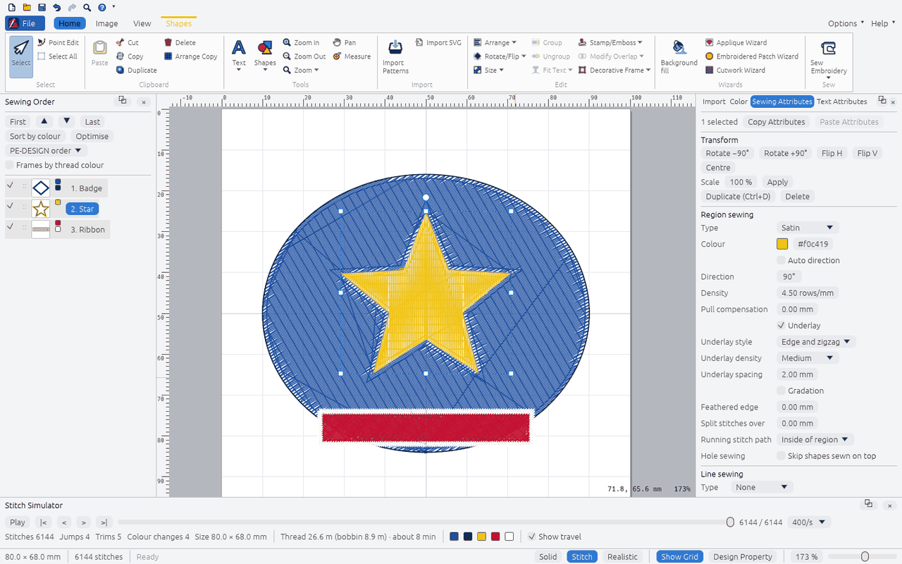

## Contents

- [Status at a glance](#status-at-a-glance)
- [Screenshots](#screenshots)
- [From image to embroidery](#from-image-to-embroidery)
- [Features](#features)
- [Not yet implemented](#not-yet-implemented)
- [Known issues](#known-issues)
- [Planned](#planned)
- [Download a build](#download-a-build)
- [Build from source](#build-from-source)
- [MCP server](#mcp-server-claude-code-and-other-mcp-clients)
- [Contributing](#contributing)
- [Releases](#releases)
- [Documents](#documents)
- [License](#license)

## Status at a glance

Current release: **v0.1.0-alpha.8** ([notes](docs/releases/v0.1.0-alpha.8.md)).

OpenStitch is checked against PE-DESIGN 11.50 itself. Simple test designs made in a licensed copy
through its normal interface are committed under `compat/reference/`. The compatibility harness
(`stitchtool compat`) compares OpenStitch's output with them spec by spec.

<!-- status:glance -->
| | |
|---|---|
| Feature matrix rows | 178: 146 implemented (3 of them partially compatible), 2 documented only, 10 blocked, 20 planned beyond PE-DESIGN |
| Compatibility specs | 443: 443 pass, 0 fail ([status](docs/COMPATIBILITY_STATUS.md)) |
| Matrix rows covered by specs | 33: 26 at the reference tier, 5 at the internal-regression tier, 2 at the oracle tier |
| Open audit differences | 11 ([audit](docs/COMPATIBILITY_AUDIT.md#summary)) |
| Open GitHub issues | 5 ([list](https://github.com/cristianonescu/OpenStitch/issues)) |
<!-- /status:glance -->

Tiers, weakest first: *internal regression* (our own earlier output), *oracle* (an independent
implementation), *reference* (PE-DESIGN 11.50's own output), *machine* (a recorded sew-out; none
yet). Every feature and its evidence is in [docs/FEATURE_MATRIX.md](docs/FEATURE_MATRIX.md).

## Screenshots

| | |
|---|---|
| 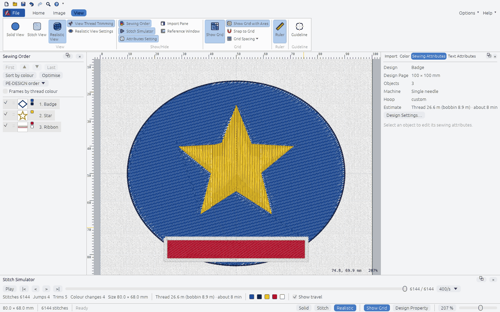 | 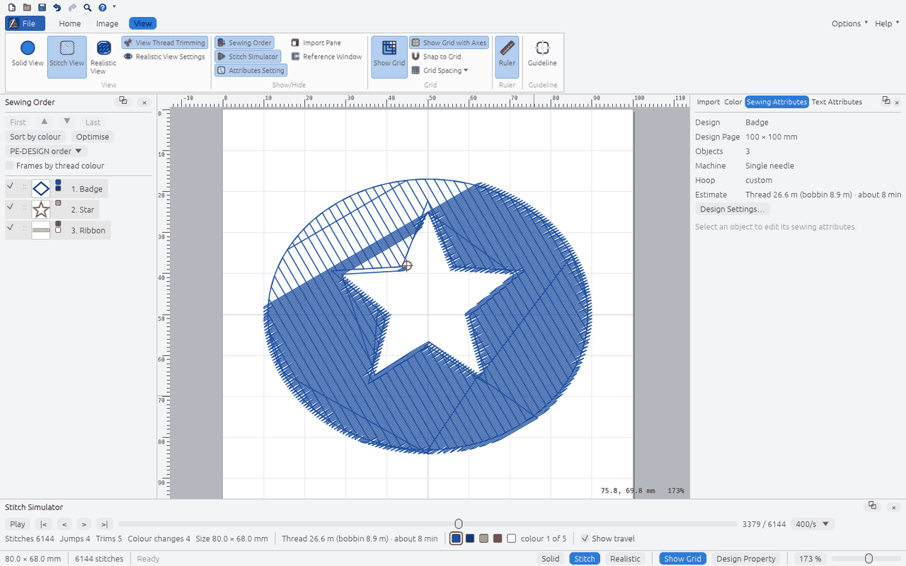 |
| **Realistic view:** see how the stitches will look on fabric. | **Stitch simulator:** play the design back stitch by stitch, with jumps and trims. |
| 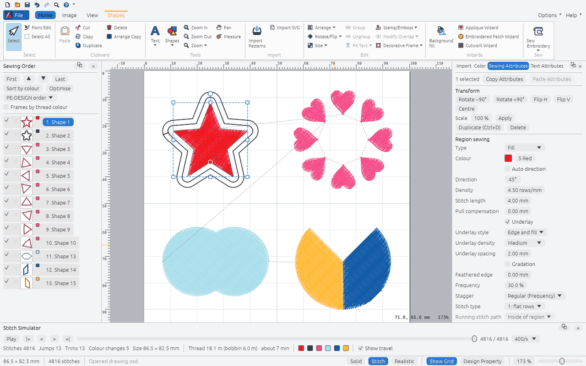 | 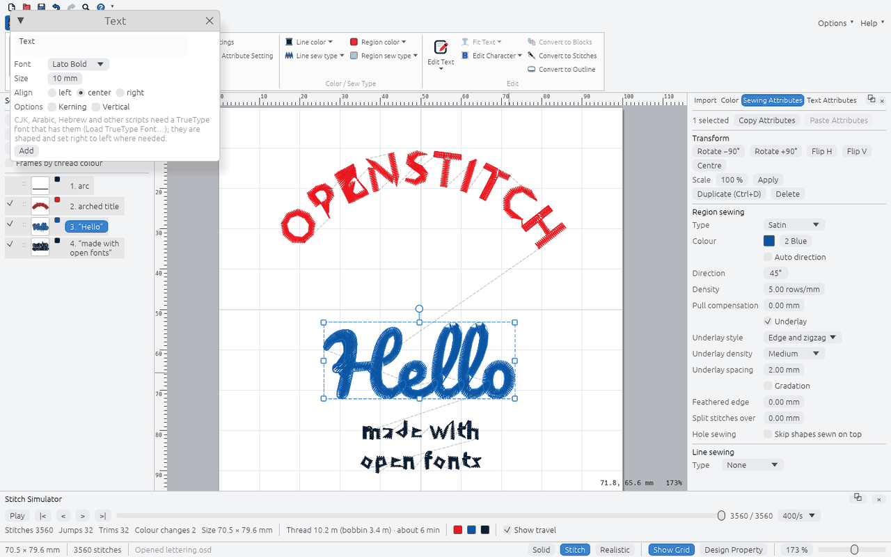 |
| **Drawing and editing:** shapes, Bézier outlines, arranged copies and shape operations. | **Lettering:** TrueType text with PE-DESIGN's size, spacing and transforms. |
| 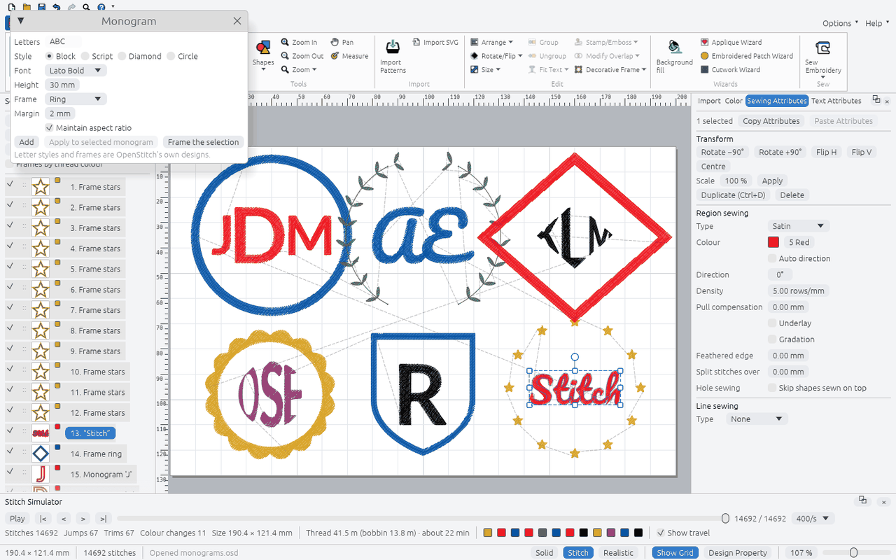 | 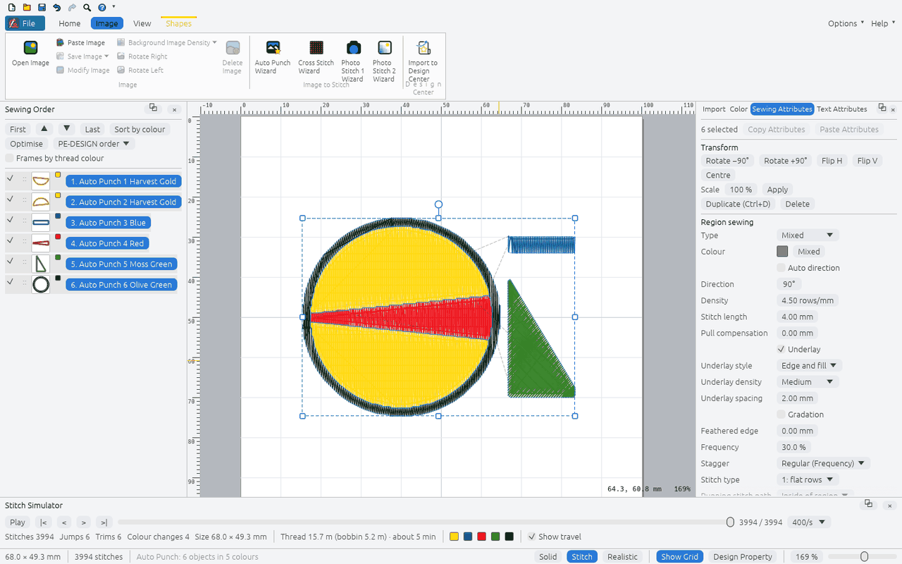 |
| **Monograms:** letters in a frame, kept editable. | **Image to embroidery:** Auto Punch, Cross Stitch and Photo Stitch-style conversion. |
| 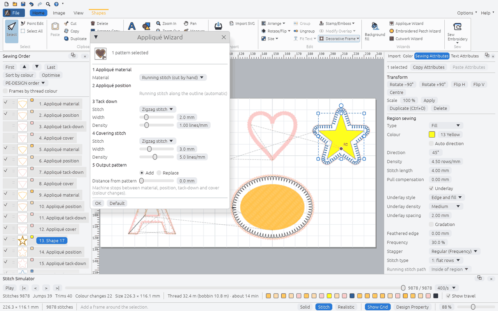 | 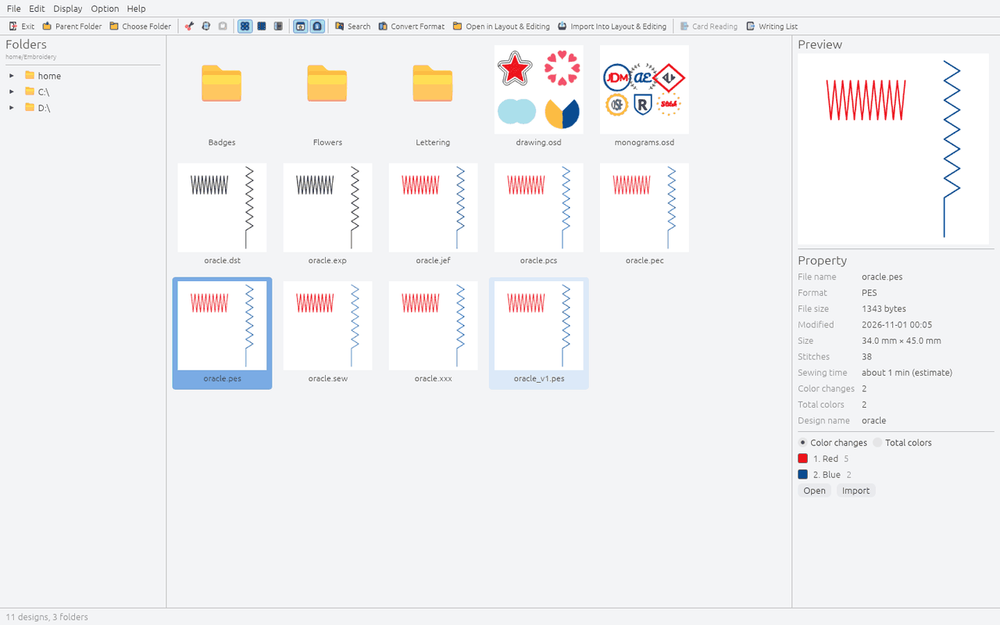 |
| **Wizards:** appliqué, patch, cutwork, background fill and split designs. | **Design Database:** browse, search, organise and convert your design files. |
| 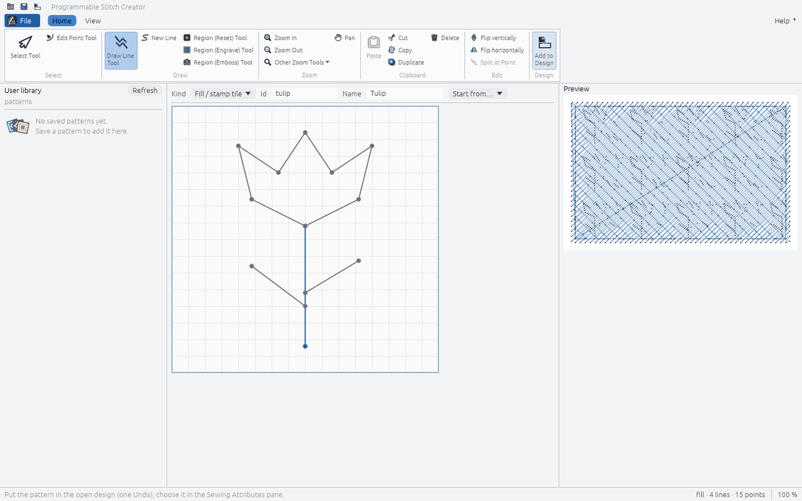 | 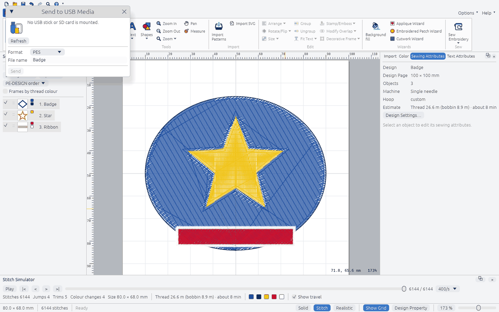 |
| **Programmable Stitch Creator:** draw your own fill and motif stitch patterns. | **Machine transfer:** write the design to a USB stick or SD card. |
| 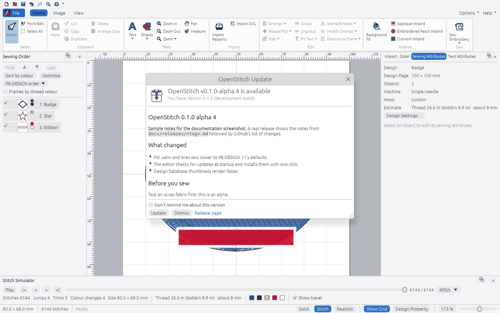 | 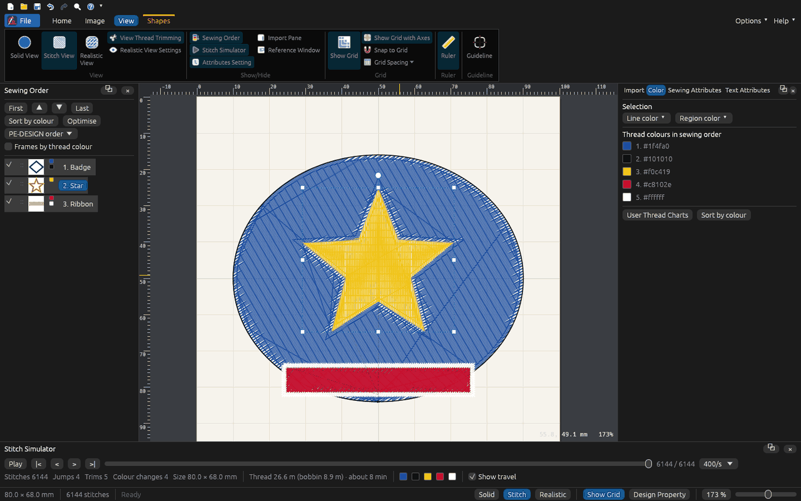 |
| **Updates:** the editor updates itself from GitHub releases. | **Light or dark** theme. |

## From image to embroidery

Test images from [examples/images](examples/images), generated for OpenStitch (see their
[provenance](examples/images/PROVENANCE.md)), converted by the image wizards and shown in the
editor's Realistic view. **Every picture here is OpenStitch's own output, none is
PE-DESIGN's.** They use OpenStitch's PE-DESIGN-compatible mode (the default): OpenStitch's own
reimplementation of PE-DESIGN 11's method, at the settings named. `python3 tools/gallery.py`
regenerates them.

<!-- gallery:start -->
| Image | OpenStitch (Realistic view) | Wizard and result |
|---|---|---|
|  | 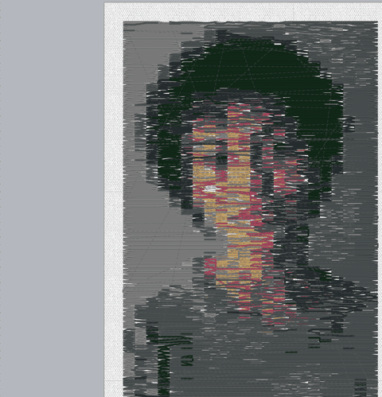 | **Photo Stitch 1, colour, defaults**<br>12,512 stitches, 385 trims, 7 colours |
|  | 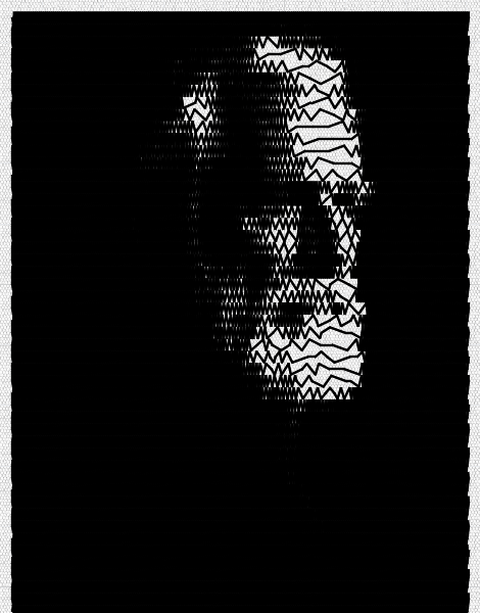 | **Photo Stitch 2, mono, defaults**<br>19,991 stitches, 1 trims, 1 colour |
|  | 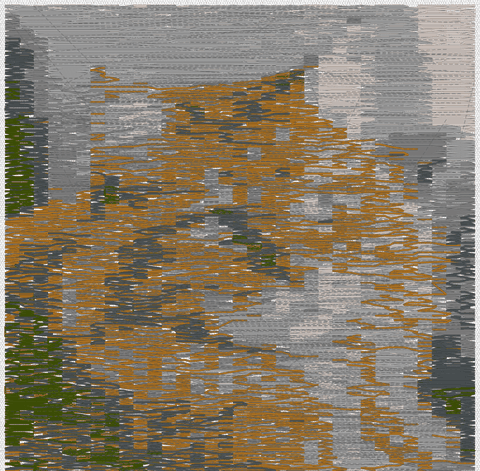 | **Photo Stitch 1, colour, defaults**<br>21,077 stitches, 839 trims, 8 colours |
|  | 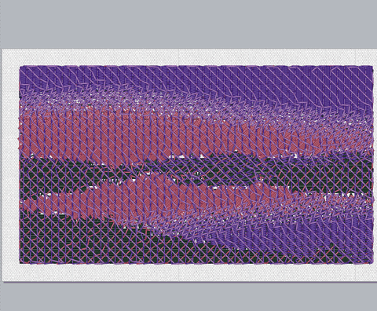 | **Photo Stitch 2, Auto Select**<br>18,514 stitches, 4 trims, 4 colours |
|  | 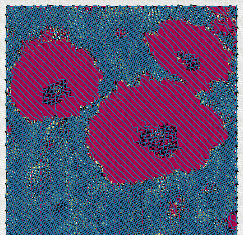 | **Photo Stitch 2, Color Set CMYK**<br>35,725 stitches, 4 trims, 4 colours |
|  | 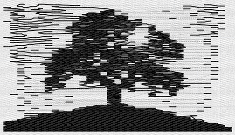 | **Photo Stitch 1, mono, defaults**<br>3,585 stitches, 130 trims, 1 colour |
|  | 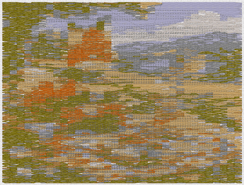 | **Photo Stitch 1, colour, defaults**<br>16,018 stitches, 789 trims, 8 colours |
|  |  | **Auto Punch, defaults**<br>8,688 stitches, 10 trims, 3 colours |
|  | 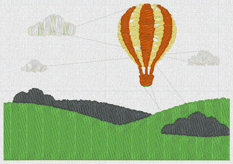 | **Auto Punch, defaults**<br>7,926 stitches, 12 trims, 5 colours |
|  | 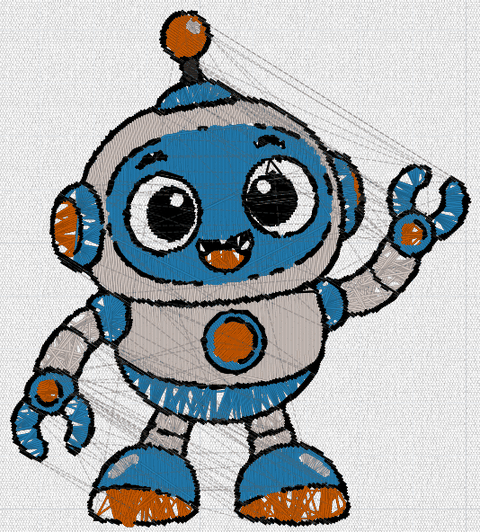 | **Auto Punch, defaults**<br>11,897 stitches, 231 trims, 6 colours |
|  | 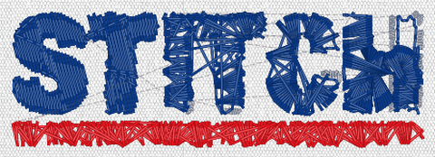 | **Auto Punch, defaults**<br>1,982 stitches, 16 trims, 3 colours |
|  | 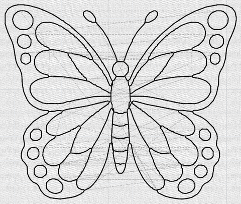 | **Design Center, running line**<br>1,271 stitches, 92 trims, 1 colour |
|  | 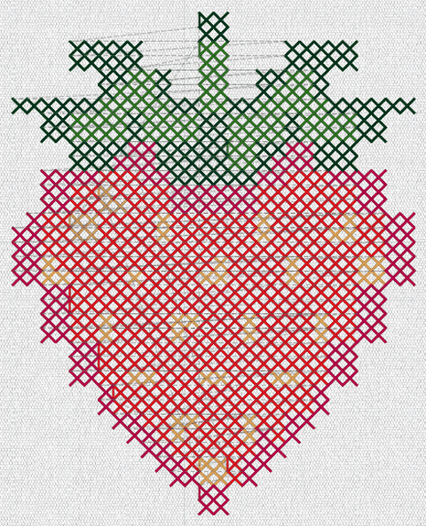 | **Cross Stitch, defaults**<br>3,931 stitches, 190 trims, 6 colours |
|  | 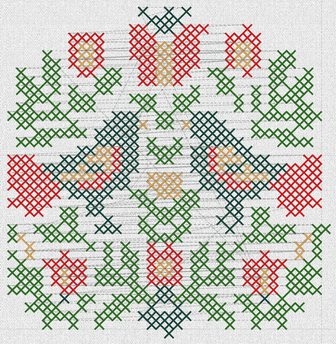 | **Cross Stitch, defaults**<br>4,467 stitches, 303 trims, 4 colours |
<!-- gallery:end -->

Auto Punch and Photo Stitch 1 and 2 have two modes, both run by OpenStitch (the image
dialog's Mode choice):

- **PE-DESIGN-compatible** (the default, labelled "PE-DESIGN" in the dialog): OpenStitch's own
  reimplementation of PE-DESIGN 11's method, so a design converts the way it would in
  PE-DESIGN. It is not PE-DESIGN's output, and it does not sew PE-DESIGN's exact stitches.
- **OpenStitch** (➕): colours are reduced, matched to threads and mixed by how they look, and
  Auto Punch merges specks under 3 mm² ([research](docs/research/beyond/image-digitizing.md)).

The table below shows both modes, both from OpenStitch. OpenStitch mode measures better on
average, not on every image, so try both. For example, the test portrait sews truer in Photo
Stitch 2's PE-DESIGN-compatible mode, whose three threads suit its skin and background.

<!-- gallery-modes:start -->
| Image | OpenStitch, PE-DESIGN-compatible mode (default) | OpenStitch, OpenStitch mode ➕ |
|---|---|---|
| <br>Auto Punch | <br>11,897 stitches, 231 trims, 6 colours | 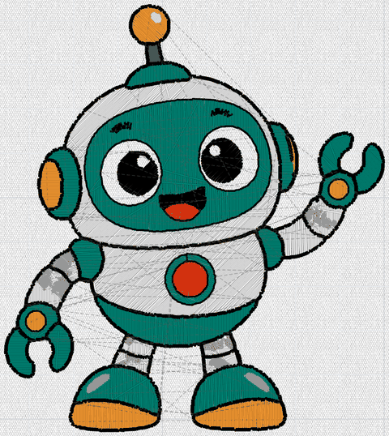<br>11,176 stitches, 204 trims, 5 colours |
| <br>Auto Punch | 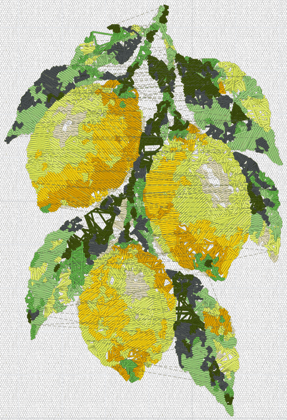<br>18,278 stitches, 284 trims, 9 colours | 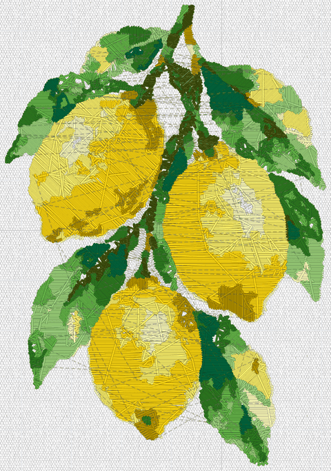<br>13,662 stitches, 111 trims, 7 colours |
| <br>Auto Punch | 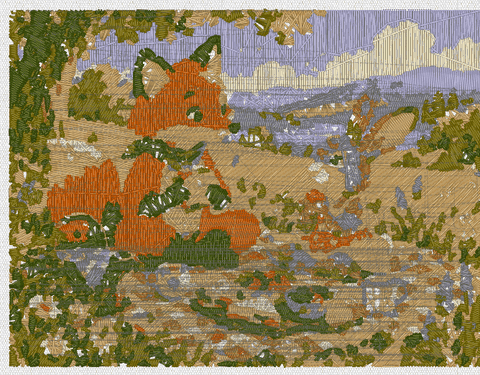<br>41,676 stitches, 699 trims, 8 colours | 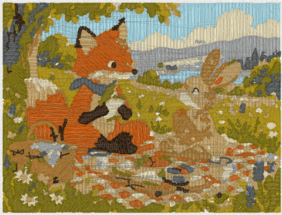<br>30,627 stitches, 284 trims, 10 colours |
| <br>Photo Stitch 1 | <br>12,512 stitches, 385 trims, 7 colours | 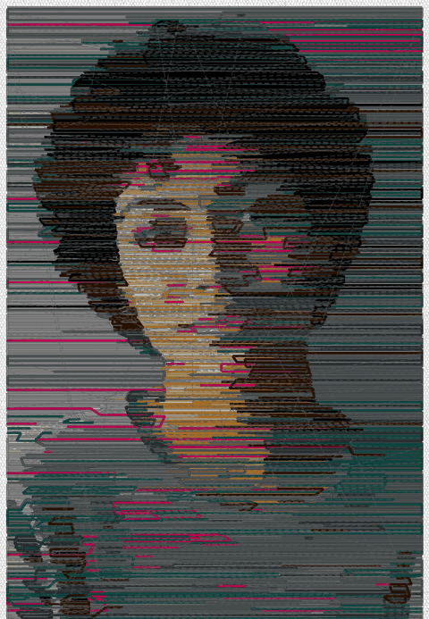<br>12,983 stitches, 451 trims, 8 colours |
| <br>Photo Stitch 1 | 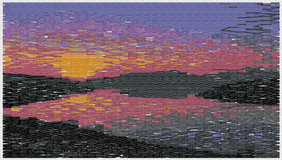<br>11,038 stitches, 370 trims, 11 colours | 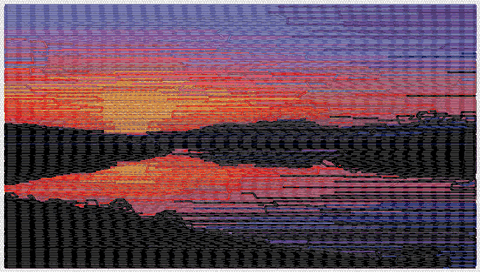<br>11,352 stitches, 474 trims, 11 colours |
| <br>Photo Stitch 2 | 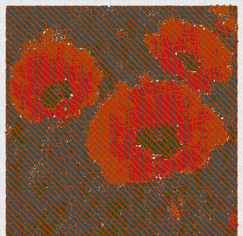<br>32,921 stitches, 4 trims, 4 colours | 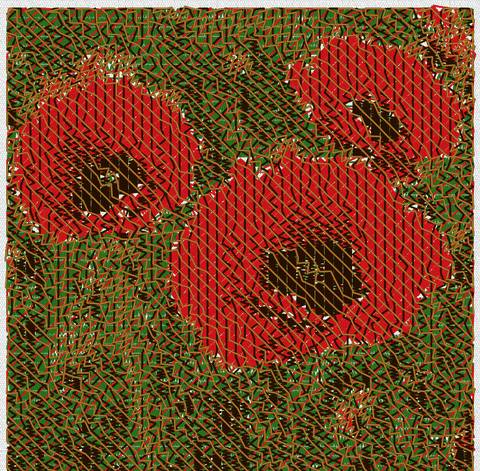<br>32,394 stitches, 4 trims, 4 colours |
| <br>Photo Stitch 2 | 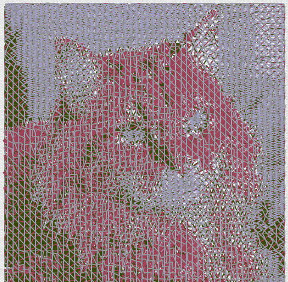<br>28,016 stitches, 4 trims, 4 colours | 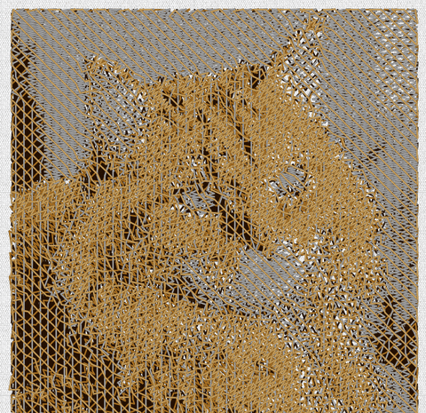<br>29,653 stitches, 4 trims, 4 colours |
<!-- gallery-modes:end -->

## Features

Features marked **➕** go beyond PE-DESIGN 11: they are off unless you choose them, so
PE-DESIGN-compatible output stays the default.

### Editing

- **Editor window laid out like PE-DESIGN 11's Layout & Editing window:** Application menu,
  Home / Image / View ribbon with contextual tabs, Quick Access Toolbar, Sewing Order and
  attribute panes ([docs/UI_LAYOUT.md](docs/UI_LAYOUT.md)). Light or dark theme.
- **Drawing:** rectangle, ellipse, polygon, Pencil (freehand), Bézier pen, arcs and preset
  shapes (stars, hearts, arrows and more), Manual Punch columns and curved blocks.
- **Shape editing:** point editing, move/scale/rotate/flip, group, cut and paste, arranged copies
  (mirror, circle, matrix), merge, remove overlap, boolean operations, split, offset lines.
  Bézier curves survive these operations.
- **Sewing attributes and order:** thread colour from the Brother chart or your own charts, sew
  type, direction (straight, auto or curved), entry and exit points, hole sewing, saved
  attribute sets, Copy Sewing Attributes. Sewing order by drag, by colour or optimised as
  PE-DESIGN does, plus a **➕** shortest-jump order (`minJump`).
- **Stitch pattern editing:** move, insert and delete needle points; split, connect, divide by
  colour and change a block's colour.
- **Conversions:** text and shapes to stitches, stitches back to shapes, text to outlines, region
  to line.
- **Ornaments:** floral patterns, decorative frames, stamps, embossing and engraving, using
  OpenStitch's own designs.
- **Workspace:** rulers, grid, measure tool, Reference window, Design Page and Brother hoop list
  with user hoops, undo/redo, stitch simulator, realistic and solid views, Fabric Selector.

### Stitch types

PE-DESIGN 11.50's defaults, tie-in and lock, measured from its own files.

- **Regions:** fill (tatami with Frequency, PE-DESIGN's two Stitch Types (flat or sloped rows),
  under sewing, gradation and feathered edge), satin
  (PE-DESIGN's sawtooth and Auto satin), programmable fill, motif fill, concentric circle,
  radial and spiral.
- **➕ Contour fill:** rows that follow the outline (rings, single or double spiral, echo
  lines, round or mitred corners).
- **➕ Random tatami stagger,** seeded and reproducible, beside PE-DESIGN's Frequency brick.
- **Lines:** running, triple, zigzag, motif, stem, candlewicking, E and V, chain and cutting
  (cutwork needles), with Start/End Feed or Run as PE-DESIGN sews them.
- **Patterns:** OpenStitch's own fill, stamp and motif library, or your own patterns drawn in
  the Programmable Stitch Creator or imported from PE-DESIGN's `.pas`, `.pmf` and `.plf` files.
- **➕ Skeleton satin:** a satin column sewn along a derived centre line.

### Lettering

- **Text:** multi-line TrueType/OpenType text with PE-DESIGN's text size, character and line
  spacing, alignment and Satin or Fill sewing. Satin letters are sewn stroke by stroke, in
  PE-DESIGN's block order. Bundled open-licence fonts (Lato Bold, Pacifico)
  or your own fonts, embedded in the design. Complex scripts (Arabic, Indic, right-to-left) are
  shaped.
- **Fit Text to Outline** and all 26 **Text Transform** presets, checked against PE-DESIGN.
- **Monograms**, **templates** with a Template Wizard, and **Name Drop** (one design, a list of
  names).
- **Your own embroidery fonts:** map stitch designs to characters, or build a font from TrueType
  glyphs and drawn shapes (Font Creator).

### Image digitizing

- **Auto Punch**, **Cross Stitch** and **Photo Stitch 1 and 2**: an image becomes embroidery
  regions, cross stitches or photo-style lines. These are independent approximations of
  PE-DESIGN's wizards, compared with its output.
- **Design Center** pipeline (image → outline → figure → sew settings) and the Stitch Wizard.
- ➕ **OpenStitch mode for Auto Punch, Photo Stitch 1 and Photo Stitch 2**: colours reduced,
  matched to threads and mixed by how they look (CIELAB, CIEDE2000, a linear-light mix in Photo
  Stitch 2); Auto Punch also merges specks and keeps line art's lines. The PE-DESIGN-compatible
  mode (OpenStitch's reimplementation of PE-DESIGN's method) stays the default; for some photos
  it still sews truer, so try both.
- **Background images** (PNG, JPEG, BMP or the clipboard): place, crop, rotate, adjust and trace
  over.

### Wizards and tools

- **Appliqué, embroidered patch, cutwork and background fill** wizards (approximations of
  PE-DESIGN's). The Applique Wizard's lines sit at PE-DESIGN's distances, in its appliqué
  colours.
- **Split designs** for large designs, **multi-position hoops** and the **jumbo frame**.
- **Design Database:** browse folders as thumbnails, search, organise, convert formats in batch
  and print catalogues.
- **Programmable Stitch Creator** and **Stitch Design Factory** (sewing-machine stitches; PMV
  export is experimental).
- **Printing:** actual-size sheets, PDF, and the operating system's printer.

### Files and formats

- **Read and write:** PES, PEC, DST, EXP, JEF, PCS, SEW, XXX, HUS, VIP. The machine formats match
  PE-DESIGN 11.50's own exports record for record or byte for byte.
- **Read only:** SHV, PHC (read only in PE-DESIGN too) and CSD.
- **PE-DESIGN 11 PES (`#PES0110`):** OpenStitch reads the metadata, thread table and shapes. Saved
  as "PE-DESIGN 11", its shapes and Lato Bold text open **editable** in PE-DESIGN 11.50 (text
  retypable), including Fit Text to Outline and Text Transform, Manual Punch blocks, stitch
  groups, grouped appliqué, hole sewing, programmable and decorative fill, the other region types
  and stem, candlewick and chain lines, with the Design Settings' hoop and machine type.
  `import.pes` opens PE-DESIGN's shapes and blocks as editable objects. Details in
  [docs/FILE_FORMATS.md](docs/FILE_FORMATS.md).
- **PES versions 1, 6 and 11** on export, with Design Property (category, author, keywords,
  comments). Version 6 with its stitch group is the default.
- **SVG import** as editable shapes, colours snapped to the Brother chart.
- **Editable `.osd` projects**, and large designs split into several files when a format's limits
  are exceeded.
- **Thread charts:** Brother's 64-colour PEC chart with its catalogue numbers, PE-DESIGN's
  colour matching, and your own charts as CSV, exported in the layout PE-DESIGN's Import Chart
  reads.

### Machine transfer

- **USB stick or SD card:** the editor and the Design Database find removable drives on every OS
  and write the machine file to them, asking before overwriting.
- Wireless transfer and Link are not available; see [Not yet implemented](#not-yet-implemented).

### Scripting and MCP

- **➕ `stitchtool`:** run JSON command scripts, list every command, or drive a JSON-lines
  control channel. Every editor action is the same engine command.
- **➕ `openstitch-mcp`:** an MCP server for Claude Code and other MCP clients, with one tool per
  command, batches and PNG previews; file access only to folders you grant.
- **➕ Live editor socket:** `openstitch --listen` lets scripts and MCP act on the running editor
  (127.0.0.1 only, per-launch token).

### Installation and updates

- **Packages** for macOS (universal `.app`), Windows (MSI and portable zip) and Linux (AppImage,
  tarball, Flatpak), with `.osd` and `.pes` file associations.
- **➕ Linux file-manager thumbnails** for `.osd` and `.pes` files.
- **➕ Self-update** from GitHub releases, checked against the release's checksums (see
  [Updates](#updates)).

## Not yet implemented

PE-DESIGN 11 features OpenStitch does not have yet, from the feature matrix:

<!-- status:not-implemented -->
- **Export CSD, SHV** (Files)
- **Import WMF/EMF** (Files)
<!-- /status:not-implemented -->

Also missing, from the [roadmap](docs/ROADMAP.md#still-to-do):

- **Stroke-wise fill lettering:** satin text is sewn stroke by stroke, as PE-DESIGN does;
  fill text still sews a whole letter in one direction.
- **Text details:** per-character colour, multi-character selection, Connection Points, minimum
  font sizes and small-text fonts, kerning that reflows the line.
- **Satin and fill details:** Half Stitch for Auto satin, Miter limit, gradation per-step
  editing and Blend.
- **PES:** opening PE-DESIGN's texts and stitch groups as editable OpenStitch objects; motif
  fill, motif lines, several groups, right-aligned and vertical text in the editable PES 11
  writer; PES versions 4, 5 and 7–10; CSD and SHV export.

**Not planned, by design:**

- **PE-DESIGN's bundled fonts, motifs, stamps, floral and decorative patterns** are Brother's
  content. OpenStitch ships its own designs and open-licence fonts instead, and imports patterns
  you draw yourself.

**Blocked:**

<!-- status:blocked -->
- **Import PHX** (Files)
- **Import PEN** (Files)
- **Background image from a scanner** (Files)
- **ScanNCut FCM export/import** (Files)
- **Transfer directly to machine memory, wireless network, original card** (Machine)
- **Link function** (Machine)
- **Transfer by wireless network, USB cable to machine memory, original card, USB/Wireless Link** (Design Database)
- **Brother PMP and PSF files** (Stitch Design Factory)
- **File-manager thumbnails, macOS Quick Look and Windows Explorer** (OS integration)
- **PEN thumbnails** (OS integration)
<!-- /status:blocked -->

Wireless transfer, Link, card reading and PHX use undocumented protocols or formats that the
project will not reverse-engineer. PEN is an encrypted purchase format: reading it would
circumvent its protection. ScanNCut FCM has no Brother specification and malformed files can
reboot the machine. Scanners, Quick Look and Explorer thumbnails need native code (`unsafe`),
which the workspace forbids for now.

## Known issues

Open differences from PE-DESIGN 11 that you may notice, from the
[compatibility audit](docs/COMPATIBILITY_AUDIT.md):

<!-- status:known-issues -->
- [Trims between underlay, top stitching and outline of one object](docs/COMPATIBILITY_AUDIT.md#4-trims-between-underlay-top-stitching-and-outline-of-one-object)
- [Every design is written as one stitch group, nothing editable](docs/COMPATIBILITY_AUDIT.md#5-every-design-is-written-as-one-stitch-group-nothing-stays-editable-in-pe-design) (partly fixed)
- [One sewing direction per text instead of per stroke](docs/COMPATIBILITY_AUDIT.md#6-one-sewing-direction-per-text-instead-of-per-stroke)
- [Underlay model differs](docs/COMPATIBILITY_AUDIT.md#8-underlay-model-differs-zigzag-lines-have-no-underlay) (partly fixed)
- [PE-DESIGN-made PES files lose objects, properties and colours on re-save](docs/COMPATIBILITY_AUDIT.md#9-pe-design-made-pes-files-lose-objects-properties-and-colours-on-re-save)
- [Hoop and Design Page fields hard-coded in PES](docs/COMPATIBILITY_AUDIT.md#10-hoop-and-design-page-fields-are-hard-coded-in-pes)
- [No Connection Points (Default / Closest / Farther) for text](docs/COMPATIBILITY_AUDIT.md#11-no-connection-points-default--closest--farther-for-text)
- [No minimum font sizes or small-text fonts](docs/COMPATIBILITY_AUDIT.md#12-no-minimum-font-sizes-or-small-text-fonts)
- [No per-character colour or multi-character selection](docs/COMPATIBILITY_AUDIT.md#13-no-per-character-colour-or-multi-character-selection)
- [Missing fill, satin and zigzag attributes; wrong ranges](docs/COMPATIBILITY_AUDIT.md#15-missing-fill-satin-and-zigzag-attributes-wrong-ranges) (partly fixed)
- [Character kerning moves one glyph without reflowing the line](docs/COMPATIBILITY_AUDIT.md#20-character-kerning-moves-one-glyph-without-reflowing-the-line)
<!-- /status:known-issues -->

Other things to know:

- **No sew-out yet:** no OpenStitch-written file has a recorded sew-out on a Brother machine.
- **Image digitizing is approximate:** Auto Punch, Cross Stitch and Photo Stitch are compared with
  PE-DESIGN but do not sew the same stitches.
- **Builds are not code-signed:** macOS and Windows warn on first launch (see
  [Download a build](#download-a-build)).
- **macOS:** double-clicking a `.osd` or `.pes` file in Finder does not open it; use File ▸ Open.
- **Updates:** versions before v0.1.0-alpha.4 have no updater and must be replaced by hand.

Bugs reported on GitHub:

<!-- status:issues-bugs -->
_None._
<!-- /status:issues-bugs -->

[Report a bug](https://github.com/cristianonescu/OpenStitch/issues/new).

## Planned

Next, from [docs/ROADMAP.md](docs/ROADMAP.md):

- **Lettering:** stroke-wise sewing of fill text, as PE-DESIGN does it.
- **PES:** PE-DESIGN's text opened as editable objects; motif fill and lines, several groups and
  the remaining hoops in the PES 11 writer.
- **Stitches:** the remaining fill, satin and line details listed above, and branching skeletons.
- **Machine tier:** a first recorded sew-out on a Brother machine.
- **Image digitizing:** run-to-run travel in Cross Stitch, fewer trims in Photo Stitch 1's
  OpenStitch mode, and closer Photo Stitch output.
- **Distribution:** code signing and a Flathub listing.

Open enhancement issues:

<!-- status:issues-planned -->
- [#120](https://github.com/cristianonescu/OpenStitch/issues/120) Add a `#PES0110` editable-object-section writer
- [#127](https://github.com/cristianonescu/OpenStitch/issues/127) Rework auto-punch colour reduction, small-region removal, and the satin-vs-fill decision
- [#129](https://github.com/cristianonescu/OpenStitch/issues/129) (Optional, larger) Photo-stitch rotating-line coverage density model
- [#130](https://github.com/cristianonescu/OpenStitch/issues/130) Add a PMV motif/pattern reader
- [#134](https://github.com/cristianonescu/OpenStitch/issues/134) Import external scalable embroidery font containers
<!-- /status:issues-planned -->

### Beyond PE-DESIGN

After PE-DESIGN compatibility, OpenStitch adds what other digitizing programs offer and
PE-DESIGN 11 does not. Each item is sketched in
[docs/research/beyond](docs/research/beyond/readiness.md) and will be off unless chosen:

<!-- status:beyond-planned -->
- Image similarity, Phase 0 (measurement): the similarity score (0.4 MS-SSIM, 0.4 CIEDE2000, 0.2 DISTS on a thread render at actual size from 40 cm) with a sewability report, a calibration test card and a realistic render fitted to its photographed sew-out, deterministic digitizing maths and cross-platform golden hashes (B16.1)
- Image similarity, Phase 1 (shared colour engine): thread selection by backward elimination, multi-brand charts and My Threads as an additive source, dithering only in tonal regions, a Standard / High fidelity setting in the image dialog (B16.1)
- Image similarity, Phase 2 (Photo Stitch 2): least-squares thread shares with 4–6 threads and a sew-out-calibrated coverage model; target photo mean ≥ 75 (B16.1)
- Image similarity, Phase 3 (Photo Stitch 1 High fidelity): fine colour sampling with variable stitch boundaries, rate-constrained rows under 2.1 needle points/mm², a saliency-weighted budget, metric-driven local search; firm target 85 % (B16.1)
- Image similarity, Phase 4 (Auto Punch): a sewn coloured background, SLIC regions that keep line art, skeleton satin for outlines; target 95 % for logos, clip art and lettering (B16.1)
- Image similarity, Phase 5 (Cross Stitch and Design Center): OpenStitch modes for both, with mean-Lab cells, edge part-crosses and an Otsu line threshold; targets g07 ≥ 85, g03 and g04 ≥ 95 (B16.1)
- Density profiles on fills and satin columns, two-colour blend command, hidden travel for open fills (B6)
- 3D puff satin mode: density, caps, no underlay or pull compensation, foam stop, ordering (B7)
- Crosshatch, curved crosshatch and double-zigzag lace as a region type (B8)
- Carving lines drawn on fills; knockdown (laydown) fill sewn first (B12)
- Satin corner handling (mitre / cap / lap) and short stitches on inner curves for columns and regions (B3)
- Pull compensation in mm per side and %, push compensation, automatic underlay by width with first and second underlay, editable fabric table (B5)
- Satin line with variable width: width keys, two rails, tapered ends (B10)
- Auto-routed running stitches (Euler path), Redwork, satin branching with one entry and exit (B4)
- Closest join per object, auto start/end, continue digitizing, automatic overlap removal (B11)
- Guided fill with two guides; stitch-angle maps with several direction lines per region (B2)
- Maze and tiled meander fills, zigzag (fur) variant, seeded hand-stitch randomisation (B9)
- Quality tools: density map, troubleshoot rules, thread-brand conversion, automatic hoop selection (B13)
- Stitch-file resize with density recalculation and density tuning (B14)
- Lettering: baseline model, saved kerning pairs, team names from CSV, closest-point letter connections (B15)
<!-- /status:beyond-planned -->

## Download a build

The latest pre-release is on the
[Releases](https://github.com/cristianonescu/OpenStitch/releases) page, with notes in
[docs/releases](docs/releases/). It is an alpha for testing, not for production work: do a test
sew-out on scrap fabric first.

Every merge to `main` also builds the executables for all three operating systems. Open the
repository on GitHub, go to **Actions → Rust workspace**, pick the latest run on `main` and
download the artifact for your system:

| Artifact | Contents |
|---|---|
| `openstitch-main-<sha>-macos-universal` | `OpenStitch-…-macos-universal.zip` (the `OpenStitch.app` editor, Apple Silicon and Intel) and `openstitch-cli-…tar.gz` (`stitchtool`, `openstitch-mcp`) |
| `openstitch-main-<sha>-windows-x86_64` | `OpenStitch-…-windows-x86_64.msi` (installer with `.osd`/`.pes` associations), a portable `.zip` of the editor, and `openstitch-cli-…zip` |
| `openstitch-main-<sha>-linux-x86_64` | `OpenStitch-…-linux-x86_64.AppImage` (single file: `chmod +x` and run; `--install-integration` adds the menu entry, `.osd`/`.pes` types and thumbnails), `OpenStitch-…-linux-x86_64.tar.gz` (editor with `install.sh`, desktop entry, MIME types and thumbnailer) and `openstitch-cli-…tar.gz` |

A Flatpak bundle (`openstitch-flatpak-x86_64`) is built by the **Flatpak** workflow when the
Linux packaging changes, and can be built locally from
`packaging/flatpak/io.github.cristianonescu.OpenStitch.yml`.

Details are in [docs/DISTRIBUTION.md](docs/DISTRIBUTION.md).

The builds are not code-signed yet:
- **macOS:** unzip and move `OpenStitch.app` to Applications, then right-click → Open the first
  time (or run `xattr -dr com.apple.quarantine OpenStitch.app`).
- **Windows:** choose *More info → Run anyway* in the SmartScreen prompt.

### Updates

The editor keeps itself current. At a plain start it asks GitHub whether a newer release
exists. If so, a dialog shows the release notes with three choices:

- **Dismiss.**
- **Don't remind me about this version:** quiet until a newer one appears.
- **Update:** downloads the package for your system, checks it against the release's
  `SHA256SUMS`, installs it and restarts OpenStitch.

The portable zip, the MSI (Windows Installer asks for permission), the macOS app and the Linux
AppImage and tarball all update in place; a Flatpak updates through Flatpak. In Options,
*Check for updates at startup* turns the check off, *Include pre-releases* opts a stable build
into alphas and betas, and *Check for Updates Now* asks right away. Builds from source and the
artifacts of `main` have no release tag and never check. Details:
[docs/DISTRIBUTION.md](docs/DISTRIBUTION.md#updates).

## Build from source

### Prerequisites

- **Rust** stable via [rustup](https://rustup.rs) (CI builds with the current stable; the
  workspace uses the 2024 edition):
  - macOS: `brew install rustup && rustup default stable`
  - Windows: install rustup-init and the "Desktop development with C++" build tools; the
    toolchain is the MSVC one (`x86_64-pc-windows-msvc`, rustup's default on Windows), which
    is also what embeds the icon in `openstitch.exe`
  - Linux: the rustup installer from rustup.rs
- **Linux only, at run time:** the desktop libraries every X11/Wayland desktop already has
  (`libxkbcommon`, `libwayland-client` or `libX11`, and Vulkan or OpenGL drivers). Building needs
  no extra `-dev` packages.

### Build

```bash
git clone https://github.com/cristianonescu/OpenStitch.git
cd OpenStitch
cargo build --release
```

The binaries are written to `target/release/`: `openstitch` (the editor), `stitchtool` and
`openstitch-mcp` (`.exe` on Windows).

### Run

```bash
cargo run --release -p openstitch-app                   # the desktop editor
cargo run --release -p openstitch-app -- design.osd     # open a design or machine file
```

```bash
cargo run -p stitchtool -- exec examples/badge.json   # run a command script → badge.pes + badge.osd
cargo run -p stitchtool -- exec examples/heart.json   # Bézier example
cargo run -p stitchtool -- commands                   # list every command (JSON)
cargo run -p stitchtool -- serve                      # JSON-lines control channel on stdio
```

```bash
cargo run -p openstitch-app -- --listen 0 --listen-root ~/Embroidery   # editor with the automation socket
cargo run -p stitchtool -- connect                    # JSON lines to the running editor
cargo run -p openstitch-mcp -- --live                 # MCP tools act on the running editor
```

The socket listens on 127.0.0.1 only and every request must carry the per-launch token that the
editor prints and writes to `automation.json` (readable by you only) in the OpenStitch config
directory; clients read it from there. See [docs/ARCHITECTURE.md](docs/ARCHITECTURE.md#automation-socket-live-editor).

A command script is a JSON array of `{"command": …, "params": {…}}` steps; see `examples/`.
Lengths are in millimetres and angles in degrees. Sewing directions turn counter-clockwise on
screen, as in PE-DESIGN (45 = rows rising to the right); `.osd` files from before format
version 2 stored them clockwise and are converted when opened.

### Test

```bash
cargo fmt --all -- --check
cargo test --workspace
cargo clippy --workspace --all-targets -- -D warnings
cargo run -p stitchtool -- compat
```

CI runs the same checks on macOS, Windows and Linux for every pull request, checks that
`docs/COMPATIBILITY_STATUS.md` matches the harness's result, and scans the history for secrets
with gitleaks.

## MCP server (Claude Code and other MCP clients)

`openstitch-mcp` exposes every engine command as an MCP tool. It also adds `run_batch` (up to 256
commands at once) and `preview` (a PNG of the generated stitches). It talks JSON-RPC over stdio
and opens no network port.

File commands can only touch the directories you grant:
- `--root DIR` is read/write and `--read-root DIR` is read-only; both can be repeated.
- With no roots, every file command is refused.

Register it with Claude Code, from this checkout:

```bash
claude mcp add openstitch -- cargo run -q --release -p openstitch-mcp --manifest-path "$PWD/Cargo.toml" -- --root ~/Embroidery
```

or build once and register the binary (faster start-up, no cargo output on stdio):

```bash
cargo build --release -p openstitch-mcp
```

```bash
claude mcp add openstitch -- "$PWD/target/release/openstitch-mcp" --root ~/Embroidery --read-root ~/Documents/Designs
```

Then ask Claude, for example, to "make a 60 × 40 mm badge with a red satin border, preview it and
export badge.pes". `--read-only` blocks every editing command and `--no-files` blocks all file
access; run `openstitch-mcp --help` for these and the size-limit flags. Other clients (Claude
Desktop, IDEs) take the same command and arguments in their MCP server configuration.

## Contributing

- Work on a branch and open a pull request to `main`; nobody pushes to `main` directly.
- A PR is merged once CI is green on all three operating systems.
- Every merge to `main` builds the executables (see [Download a build](#download-a-build)).
- Every PR that changes a feature updates [docs/FEATURE_MATRIX.md](docs/FEATURE_MATRIX.md); the
  README's status lists are generated from it (`python -I tools/readme_status.py --write`).
- Rules for the code (clean-room boundaries, command registry, golden tests) are in
  [docs/ARCHITECTURE.md](docs/ARCHITECTURE.md) and [docs/LEGAL_AND_LICENSING.md](docs/LEGAL_AND_LICENSING.md).

## Releases

Only the maintainer creates release tags:

- `vX.Y.Z` is a stable release.
- `vX.Y.Z-alpha.N`, `-beta.N` and `-rc.N` are pre-releases, marked as such on GitHub.

Pushing a tag on `main` runs the **Release** workflow: it checks the tag against the workspace
version, runs the full test suite, builds all three platforms and creates a **draft** GitHub
release with the packages and the notes from `docs/releases/<tag>.md`. The full procedure,
including the README refresh done at every release, is in [docs/RELEASING.md](docs/RELEASING.md).

## Documents

- [Research log](docs/RESEARCH.md)
- [Architecture](docs/ARCHITECTURE.md)
- [Editor window layout](docs/UI_LAYOUT.md)
- [Feature matrix](docs/FEATURE_MATRIX.md)
- [File formats](docs/FILE_FORMATS.md)
- [Compatibility tests](docs/COMPATIBILITY_TESTS.md) and the generated
  [compatibility status](docs/COMPATIBILITY_STATUS.md)
- [Compatibility audit](docs/COMPATIBILITY_AUDIT.md)
- [Adding a PE-DESIGN reference file](compat/reference/README.md)
- [Legal and licensing](docs/LEGAL_AND_LICENSING.md)
- [Roadmap](docs/ROADMAP.md)
- [Distribution and packaging](docs/DISTRIBUTION.md)
- [Releasing](docs/RELEASING.md) and the [release notes](docs/releases/)
- [Test images for the image wizards](docs/research/test-images.md)
- Handoffs (history): [2026-10-30](docs/HANDOFF-2026-10-30.md), [2026-10-29](docs/HANDOFF-2026-10-29.md),
  [2026-10-28](docs/HANDOFF-2026-10-28.md), [2026-10-27](docs/HANDOFF-2026-10-27.md),
  [2026-10-19](docs/HANDOFF-2026-10-19.md), [2026-10-18](docs/HANDOFF-2026-10-18.md)

`tools/` holds the Python scripts that generate fixtures, data tables, screenshots and the
README's status lists (`pip install pyembroidery pillow`, run with `python -I`).

## License

OpenStitch is licensed under either of

- Apache License, Version 2.0 ([LICENSE-APACHE](LICENSE-APACHE))
- MIT license ([LICENSE-MIT](LICENSE-MIT))

at your option. Unless you explicitly state otherwise, any contribution you intentionally submit
for inclusion in OpenStitch, as defined in the Apache-2.0 license, is dual-licensed as above,
without any additional terms or conditions.

Bundled fonts and third-party crates keep their own licences; see
[THIRD_PARTY_NOTICES.md](THIRD_PARTY_NOTICES.md).
