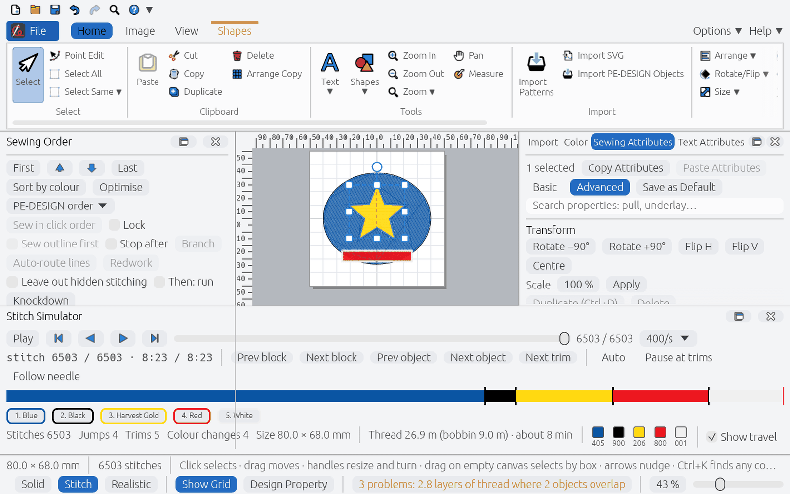

# Accessibility

What OpenStitch's editor does for people who cannot use a mouse precisely, who need larger text
or more contrast, or who use a screen reader, and where it stops (#499). Beyond PE-DESIGN 11,
which documents none of this.

## Keyboard

- **Every command** has a keyboard path: the ribbon and menus are reachable with Tab and the
  arrow keys, the command palette (Ctrl+K, Cmd+K on macOS) runs any command by name, and the
  shortcuts are editable (Help ▸ Keyboard Shortcuts).
- **Drawing without a mouse** (beyond PE-DESIGN): with a drawing tool, an arrow key shows a
  cross-hair cursor on the Design Page and moves it by the nudge step (Shift: ten times it, or a
  grid step with Nudge by Grid). **Space** clicks there, **Shift+Space** places a smooth Pen or
  Satin Skeleton point, **Return** finishes, **Esc** cancels, **Backspace** takes back the last
  point. Rectangle and Ellipse: the first Space starts the shape, the second ends it. While the
  Pen or Satin Skeleton draws, **[** and **]** narrow and widen the next point. Each drawing ends
  in the same command a mouse drawing makes, one undo step. See
  [UI_LAYOUT.md](UI_LAYOUT.md#how-the-drawing-and-editing-commands-work).
- The Pencil (freehand) tools still need a pointer.

## Text size and contrast

- The window follows the operating system's **display scale** (Windows Settings ▸ Display ▸
  Scale, macOS Displays, the desktop's scale on Linux).
- **Options ▸ Text size** enlarges the whole window further: 100 % to 200 % (`ui.set textSize`).
  The ribbon, panes and dialogs grow with it. Checked at 150 % in a 1440 × 900 window: the
  ribbon's groups that do not fit scroll into view under a solid scroll bar, the status bar's
  controls take a row of their own, and the Stitch Simulator's buttons wrap; nothing overlaps.

  
- The Light and Dark themes meet **WCAG 2 AA**: text 4.5:1 on every background it is drawn on,
  focus and selection outlines 3:1. A test checks every theme colour pair (`theme.rs`
  `contrast_tests`), also with a light custom accent; selected buttons darken a custom accent
  until white text on it reaches 4.5:1 (#559).
- **Keyboard focus** is visible: the focused control gets the hovered look with a 1.5 pt
  outline in the accent's dark blue.

## Screen readers

- The editor publishes its controls through AccessKit, which Windows Narrator, macOS VoiceOver
  and Linux Orca read. Every button, check box, list, text field, slider and tab in the main
  window and in each dialog has a name: a test walks the whole AccessKit tree of the window and
  of every dialog the documentation scenes open and fails on any unnamed control
  (`a11y_tests.rs`).
- Controls whose label is drawn beside them (in the Sewing Attributes pane and the dialogs)
  carry that label as their name.

## Limits

- The canvas (the design itself) is a picture to a screen reader: objects are reached through
  the Sewing Order pane, the selection commands and `ui.state` rather than on the canvas.
- Windows' separate "Make text bigger" setting (text only, not the display scale) is not read;
  use Options ▸ Text size.
- Menu entries have no Alt-letter accelerators (egui has none); the command palette and the
  shortcuts cover them.
- At large text sizes the left pane's divider line is drawn through the Stitch Simulator.
- Checked by the tests above; no manual pass with Narrator or VoiceOver has been recorded yet.
