# Line sew types

Every line sew type, and the motif line's own options (#544), each sewn on the same curved
line across 84 mm. Each picture is the stitches the engine sends to the machine, drawn by
`tools/engine_image.py` from `examples/line-type-<name>.json` (regenerate them with
`python3 -I tools/docs_images.py --only engine`); the command beside it is the one in that
script. Beyond PE-DESIGN: groups, free ends, motifs in turn and the hand-embroidery lines are
OpenStitch's own; PE-DESIGN's defaults are unchanged.

## Running

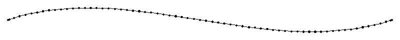

`object.setLine {"type": "running"}`

## Triple

`object.setLine {"type": "triple"}`

## Zigzag

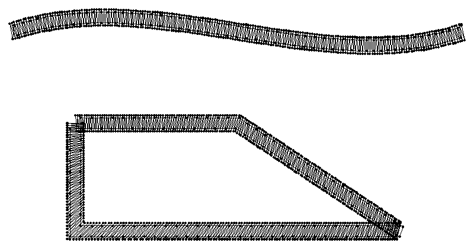

`object.setLine {"type": "zigzag", "width": 3, "halfStitch": true}` (the curve); `object.setLine {"type": "zigzag", "width": 3, "sharpCorners": 1, "underSewing": true}` (the closed outline below it: PE-DESIGN's first Sharp Corners button at its acute corners, #373, and under sewing in its two runs, #964)

## Satin line

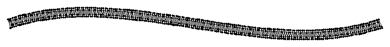

`object.setLine {"type": "satin"}`

## Back stitch

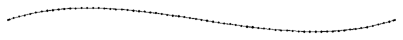

`object.setLine {"type": "backStitch"}`

## Stem

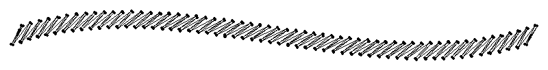

`object.setLine {"type": "stem", "width": 2.5, "spacing": 1.5}`

## Chain

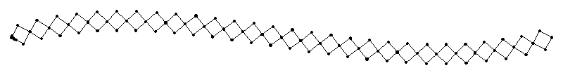

`object.setLine {"type": "chain", "width": 3, "chainShape": "diamond"}`

## Candlewicking

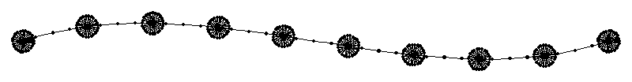

`object.setLine {"type": "candlewick", "width": 3, "spacing": 6}`

## E stitch

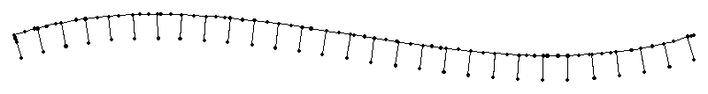

`object.setLine {"type": "eStitch", "width": 3, "spacing": 3}`

## V stitch

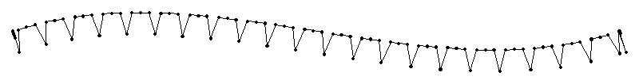

`object.setLine {"type": "vStitch", "width": 3, "spacing": 4}`

## Scribble

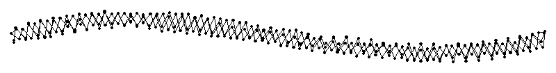

`object.setLine {"type": "scribble"}`

## Chevron

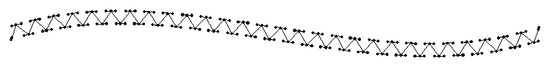

`object.setLine {"type": "chevron"}`

## Cretan

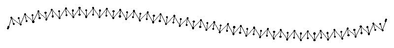

`object.setLine {"type": "cretan"}`

## Feather

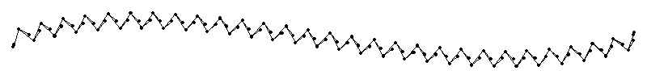

`object.setLine {"type": "feather"}`

## Overlock

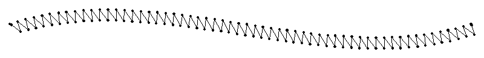

`object.setLine {"type": "overlock"}`

## Alternating triangles

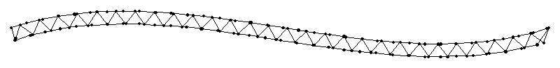

`object.setLine {"type": "alternatingTriangles"}`

## Double zigzag

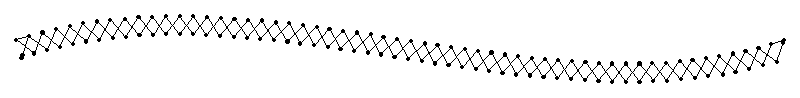

`object.setLine {"type": "doubleZigzag"}`

## Lattice

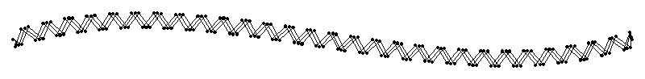

`object.setLine {"type": "lattice"}`

## Stripes

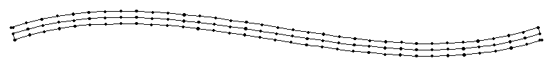

`object.setLine {"type": "stripes"}`

## Ripple

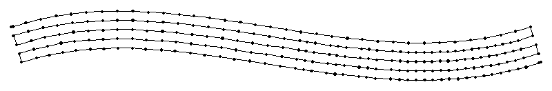

`object.setLine {"type": "ripple"}`

## Cutting

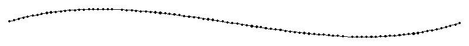

`object.setLine {"type": "cutting", "leaveUncut": true}`

## Motif

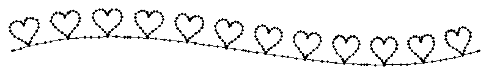

`object.setLine {"type": "motif", "motif": "heart", "width": 6, "height": 5, "spacing": 1}`

## Motif line in groups with free ends

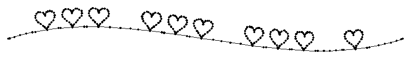

`object.setLine {"type": "motif", "motif": "heart", "width": 5, "height": 4, "spacing": 0.5, "groupSize": 3, "groupGap": 6, "freeStart": 6, "freeEnd": 6}`

## Motifs in turn

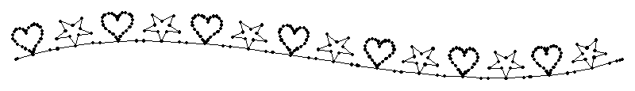

`object.setLine {"type": "motif", "motif": "heart", "width": 5, "height": 4, "spacing": 1, "motifs": ["star"]}`

## Motifs in turn, mirror-alternate

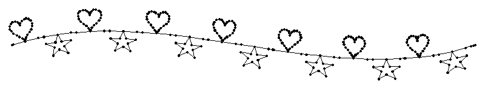

`object.setLine {"type": "motif", "motif": "heart", "width": 5, "height": 4, "spacing": 1, "motifs": ["star"], "arrange": "alternate"}`
