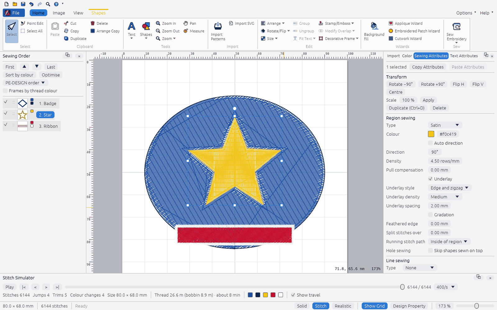
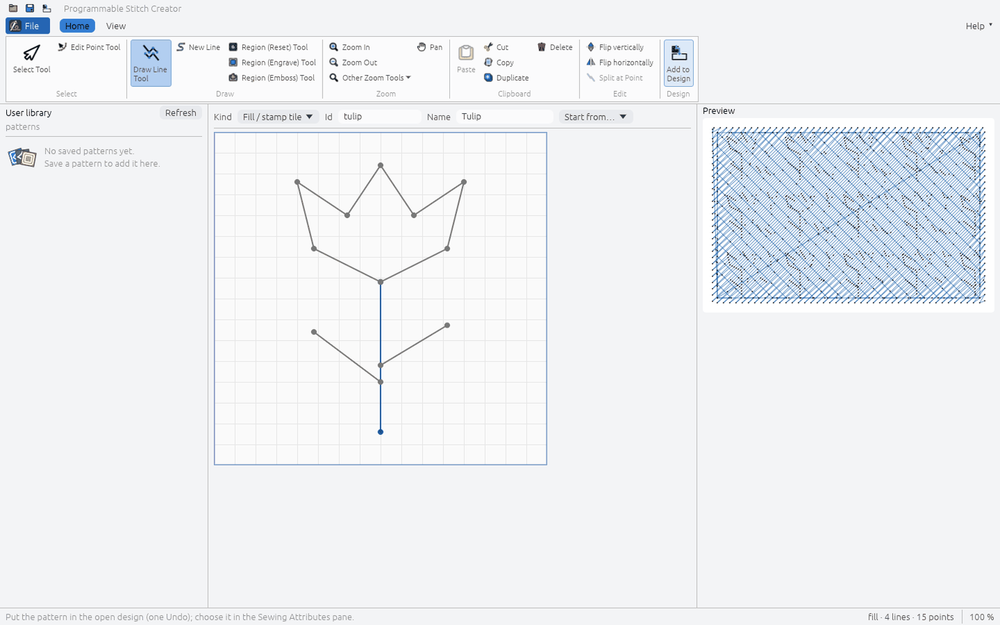
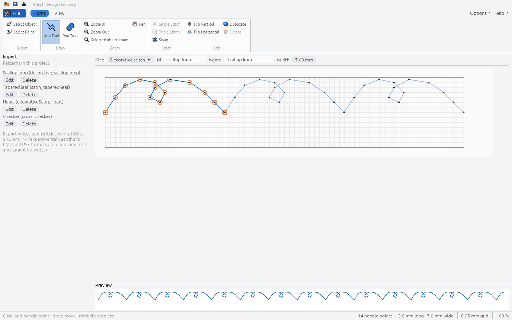
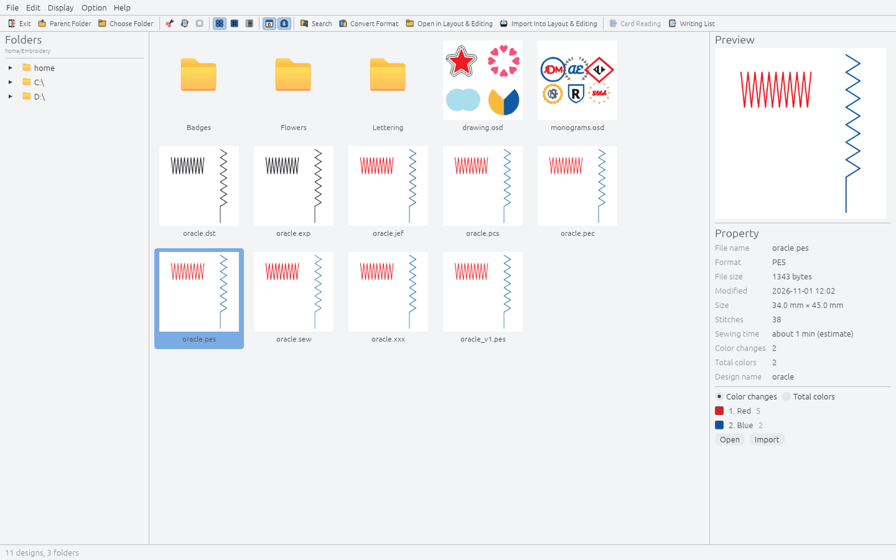

# Editor window layout

The OpenStitch editor arranges its commands the way the Layout & Editing window of Brother
PE-DESIGN 11 does, so people moving from it find each command where they expect it. The
arrangement, command names and workflow follow Brother's public online guide:
[Layout & Editing Window](https://support.brother.com/g/s/hf/htmldoc/ped/im/ped11/en/PED11_EN/pages/03_1245825.html),
[Ribbon menu tabs](https://support.brother.com/g/s/hf/htmldoc/ped/im/ped11/en/PED11_EN/pages/04_2156079.html)
and [Application button menu](https://support.brother.com/g/s/hf/htmldoc/ped/im/ped11/en/PED11_EN/pages/04_2152475.html).
Icons, colours and visual style are OpenStitch's own (see
[LEGAL_AND_LICENSING.md](LEGAL_AND_LICENSING.md#user-interface)).

| Guide element | OpenStitch |
|---|---|
| 1 Application button | **File** button at the top left: New, Open, Save, Save As, Print ▸, Design Property, Design Settings, Fabric Selector, Select Color Palette, Wizard ▸, Export ▸, Recent Files, Options, Exit ([screenshot](images/rust-editor-appmenu.png)) |
| 2 Ribbon | Tabs Home, Image, View plus contextual tabs (orange) for the active tool or selection; large and small buttons, dropdown arrows, group captions, ScreenTips with shortcuts |
| 3 Quick Access Toolbar | Above the ribbon (or below it, Options ▸ or ▾ ▸ Show below the Ribbon): New, Open, Save, Undo, Redo, Zoom, Help by default; ▾ adds or removes commands. Saved in `ui.json` next to the user settings file |
| 4 Option button | **Options ▾** at the top right: Design Database, Programmable Stitch Creator, Stitch Design Factory, Font Creator, Sewing Attribute Sets, User Thread Charts, colour theme (Light, Dark, System) |
| 5 Help button | **Help ▾**: instruction manual (this repository), Ready-to-Sew Designs (the kit packaged with the app, `examples/sew`; GitHub when none is packaged), Ready-to-Sew Designs Online, keyboard shortcuts, About |
| 6 Sewing Order pane | Docked left: buttons at the top (sew first / earlier / later / last, sort by colour, optimise, frames by thread colour), one frame per object with a thumbnail and its thread colours; drag to reorder |
| 7 Import / Color / Sewing Attributes / Text Attributes | Docked right as four tabs |
| 8 Stitch Simulator pane | Docked under the work area |
| 9–10 Design Page, work area | White page on a grey work area (light theme) |
| 11 Status bar | Design size, stitch count, the ScreenTip of the command under the pointer or the active tool's hint |
| 12–15 View mode, Show grid, Design Property, zoom | Right of the status bar: Solid / Stitch / Realistic, Show Grid, Design Property, zoom percentage (type or drag) and zoom slider |

Panes 6, 7 and 8 are shown or hidden from View ▸ Show/Hide or their × button, and float as a
window (⧉) or dock again (⊟ Dock) ([screenshot](images/rust-editor-floating-panes.png)).

Commands OpenStitch does not implement yet are shown disabled, with a ScreenTip that says
"Not yet available in OpenStitch", rather than left out. The tables below are the model in
`crates/openstitch-app/src/editor/ribbon.rs`; `ribbon::tests` and the binary's
`ribbon::tests` check that every button runs an existing action or is marked unavailable, that
each engine command named exists, and that the contextual tabs follow the tool and selection.

## View, Image and Text commands

Behaviour follows the guide's pages
[Changing the display of the embroidery design](https://support.brother.com/g/s/hf/htmldoc/ped/im/ped11/en/PED11_EN/pages/04_2051337.html),
[Specifying Basic Display Settings](https://support.brother.com/g/s/hf/htmldoc/ped/im/ped11/en/PED11_EN/pages/03_1246217.html),
[Changing the size, angle and position of the image](https://support.brother.com/g/s/hf/htmldoc/ped/im/ped11/en/PED11_EN/pages/06_1804142.html),
[Saving the image data](https://support.brother.com/g/s/hf/htmldoc/ped/im/ped11/en/PED11_EN/pages/06_1804194.html),
[Setting text attributes](https://support.brother.com/g/s/hf/htmldoc/ped/im/ped11/en/PED11_EN/pages/05_1810676.html) (Font Filter) and
[Using Fabric Selector](https://support.brother.com/g/s/hf/htmldoc/ped/im/ped11/en/PED11_EN/pages/03_1246198.html).

- **Solid View** draws every stitch 0.7 mm wide without shading, so the rows of a region merge
  into flat areas of thread colour. Solid, Stitch and Realistic are exclusive (ribbon and status
  bar).
- **Realistic View Settings**: thread width (0.2–1 mm, default 0.4), contrast and brightness
  (−100–100), shown at once and kept in `ui.json`; Default restores them.
- **Show Grid with Axes**: on, the grid is drawn with solid lines; off, dotted.
- **Guideline** (also turns the rulers on): click or drag on the top ruler for a vertical
  guideline, on the left ruler for a horizontal one; drag its marker in the ruler to move it,
  click the × beside the marker (or drop it outside the canvas) to delete it. With Show Grid and
  Snap to Grid on, guidelines move in grid steps. The status bar shows the position while
  dragging. Up to 100 per ruler; they are saved in the `.osd` (`guides.set`, one Undo per
  change) and hidden when Ruler or Guideline is off.
- **Save Image** ▸ to File… writes the background image as shown (turned, cropped, colours
  adjusted) as PNG, BMP or JPEG (`background.save`); ▸ to Clipboard copies it.
- **Modify Image** opens a window with the image's position and width (the height keeps its
  proportions), a crop of each side (the kept part stays where it was, at the same scale),
  brightness, contrast and saturation; the image is outlined in red while the window is open.
  Each change is one `background.modify` (one Undo); the image file is never changed.
- **Rotate Right / Left** turn the background image 90° about its centre (`background.rotate`).
- **Font Filter Settings** lists the built-in fonts and the fonts in the design with check
  boxes (All / None per group, Default shows every font); OK turns the filter on. **Font
  Filter** switches filtering on and off; it applies to every font list. A filter that would
  hide every font is ignored. Both are kept in `ui.json`.
- **Fabric Selector** (Application menu): pick a fabric type to read a description and advice
  and see the recommended settings; OK applies them to every shape and text pattern on the
  Design Page, or, with the check box cleared, to the selected ones (`fabric.apply`, one Undo).
  It sets the density, stitch length, pull compensation and underlay of fill, programmable
  fill and satin regions; colours and sew types stay. The values are OpenStitch's own
  approximations (`openstitch_engine::fabric::FABRICS`), not PE-DESIGN's.

## Where the previous menus went

| Previous menu item | Now |
|---|---|
| File ▸ New, Open, Save, Save As, Print, Export, Quit | Application menu (Print ▸ Print: system print dialog or Save PDF; Export ▸, Exit) |
| File ▸ Import into design, Import SVG | Home ▸ Import |
| File ▸ Background Image (choose, paste, show/hide, opacity, remove) | Image ▸ Open Image, Paste Image, Background Image Density, Delete Image |
| File ▸ Export Sections, Send to USB Media | Home ▸ Sew ▸ Sew Embroidery; Hoop Settings tab; Application menu ▸ Export ▸ |
| File ▸ Design Database | Options ▸ Design Database |
| Edit ▸ Undo, Redo | Quick Access Toolbar (⌘/Ctrl+Z, ⌘/Ctrl+Y) |
| Edit ▸ Select All, Duplicate, Delete, Arrange Copies | Home ▸ Select, Clipboard |
| Edit ▸ Group, Ungroup | Home ▸ Edit |
| Edit ▸ Copy / Paste Attributes | Sewing Attributes pane |
| Edit ▸ Sewing Attribute Sets, User Thread Charts | Options ▸; Application menu ▸ Select Color Palette |
| Shapes ▸ Insert presets | Home ▸ Tools ▸ Shapes ▸ Insert Preset Shape |
| Shapes ▸ Merge, Remove Overlap, Combine | Home ▸ Edit ▸ Modify Overlap |
| Shapes ▸ Split with Outline, Sewing Direction, Entry/Exit Points | Shapes tab ▸ Split Outline, Add/Delete Direction Line, Center/Reference Point, Entry/Exit Points |
| Shapes ▸ Offset Lines, Floral Pattern | Shapes tab ▸ Create |
| Shapes ▸ Decorative Frame, Stamp/Emboss | Home ▸ Edit |
| Lettering ▸ Text, Monogram, Name Drop List, Template Wizard, Save as Template, Fonts, Load TrueType Font | Home ▸ Tools ▸ Text ▾ (and Text tab, Text Attributes pane) |
| Convert ▸ Convert to Stitch Pattern, Region to Line, to Outline/Blocks | Text, Shapes and Stitches tabs |
| Stitches ▸ Divide by Colour, Split at Point, Connect, Split Off Area | Stitches tab |
| Design ▸ Design Settings, Image to Embroidery, pattern wizards | Application menu ▸ Design Settings, Wizard ▸; Image tab; Home ▸ Wizards |
| Tools ▸ Programmable Stitch Creator, Stitch Design Factory | Options ▸ |
| View ▸ Fit, travel, realistic, rulers, grid, snap to grid, grid spacing, reference window, measure | Home ▸ Tools ▸ Zoom ▾, Measure; View tab |
| Toolbar tools and hints | Home ▸ Select / Tools, contextual tabs; hints in the status bar |

## Commands by tab

### Home

| Group | Command | Shortcut | OpenStitch action | Engine command | Available |
|---|---|---|---|---|---|
| Select | Select | `V` | `Action::SelectTool` | view/UI only | yes |
| Select | Point Edit | `A` | `Action::PointTool` | `object.setPoint` | yes |
| Select | Select All | `Ctrl+A` | `Action::SelectAll` | view/UI only | yes |
| Clipboard | Paste | `Ctrl+V` | `Action::Paste` | `object.duplicate` | yes |
| Clipboard | Cut | `Ctrl+X` | `Action::Cut` | `object.delete`, then `object.paste` on Paste | yes |
| Clipboard | Copy | `Ctrl+C` | `Action::Copy` | view/UI only | yes |
| Clipboard | Duplicate | `Ctrl+D` | `Action::Duplicate` | `object.duplicate` | yes |
| Clipboard | Delete | `Delete` | `Action::Delete` | `object.delete` | yes |
| Clipboard | Arrange Copy |  | `Action::ArrangeCopy` | `object.arrangeCopies` | yes |
| Tools | Text |  | `Action::TextTools` | `text.add` | yes |
| Tools | Shapes |  | `Action::ShapesTools` | `shape.preset` | yes |
| Tools | Zoom In | `Ctrl+=` | `Action::ZoomIn` | view/UI only | yes |
| Tools | Zoom Out | `Ctrl+-` | `Action::ZoomOut` | view/UI only | yes |
| Tools | Zoom | `Ctrl+0` | `Action::OtherZoom` | view/UI only | yes |
| Tools | Pan | `H` | `Action::Pan` | view/UI only | yes |
| Tools | Measure | `M` | `Action::Measure` | `design.measure` | yes |
| Import | Import Patterns | `Ctrl+Shift+I` | `Action::ImportPatterns` | `stitches.import` | yes |
| Import | Import SVG |  | `Action::ImportSvg` | `import.svg` | yes |
| Edit | Arrange |  | `Action::Arrange` | `order.move` | yes |
| Edit | Rotate/Flip |  | `Action::RotateFlip` | `object.rotate` | yes |
| Edit | Size |  | `Action::Size` | `object.scale` | yes |
| Edit | Group | `Ctrl+G` | `Action::Group` | `object.group` | yes |
| Edit | Ungroup | `Ctrl+Shift+G` | `Action::Ungroup` | `object.ungroup` | yes |
| Edit | Fit Text ▾ (Fit Text to Outline…, Release Text from Outline) |  | `Action::FitTextToOutline` | `text.setPath` | yes |
| Edit | Stamp/Emboss |  | `Action::StampEmboss` | `shape.emboss` | yes |
| Edit | Modify Overlap |  | `Action::ModifyOverlap` | `shape.combine` | yes |
| Edit | Decorative Frame |  | `Action::DecorativeFrame` | `shape.decorative` | yes |
| Wizards | Background fill |  | `Action::BackgroundFill` | `wizard.backgroundFill` | yes |
| Wizards | Applique Wizard |  | `Action::Applique` | `wizard.applique` | yes |
| Wizards | Embroidered Patch Wizard |  | `Action::Patch` | `wizard.patch` | yes |
| Wizards | Cutwork Wizard |  | `Action::Cutwork` | `wizard.cutwork` | yes |
| Sew | Sew Embroidery |  | `Action::SendEmbroidery` | `transfer.send` | yes |

### Image

| Group | Command | Shortcut | OpenStitch action | Engine command | Available |
|---|---|---|---|---|---|
| Image | Open Image |  | `Action::OpenImage` | `background.set` | yes |
| Image | Paste Image |  | `Action::PasteImage` | `background.set` | yes |
| Image | Save Image |  | `Action::SaveImage` | `background.save` | yes |
| Image | Modify Image |  | `Action::ModifyImage` | `background.modify` | yes |
| Image | Background Image Density |  | `Action::ImageDensity` | `background.show` | yes |
| Image | Rotate Right |  | `Action::ImageRotateRight` | `background.rotate` | yes |
| Image | Rotate Left |  | `Action::ImageRotateLeft` | `background.rotate` | yes |
| Image | Delete Image |  | `Action::DeleteImage` | `background.clear` | yes |
| Image to Stitch | Auto Punch Wizard |  | `Action::AutoPunch` | `digitize.autoPunch` | yes |
| Image to Stitch | Cross Stitch Wizard |  | `Action::CrossStitch` | `digitize.crossStitch` | yes |
| Image to Stitch | Photo Stitch 1 Wizard |  | `Action::PhotoStitch1` | `digitize.photoStitch` | yes |
| Image to Stitch | Photo Stitch 2 Wizard |  | `Action::PhotoStitch2` | `digitize.lineImage` | yes |
| Design Center | Import to Design Center |  | `Action::DesignCenter` | `digitize.designCenter` | yes |

### View

| Group | Command | Shortcut | OpenStitch action | Engine command | Available |
|---|---|---|---|---|---|
| View | Solid View |  | `Action::SolidView` | view/UI only | yes |
| View | Stitch View |  | `Action::StitchView` | view/UI only | yes |
| View | Realistic View |  | `Action::RealisticView` | view/UI only | yes |
| View | View Thread Trimming |  | `Action::ViewThreadTrimming` | view/UI only | yes |
| View | Realistic View Settings |  | `Action::RealisticSettings` | view/UI only | yes |
| Show/Hide | Sewing Order |  | `Action::PaneSewingOrder` | view/UI only | yes |
| Show/Hide | Stitch Simulator |  | `Action::PaneSimulator` | view/UI only | yes |
| Show/Hide | Attributes Setting |  | `Action::PaneAttributes` | view/UI only | yes |
| Show/Hide | Import Pane |  | `Action::PaneImport` | view/UI only | yes |
| Show/Hide | Reference Window |  | `Action::ReferenceWindow` | view/UI only | yes |
| Grid | Show Grid |  | `Action::ShowGrid` | view/UI only | yes |
| Grid | Show Grid with Axes |  | `Action::GridAxes` | view/UI only | yes |
| Grid | Snap to Grid |  | `Action::SnapToGrid` | view/UI only | yes |
| Grid | Grid Spacing |  | `Action::GridSpacing` | view/UI only | yes |
| Ruler | Ruler |  | `Action::Ruler` | view/UI only | yes |
| Guideline | Guideline |  | `Action::Guideline` | `guides.set` | yes |

### Text (contextual: text selected)

| Group | Command | Shortcut | OpenStitch action | Engine command | Available |
|---|---|---|---|---|---|
| Select | Select | `V` | `Action::SelectTool` | view/UI only | yes |
| Select | Point Edit | `A` | `Action::PointTool` | `object.setPoint` | yes |
| Select | Select All | `Ctrl+A` | `Action::SelectAll` | view/UI only | yes |
| Text | Text |  | `Action::TextTools` | `text.add` | yes |
| Text | Font |  | `Action::Font` | `object.setText` | yes |
| Text | Text Size |  | `Action::TextSize` | `object.setText` | yes |
| Text | Font Filter |  | `Action::FontFilter` | view/UI only | yes |
| Text | Font Filter Settings |  | `Action::FontFilterSettings` | view/UI only | yes |
| Text | TrueType Font Attribute Setting |  | `Action::TrueTypeAttributes` | `fonts.loadTrueType` | yes |
| Color / Sew Type | Line color |  | `Action::LineColor` | `object.setLine` | yes |
| Color / Sew Type | Line sew type |  | `Action::LineSewType` | `object.setLine` | yes |
| Color / Sew Type | Region color |  | `Action::RegionColor` | `object.setRegion` | yes |
| Color / Sew Type | Region sew type |  | `Action::RegionSewType` | `object.setRegion` | yes |
| Edit | Edit Text |  | `Action::EditText` | `object.setText` | yes |
| Edit | Fit Text ▾ (Fit Text to Outline…, Release Text from Outline) |  | `Action::FitTextToOutline` | `text.setPath` | yes |
| Edit | Edit Character |  | `Action::EditCharacter` | `text.setCharacter` | yes |
| Edit | Convert to Blocks |  | `Action::ConvertToBlocks` | `object.toShapes` | yes |
| Edit | Convert to Stitches |  | `Action::ConvertToStitches` | `object.toStitches` | yes |
| Edit | Convert to Outline |  | `Action::ConvertToOutline` | `object.toShapes` | yes |

### Outline — Shapes (Outline) (contextual: an Outline tool: straight line, curve or pencil)

| Group | Command | Shortcut | OpenStitch action | Engine command | Available |
|---|---|---|---|---|---|
| Select | Select | `V` | `Action::SelectTool` | view/UI only | yes |
| Select | Point Edit | `A` | `Action::PointTool` | `object.setPoint` | yes |
| Select | Select All | `Ctrl+A` | `Action::SelectAll` | view/UI only | yes |
| Shapes | Closed Straight Line | `P` | `Action::ClosedStraight` | `shape.polygon` | yes |
| Shapes | Closed Curve | `B` | `Action::ClosedCurve` | `shape.path` | yes |
| Shapes | Pencil (Closed Curve) |  | `Action::PencilClosed` | `shape.freehand` | yes |
| Shapes | Open Straight Line | `L` | `Action::OpenStraight` | `shape.polygon` (`closed: false`) | yes |
| Shapes | Open Curve |  | `Action::OpenCurve` | `shape.path` | yes |
| Shapes | Pencil (Open Curve) |  | `Action::PencilOpen` | `shape.freehand` (`closed: false`) | yes |
| Color / Sew Type | Line color |  | `Action::LineColor` | `object.setLine` | yes |
| Color / Sew Type | Line sew type |  | `Action::LineSewType` | `object.setLine` | yes |
| Color / Sew Type | Region color |  | `Action::RegionColor` | `object.setRegion` | yes |
| Color / Sew Type | Region sew type |  | `Action::RegionSewType` | `object.setRegion` | yes |

### Outline — Shapes (Rectangle) (contextual: Rectangle tool)

| Group | Command | Shortcut | OpenStitch action | Engine command | Available |
|---|---|---|---|---|---|
| Select | Select | `V` | `Action::SelectTool` | view/UI only | yes |
| Select | Point Edit | `A` | `Action::PointTool` | `object.setPoint` | yes |
| Select | Select All | `Ctrl+A` | `Action::SelectAll` | view/UI only | yes |
| Shapes | Rectangle | `R` | `Action::Rectangle` | `shape.rectangle` | yes |
| Shapes | Edge radius |  | `Action::EdgeRadius` | `shape.rectangle` (`cornerRadius`) | yes |
| Color / Sew Type | Line color |  | `Action::LineColor` | `object.setLine` | yes |
| Color / Sew Type | Line sew type |  | `Action::LineSewType` | `object.setLine` | yes |
| Color / Sew Type | Region color |  | `Action::RegionColor` | `object.setRegion` | yes |
| Color / Sew Type | Region sew type |  | `Action::RegionSewType` | `object.setRegion` | yes |

### Manual Punch (contextual: a Manual Punch tool)

| Group | Command | Shortcut | OpenStitch action | Engine command | Available |
|---|---|---|---|---|---|
| Select | Select | `V` | `Action::SelectTool` | view/UI only | yes |
| Select | Point Edit | `A` | `Action::PointTool` | `object.setPoint` | yes |
| Select | Select All | `Ctrl+A` | `Action::SelectAll` | view/UI only | yes |
| Manual Punch | Straight Block | `U` | `Action::StraightBlock` | `shape.column` | yes |
| Manual Punch | Curved Block |  | `Action::CurvedBlock` | `shape.column` (`curved: true`) | yes |
| Manual Punch | Running |  | `Action::Running` | `shape.polygon` (`closed: false`) | yes |
| Manual Punch | Feed |  | `Action::Feed` | `shape.feed` | yes |
| Manual Punch | Satin Skeleton |  | `Action::SatinSkeleton` | `shape.skeletonSatin`; `object.setSkeleton` (editing) | yes |
| Manual Punch | Column width |  | `Action::SkeletonWidth` | `shape.skeletonSatin` (`widths`) | yes |
| Color / Sew Type | Region color |  | `Action::RegionColor` | `object.setRegion` | yes |
| Color / Sew Type | Region sew type |  | `Action::RegionSewType` | `object.setRegion` | yes |

### Shapes — Shapes/Circle/Arc (contextual: shape selected, Circle or Point Edit tool)

| Group | Command | Shortcut | OpenStitch action | Engine command | Available |
|---|---|---|---|---|---|
| Select | Select | `V` | `Action::SelectTool` | view/UI only | yes |
| Select | Point Edit | `A` | `Action::PointTool` | `object.setPoint` | yes |
| Select | Select All | `Ctrl+A` | `Action::SelectAll` | view/UI only | yes |
| Edit Outline | Split Outline |  | `Action::SplitOutline` | `shape.split` | yes |
| Edit Outline | Add Direction Line |  | `Action::AddDirectionLine` | `object.setDirectionCurve` | yes |
| Edit Outline | Delete Direction Line |  | `Action::DeleteDirectionLine` | `object.setDirectionLines` | yes |
| Edit Outline | Reverse Direction Line |  | `Action::ReverseDirectionLine` | `object.reverseDirection` | yes |
| Edit Outline | Edit Point | `A` | `Action::EditPoint` | `object.setPoint` | yes |
| Edit Outline | Delete Point | `Delete` | `Action::DeletePoint` | `object.deletePoint` | yes |
| Edit Outline | Split at Point |  | `Action::SplitAtPoint` | `stitches.splitAt` | yes |
| Edit Outline | Satin Skeleton from Shape |  | `Action::DeriveSkeleton` | `object.deriveSkeleton` | yes |
| Color / Sew Type | Line color |  | `Action::LineColor` | `object.setLine` | yes |
| Color / Sew Type | Line sew type |  | `Action::LineSewType` | `object.setLine` | yes |
| Color / Sew Type | Region color |  | `Action::RegionColor` | `object.setRegion` | yes |
| Color / Sew Type | Region sew type |  | `Action::RegionSewType` | `object.setRegion` | yes |
| Convert | Convert Region to Line |  | `Action::ConvertRegionToLine` | `object.regionToLine` | yes |
| Convert | Convert to Stitches |  | `Action::ConvertToStitches` | `object.toStitches` | yes |
| Create | Create Offset Lines |  | `Action::OffsetLines` | `shape.offsetLines` | yes |
| Create | Create Floral Pattern |  | `Action::FloralPattern` | `shape.floral` | yes |
| Create | Entry/Exit Points |  | `Action::EntryExit` | `object.setEntryExit` | yes |
| Create | Center/Reference Point |  | `Action::SewingPoints` | `object.setCenterPoint` | yes |

### Stitches (contextual: stitch pattern selected)

| Group | Command | Shortcut | OpenStitch action | Engine command | Available |
|---|---|---|---|---|---|
| Select | Select | `V` | `Action::SelectTool` | view/UI only | yes |
| Select | Point Edit | `A` | `Action::PointTool` | `object.setPoint` | yes |
| Select | Select All | `Ctrl+A` | `Action::SelectAll` | view/UI only | yes |
| Edit | Split Stitch Data |  | `Action::SplitStitchData` | `stitches.splitArea` | yes |
| Edit | Change Color |  | `Action::ChangeColor` | `stitches.setThread` | yes |
| Edit | Divide by Color |  | `Action::DivideByColor` | `stitches.divideByColor` | yes |
| Edit | Split at Point |  | `Action::SplitAtPoint` | `stitches.splitAt` | yes |
| Edit | Connect |  | `Action::Connect` | `stitches.connect` | yes |
| Convert | Convert to Blocks |  | `Action::ConvertToBlocks` | `object.toShapes` | yes |
| Convert | Convert to Outline |  | `Action::ConvertToOutline` | `object.toShapes` | yes |
| Convert | Convert to Outlines |  | `Action::ConvertToOutlines` | `object.toShapes` | yes |

### Hoop Settings (contextual: design larger than the hoop)

| Group | Command | Shortcut | OpenStitch action | Engine command | Available |
|---|---|---|---|---|---|
| Select | Select | `V` | `Action::SelectTool` | view/UI only | yes |
| Select | Point Edit | `A` | `Action::PointTool` | `object.setPoint` | yes |
| Select | Select All | `Ctrl+A` | `Action::SelectAll` | view/UI only | yes |
| Hoop Settings | Move Sections |  | `Action::MoveSections` | `sections.set` (`splitsX` / `splitsY`) | yes |
| Hoop Settings | Design Settings |  | `Action::DesignSettings` | `machine.set` | yes |
| Hoop Settings | Export Sections |  | `Action::ExportSections` | `sections.export` | yes |

### How the drawing and editing commands work

Behaviour follows the guide pages
[Drawing outlines](https://support.brother.com/g/s/hf/htmldoc/ped/im/ped11/en/PED11_EN/pages/04_1835552.html),
[Using Manual Punch Tool](https://support.brother.com/g/s/hf/htmldoc/ped/im/ped11/en/PED11_EN/pages/07_1892457.html),
[Specifying the straight sewing direction](https://support.brother.com/g/s/hf/htmldoc/ped/im/ped11/en/PED11_EN/pages/04_1869360.html)
and [Adjusting the split positions](https://support.brother.com/g/s/hf/htmldoc/ped/im/ped11/en/PED11_EN/pages/07_1925948.html).

- **Cut** removes the selection (one Undo) and keeps it; **Paste** adds it back where it was
  (`object.paste`). After Copy, Paste duplicates the copied objects as before.
- **Open Straight Line** (`L`): click the points; double-click or Return ends the line (it never
  closes on the first point). **Pencil**: press and drag; releasing ends the stroke. The trail
  is simplified to within about 1.5 screen points and smoothed into Bézier curves; turns
  sharper than 75° stay corners (`shape.freehand`, `tolerance`).
- **Edge radius** sets the corner radius of the rectangles drawn next with the Rectangle tool.
- **Curved Block** is clicked like Straight Block (both ends of each direction line); the sides
  curve through the ends and the stitching follows them. **Running** and **Feed**: click the
  points, double-click or Return ends; Running makes a running-stitch line, Feed a pattern of
  jump stitches only (the frame moves, the thread is not cut). Each Manual Punch part is its
  own pattern; switching tools ends the part (the guide switches within one input).
- **Reverse Direction Line** reverses every direction line of the selected shape (or turns a
  single sewing direction by 180°).
- **Satin Skeleton** (Manual Punch tab; OpenStitch's own tool, PE-DESIGN has no direct
  equivalent): click the centre line of a satin column like the Closed/Open Curve pen (click
  for a corner, drag for a smooth point); every point carries a column width, shown as a
  handle on either side of the line, and dragging a handle sets that point's width. New points
  take **Column width**. Double-click or Return ends the line as one satin object sewn
  perpendicular to it (`shape.skeletonSatin`; curves are flattened, widths interpolated
  between the points). With nothing being drawn the tool shows the selected object's
  skeleton: dragging a width handle or a centre point is one `object.setSkeleton` (the outline
  follows when it is the column's own).
- **Satin Skeleton from Shape** (Shapes ▸ Edit Outline) sews the selected shape as satin along
  a centre line derived from its outline — an approximation of the medial axis (grid
  clearance, the longest path through the shape, corner ends trimmed; branches are not
  followed). Edit the result with the Satin Skeleton tool.
- **Change Color** lists the selected stitch pattern's threads; pick one and its new colour.
- **Editing characters** (after the guide's
  [Editing individual characters](https://support.brother.com/g/s/hf/htmldoc/ped/im/ped11/en/PED11_EN/pages/05_1904502.html)):
  with **Point Edit** on the selected text, click a character to select it; its box gets the
  usual handles. Drag inside it to move the character (Shift locks one axis), the top handle
  to turn it about its middle (Shift: 15° steps), any other handle to resize it (its capital
  height). Each drag is one `text.setCharacter`, so one Undo; moves follow the text's own
  direction when it is rotated, mirrored, on a path or in a Name Drop box. **Text ▸ Edit
  Character** shows the selected character's offset, rotation and size to type, and resets
  it. One character at a time (the guide also selects several).
- **Move Sections** (on/off) lets you drag the red split lines of a split design; releasing
  sets the new split position. Positions that would make a section larger than the hoop
  allows are refused and the status bar says why.

### Application menu

| Command | Shortcut | OpenStitch action | Engine command | Available |
|---|---|---|---|---|
| New | `Ctrl+N` | `Action::New` | `design.new` | yes |
| Open | `Ctrl+O` | `Action::Open` | `project.open` | yes |
| Save | `Ctrl+S` | `Action::Save` | `project.save` | yes |
| Save As | `Ctrl+Shift+S` | `Action::SaveAs` | `project.save` | yes |
| Print |  | `Action::Print` | `design.print` | yes |
| Design Property |  | `Action::DesignProperty` | `design.info` | yes |
| Design Settings |  | `Action::DesignSettings` | `machine.set` | yes |
| Fabric Selector |  | `Action::FabricSelector` | `fabric.apply` | yes |
| Select Color Palette |  | `Action::SelectColorPalette` | `threads.charts` | yes |
| Wizard |  | `Action::Wizard` | view/UI only | yes |
| Export |  | `Action::Export` | `design.export` | yes |
| Exit |  | `Action::Exit` | view/UI only | yes |

**Unsaved changes.** The title bar shows a `•` after the design's name while it has changes
that are not saved. Closing the window (the X button, Alt+F4, File ▸ Exit), File ▸ New and
File ▸ Open (also a recent file, or Open in Layout & Editing from the Design Database) then
ask "Save changes to NAME?" ([screenshot](images/rust-editor-close-prompt.png)): **Save**
(Enter) saves (Save As when the design has no file yet) and goes on, **Don't Save** goes on
and discards the changes, **Cancel** (Esc) returns to the editor. A cancelled Save As returns
to the editor too. As PE-DESIGN 11 does. On macOS Cmd+Q and Cmd+W close through the same
prompt, also while the Design Database, Stitch Creator or Stitch Design Factory fills the
window: the editor installs no default application menu (its Quit would terminate the app
without asking, and its items were named after the process, "Quit openstitch"), so Cmd+M
minimises through the editor and Cmd+H, About, Services and Hide Others are not available
from a menu (Help ▸ About OpenStitch stays; see docs/DISTRIBUTION.md "macOS application
menu").

### Option button

| Command | Shortcut | OpenStitch action | Engine command | Available |
|---|---|---|---|---|
| Design Database |  | `Action::DesignDatabase` | `library.list` | yes |
| Programmable Stitch Creator |  | `Action::StitchCreator` | `pattern.define` | yes |
| Stitch Design Factory |  | `Action::StitchDesignFactory` | `sewing.define` | yes |
| Font Creator |  | `Action::FontCreator` | `fonts.create` | yes |
| Sewing Attribute Sets |  | `Action::AttributeSets` | `attributes.save` | yes |
| User Thread Charts |  | `Action::UserThreadCharts` | `threads.createChart` | yes |

### Quick Access Toolbar (default)

| Command | Shortcut | OpenStitch action | Engine command | Available |
|---|---|---|---|---|
| New | `Ctrl+N` | `Action::New` | `design.new` | yes |
| Open | `Ctrl+O` | `Action::Open` | `project.open` | yes |
| Save | `Ctrl+S` | `Action::Save` | `project.save` | yes |
| Undo | `Ctrl+Z` | `Action::Undo` | `history.undo` | yes |
| Redo | `Ctrl+Y` | `Action::Redo` | `history.redo` | yes |
| Zoom | `Ctrl+0` | `Action::OtherZoom` | view/UI only | yes |
| Help |  | `Action::Help` | view/UI only | yes |

## Other suite windows

Design Database, Programmable Stitch Creator and Stitch Design Factory are separate programs in
the suite OpenStitch is compatible with. OpenStitch opens each from the Option button
(**Options ▾**) and shows it in place of Layout & Editing until its **Exit** (Application menu or
toolbar) returns there; the window title names the program. Their commands follow the guide
pages linked under each heading and are the model in
`crates/openstitch-app/src/editor/suite.rs`; the binary draws them with the same ribbon code as
the editor (`ribbon::button`, `ribbon::group`, `ribbon::body`, `suite_chrome.rs`). As in the
editor, commands OpenStitch lacks are shown disabled with a "Not yet available in OpenStitch"
ScreenTip. `suite::tests` check every command has a place, a ScreenTip and an existing engine
command; the binary's `suite_chrome::tests` run every command (or draw its list) or check it is
marked unavailable. Group names are OpenStitch's where the guide shows the ribbon only as a
picture.

### Programmable Stitch Creator

Guide: [Programmable Stitch Creator Window](https://support.brother.com/g/s/hf/htmldoc/ped/im/ped11/en/PED11_EN/pages/12_1155973.html),
[Application button menu](https://support.brother.com/g/s/hf/htmldoc/ped/im/ped11/en/PED11_EN/pages/12_1170101.html),
[Ribbon menu tabs](https://support.brother.com/g/s/hf/htmldoc/ped/im/ped11/en/PED11_EN/pages/12_1170222.html).

| Guide element | OpenStitch |
|---|---|
| Application button | **File**: New Fill/Stamp Pattern, New Motif Pattern, New Decorative Fill Pattern, Open, Save (to the user library folder), Save As (an `openstitch.pattern` file), Exit |
| Ribbon | Home and View tabs below |
| Quick Access Toolbar | Open, Save, Add to Design |
| Help button | **Help ▾** at the top right |
| Design Page, work area | The tile (or motif cell) with its grid and the neighbouring repeats; Kind, Id, Name (and Row shift) above it |
| Preview window | Right: the pattern sewn in a region (View ▸ Show/Hide Preview window) |
| Status bar | Tool hint or the ScreenTip under the pointer; kind, lines, points, zoom |

OpenStitch additions: **New Line** (Home ▸ Draw) starts another line of a fill or decorative
pattern; **Add to Design** (Home ▸ Design) puts the pattern in the open design in one Undo step,
where the Sewing Attributes pane offers it; the **User library** pane at the left lists saved
patterns (Edit, Add to Design, Delete file). Cut, Copy, Paste, Duplicate, Delete and the flips
work on the current line.

The Region tools click a closed area of a fill/stamp tile (the tile wraps, so a line leaving one
side closes at the other): Engrave shades it red, Emboss blue, Reset clears it; the areas travel
in the pattern's `regions` (docs/FILE_FORMATS.md) and programmable fill sews them engraved or
embossed. Split at Point splits the line at the point last clicked (fill/stamp tiles). The
template is an image of the user's own (PNG, JPEG, BMP), shown behind the tile and never saved
in the pattern; Modify Template drags it (its corner scales it), Background Image Density offers
Hide, 25, 50, 75 and 100 % (F6 steps through them). Guideline shows rulers along the top and
left: a click adds a guideline (on the grid while it is shown, at most 100 per ruler), a drag
moves it, a right-click deletes it. Pan drags the magnified Design Page.

#### Home

| Group | Command | Shortcut | OpenStitch action | Engine command | Available |
|---|---|---|---|---|---|
| Select | Select Tool |  | `CreatorAction::SelectTool` | view/UI only | yes |
| Select | Edit Point Tool |  | `CreatorAction::EditPoint` | view/UI only | yes |
| Draw | Draw Line Tool |  | `CreatorAction::DrawLine` | view/UI only | yes |
| Draw | New Line |  | `CreatorAction::NewLine` | view/UI only | yes |
| Draw | Region (Reset) Tool |  | `CreatorAction::RegionReset` | view/UI only | yes |
| Draw | Region (Engrave) Tool |  | `CreatorAction::RegionEngrave` | view/UI only | yes |
| Draw | Region (Emboss) Tool |  | `CreatorAction::RegionEmboss` | view/UI only | yes |
| Zoom | Zoom In | `Ctrl+=` | `CreatorAction::ZoomIn` | view/UI only | yes |
| Zoom | Zoom Out | `Ctrl+-` | `CreatorAction::ZoomOut` | view/UI only | yes |
| Zoom | Other Zoom Tools |  | `CreatorAction::OtherZoom` | view/UI only | yes |
| Zoom | Pan |  | `CreatorAction::Pan` | view/UI only | yes |
| Clipboard | Paste | `Ctrl+V` | `CreatorAction::Paste` | view/UI only | yes |
| Clipboard | Cut | `Ctrl+X` | `CreatorAction::Cut` | view/UI only | yes |
| Clipboard | Copy | `Ctrl+C` | `CreatorAction::Copy` | view/UI only | yes |
| Clipboard | Duplicate | `Ctrl+D` | `CreatorAction::Duplicate` | view/UI only | yes |
| Clipboard | Delete | `Delete` | `CreatorAction::Delete` | view/UI only | yes |
| Edit | Flip vertically |  | `CreatorAction::FlipVertical` | view/UI only | yes |
| Edit | Flip horizontally |  | `CreatorAction::FlipHorizontal` | view/UI only | yes |
| Edit | Split at Point |  | `CreatorAction::SplitAtPoint` | view/UI only | yes |
| Design | Add to Design |  | `CreatorAction::AddToDesign` | `pattern.define` | yes |

#### View

| Group | Command | Shortcut | OpenStitch action | Engine command | Available |
|---|---|---|---|---|---|
| Template | Open Template |  | `CreatorAction::OpenTemplate` | view/UI only | yes |
| Template | Modify Template |  | `CreatorAction::ModifyTemplate` | view/UI only | yes |
| Template | Delete Image |  | `CreatorAction::DeleteImage` | view/UI only | yes |
| Template | Background Image Density |  | `CreatorAction::ImageDensity` | view/UI only | yes |
| Show/Hide | Show/Hide Preview window |  | `CreatorAction::PreviewWindow` | view/UI only | yes |
| Show/Hide | Show/Hide Status Bar |  | `CreatorAction::StatusBar` | view/UI only | yes |
| Grid | Show Grid with Axes |  | `CreatorAction::GridAxes` | view/UI only | yes |
| Grid | Grid interval |  | `CreatorAction::GridInterval` | view/UI only | yes |
| Guideline | Guideline |  | `CreatorAction::Guideline` | view/UI only | yes |

#### Application menu

| Command | Shortcut | OpenStitch action | Engine command | Available |
|---|---|---|---|---|
| New Fill/Stamp Pattern |  | `CreatorAction::NewFill` | view/UI only | yes |
| New Motif Pattern |  | `CreatorAction::NewMotif` | view/UI only | yes |
| New Decorative Fill Pattern |  | `CreatorAction::NewDecorative` | view/UI only | yes |
| Open | `Ctrl+O` | `CreatorAction::Open` | `pattern.import` | yes |
| Save | `Ctrl+S` | `CreatorAction::Save` | view/UI only | yes |
| Save As | `Ctrl+Shift+S` | `CreatorAction::SaveAs` | `pattern.export` | yes |
| Exit |  | `CreatorAction::Exit` | view/UI only | yes |

#### Quick Access Toolbar and buttons

| Command | Shortcut | OpenStitch action | Engine command | Available |
|---|---|---|---|---|
| Open | `Ctrl+O` | `CreatorAction::Open` | `pattern.import` | yes |
| Save | `Ctrl+S` | `CreatorAction::Save` | view/UI only | yes |
| Add to Design |  | `CreatorAction::AddToDesign` | `pattern.define` | yes |
| Help |  | `CreatorAction::Help` | view/UI only | yes |

### Stitch Design Factory

Guide: [Stitch Design Factory Window](https://support.brother.com/g/s/hf/htmldoc/ped/im/ped11/en/PED11_EN/pages/14_1181468.html),
[Application button menu](https://support.brother.com/g/s/hf/htmldoc/ped/im/ped11/en/PED11_EN/pages/14_1209830.html),
[Ribbon menu tabs](https://support.brother.com/g/s/hf/htmldoc/ped/im/ped11/en/PED11_EN/pages/14_1207694.html).

| Guide element | OpenStitch |
|---|---|
| Application button | **File**: New ▸ (decorative, satin, decorative satin, cross), Open and Save As (`openstitch.sewing` files), Save (into the project, one Undo), Export (JSON, SVG, experimental PMV), Exit |
| Ribbon | Home and View tabs below |
| Quick Access Toolbar | Open, Save, Export |
| Options button | **Options ▾**: colour theme |
| Help button | **Help ▾** |
| Import pane | Left: the patterns kept in the project (Edit, Delete) |
| Preview pane | Bottom: the pattern repeated along a seam |
| Design area | The pattern with its width band, grid (Grid Spacing), the end of the first repeat and two more repeats, the start (blue square) and end (red square) points and the template image behind; landscape, or portrait with Horizontal Orientation off; Kind, Id, Name, Width and the kind's settings above it |
| Status bar | Tool hint or the ScreenTip under the pointer; template and its density, needle points, length, width, grid spacing, zoom |
| Stitch Simulator | A window: the editor simulator's controls (Play/Pause, start, previous/next needle point, end, slider, speed) sewing three repeats needle by needle |

Single Stitch and Triple Stitch apply to cross patterns (each diagonal once or three times).
Delete removes the selected point (Select Point tool, or the last point clicked), or the
template while Modify Template is on.
Select Object selects the whole pattern (the window edits one); dragging it or the arrow keys
move it by grid steps (Shift: straight), refused where it would leave the width band. The Pen
Tool adds needle points, satin stations or cross cells along a dragged stroke, or replaces a
decorative satin outline with it. Swap exchanges the start and end points (`swapped` in the
document: the same needle points sewn in reverse order). Duplicate puts a copy of the pattern
where it ends (not decorative satin, one outline). Selected object zoom fits the pattern to the
design area; Pan drags it. Templates are images of the user's own (PNG, JPEG, BMP, GIF, TIFF):
Modify Template draws a red frame (drag inside: move, its corner: scale, click outside or
Escape: finish), Template Density fades it (0 % hides it, F6 steps), Delete Image removes it.
Horizontal Orientation lays the page landscape (the feed running to the right, OpenStitch's
default); off, the feed runs upwards. Grid Spacing: 0.25, 0.5, 1, 2 or 5 mm, also what points
snap to.

#### Home

| Group | Command | Shortcut | OpenStitch action | Engine command | Available |
|---|---|---|---|---|---|
| Select | Select Object |  | `FactoryAction::SelectObject` | view/UI only | yes |
| Select | Select Point |  | `FactoryAction::SelectPoint` | view/UI only | yes |
| Draw | Line Tool |  | `FactoryAction::LineTool` | view/UI only | yes |
| Draw | Pen Tool |  | `FactoryAction::PenTool` | view/UI only | yes |
| Zoom | Zoom in | `Ctrl+=` | `FactoryAction::ZoomIn` | view/UI only | yes |
| Zoom | Zoom Out | `Ctrl+-` | `FactoryAction::ZoomOut` | view/UI only | yes |
| Zoom | Selected object zoom |  | `FactoryAction::SelectedZoom` | view/UI only | yes |
| Zoom | Pan |  | `FactoryAction::Pan` | view/UI only | yes |
| Stitch | Single Stitch |  | `FactoryAction::SingleStitch` | view/UI only | yes |
| Stitch | Triple Stitch |  | `FactoryAction::TripleStitch` | view/UI only | yes |
| Stitch | Swap |  | `FactoryAction::Swap` | `sewing.swap` | yes |
| Edit | Flip Vertical |  | `FactoryAction::FlipVertical` | view/UI only | yes |
| Edit | Flip Horizontal |  | `FactoryAction::FlipHorizontal` | view/UI only | yes |
| Edit | Duplicate | `Ctrl+D` | `FactoryAction::Duplicate` | `sewing.duplicate` | yes |
| Edit | Delete | `Delete` | `FactoryAction::Delete` | view/UI only | yes |

#### View

| Group | Command | Shortcut | OpenStitch action | Engine command | Available |
|---|---|---|---|---|---|
| Template | Open Template |  | `FactoryAction::OpenTemplate` | view/UI only | yes |
| Template | Modify Template |  | `FactoryAction::ModifyTemplate` | view/UI only | yes |
| Template | Delete Image |  | `FactoryAction::DeleteImage` | view/UI only | yes |
| Template | Template Density | `F6` | `FactoryAction::TemplateDensity` | view/UI only | yes |
| Display | Needle Drop Point |  | `FactoryAction::NeedleDropPoint` | view/UI only | yes |
| Display | Horizontal Orientation |  | `FactoryAction::HorizontalOrientation` | view/UI only | yes |
| Show/Hide | Import Pane |  | `FactoryAction::ImportPane` | `sewing.list` | yes |
| Show/Hide | Preview Window |  | `FactoryAction::PreviewWindow` | view/UI only | yes |
| Show/Hide | Status Bar |  | `FactoryAction::StatusBar` | view/UI only | yes |
| Grid | Show Grid |  | `FactoryAction::ShowGrid` | view/UI only | yes |
| Grid | Snap to Grid |  | `FactoryAction::SnapToGrid` | view/UI only | yes |
| Grid | Grid Spacing |  | `FactoryAction::GridSpacing` | view/UI only | yes |
| Simulator | Stitch Simulator |  | `FactoryAction::StitchSimulator` | view/UI only | yes |

#### Application menu

| Command | Shortcut | OpenStitch action | Engine command | Available |
|---|---|---|---|---|
| New |  | `FactoryAction::New` | view/UI only | yes |
| Open | `Ctrl+O` | `FactoryAction::Open` | `sewing.import` | yes |
| Save | `Ctrl+S` | `FactoryAction::Save` | `sewing.define` | yes |
| Save As | `Ctrl+Shift+S` | `FactoryAction::SaveAs` | view/UI only | yes |
| Export |  | `FactoryAction::Export` | `sewing.export` | yes |
| Exit |  | `FactoryAction::Exit` | view/UI only | yes |

#### Quick Access Toolbar and buttons

| Command | Shortcut | OpenStitch action | Engine command | Available |
|---|---|---|---|---|
| Open | `Ctrl+O` | `FactoryAction::Open` | `sewing.import` | yes |
| Save | `Ctrl+S` | `FactoryAction::Save` | `sewing.define` | yes |
| Export |  | `FactoryAction::Export` | `sewing.export` | yes |
| Help |  | `FactoryAction::Help` | view/UI only | yes |
| Options |  | `FactoryAction::Options` | view/UI only | yes |

### Design Database

Guide: [Design Database Window](https://support.brother.com/g/s/hf/htmldoc/ped/im/ped11/en/PED11_EN/pages/11_1142905.html), [List of menus](https://support.brother.com/g/s/hf/htmldoc/ped/im/ped11/en/PED11_EN/pages/11_1142946.html).

The guide gives the Design Database a classic menu bar and toolbar rather than a ribbon, so
OpenStitch does the same: menus File, Edit, Display, Option, Help in the guide's order, a toolbar
with the guide's icon buttons (Cut, Copy, Paste, Large Thumbnails, Small Thumbnails, Details,
Preview, Property) plus labelled ones, and a status bar.

| Guide element | OpenStitch |
|---|---|
| Toolbar | Exit, Parent Folder, Choose Folder · Cut, Copy, Paste · Large/Small Thumbnails, Details · Preview, Property · Search, Convert Format, Open in / Import Into Layout & Editing · Card Reading (Blocked), Writing List |
| Folder pane | Left: folder tree; drop files on a folder to move them there |
| Contents pane | Thumbnails or details of the folder; double-click opens in Layout & Editing |
| Preview and Property | Right; each shown or hidden from Display |
| Writing list, Send to selector | Transfer area under the contents (toolbar ▸ Writing List): Send To lists the USB media found; Add, Remove, Write; right-click Add to / Remove from Writing List, or drag designs into the list. Machine memory, wireless, original card and Link are listed disabled (Blocked: undocumented protocols) |
| Card reading button | Blocked: Brother has not published the USB card reader/writer protocol or the card data layout, and OpenStitch will not reverse-engineer them; the button stays disabled and its ScreenTip says why |
| Status bar | Folder summary or the ScreenTip under the pointer |

OpenStitch differences: File ▸ Print Setup opens the catalogue dialog (Print hands the PDF to
the system print dialog, Save keeps it), File ▸ Print prints with those options through the
system print dialog (on Linux, the PDF viewer), and Print Preview writes page images; File ▸ Rename (F2)
renames in every view; Option ▸ Application Color offers OpenStitch's Light, Dark and System
themes instead of Blue, Black, Silver and Aqua; Help ▸ Customer Support opens the project's issue
tracker.

#### File menu

| Command | Shortcut | OpenStitch action | Engine command | Available |
|---|---|---|---|---|
| Open in Layout & Editing | `Enter` | `DbAction::OpenInEditor` | `project.open` | yes |
| Import Into Layout & Editing |  | `DbAction::ImportIntoEditor` | `stitches.import` | yes |
| Create New Folder |  | `DbAction::NewFolder` | view/UI only | yes |
| Convert Format |  | `DbAction::ConvertFormat` | `library.convert` | yes |
| Delete | `Delete` | `DbAction::Delete` | view/UI only | yes |
| Rename | `F2` | `DbAction::Rename` | view/UI only | yes |
| Search |  | `DbAction::Search` | `library.search` | yes |
| Print Setup |  | `DbAction::PrintSetup` | view/UI only | yes |
| Print Preview |  | `DbAction::PrintPreview` | view/UI only | yes |
| Print |  | `DbAction::Print` | `library.catalog` | yes |
| Create Image File and HTML |  | `DbAction::ImageHtml` | `library.catalog` | yes |
| Create CSV |  | `DbAction::Csv` | `library.catalog` | yes |
| Exit |  | `DbAction::Exit` | view/UI only | yes |

#### Edit menu

| Command | Shortcut | OpenStitch action | Engine command | Available |
|---|---|---|---|---|
| Cut | `Ctrl+X` | `DbAction::Cut` | view/UI only | yes |
| Copy | `Ctrl+C` | `DbAction::Copy` | view/UI only | yes |
| Paste | `Ctrl+V` | `DbAction::Paste` | view/UI only | yes |
| Select All | `Ctrl+A` | `DbAction::SelectAll` | view/UI only | yes |

#### Display menu

| Command | Shortcut | OpenStitch action | Engine command | Available |
|---|---|---|---|---|
| Large Thumbnails |  | `DbAction::LargeThumbnails` | view/UI only | yes |
| Small Thumbnails |  | `DbAction::SmallThumbnails` | view/UI only | yes |
| Details |  | `DbAction::Details` | view/UI only | yes |
| Preview |  | `DbAction::Preview` | view/UI only | yes |
| Property |  | `DbAction::Property` | view/UI only | yes |
| Refresh |  | `DbAction::Refresh` | view/UI only | yes |
| Toolbar |  | `DbAction::Toolbar` | view/UI only | yes |
| Status Bar |  | `DbAction::StatusBar` | view/UI only | yes |

#### Option menu

| Command | Shortcut | OpenStitch action | Engine command | Available |
|---|---|---|---|---|
| Select System Unit |  | `DbAction::SystemUnit` | view/UI only | yes |
| Application Color |  | `DbAction::ApplicationColor` | view/UI only | yes |
| USB Link |  | `DbAction::UsbLink` | view/UI only | **not yet** (disabled, ScreenTip says so) |
| Wireless Link |  | `DbAction::WirelessLink` | view/UI only | **not yet** (disabled, ScreenTip says so) |
| DST Settings |  | `DbAction::DstSettings` | view/UI only | yes |
| Network Machine Settings |  | `DbAction::NetworkMachines` | view/UI only | **not yet** (disabled, ScreenTip says so) |

#### Help menu

| Command | Shortcut | OpenStitch action | Engine command | Available |
|---|---|---|---|---|
| Online Instruction Manual |  | `DbAction::Manual` | view/UI only | yes |
| About Design Database |  | `DbAction::About` | view/UI only | yes |
| Customer Support |  | `DbAction::Support` | view/UI only | yes |

#### Toolbar

| Command | Shortcut | OpenStitch action | Engine command | Available |
|---|---|---|---|---|
| Exit |  | `DbAction::Exit` | view/UI only | yes |
| Parent Folder | `Alt+Up` | `DbAction::ParentFolder` | view/UI only | yes |
| Choose Folder |  | `DbAction::ChooseFolder` | view/UI only | yes |
| Cut | `Ctrl+X` | `DbAction::Cut` | view/UI only | yes |
| Copy | `Ctrl+C` | `DbAction::Copy` | view/UI only | yes |
| Paste | `Ctrl+V` | `DbAction::Paste` | view/UI only | yes |
| Large Thumbnails |  | `DbAction::LargeThumbnails` | view/UI only | yes |
| Small Thumbnails |  | `DbAction::SmallThumbnails` | view/UI only | yes |
| Details |  | `DbAction::Details` | view/UI only | yes |
| Preview |  | `DbAction::Preview` | view/UI only | yes |
| Property |  | `DbAction::Property` | view/UI only | yes |
| Search |  | `DbAction::Search` | `library.search` | yes |
| Convert Format |  | `DbAction::ConvertFormat` | `library.convert` | yes |
| Open in Layout & Editing | `Enter` | `DbAction::OpenInEditor` | `project.open` | yes |
| Import Into Layout & Editing |  | `DbAction::ImportIntoEditor` | `stitches.import` | yes |
| Card Reading |  | `DbAction::ReadCard` | view/UI only | **Blocked** (disabled, ScreenTip says why: undocumented card reader protocol) |
| Writing List |  | `DbAction::WritingBox` | view/UI only | yes |
