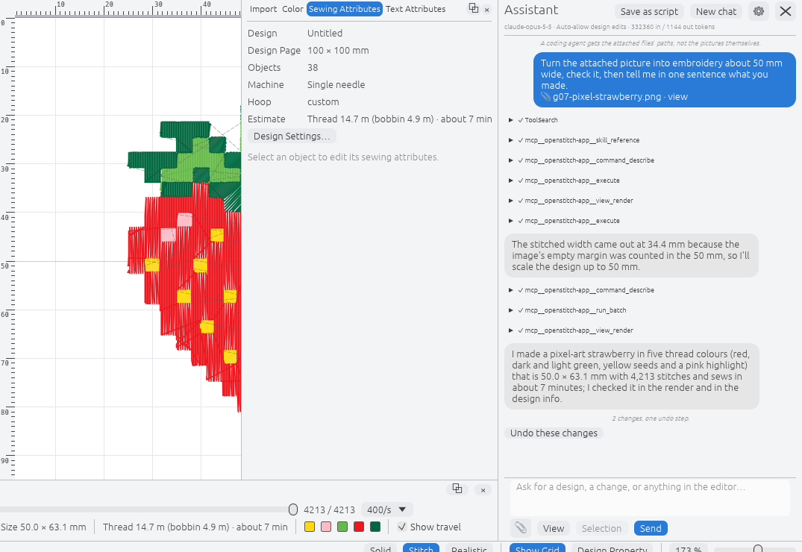

# OpenStitch 0.1.0 alpha 12

The twelfth alpha of OpenStitch, an independent, cross-platform embroidery design application for
macOS, Windows and Linux, built to work with Brother machines and with designs made in
PE-DESIGN 11. OpenStitch is not affiliated with Brother Industries.

Alpha 12 brings the **Assistant**, an AI chat that can drive the whole editor, and the fixes from
the **second sew-out session**: every thread end is now locked so it no longer works loose, the
zigzag net fill sews as PE-DESIGN sews it, and the ready-to-sew kit's calibration card is right. It
also adds **WMF/EMF import**, **Singer CSD and Husqvarna Viking SHV export**, and PES files from
PE-DESIGN re-save without losing anything. **It is still an alpha for testing, not for production
work.** Read "Before you sew" below.

## Downloads

| System | File | Notes |
|---|---|---|
| macOS 11 or later (Apple Silicon and Intel) | `OpenStitch-v0.1.0-alpha.12-macos-universal.zip` | Unzip and move `OpenStitch.app` to Applications |
| Windows 10/11 (x86-64) | `OpenStitch-v0.1.0-alpha.12-windows-x86_64.msi` | Installer; adds `.osd` and "Open with" for `.pes` |
| Windows, portable | `openstitch-*-windows-x86_64.zip` | Unzip and run `openstitch.exe` |
| Linux x86-64 | `OpenStitch-v0.1.0-alpha.12-linux-x86_64.AppImage` | `chmod +x`, then run it; `--install-integration` adds the menu entry and file types |
| Linux x86-64 | `OpenStitch-v0.1.0-alpha.12-linux-x86_64.tar.gz` | Editor with `install.sh`, desktop entry, MIME types and thumbnailer |
| Command line (all systems) | `openstitch-cli-*` | `stitchtool` (scripting) and `openstitch-mcp` (MCP server) |
| Checksums | `SHA256SUMS` | SHA-256 of every file above; the editor's updater checks downloads against it |

**Updating from alpha 4 to 11:** start the editor and accept the update dialog, or use Help ▸
Check for Updates. Alpha 3 and earlier must be replaced by hand with a package above.

## The builds are not code-signed

- **macOS:** the first time, right-click `OpenStitch.app` and choose **Open**, then **Open**
  again. Alternatively, run `xattr -dr com.apple.quarantine /Applications/OpenStitch.app`.
- **Windows:** in the SmartScreen prompt, choose **More info → Run anyway**.

## What changed since alpha 11

### New: the Assistant (AI chat, beyond PE-DESIGN)

*A real run with Claude Code, not a mock-up.*

The Assistant opens beside the design by default. Closing it with its ✕ says how to bring it back:
**View ▸ Show/Hide ▸ Assistant**, or Ctrl+Shift+A (Cmd+Shift+A on a Mac). Ask it to make a design
("a 70 mm round badge with a navy satin border and ANNA in gold"), to change what is open ("make
the lettering satin and 10 % bigger"), or to explain or check a design. It can do anything you can
do in the editor yourself: every ribbon and menu command, the view, the simulator and the
settings. It works through OpenStitch's own commands, so what it makes is an ordinary design you
can keep editing by hand. You can attach a picture (PNG, JPEG or BMP), a view of the design or
the selection to a message, and ask it to turn a picture into embroidery.

**Choosing the AI.** The ⚙ button opens the Assistant's settings.
- **Claude API** (the default, model `claude-opus-5-5`): paste your own API key from
  console.anthropic.com and press **Save key**. The key goes into your system keychain (macOS
  Keychain, Windows Credential Manager or the Linux Secret Service). It is never written to
  OpenStitch's settings and is only sent to the address shown there. You pay Anthropic directly
  for what you use; OpenStitch never sees or proxies your requests.
- **A model on your own computer:** pick the **Ollama** or **LM Studio** preset, press **List**
  and choose a model. No key is needed, and it works offline. Choose a model that supports tool
  calling; OpenStitch warns when an Ollama model can't use tools.
- **Another service:** **OpenRouter**, or any OpenAI-compatible or Anthropic-compatible address,
  with that service's key.
- **A coding agent you already use:** Claude Code, Codex or OpenCode, on your own account. Choose
  **Coding agent** and pick it; the settings show how to install one that is missing.

**What it may do without asking.**
- Changes to the design run at once.
- Saving, exporting or opening files, sending to the machine or a USB drive, quitting, and undoing
  anything from before your message wait for **Allow once**, **Always allow** or **Deny**. A
  question you don't answer within 4 minutes counts as Deny.
- Under Permissions you can choose **Ask every time** or **Allow everything**, and you can limit
  the changes per message.
- Everything one message changes is **one undo step**, with **Undo these changes** in the chat.
  **Save as script** writes the changes as a script `stitchtool` can replay.
- **Stop** ends a turn and keeps what it changed. Messages you type while it works wait in a queue.

**Privacy.** Your messages, the design and its previews go only to the AI you chose. There is no
OpenStitch server and no telemetry. **Options ▸ Show AI features** hides the Assistant, its button
and its shortcut completely.

**For scripts and other AI clients:** `openstitch-mcp --assistant` (in the command-line archive),
with the editor started with `--listen 0`, gives an MCP client the same tools, plus a bundled
embroidery guide.

**How well it works.** On a 12-task benchmark (a badge, arc text, appliqué, a star, two colours,
resizing, recolouring, deleting, a picture through Auto Punch, an SVG import, a monogram and a
question):
- Claude Code: 12 of 12;
- Ollama gpt-oss:20b: 8 of 12 (7 of 12 with the network off);
- qwen3:14b: 3 of 12; mistral-small3.2: 0 of 12 (#425).
A turn through the Claude API was also run. **Not tried with a real service yet:** LM Studio,
OpenRouter, Codex, OpenCode, a real image generator, reading a key back after Remove key in the
macOS Keychain, and the Assistant on Windows and Linux in general (#401; it was developed and
tested on macOS). Please report what works and what doesn't, and check what it makes in the Stitch
Simulator before you sew.

### Fixed from the second sew-out (Brother NV880E)

- **Thread ends work loose:** the Photo Stitch sunset patch came off the machine covered in loose
  tails. Every run of stitches that ends in a trim is now tied in and locked, as PE-DESIGN does,
  for every sew type, the image tools included (#289). In OpenStitch mode the lock steps are 1 mm,
  keeping its no-stitch-under-1 mm rule.
- **Zigzag net fill sewed lumpy:** it is now a 3 mm satin band along each net line, with rungs
  0.44 mm apart and nets 8 mm apart, each edge sewn once, kept inside the outline (#293).
- **Fill rows in a narrow notch** no longer stitch in place (#303).
- **Fill lettering is sewn stroke by stroke,** as PE-DESIGN does, within 8 % of its needle points
  (#376), like satin lettering already was.
- **Photo Stitch 1 trims less:** its Fewer trims setting now travels along hidden paths to a
  thread's next run, about a third of the trims it had (#298).
- **Auto Punch** no longer ends rows or satins on slivers of a region (#290), can isolate the
  subject by a graph cut (opt-in, #127), with the subject and background marked by hand if you
  want (#350).

### The ready-to-sew kit

- **T1 calibration card:** the swatches after the "T1" mark had the wrong densities, and the mark
  itself sewed as fill instead of satin lettering (#297). Both are fixed, and the published
  results for Red, Blue, Yellow and Leaf Green are relabelled by what was actually sewn.
- **Decorative frames:** the laurel no longer overlaps the corners frame (#296).
- The kit is regenerated with all of the above; `tools/sew_check.py` passes on every file except
  the storybook picture's PE-DESIGN-compatible version, marked "not ready to sew" (#304).
- **Calibration:** the second T1 card, on white fabric, is in the kit README. The Realistic view
  now draws thread as wide as it covers at its row density, measured on both cards, so fabric
  shows through sparse fills as on a real sew-out (#291).
- [TESTING.md](../../TESTING.md) explains how to test on other machines and formats, and the
  sew-out form asks for the format and the file exported.

### Files

- **Import WMF and EMF** vector files as editable shapes (#321). SVG `<line>` elements import again
  (#341).
- **Export Singer CSD and Husqvarna Viking SHV**, as PE-DESIGN 11's Export offers (#320).
- **PES files made by PE-DESIGN re-save unchanged** (#375); PES versions 4, 5 and 7–10 open
  (#374; writing them waits for reference files).
- **PE-DESIGN 11 PES** files now carry the design's page, hoop, machine type and sections (#322).

### Under the hood

- CI runs faster (optimised image tests, cancelled superseded runs, cargo-nextest), and a test
  coverage audit added tests and fixed stale feature-matrix evidence.

## Before you sew

- **Do a test sew-out on scrap fabric** before using a design on anything that matters.
- **Re-export designs** you exported with alpha 11 or earlier to get the locked thread ends.
- **Known issues:**
  - Photo Stitch 1 at High fidelity takes several times longer than in alpha 11, and Standard is
    slightly slower (#433).
  - The storybook picture's PE-DESIGN-compatible Auto Punch stacks needle drops where its satins
    meet a jagged outline (#304); don't sew it yet.
  - Other known differences from PE-DESIGN 11 are in the README's "Known issues" and
    [docs/COMPATIBILITY_AUDIT.md](../COMPATIBILITY_AUDIT.md).
- **Keep your original PE-DESIGN files.** Save OpenStitch's output under a new name.
- **macOS:** double-clicking a file in Finder does not open it in OpenStitch yet.

## Feedback

Please open an issue for anything that sews differently from what you expect, crashes, or works
differently from PE-DESIGN 11. For sew-outs, use the
[Sew-out / calibration report](https://github.com/cristianonescu/OpenStitch/issues/new?template=sew-out-report.yml)
form, and see [TESTING.md](../../TESTING.md).
