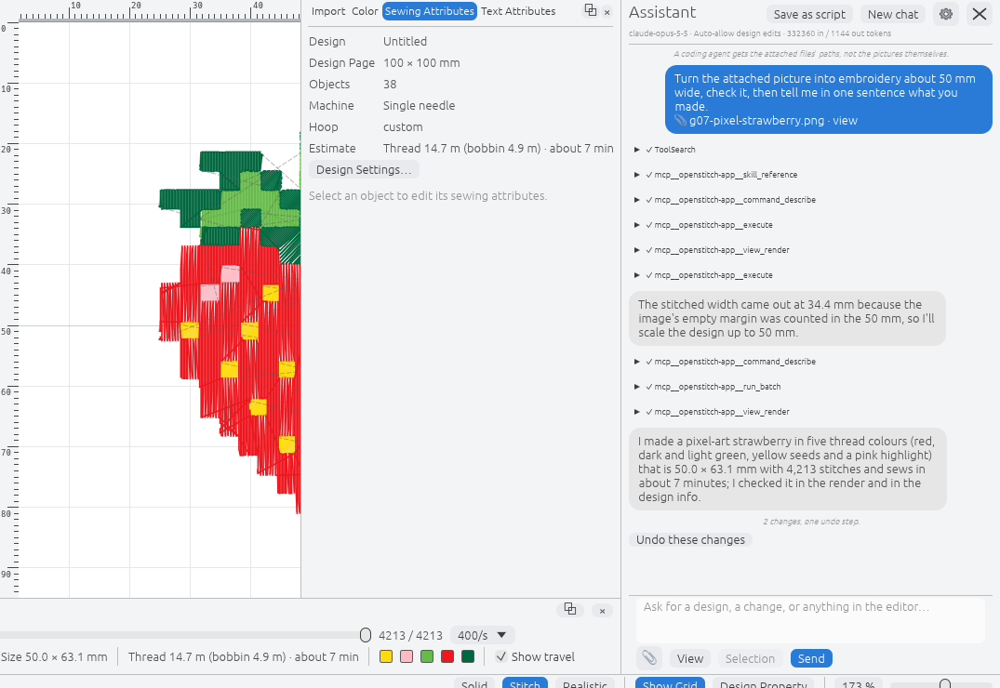
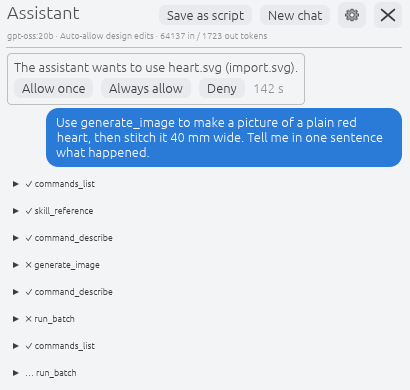
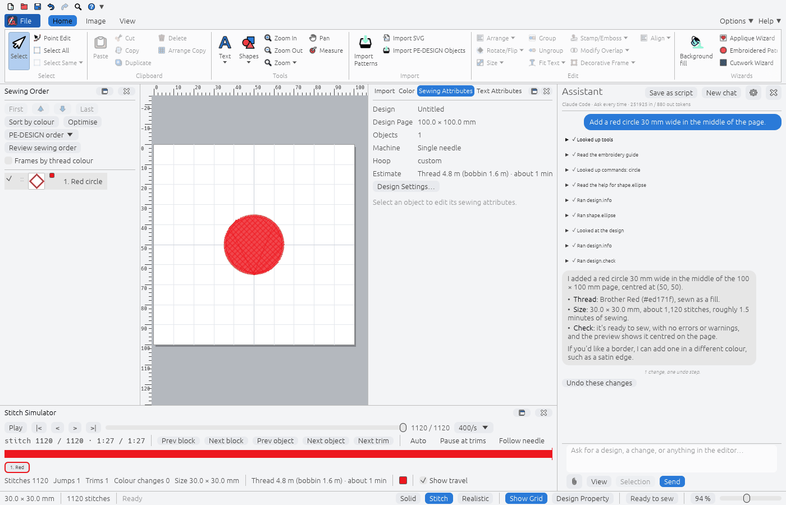

# B17. AI assistant: generate and edit embroidery by asking

Research date: 2026-11-04. The owner asked to "research how solidcraft made the AI
integrations and mirror that feature for OpenStitch ... basically the user should be able to
use it the same as it works for solidcraft in order to generate embroidery". This note:
- maps how SolidCraft's assistant works, with file and line references;
- lists what OpenStitch already has that an assistant can drive;
- records the owner's decisions;
- sets out the OpenStitch design, phased tasks with acceptance criteria, and the risks.

The owner approved the plan on 2026-11-04, adding one requirement: "each and every OpenStitch
feature is supported through the AI chat. The user should be able to control the tool
completely from there". Progress is in section 9.

## 1. The owner's decisions (2026-11-04)

| Question | Answer |
|---|---|
| Provider, model and key | **SolidCraft's full set.** The user's own key, kept in the OS keychain. Anthropic's Claude API is the built-in default with `claude-opus-5-5`. Any Anthropic- or OpenAI-compatible endpoint can be added (Ollama, LM Studio, OpenRouter and others), and so can ACP coding agents (Claude Code, Codex and others) that run under the user's own account. OpenStitch never sells, proxies or pays for a model. |
| Where the user talks to it | **A chat panel in the editor**, like SolidCraft's Assistant. `openstitch-mcp` stays as it is for external clients. |
| What is in scope | **All of it.** Text to design through the engine commands, editing the open design, explaining or fixing a design, text to image followed by digitizing, and in the owner's words "support any user request or questions". |
| Privacy and offline | **Data goes only to the provider the user chose.** Nothing goes to OpenStitch and there is no telemetry. Offline, the panel says that no provider can be reached and the editor works as usual. A local model (Ollama, LM Studio) works fully offline. |
| How it ships | **On by default, like SolidCraft.** A Preferences ▸ AI ▸ **Show AI features** master switch starts on. Nothing is detected, started or sent until the user opens the panel, sends a message or presses **Connect**. |

Being on by default does not touch PE-DESIGN compatibility. The assistant changes a design
only through the existing engine commands, so a design it makes is a design a user could
have made by hand. No compatibility spec, golden file or default changes.

## 2. How SolidCraft does it

Source: [tangency-labs/solidcraft](https://github.com/tangency-labs/solidcraft) at commit
`6bca7d2854469b279c9ce07a519ba60f462dbf56` (2026-11-04). Paths are relative to that
repository. It was read as source in a scratch clone. Nothing in it was built or run, and no
reverse engineering was needed because everything is public source.

**Licence:** dual MIT OR Apache-2.0 (`LICENSE-MIT`, `LICENSE-APACHE`, `NOTICE`), the same as
OpenStitch. Its code may be copied if the copyright line is kept. Section 6 says what to
reuse.

### 2.1 What the user sees

The user documentation is `docs/agent-chat.md` (527 lines):

- **Panel.** The Assistant panel opens from the application bar, with Ctrl/Cmd+Shift+A, or from
  View settings (`docs/agent-chat.md:35-43`). It can dock left or right, pop out into its own
  window, or minimise to a strip (`:61-78`).
- **One master switch.** Preferences → AI → **Show AI features** is on by default. Turned off,
  SolidCraft shows nothing of the assistant and starts nothing (`:15-33`).
- **Nothing runs early.** SolidCraft looks for installed agents only when the panel or the AI
  page first opens, and starts one only on Send or Connect (`:41-43`).
- **Two kinds of "agent"** (`:188-346`):
  - an ACP coding agent found on `PATH` (Claude Code through `claude-agent-acp`, Codex,
    Antigravity, OpenCode, Grok Build, …), which signs in under the user's own account;
  - an endpoint the user adds: OpenAI-compatible (presets for Ollama, LM Studio, OpenRouter,
    OpenAI, …) or Anthropic-compatible (`{base}/v1/messages`), with a model picker filled
    from the endpoint's own list.
- **Queue, Stop, Send now and New chat** (`:155-186`). Each design tab has its own
  conversation (`:157-169`).
- **Attachments** (`:115-153`): up to eight files per message. Pictures are scaled to 2048 px.
  Text files go inline. CAD files are imported into the design. **Attach view** sends a
  picture of the viewport and **Attach selection** sends what is selected (`:395-416`).
- **One undo per message.** Everything the agent changes while answering one message is a
  single undo step named after the message, with **Undo these changes** in the chat
  (`:388-390`).
- **Permissions** (`:418-447`): *Ask every time*, *Auto-allow model edits* (the default; saving,
  opening, exporting, importing and any command given a file name still ask) or *Allow
  everything*. **Always allow** is remembered per agent and command. An optional limit caps
  the changes per message. A question nobody answers is declined after four minutes (`:449-468`).
- **Privacy** (`:470-479`): data goes only to the chosen agent or endpoint. An endpoint's key is
  kept in the keychain and only sent to that endpoint.
- **Benchmark** (`:494-525`): `solidcraft-cli bench-assistant` runs eleven fixed modelling tasks
  against a model and checks each result on the design itself.

### 2.2 How it is built

The assistant lives in `crates/ui-egui/src/agent_chat/`: 18 files and 21,018 lines, 4,599 of
them tests.

| Piece | Where | What it does |
|---|---|---|
| State and turn logic | `mod.rs` (2,563 lines): `AgentChat` :329, `connect` :963, `send` :1261, `start_turn_with` :1463, `finish_turn` :1738, `pump_tools` :1797 | One conversation per design tab, the message queue, and running each tool call through the gate. |
| Backend seam | `backend.rs:137` `trait ChatBackend`, `:171` `HttpRequest`/`HttpFn`, `:183` `trait Secrets` | The panel talks to one trait. HTTP and the keychain are injected by the app, so the crate stays testable. |
| ACP client | `acp.rs` (953 lines, hand-written JSON-RPC 2.0, `PROTOCOL_VERSION = 1` at :124), `acp_client.rs:56` `AcpBackend::start`, `process.rs:149` `AgentProcess::spawn` | Starts the agent as a child process in its own process group (`process.rs:64`; stopped with `killpg`, or `taskkill /T` on Windows). Declares no file system and no terminal to the agent (`acp.rs:145-156`). |
| MCP bridge for agents | `acp.rs:161` `BRIDGE_NAME = "solidcraft-app"`, `acp.rs:182-190` `McpBridge::to_json` | Hands the agent an MCP server, `solidcraft-cli mcp --connect 127.0.0.1:PORT`, which reaches the running app over its loopback control port with a per-launch token. The token never passes through the agent: `acp_client.rs:30` removes it from the agent's environment. |
| Claude Code's own tools off | `acp.rs:240` `CLAUDE_DISALLOWED_TOOLS` (Bash, Read, Write, Edit, Glob, Grep, WebFetch, WebSearch, Task, …), sent in `session_new_params` :245-270 | Claude Code can only touch the design through SolidCraft's tools. It runs in an empty working folder (`mod.rs:952`). |
| System prompt | `acp.rs:228` `SYSTEM_NOTE` | A short note: use the `solidcraft-app` tools, prefer `batch`, verify with `measure`/`inspect_design`, and read `skill_reference` before building more than one primitive. |
| Endpoint loop | `api_client.rs` (3,077 lines): `ApiBackend` :663, `start_mcp` :886, `turn` :906 | SolidCraft runs the tool loop itself, as a client of the same MCP server. MCP `tools/list` is converted to OpenAI tools (:1558) or Anthropic tools (:1582), capped at 128. At most 32 calls run per round, and rounds are uncapped until Stop. |
| Endpoint details | `api_client.rs:46` `ANTHROPIC_MAX_TOKENS = 8192`, :49 `anthropic-version: 2023-06-01`, `stop_reason` :1387 | **No streaming.** `max_tokens`/`length` and `refusal`/`content_filter` stop reasons are reported in the chat. The request timeout defaults to 300 s, from 30 s to an hour (`agents.rs:139-155`). |
| Keys | `agents.rs:326` `key_safe_for`; app side `apps/solidcraft/src/main.rs:674-695` (`keyring` 3.6) | A key is only ever sent over `https://` or to exactly localhost / 127.0.0.1 / [::1]. It is stored as `keyring::Entry::new("SolidCraft agent chat", id)`. HTTP uses `ureq` 3.4 (`apps/solidcraft/src/main.rs:618`). |
| Permission gate | `gate.rs` (363 lines): `Verdict` :20, `looks_like_file` :81, `names_a_file` :93, `request` :151; modes `agents.rs:12-21` | A command is classed Run, Ask or Refuse. "Given a file name" is a heuristic over the parameter names and values. The turn limit is `gate.rs:12-17` (default 0 = none, 24 when turned on). The 4-minute timeout is `mod.rs:63`. |
| One undo per message | `mod.rs:1484-1491` (records the start), `merge_undo` :1764-1781, `undo_changes` :1784 | The turn's snapshots are folded into one, labelled with the first 48 characters of the message. |
| Attachments | `attach.rs` (`MAX_FILES = 8` :26, `MAX_SIDE = 2048` :34, `MAX_SENT_BYTES` :37), `context.rs:123` `describe_selection` | Pictures are resized and re-encoded (:295-322). The selection is sent as text with ids and sizes. |
| MCP server | `crates/mcp` (7,126 lines): `tools.rs:96` `tool_definitions` | About 20 **meta tools**, not one tool per command: `list_commands`, `describe_command`, `execute`, `batch`, `inspect_design`, `measure`, `screenshot`, `compare_picture`, `undo`, `redo`, `skill_reference`, … |
| Domain knowledge | `crates/mcp/src/skill_reference.rs:11-31` | Four Agent Skills (`skills/solidcraft-modeling` and three others) are compiled in with `include_str!`. The model reads them on demand through `skill_reference`; they are not in the system prompt. |
| Benchmark | `apps/solidcraft-cli/src/bench_assistant.rs` (701 lines): `TASKS` :26, `check` :204, `classify` :278 | Results are scored on the design (volume, bounding box), not on the model's words. Failures are put in categories such as "wrote the call as text" or "only talked". |

What carries over to embroidery: one tool layer shared by every model; meta tools instead of
hundreds of tool definitions; knowledge loaded on demand; changes allowed by effect with files
behind approval; one undo per message; keys in the keychain; and scoring on the result.

## 3. What OpenStitch already has

Most of SolidCraft's plumbing already exists in OpenStitch:

| SolidCraft piece | OpenStitch today | Gap |
|---|---|---|
| Control port with per-launch token | `openstitch --listen PORT` (`crates/openstitch-remote`): 127.0.0.1 only, 32-byte token from `getrandom`, `automation.json` 0600, at most 4 connections, 1 MiB requests (docs/ARCHITECTURE.md, Automation socket) | The assistant needs the socket even when the user did not pass `--listen`. It should start a private listener of its own, with a token that is not written to `automation.json`. |
| `solidcraft-cli mcp --connect` | `openstitch-mcp --live` (`crates/openstitch-mcp/src/main.rs:19`) | Tools are one per command: about 190 `CommandSpec`s plus `run_batch` and `preview`. That is more than SolidCraft's 128-tool cap, and expensive in tokens on every request. `preview` is refused in live mode (`server.rs:430`). |
| Command registry with effects | `CommandSpec` with `read`/`edit`/`file`/`history` effects, `Session::set_capabilities`, `--read-only`, `--no-files`, `FILE_READING_COMMANDS` | None. This is better than SolidCraft's file-name heuristic: every command already **declares** whether it touches files. |
| Sandbox roots | engine `Sandbox`, with read and write roots per client (`Policy::apply`) | The assistant needs a scratch folder for SVG and image files the model writes. |
| One undo per gesture | `EditorApp::grouped` (`crates/openstitch-app/src/app.rs:520`), `undo_groups`; remote edits push one group each (`remote.rs:63`) | A turn spans many frames, so `grouped` cannot wrap it. It needs a start marker and a fold at the turn's end, as SolidCraft's `merge_undo` does. |
| Previews | `openstitch-render` (tiny-skia) for MCP `preview` and thumbnails | Needs a live-mode render of the editor's own design, so the model can look at its work. |
| Image digitizing | `digitize.autoPunch`, `photoStitch`, `crossStitch`, `designCenter`, `lineImage`, `figure` (`crates/openstitch-engine/src/digitize.rs`), with `compatMode: openStitch` | They read an image **file** under the session directory, so a generated image has to be written to the scratch folder first. |
| Vector import | `import.svg` (`crates/openstitch-engine/src/imports.rs:219`) | Also takes a file path. |
| HTTPS client | `ureq` 3 with rustls in `crates/openstitch-update` | None: reuse it. |
| Preferences | `ui.json` through `crates/openstitch-app/src/editor/prefs.rs` | Add an `ai` section. Keys never go in it. |
| Keychain | — | Add `keyring` (pure-Rust backends: `apple-native`, `windows-native`, `async-secret-service` + `crypto-rust`, as SolidCraft does). |
| Knowledge | README, docs/UI_LAYOUT.md, the command summaries and parameter docs | Write an embroidery skill: hoop sizes, density, underlay, satin widths, lettering sizes, thread charts, what PE-DESIGN-compatible mode means, and recipes. |

## 4. The OpenStitch design

### 4.1 Shape

```text
 Assistant panel (egui, openstitch-app)
   │  ChatBackend trait  (Anthropic · OpenAI-compatible · ACP)
   │
   ├─ Anthropic / OpenAI-compatible: OpenStitch runs the tool loop ──┐
   └─ ACP agent (Claude Code, Codex, …) runs its own loop ───────────┤
                                                                     ▼
                       openstitch-mcp --live --assistant   (MCP over stdio, meta tools)
                                                                     │  per-launch token, 127.0.0.1
                                                                     ▼
                  editor's private assistant listener ─► Gate (Ask / Edits / All)
                                                                     │
                                                                     ▼
                     Session::execute ─► one undo step per message (undo_groups fold)
```

Every backend reaches the design through **one** MCP server, so a tool, a permission rule or
a fix works the same for Claude, a local model and Claude Code. This is SolidCraft's split:
the API loop and the ACP agent both use the same `mcp --connect` server.

### 4.2 Tools the model sees (`openstitch-mcp --assistant`)

This is a new mode of the existing server. The per-command tools stay as they are for
`openstitch-mcp` without the flag. In assistant mode the server exposes meta tools in a fixed,
sorted order, so prompt caching holds:

| Tool | What it does |
|---|---|
| `commands_list` | Command ids, summaries and effects, filtered by a prefix or search text (from `Session::commands()`). |
| `command_describe` | One command's parameters, with the schema `openstitch-mcp` already generates. |
| `execute` | Runs one command through `Session::execute`. Failures come back as `isError` results the model can correct. |
| `run_batch` | Up to 256 steps, checked before any runs (existing). |
| `design_info` / `object_get` | The existing read commands: what is in the design, its sizes, stitch statistics and colours. |
| `view_render` | **New.** A PNG of the editor's design (Design Page plus stitches, 64–2048 px), drawn by `openstitch-render` from the live session, so the model can check its work. |
| `scratch_write` | **New.** Writes an SVG (text) or a picture (base64 PNG/JPEG, at most 16 MiB) into the conversation's scratch folder and returns its path, ready for `import.svg` or `digitize.*`. |
| `skill_reference` | **New.** Returns a bundled skill file (section 4.6). |
| `notes_read` / `notes_write` | **New (#491).** The Assistant's memory between conversations: read the notes, or append to / replace one section (Machine, Threads, Fabric, Preferences, Lessons). Writes go through the permission gate (section 4.10). |

### 4.3 The default model and the Anthropic request

The built-in default follows the current Claude API guidance (Anthropic `claude-api`
reference, cached 2026-10-06):

- **Model `claude-opus-5-5`.** Users can pick any model the endpoint lists, as in SolidCraft's
  picker. Nothing is hard-coded beyond the default.
- **Raw HTTP to `POST {base}/v1/messages`** with `ureq`. There is no official Anthropic SDK for
  Rust, and the project already uses `ureq`. Send a current `anthropic-version`, not
  SolidCraft's `2023-06-01`.
- **Adaptive thinking** (`thinking: {type: "adaptive"}`, which is what Opus 5.5 does when the
  field is omitted). `output_config.effort` is set **explicitly**, because Opus 5.5 defaults to
  `medium`. Use `high` for generating a design and `medium` for questions, adjustable under
  Preferences ▸ AI. Opus 5.5 rejects `thinking: disabled` and `budget_tokens` with a 400.
- **Streaming (SSE)** with `max_tokens` around 64,000, so long turns never hit the HTTP
  timeout and text appears as it is written. SolidCraft does not stream and caps output at
  8,192 tokens. The tools are client tools, so set `eager_input_streaming: true` on each one.
  Every streamed tool input is then validated against its schema before it runs, and an
  input cut off by `max_tokens` is never run.
- **Stop reasons:** check `refusal` and `max_tokens` before running any tool call, and say in
  the chat which one ended the turn (as SolidCraft does at `api_client.rs:1387`). Turn on
  server-side refusal fallbacks (`fallbacks: "default"` with the
  `server-side-fallback-2026-07-01` beta) on the Claude API, and tell the user it is on.
- **No forced tool choice.** `tool_choice: any`/`tool` returns a 400 on Opus 5.5, so use
  `auto`, `strict: true` tool schemas, and the system prompt.
- **Prompt caching:** tools, then system prompt, then messages, with stable content first and
  a cache breakpoint after the system prompt. Volatile data such as the date, the selection or
  the design summary goes in the user turn, never in the system prompt.
- **Parallel tool calls:** return all results of one assistant message in one user message,
  with failures marked `is_error`.
- **Thinking blocks:** pass the model's content blocks back unchanged every turn, and keep
  history append-only (preserved thinking).

OpenAI-compatible endpoints get the same loop over `/chat/completions`. As in SolidCraft,
there is an optional `reasoning_effort` and an Ollama `tools` capability check with a warning
(`docs/agent-chat.md:325-346`).

### 4.4 Permissions

Commands are judged by their **declared effect**, not by guessing from parameter names:

| Mode | Runs without asking | Asks |
|---|---|---|
| Ask every time | `read` commands | every `edit`, `history` and `file` command |
| **Auto-allow design edits** (default) | `read`, `edit`, and `history` within the current message | `file` commands, the edit commands in `FILE_READING_COMMANDS`/`library.*` outside the scratch folder, machine transfer (`transfer.*`), and undo past the message's start |
| Allow everything | all, within the sandbox roots | — |

- **Always allow** is remembered per provider and command.
- There is an optional limit on edits per message (default none).
- A question nobody answers is declined after 4 minutes.
- **Stop** always works.
- The assistant's sandbox is read/write on the scratch folder only. The design's own folder
  and the user's roots are reached through **Ask**.
- The assistant cannot click the interface, change preferences, read crash reports, or drive
  the chat.
- **Memory** (#491): `ui.notesWrite`, `ui.notesClear` and `ui.set assistantMemory` ask in Ask
  and Auto-allow modes ("remember (Threads): ...", "forget everything it remembers about you",
  "turn its memory off"); Always allow and Allow everything run them. With memory off,
  `ui.notesRead` and `ui.notesWrite` are refused before anyone is asked.
- **Bare scratch names** (#431): a file parameter that is a bare file name (`heart.svg`, no
  folder) and names an existing file in the scratch folder becomes that file's absolute path
  before the gate and the command see it. Names with a folder, `..`, hidden files and links
  that lead out of the folder are left as they are, so the gate asks about them as before.

### 4.5 One undo per message

At the start of a turn, record `undo_groups.len()` and the message's first line (at most 48
characters). At the end of the turn, or on Stop, or when an error ends it, fold the groups
pushed since then into one, named *Assistant: "…"*. The chat then shows *N changes, one undo
step* with **Undo these changes**. Switching design tabs ends the turn first. This is the same
fold as `EditorApp::grouped`, split across frames.

### 4.6 Knowledge: embroidery skills

`skills/openstitch-embroidery/` holds Agent Skills files, compiled in with `include_str!` and
served by `skill_reference`:

- `SKILL.md`: units (mm, degrees counter-clockwise), the Design Page and hoops, how to build a
  design (shapes → sew types → colours → order), and verifying with `view_render` and
  `design_info`.
- `reference/density-and-sizes.md`: minimum lettering heights, satin widths, fill density,
  underlay and pull compensation, and what sews badly (tiny specks, long jumps, stacked needle
  drops).
- `reference/commands.md`: recipes per task: badge, monogram, name drop, appliqué, patch,
  lettering on a path, image to embroidery with each wizard and when to use which, and
  `compatMode`.
- `reference/answers.md`: for "support any user request or questions": what OpenStitch can and
  cannot do (from docs/FEATURE_MATRIX.md), file formats and machines, and where things are in
  the UI (from docs/UI_LAYOUT.md).

(As of 2026-11-13 the folder holds `answers.md`, `composition.md`, `examples.md`, `recipes.md`,
`sewability.md` and `examples/`; `density-and-sizes.md` and `commands.md` do not exist, their
planned content is in `sewability.md` and `recipes.md`.)

The system prompt stays short, as SolidCraft's `SYSTEM_NOTE` is:
- you are inside OpenStitch;
- use the `openstitch` tools only;
- prefer `run_batch`;
- read `skill_reference` before building anything;
- check the result with `view_render`;
- never claim a result you did not check.

### 4.7 The five kinds of request

1. **Text to design.** "A 70 mm round badge, navy satin border, 'ANNA' in gold" → the model
   reads the skill, then runs `run_batch` over the shape, text, sew-type and thread commands,
   then `view_render`.
2. **Edit the open design.** The user's message carries the selection (ids, kinds, sizes), as
   SolidCraft's **Attach selection** does. The edits are one undo step.
3. **Explain or fix.** `design_info` and the stitch statistics, then the skill's sewability
   rules, then fixes that need approval. The **troubleshoot** commands of B13
   (quality-tools.md) make this sharper once they exist. Until then the model judges from the
   statistics and the render. (Since 2026-11-05 they exist: `design.check`, #503, and
   `design.density`, #504.)
4. **Text to image, then digitize.** There are three routes, and the model picks one per
   request:
   - *Vector art (no image model needed):* the model writes SVG → `scratch_write` →
     `import.svg` → sew types. This suits logos, clip art and monograms, and works with any
     provider, Claude included.
   - *The user's own picture:* an attached picture goes to the scratch folder → `digitize.*`
     with `compatMode: openStitch` (B16/B16.1) → `view_render`.
   - *A generated picture:* this needs an **image-generation provider**, because Claude
     produces text, not pictures. Add an optional "Image generation" endpoint (an
     OpenAI-compatible `/images/generations`, or a local server) under Preferences ▸ AI, with
     its own keychain key. The picture goes to the scratch folder, then `digitize.*`. Without
     that provider, the assistant offers the vector route and says why.
5. **Questions.** These are answered from the skill references and `commands_list`. They need
   no design changes and no approval.

### 4.8 The panel and preferences

The panel mirrors SolidCraft's: an Assistant button and Cmd/Ctrl+Shift+A; dock left or right,
or its own window; and a provider switcher with a model picker. It also has:
- Queue, Stop, Send now and New chat;
- attachments (pictures, SVG, text, stitch files imported as SolidCraft imports CAD files);
- **Attach view**;
- tool cards, and Markdown answers.

Preferences ▸ AI holds:
- **Show AI features** (on);
- the button;
- connect at launch (off) and open at launch (off);
- providers, with Test, Default, Edit and Remove;
- permissions;
- the edit limit;
- request timeout and effort;
- the image-generation endpoint.

These live in `ui.json`. Keys go in the keychain under `OpenStitch assistant`, and are only
ever sent over `https://` or to exactly localhost / 127.0.0.1 / [::1] (SolidCraft's
`key_safe_for` rule).

### 4.9 Determinism

The model is not deterministic, but the result it leaves is a list of engine commands, and
those are. Every turn keeps its tool calls, so **Save as script** writes them as a
`stitchtool exec` JSON script that rebuilds the same design byte for byte on every OS. No
engine, generator or golden test changes. Tests use a scripted test backend (as SolidCraft's
`acp_test_agent` does), never a live model.

### 4.10 Memory between conversations (#491)

The Assistant keeps short notes about the user: their machine and hoops, the threads they own,
their fabrics, their preferences, and corrections that worked. The idea comes from threadspool's
notes file (no licence: concepts only, no code), where the agent reads its notes at the start of
every session and adds the smallest lasting lesson after each result.

- **Store.** `assistant-notes.md` in the config folder, beside `ui.json`: Markdown with
  `## Machine`, `## Threads`, `## Fabric`, `## Preferences` and `## Lessons`, at most 8 KB
  (`openstitch_assistant::notes`). Written through a temporary file; empty notes remove it.
- **Prompt.** At the start of each request the notes follow the instructions in the system
  prompt ("What you remember about this user"), for the Claude API, OpenAI-compatible
  endpoints and coding agents (their `systemPrompt` append). Nothing is added when memory is
  off or the notes are empty. The notes go only to the provider the user chose, never into a
  design or an export.
- **Tools.** `notes_read` and `notes_write {section, text, mode: append|replace}` in
  `openstitch-mcp --assistant`, over `ui.notesRead` / `ui.notesWrite`; `ui.notesClear` clears
  them. A write is at most 1000 characters; text that looks like a password, key or token is
  refused; a write that would pass 8 KB is refused with a request to summarise (replace a
  section with a shorter version), and nothing changes.
- **Gate.** Every write asks (section 4.4); a denied write changes nothing and the model is
  told.
- **Panel.** Assistant settings ▸ "Let the Assistant remember things" (on by default), the
  notes as an editable text with their size, Save notes, Undo edits and Forget everything (with
  a confirmation). The switch is also `ui.set assistantMemory`.
- **Skill.** SKILL.md's Memory section says when to write (a lasting fact, a correction that
  worked), when not to (one-off requests, guesses) and never to store secrets.
- **Bench.** `stitchtool bench-assistant` carries the notes from task to task: `remember`
  ("remember that I only own Madeira Polyneon threads") then `remembered-heart` ("make a red
  heart"), which passes when the heart's thread is a red from the Madeira Polyneon chart.

## 5. Phased tasks

Each phase is its own PR batch. Docs (README, FEATURE_MATRIX, ROADMAP and this file) are
updated in every PR.

| Phase | Work | Acceptance criteria |
|---|---|---|
| **A0 Tool surface** | `openstitch-mcp --assistant` with the meta tools; `view_render` in live mode; `scratch_write`; `skill_reference`; the editor's private assistant listener; the first `skills/openstitch-embroidery` files | `tools/list` returns at most 12 tools, in sorted order, and stays the same between runs. `view_render` returns the editor's design. `scratch_write` refuses paths outside the scratch folder, `..` components and sizes over the limit. The existing MCP tests and `live.rs` stay green, and the new tests run on all three OSes. |
| **A1 Claude in the panel** | `ChatBackend` trait; Anthropic backend (streaming, adaptive thinking, explicit effort, eager input streaming with validation, refusal and `max_tokens` handling, fallbacks, caching); panel MVP; Preferences ▸ AI; `keyring`; permission gate; one undo per message; Save as script | With a scripted backend, the tests show: a three-step turn becomes one undo step; a `file` command waits for approval and is declined after 4 minutes; Stop ends the turn and keeps its changes undoable; a truncated tool input is not run; a key is refused for a plain `http://` non-loopback URL; Save as script replays to the same `.osd`. A manual run with a real key makes the README badge example from one sentence. |
| **A2 Endpoints and local models** | OpenAI-compatible backend, presets, the model list, the Ollama tools warning, request timeout | A scripted OpenAI-compatible server passes the same suite. With a local Ollama model and the network off, a simple badge is made. |
| **A3 ACP agents** | Discovery (`--version` on `PATH` and the usual folders), spawning in a process group, the MCP bridge, Claude Code's own tools turned off, sign-in prompts | A scripted ACP test agent makes and edits a design through the bridge. Killing the panel kills the agent's process tree. Claude Code cannot run a shell or read files (checked from the `session/new` params). |
| **A4 Pictures and digitizing** | Attachments (8 files, 2048 px), Attach view, Attach selection, the vector route, digitizing an attached picture, the optional image-generation endpoint | An attached PNG becomes an Auto Punch design in OpenStitch mode in one turn. An SVG written by the model is imported as shapes. With no image provider the assistant offers the vector route. |
| **A5 Benchmark and docs** | `stitchtool bench-assistant`: about 12 embroidery tasks scored on `design_info` (sizes, colours, object kinds, stitch count ranges); README section; packaging check | The benchmark runs against a scripted endpoint in CI (no network), and against real models by hand with a Markdown report. The README documents setup, privacy and permissions. |

## 6. Reuse from SolidCraft and reimplementation

The licences are compatible (both MIT OR Apache-2.0). A file adapted from SolidCraft keeps a
header line, "Adapted from SolidCraft (github.com/tangency-labs/solidcraft), Copyright (c)
2026 SolidCraft contributors, MIT OR Apache-2.0", and gets a line in NOTICE and
docs/LEGAL_AND_LICENSING.md. None of the agent-chat files are among the third-party
adaptations in SolidCraft's own `NOTICE`.

| Adapt (protocol code that has nothing to do with CAD) | Reimplement (tied to SolidCraft's document and UI) |
|---|---|
| `acp.rs` message builders and `PROTOCOL_VERSION` handling | `mod.rs` turn logic (OpenStitch's `Session`, `undo_groups` and frames) |
| `process.rs` process-group spawning and stopping | `gate.rs` (OpenStitch judges by declared effects instead) |
| `discover.rs` `KNOWN` agents and search folders | `panel.rs`/`settings.rs` (OpenStitch's ribbon, panes and theme) |
| `agents.rs` `key_safe_for`, the timeout range | the MCP tool layer (OpenStitch's `openstitch-mcp` and registry) |
| `attach.rs` picture limits and re-encoding (OpenStitch must use its own `png`/`image` stack) | `bench_assistant.rs` (embroidery tasks and checks) |
| `api_client.rs` OpenAI-compatible request and response mapping (not its Anthropic path, which does not stream) | the system prompt and skills (embroidery knowledge) |

## 7. Risks

| Risk | Mitigation |
|---|---|
| **Cost.** Each turn resends the tools and the history, and previews are images. | The user pays their provider, and OpenStitch pays nothing. The meta tools keep the tool block small and cacheable, and previews default to 800 px. The panel shows the tokens used per turn when the provider reports usage. There is an optional edit limit per message, and effort and model can be chosen. |
| **Key storage.** | Keys are kept only in the OS keychain and never in `ui.json`, logs or crash reports. They are only sent over HTTPS or loopback. A stored key is never shown again. The keychain is not available in the Flatpak sandbox without portal access, so say so in the panel. |
| **Commands the model runs.** | The sandbox has the scratch folder only. File and transfer commands ask. Engine `Params` validation stays the boundary, and `bad_parameters_fail_cleanly` covers it. The `--listen` socket's capabilities apply per request. Claude Code's own tools are off. The token stays out of the agent's environment. Text the model writes that only looks like a call is never run. |
| **Prompt injection** from an attached file or SVG. | File content is data for the model, not an instruction to OpenStitch. Nothing a file says can widen permissions, and every file and transfer action still goes through the gate. |
| **Determinism and compatibility.** | The model's output varies, but the commands it leaves do not, and Save as script records them. No generator, default or golden file changes, and the PE-DESIGN reference specs are untouched. |
| **On by default** (the owner's choice). | Nothing is detected, started or sent until the panel is used. The master switch hides everything. `--listen`, `--screenshot` and scripted runs never start the assistant. |
| **Quality of designs.** | Models do not know sewability. The skills carry the rules, `view_render` lets the model check its work, and A5's benchmark measures it. Results must be checked in a sew-out before README claims are made. |
| **Image generation** depends on a second provider. | It is optional. The vector route and digitizing an attached picture need no image model. |
| **Licensing of generated artwork.** | The user owns their prompt and its results. The README says that trademarks and copyrighted characters are the user's responsibility. |
| **Size.** SolidCraft's version is about 21,000 lines. | The work is phased, and A1 is useful alone. Socket, sandbox, registry, MCP and rendering are already done, which is about a third of SolidCraft's work. |

## 8. What is not established yet

Written with the plan (2026-11-04). Since then, section 9 records model quality and token use
from the benchmark runs (A5 and later, Claude Code and Ollama) and the ACP agents' behaviour
(A3); the Flatpak and portable-zip keychain and an image-generation provider remain untested.

- **Model quality.** How well each model builds embroidery through these tools has not been
  measured. A5's benchmark measures it. Until then, no claim is made.
- **Token cost per design.** No turn has been run. It will be measured in A1 with the real
  API and recorded here.
- **Keychain support in the Flatpak and in the portable Windows zip** has not been tested.
- **Which image-generation provider** to recommend. None was tested, and it is optional.
- **Behaviour of each ACP agent.** Only SolidCraft's documentation of it was read. The current
  `claude-agent-acp` options must be checked against its own release notes in A3.
- **Facts taken from SolidCraft** in section 2 are as of commit `6bca7d2`, and its code moves
  fast.

## 9. Progress

### A0, the tool surface (landed 2026-11-04)

Complete control (the owner's requirement) is built and tested as follows.

**Design changes.** Every design change is an engine command. The assistant reaches all of
them through `commands_list`, `command_describe`, `execute` and `run_batch`. These read the
editor's own `commands.list`, so a new engine command is offered with no assistant code.

**The window.** Everything the window holds has an editor command on the automation socket
(docs/ARCHITECTURE.md, "Assistant commands"):
- `ui.state`, `ui.actions` and `ui.run`. `ui.run` covers every ribbon, menu and Quick Access
  Toolbar command.
- `ui.select` and `ui.zoom`.
- `ui.settings` and `ui.set`, with 25 settings: view, grid, rulers, guides, panes, theme,
  splash, Quick Access Toolbar position, update checks, realistic view, font filter, optimise
  entry/exit, simulator speed.
- `ui.render`, `ui.simulate`, `ui.help` and `ui.update`.
- `ui.scratchWrite`, which writes into a per-launch scratch folder that becomes the socket's
  extra write root.

**Routes.** `editor::assistant::route` gives each of the 153 `Action`s a way in:
- `ui.run`;
- a drawing tool plus its engine command;
- the engine command with a path, in place of a native file dialog;
- the command behind a list of choices.

Dialogs are reached two ways. `ui.run` opens one for the user. The engine command behind the
dialog sets its values.

**Coverage tests.**
- `every_editor_feature_is_reachable_from_the_assistant` fails when an engine command, an
  action's engine or route command, or an Options or Help menu entry has no assistant route.
  The menu entries are found by a scan of `ribbon.rs`.
- `every_run_action_runs_through_ui_run` runs every runnable action with four selections.
  `ui.run` must succeed exactly when the button is enabled.

**MCP and skills.**
- `openstitch-mcp --assistant` offers seven meta tools (nine since #491 added `notes_read` and
  `notes_write`). Their order is fixed and their bytes
  are identical across runs, so prompt caching holds. Their schemas are strict. A
  `view_render` image block replaces `preview`, which is refused in live mode.
- `skills/openstitch-embroidery` holds `SKILL.md` and three references. A test checks that
  every command id they name exists.

**Not done in A0** (the first two landed in A1).
- One undo step per message. It needs the turn boundary that the A1 panel owns. Until then
  each socket edit is its own undo step, as before.
- The permission gate (Ask, Edits, All) is A1. A socket client keeps the
  `--listen-read-only` and `--listen-no-files` capabilities and the file roots.
- A real model drove these tools for the first time in A5 (2026-11-04): Claude Code with `claude-opus-5-5`, 12 of 12 benchmark tasks.

### A1, the Assistant panel (landed 2026-11-04, #306)

**What the user sees.** View ▸ Show/Hide ▸ **Assistant** (Ctrl/Cmd+Shift+A) opens a chat on the right. The settings (⚙) hold:
- the address (the Claude API by default);
- the model (`claude-opus-5-5`);
- the effort;
- the permissions and the change limit;
- the API key, which is saved in the system keychain and never shown again.

Options ▸ **Show AI features** is on by default. While it is off, the panel, its button and the shortcut are gone.

**How a request runs.** As planned (section 4):
- `openstitch-assistant` streams from the Messages API, sending `anthropic-version` 2026-10-21. The request uses adaptive thinking with a summarised display, explicit effort, `max_tokens` 64000, and `eager_input_streaming` tool inputs that are validated before they run. Caching breakpoints sit on the tools, the system prompt and the conversation. On api.anthropic.com it also sends `fallbacks: "default"`.
- The tools are the A0 assistant server's, driven in-process.
- Every command passes the effect-based gate.
- Each message is one undo step.
- **Save as script** writes the engine edits as a `stitchtool exec` script, and a test checks that the script rebuilds the same objects.

**Choices made while building.**
- The editor's context (file name, object count, selection, scratch folder) goes in each user message, not the system prompt, so the prompt cache holds.
- The API key is stored per address, so a local endpoint and the Claude API keep separate keys.
- The undo step has no name: the editor's undo history has no labels yet. The chat shows "N changes, one undo step" with **Undo these changes**.

**Not done in A1.**
- No turn has run against the real API. The first real run (A5, 2026-11-04) had no key on this Mac; its token use goes into the A5 section once the owner's key is in the keychain. (Since: the panel polish below followed the first real Claude API chats.)
- Pictures and attachments: done in A4.
- Other endpoints and local models are A2 (landed, #317). The address field already takes an Anthropic-compatible URL.
- The Assistant command's own icon is #313 (closed).

### A2, other endpoints and local models (landed 2026-11-04, #317)

**Protocols.** `openstitch-assistant` speaks a second protocol, OpenAI-compatible
`/chat/completions`:
- The reply is streamed, and `delta.tool_calls` are rebuilt across chunks and checked to be
  JSON objects before they run.
- Tool results go back as `role: tool` messages. Those take text only, so a `view_render`
  image becomes a short note.
- `length` and `content_filter` are handled like `max_tokens` and `refusal`.
- No `temperature` is sent, and no token limit either: Ollama documents only `max_tokens`,
  and OpenAI has deprecated it.
- A request with no `Authorization` header goes only to this computer.

Each protocol detail is cited from the OpenAI reference, the Ollama docs and the Ollama source
in `src/openai.rs` and `src/models.rs`.

**Settings.**
- The endpoint presets are Claude API, Ollama (`http://localhost:11434/v1`), LM Studio
  (`http://localhost:1234/v1`) and OpenRouter. Any other address works too.
- The protocol can be chosen, and **List** fills a model picker from the endpoint
  (`/v1/models` or `/models`).
- The request timeout is 30-3600 s. The reasoning effort is optional and is sent only when set.
- Ollama's `/api/show` capabilities give a warning when a model can't call tools.
- The keychain is read once per address, not every frame.

**Conversations.**
- A conversation keeps the protocol it started with, so changing the protocol starts a new one,
  and the chat says so.
- When a model answers an edit request with text only, a notice points to models with tool
  calling. This is a conservative check of the English opening words, as SolidCraft's is.

**Not verified.**
- Ollama ran for real in round 2 (2026-11-04, below): gpt-oss:20b passed 8 of 12 bench tasks
  and made the badge with the network off. LM Studio and OpenRouter have not run; their tests use
  scripted streams shaped from the documentation.
- The `data:` URL form of `image_url` and in-stream error objects are handled defensively,
  because the docs don't show them.

### A3, coding agents (landed 2026-11-04, #338)

**The user's side.** In the settings, Protocol ▸ **Coding agent** offers the agents found on this
computer: Claude Code (`claude-agent-acp`), Codex (`codex-acp`), OpenCode (`opencode acp`) and the
others SolidCraft lists, each with its version. A missing agent shows its install command with
**Copy**. An agent that needs signing in says how; the panel never asks for an agent's key.

**How it works.**
- `openstitch-assistant::acp` (adapted from SolidCraft, with attribution) starts the agent in its
  own process group in an empty folder.
  - It speaks ACP v1 (newline-delimited JSON-RPC on stdio), checked against agentclientprotocol.com.
  - It declares no file system and no terminal, and sends Claude Code's `disallowedTools`.
  - It maps `session/update` to the panel's events.
  - It allows permission requests for the bridge's tools once each and refuses any other tool.
- The agent's only tool server is the editor's own executable in a windowless mode,
  `openstitch --assistant-mcp <file>`, the same server as `openstitch-mcp --assistant` through a
  shared stdio loop. The packages ship `openstitch-mcp` only in the CLI archive, so the editor
  can't count on it. This mode was checked against a running editor: initialize, the seven
  tools, a rectangle drawn, `ui.state`, a clean exit. The endpoint file is in
  the scratch folder (0700 on Unix) and points at a private loopback listener the panel opens with
  a per-launch token. The token never goes in the agent's environment.
- Every request on that listener passes the same gate and the same undo bookkeeping as the
  in-process path. `the_agent_socket_goes_through_the_gate` shows an edit running, a file command
  waiting for approval and its denial reaching the client, and a wrong token refused.

**Not verified.**
- The real Claude Code agent (claude-agent-acp 0.100.0) ran on 2026-11-04 (A5): 12 of 12
  benchmark tasks once signed in. The runs found #385, #386, #388, #389 and #390 (fixed in
  round 2: the agent no longer loads the user's own Claude Code setup).
- The Claude Code `_meta` option keys and the exact error `session/new` returns when sign-in is
  needed come from SolidCraft's code, not from the ACP spec.
- Killing an agent's process tree on Windows (`taskkill /T`): the process-group tests are
  Unix-only; see "Windows and Linux" below for the run on Windows.

### A4, pictures (2026-11-04, #364)

**The user's side.** The composer has a 📎 button for up to 8 files per message, shown as chips
that can be removed, and two toggles: **View** sends a picture of the design (`ui.render`, 1024
px), **Selection** sends the selected objects' ids, kinds, names and sizes as text. The settings
gain an optional **Image generator**: an OpenAI-compatible `/images/generations` address ending
in `/v1`, a model name and a key kept in the keychain under that address.

**How it works.**
- `editor::assistant_attach` copies every attached file into the scratch folder (as
  `attached-<name>`), so the model's commands read it without a question. Pictures go to the
  model as image blocks: a PNG or JPEG within 2048 px and 3.75 MB as it is; anything else
  re-encoded as PNG, or JPEG at quality 85 when the PNG is too large, scaled down by a quarter
  until it fits. The scratch copy stays full size for `digitize.*`. SVG and text files go as
  text (100 kB at most); stitch files as a path for `stitches.import`. The message says the
  files' content is data, not instructions, and nothing in a file changes the gate.
- The system instructions (shared with `openstitch-mcp --assistant` and the coding agents) say
  how to use pictures: `digitize.autoPunch` with `compatMode: openStitch`, then `view_render`;
  for a picture the user did not attach, `generate_image` when offered, otherwise the vector
  route (`scratch_write` an SVG, then `import.svg`), telling the user why.
- `openstitch-assistant::WithImages` adds `generate_image` to the editor's tools. With a
  generator it posts `{model, prompt, n: 1, size: 1024x1024, response_format: b64_json}`, takes
  `data[0].b64_json` (or fetches `data[0].url`), accepts only PNG or JPEG bytes and writes them
  with `scratch_write`. Without one it answers with an error that names the vector route. The
  key is only sent to https or this computer, as for the model.
- OpenAI-compatible tool messages take text only (A2), so a tool result's pictures (from
  `view_render`, say) now follow the tool messages as one user message with `image_url` parts;
  the tool message says the picture comes next. The Anthropic path already sent `image` blocks.
- A coding agent gets the attached files' paths in its prompt, not the pictures (the panel says
  so).

**Not verified.** The composer controls were clicked through in the running editor in round 2
(below). No real image generator has been called; the format follows OpenAI's "Create
image" reference and the tests use a scripted endpoint. Whether a given local server accepts
`response_format` is not checked; a `url` reply is handled.

### A5, the benchmark and the first real run (2026-11-04, #365)

**`stitchtool bench-assistant`** sends twelve fixed tasks (26 by 2026-11-09: the memory and illustrated tasks below, and the three blend and angle-line tasks in this table) to a model or a coding agent through
the assistant's own tools and scores each on the design it leaves (`object.list` and
`design.info`), never on the reply. The one exception, `question`, also checks the answer.

| Task | Asked | Passes when |
|---|---|---|
| badge | 70 mm round badge, navy fill, satin border | widest object 60-80 mm, a satin region or zigzag line, over 500 stitches |
| monogram | monogram of ABC, about 60 mm | lettering with ABC, 40-80 mm wide |
| arc-text | OPENSTITCH around a 50 mm circle | the word in a text object, at least 30 mm wide |
| applique | appliqué patch from a 60 mm heart | at least two objects, 45-75 mm |
| star | red five-pointed star, 40 mm, filled | 30-50 mm, a red thread |
| two-colours | 50 mm green square, 20 mm yellow circle in it | two objects, two colours |
| wider | (a 30 mm rectangle) twice as wide | a rectangle 55-65 mm wide |
| recolour | (two blue shapes) every object red | every fill red |
| delete | (three shapes) delete the smallest | two left, the 8 mm circle gone |
| picture | the BMP of a red disc into embroidery, 50 mm | objects 35-65 mm wide in red |
| vector | a house as SVG, imported as shapes | at least two objects |
| question | (two shapes) how many objects? change nothing | still two objects; the answer says 2 |
| sky-blend | (a 30 mm rectangle) a blend from blue at the bottom to white at the top (#532, #807) | at least two gradient fills of different colours on one shared section (one group, one outline), a white colour, over 300 stitches |
| gradation-shape | (a 30 mm rectangle) a gradation dense in the middle, open at both sides (#807) | a gradation of shape `centre` |
| angle-lines | (an L-shaped fill) rows that turn round its corner (#534) | two or more stitch angle lines, over 300 stitches |
| towel-badge | (a 50 mm disc with SPA on it) for a terry towel: a knockdown under it, a basting box, each part starting nearest (#666) | a knockdown sewn first that covers the badge and stays in the hoop, a basting box in the hoop, `autoStart` nearest, `design.check` without errors |
| no-cutter | (three separate circles) stop before each jump to snip by hand (#666) | Stop at Jumps on, at least two stops, `design.check` without errors |
| stop-after | (three circles) stop after the second, to lay appliqué fabric (#666) | a stop after the second circle only, `design.check` without errors |

- Each task starts from a fresh headless editor: an engine `Session` behind
  `openstitch-mcp --assistant`, with `ui.render` and `ui.scratchWrite` answered by the bench.
  A coding agent reaches it through `openstitch-mcp --assistant --endpoint` on a private
  loopback socket the bench serves.
- A failure is sorted into: request failed, wrote the call as text, only talked, unknown
  command, gave up after errors, wrong arguments, or wrong result (with the check that failed).
- It writes `report.json` (every tool call, error, reply, tokens and seconds per task) and
  `report.md`. The key comes from an environment variable (`ANTHROPIC_API_KEY` by default) and
  is never printed. A key saved in the editor can be passed on macOS with
  `ANTHROPIC_API_KEY=$(security find-generic-password -s "OpenStitch assistant" -a https://api.anthropic.com -w)`.
- In CI it runs against a scripted Claude Messages endpoint (no network):
  `bench::tests::the_benchmark_scores_the_design_against_a_scripted_endpoint` (a pass, an
  "only talked" and an answered question), `failures_are_sorted_into_categories`,
  `every_task_setup_runs`.

**The first real runs, 2026-11-04, on the Mac (macOS, Apple silicon).**

| Backend | Result |
|---|---|
| Claude Code (Claude Code 2.1.284, `claude-agent-acp` 0.100.0, model `claude-opus-5-5`), after the owner signed in | Run 1: **11 of 12**. Final run on the fixed build: **12 of 12** in 299 s (10-47 s a task), 113 tool calls with 2 errors, 5,723,824 input tokens (cache reads and writes included) and 16,701 output tokens. |
| Claude API, `claude-opus-5-5` | Not run. There is no key in the keychain ("OpenStitch assistant") and `ANTHROPIC_API_KEY` is not set; the bench stops with "no key". |
| OpenAI-compatible / Ollama | Not run. Ollama is not installed (`ollama` not on PATH, nothing in /Applications), and no server answers on ports 11434, 1234 or 8080. |
| Image generator | Not run. No endpoint is set up. |

Before the owner signed in, every `session/prompt` was refused with -32000 "Authentication
required" (`claude auth status`: `loggedIn: false`).

Final run, per task: badge 7 calls, monogram 7, arc-text 18, appliqué 11, star 9, two-colours 12
(1 error), wider 8, recolour 11, delete 7, picture 11, vector 10 (1 error), question 2.
- The two errors were both recovered by the agent:
  - `ui.state`, which the real editor answers but the headless bench does not;
  - an `object.setRegion` colour the engine refused.
- For the picture, the agent ran `digitize.autoPunch` with `compatMode: openStitch` and
  `width: 50` on the attached BMP. The disc came out 32.9 mm, because the width covers the
  whole picture. It then scaled and centred the object to 50 mm and checked with `view_render`.

What the real agent showed, and what changed:
- `claude-agent-acp` lists no `authMethods` and refuses only at `session/prompt`. That showed
  as a raw "-32000"; it now says to sign in with the agent's own login (#385).
- The default agent preference was `claude-agent-acp`, the program name, not the id `claude`
  (#386).
- A tool call arrives with `rawInput: {}` and then streamed, partial arguments. The client
  reported the first one, so run 1 shows `{}` for all 120 calls. The call is now reported when
  it finishes, with its last arguments (#388).
- Token use comes in the `session/prompt` result's `usage` (`inputTokens`, `outputTokens`,
  `cachedReadTokens`, `cachedWriteTokens`). It was ignored, so run 1 shows 0 tokens; it is now
  counted (#389).
- Run 1's monogram failure was the bench's: a monogram is one object per letter, and the check
  took the widest object (about 20 mm) instead of the design's width (60.7 mm). Widths are now
  the union of the objects' bounds.
- The agent brings the user's own Claude Code setup into the session: skills appear in
  `available_commands_update`, and a one-word prompt used about 37k context tokens. That was
  #390, fixed in round 2 below; it is why each task read 180k-900k input tokens, mostly from
  the cache.
- The bench strips `CLAUDE*`/`ANTHROPIC*` variables from its environment when it runs inside a
  Claude Code session.

### Round 2: real local models, the composer by hand, Claude Code without the user's setup (2026-11-04, #390, #392, #393)

All on the Mac (macOS, Apple silicon, 64 GB), Claude Code 2.1.284 with `claude-agent-acp`
0.100.0, Ollama 0.40.14 from Homebrew. Reports and request captures stay in the session's
work folder; the numbers below are copied from them.

**#390, Claude Code without the user's own setup.** `claude-agent-acp` 0.100.0 hands the Agent
SDK `settingSources: ["user", "project", "local"]` and then spreads the client's
`_meta.claudeCode.options` over it (read in its `dist/acp-agent.js`). So the user's skills,
plugins, hooks and `CLAUDE.md` files reached the Assistant's session. `session/new` now sends
`settingSources: []`. Sign-in is not a setting and still works. Measured with a direct ACP
probe (no tools, one-word prompt "Hi"):

| `session/new` | Slash commands listed | Context tokens | Cost reported by the agent |
|---|---|---|---|
| before | 201 (the user's skills and plugins) | 37,198 | USD 0.21 |
| `settingSources: []` | 55 (Claude Code's own) | 17,383 | USD 0.037 |

The 12-task bench on the fixed build: **12 of 12**, 3,605,841 input tokens (cache included)
and 18,156 output, 112 tool calls with 1 error, against 5,723,824 input tokens before (−37 %).
The question task fell from 180,036 to 106,220. Also tried: `tools: []` (no built-in Claude Code
tools at all). It raised the input, 1,150,835 tokens for the `wider` task against 219,701, so
it was dropped. What remains of the 17k is Claude Code's own system prompt and built-in tools.

**#392, Ollama.** Models pulled: `qwen3:14b`, `gpt-oss:20b` and `mistral-small3.2` (all with
the `tools` capability; only mistral-small3.2 has `vision`). The 12-task bench, network on:

| Model | Passed | Tool calls (errors) | Input / output tokens | Time |
|---|---|---|---|---|
| gpt-oss:20b | **8 of 12** (monogram, appliqué, star, two colours, recolour, delete, vector, question) | 115 (16) | 915,597 / 32,478 | 380 s |
| qwen3:14b | 3 of 12 (delete, vector, question) | 46 (28) | 167,111 / 42,984 | 954 s |
| mistral-small3.2 | 0 of 12: every task ended with an empty message (#425) | 1 (0) | 25,095 / 256 | 17 s |

**A2's acceptance criterion, a badge with the network off: met.** Ollama and the bench ran under
a `sandbox-exec` profile that denies every outbound connection except to this computer (checked:
`curl https://example.com` fails inside it, `ollama pull` fails with "connect: operation not
permitted", `localhost:11434` answers). The macOS network settings were not touched.
- gpt-oss:20b made a passing badge (60-80 mm, satin border, over 500 stitches) in 2 of 3 runs
  before the fixes below, and in 3 of 5 proxied runs; the failures were the model's (a 70 mm
  disc without a border, broken tool-call JSON).
- qwen3:14b: 0 of 3; it gave up after unknown commands each time.
- All 12 tasks offline with gpt-oss:20b on the fixed build (#416, #423, #424, #427): **7 of 12**,
  the badge among them (badge, star, two colours, recolour, delete, vector, question); 1,153,135
  input and 28,872 output tokens. Results vary from run to run: the same model made 8 of 12
  online before the fixes, with a different set.

What the local models showed, and what changed:
- A text-only model failed the whole turn once a tool returned a picture: Ollama answers 400
  "Multimodal data provided, but model does not support multimodal requests." The picture is
  now replaced by a text note and the conversation stays text-only (#416). The request capture
  shows it working: the 400, then the run carries on and passes.
- Ollama parses tool-call arguments itself and answers 500 "error parsing tool call" when
  gpt-oss writes broken JSON (`"cy","cy":50`, `"continueOnError:false`). Resending the same
  request failed the same way and ended the turn. The model is now told and asked again, twice
  at most (#427).
- These errors said "The Claude API had a server error (500)" for Ollama. Request errors now
  name the server (#423).
- gpt-oss read only `SKILL.md`, saw that satin is a region type, and said a satin border can't
  be made. SKILL.md now says a satin border is a zigzag line (#424).
- mistral-small3.2 answers a minimal tool request properly, streamed or not, but every bench
  request with an empty message, and its prompts count only 1-2k tokens. Found on 2026-11-05: Ollama drops
  its calls with a `name` argument (#425, see "Windows and Linux" below).
- Three runs ended with "The connection closed before the reply finished". The proxy caught
  one: Ollama sent HTTP 200 and 158 chunks of text, then a chunk with an empty model name and no
  finish reason, and closed, with nothing in its log. Found on 2026-11-05: Ollama's lost tool-call
  error (#429, see "Windows and Linux" below).
- Ollama 0.40.14 has no `/v1/images/generations` (404), so it can't serve as the image
  generator.

**#393, the composer in the running editor.** The editor was driven with `--script` and
`--screenshot` (no screen control), on a build of this branch merged with #395, with a throwaway
profile (`OPENSTITCH_CONFIG_DIR`, `OPENSTITCH_KEYCHAIN_SERVICE`); the owner's settings and
keychain were not used. Claude Code over ACP was the backend, chosen by clicking ⚙ ▸ Protocol ▸
Coding agent.





| Control | Result |
|---|---|
| ⚙ settings, Protocol ▸ Coding agent, Agent ▸ Claude Code | Works. The API key rows stay visible, though an agent needs no key (#420). |
| **Selection** with the Star selected, **View** on, "what does the view show, what is selected? Change nothing." | The answer named the selected Star, yellow satin, 41.8 × 39.8 mm, and nothing changed. View: the agent said no picture was attached and called `view_render` itself. Only the coding-agent path was broken: its ACP prompt is text, so the message promised a picture it never got. View now asks an agent to call `view_render` (#418, test `the_view_chip_asks_a_coding_agent_to_call_view_render`). The Claude API and OpenAI-compatible requests do carry the picture (an image block and an `image_url` part; tests `the_view_chip_sends_a_picture_of_the_design` and `the_view_chip_reaches_an_openai_compatible_model`, #395). |
| 📎 | Opens the system file dialog, which a script can't drive. Dropping files on the window now attaches them while the panel is open, and `--script` has `drop:PATH` (#407). |
| A PNG dropped on the panel, View on, "turn it into embroidery about 50 mm wide, check it" | Works: the chip shows the file and "view"; the agent ran Auto Punch, saw 34.4 mm, scaled the design to 50.0 × 63.1 mm, checked it with `view_render` and `design.info`; 38 objects, 4,213 stitches, "2 changes, one undo step". |
| Endpoint ▸ Ollama, **List**, gpt-oss:20b | Works against the real server: List shows the three pulled models. The Model field keeps `claude-opus-5-5` until one is picked (#432). |
| Image generator set to Ollama (`http://localhost:11434/v1`), "use generate_image to make a red heart, then stitch it" | `generate_image` was called and failed (Ollama has no images endpoint, 404), and the model went on to the vector route, as the system prompt asks. It then wrote `heart.svg` and imported it by its bare name, which the gate asks about (#431). No working generator was available (no key for a paid one), so a generated picture was never stitched. |

Also found there: two calls to the same tool shared a collapsing-row id, and a debug build
painted "First use of widget ID" warnings over the chat (#415, fixed in #395); the header counted only
uncached input, "12 in" for a turn of about 17k (#419, fixed: cache reads and writes now count,
as in the bench); with a coding agent the header still names the API model, `claude-opus-5-5`
(#419, in code #395 rewrites).

**Still not verified.**
- No run against the Claude API (no key on this Mac) or OpenRouter, and none with LM Studio.
- No real image generator has been called.
- Codex and OpenCode over ACP have not run.
- Design quality has not been checked in a sew-out.
- The bench's headless editor answers only `ui.render` and `ui.scratchWrite` among the `ui.*`
  commands.

### Panel polish (2026-11-04, #394, #396, #415, #422)

Done after the first real Claude API chats, in #395:
- **Controls (#394):** framed icon buttons in the header, framed View and Selection toggles, a highlighted Send, chat bubbles (the user's on the right in the accent colour, the assistant's on the left), and light Markdown in replies.
- **Keys and settings (#396):** each key row has Save key and a red Remove key, which is enabled only when a key is saved; a saved key shows as dots. Remove key reads the keychain back. Clear image generator and Reset AI settings (which asks first) read ui.json back. Tests never reach the system keychain, and a manual test run can use a throwaway profile (`OPENSTITCH_CONFIG_DIR`, `OPENSTITCH_KEYCHAIN_SERVICE`).
- **Tool rows (#415):** every tool and Thinking row has its own widget ID (repeated tool calls used to clash), and says what it did ("Ran object.list", "Looked at the design"), with the raw name, the arguments and the result inside.
- **Open by default (#422):** the panel opens on first start and then as the user left it (`panelOpen` in ui.json; an older file reads as open). Closing it with ✕, View ▸ Show/Hide ▸ Assistant or the shortcut shows where to reopen it: the menu, the shortcut as the platform shows it, and Options ▸ Show AI features when AI is off. "Don't show this again" (`closeHint`) stops the dialog. `--screenshot` runs keep the panel closed, so the documentation screenshots don't change.

Checked in the running app on macOS, with throwaway profiles and no Keychain prompts. Not checked: Windows and Linux (#401); the Higgsfield icons (#399). Both since closed: Windows and Linux below, the icons in #399.


### Windows and Linux (2026-11-05, #401, #420, #425, #429)

Run on Windows 11 (16 GB, Intel Iris Xe, no discrete GPU, so every local model ran on the CPU).
No WSL (installing it changes the system) and no Linux machine, so Linux was covered only by CI.

**Keychain (#401).** The key functions moved to `openstitch_app::keys`, which Save key and
Remove key use. `tests/keychain.rs` saves a dummy key under a throwaway service name, reads it
back through a fresh entry, checks that another address holds nothing, replaces it, removes it,
reads it back as gone, and removes it again. It is ignored by default, so a developer's
`cargo test` never touches their keychain, and CI runs it with `--ignored` on all three systems:
the Windows Credential Manager, the macOS Keychain, and on Linux a headless gnome-keyring
(Secret Service) in its own D-Bus session. On this Windows machine it passed, and `cmdkey /list`
showed no entry left. The portable zip and the Flatpak were still not tried.

**Coding agent settings (#420).** With Protocol ▸ Coding agent the settings showed the Endpoint
and API key rows of the hidden address. They now show neither, only "API key: none needed. The
agent signs in with its own login; OpenStitch never asks for it." Test
`a_coding_agent_is_offered_no_api_key` renders the settings for both protocols and reads the text.

**#429, gpt-oss streams that stop without a finish reason: found.** Ollama 0.40.14, read at the
`v0.40.14` tag and reproduced on this machine. gpt-oss uses Ollama's built-in harmony parser,
which reads tool calls only at the end of the reply. When the call's JSON is broken it fails with
"error parsing tool call", and Ollama sends `{"error": ...}` into the stream (`server/routes.go`
`ChatHandler`). If nothing was sent yet this is the HTTP 500 that #427 handles. If reply text was
already streamed, the OpenAI-compatible writer (`middleware/openai.go` `ChatWriter`) decodes the
error object as an empty chat response: one chunk with `"model":""`, `delta {"content":""}` and
`finish_reason: null`, then the stream closes with no finish chunk, no usage and no `[DONE]`.
The error text is lost, and nothing is logged. A model built to write text and then a call with
a missing `}` gave exactly #429's capture; the native `/api/chat` stream carries the error.
Ollama's Responses API writer keeps such errors; the chat completions one does not, on `main`
either. **Fix:** a stream that ends right after that chunk is treated like the 500: the text is
kept, the model is told its call could not be read and asked again, at most twice (test
`a_tool_call_ollama_lost_mid_stream_is_asked_for_again`). A stream that just stops still ends
with "The connection closed before the reply finished" (`a_stream_that_just_stops_is_not_retried`).

**#425, mistral-small3.2's empty answers: found.** The prompt was complete (system prompt and
tools, about 1,050 tokens; `strict`, `tool_choice` and content parts make no difference).
mistral-small3.2 declares no parser in the Ollama registry, so Ollama reads its calls with its
generic tool parser, which drops any call whose arguments contain a key `name` at any depth
(`tools/tools.go` `findArguments` takes such an object for a `{"name", "arguments"}` wrapper). The
model's first call is the one the system prompt asks for, `skill_reference {"name": "SKILL.md"}`,
about 13 tokens: the 13 output tokens per task. Ollama then answers an empty message with finish
reason `stop`, and no error. Reproduced with a small model given mistral's tool-call tag:
`{"name": ...}` arguments vanish, `{"filter": ...}` and `{}` parse, and the same call parses with
`PARSER ministral`. The 24B model itself does not fit on this machine and was not run.
**Fixes:**
- The meta tools' `name` argument is now `file` (`scratch_write`, `skill_reference`,
  `generate_image`); the old `name` is still accepted. A test checks that no meta tool's schema
  has a `name` property at any depth.
- Ollama reports the output tokens of a swallowed call, so a reply with no text, no call, no
  reasoning and output tokens above zero now ends with an error that says the server probably
  could not read a tool call, instead of an empty message
  (`an_empty_reply_with_output_tokens_is_reported`).
- Not fixable here: `execute`'s `params` are free-form, so a command with a `name` parameter is
  still dropped for this model. Workaround: a copy of the model with Ollama's own parser for this
  format, `ollama show mistral-small3.2 --modelfile > Modelfile`, add the line `PARSER ministral`,
  `ollama create mistral-small3.2-tools -f Modelfile`. Its template has two more defects: tools
  are left out of the prompt after the first tool round, and tool results go in unquoted.

**The editor on Windows (#401).** The release build was driven with `--script` and `--screenshot`
(no screen control), with a throwaway profile (`OPENSTITCH_CONFIG_DIR`,
`OPENSTITCH_KEYCHAIN_SERVICE`, `OPENSTITCH_NO_UPDATE_CHECK`), in both themes; the only key
typed was a dummy one.

| Check | Result |
|---|---|
| Settings, Claude API | Works: Endpoint, Address, Model, Effort, timeout, Permissions, "API key: none", Save key, Remove key (dimmed). |
| Settings, Coding agent (#420) | Works: no Endpoint, Address, Model or key rows, only the note that the agent signs in itself. |
| Dummy key | Works: Save key shows "stored in the system keychain", dots and an enabled Remove key; the Credential Manager holds one entry under the throwaway service, and a fresh launch still finds it. Remove key empties the row, says the key was removed, and the entry is gone (`cmdkey /list`). |
| Clear image generator, Reset AI settings | Works: ui.json gets the address and model, Clear empties them; Reset asks first, then restores the defaults. |
| Dropping a PNG on the panel | Works: a chip with the file name. |
| Coding agent, Claude Code | **Broken, fixed here:** "%1 is not a valid Win32 application". The panel looked for the agent's bare name before `.cmd`, and npm puts a `#!/bin/sh` script with the bare name beside `claude-agent-acp.cmd`. The panel now uses the same lookup as the agent list (`.exe`, `.cmd`, `.bat` only on Windows; test `npm_shell_script_is_skipped_on_windows`). After the fix it starts and answers with its own sign-in error ("Authentication required"), as it should when not signed in. No agent process was left after closing the editor. The agent list showed "Claude Code ·" with no version when `--version` took over 3 s on the loaded machine; the dot is now left out. |
| Ollama turn, permission prompt, Stop and the queue | Endpoint ▸ Ollama and List worked (qwen3:4b listed). Two turns on the CPU ran 8.5 and 21 minutes without a reply and were not ended by the 300 s timeout (#580, fixed 2026-11-06 below). Then **not run on this PC (too weak), owner's decision 2026-11-05**: local models were stopped and Ollama removed. The busy state (Send becomes Queue, Stop and a spinner) was seen. |
| Look | Framed header buttons, bubbles and the Send and red buttons read well in both themes. The status lines are tiny grey italics, hard to read in the dark theme (#581, since closed). |

**Local models on Windows: not run on this PC (too weak), owner's decision 2026-11-05.** No
local-model bench was run. Ollama 0.40.14 (installed per-user for this batch) was uninstalled,
with its six models (qwen3:4b, qwen2.5:0.5b and four test copies of it), its server, its
`%USERPROFILE%\.ollama` and `%LOCALAPPDATA%\Ollama` folders and its startup entry.

**The 12-task bench on Windows, Claude Code: 12 of 12** (2026-11-05, #582). Claude Code 2.1.318 with `claude-agent-acp` 0.100.0, signed in by the owner, on the model Claude Code picks for that account (the agent does not report it). 326 s in all (17-35 s a task), 102 tool calls with 2 errors, 3,220,029 input tokens (cache reads and writes included) and 15,895 output tokens; the Mac's final run was 12 of 12 in 299 s with 113 calls and 5.72 M input before #390. Both errors were the agent's and it recovered: a monogram `fill` in the wrong form, and `ui.state`, which the bench's headless editor does not answer. The bench needed `--agent-program` pointing at `claude-agent-acp.cmd`: `stitchtool` had the same bare-name lookup as the panel, now fixed the same way.

| Task | Result | Tool calls (errors) | Tokens in / out | Seconds |
|---|---|---|---|---|
| badge | pass | 7 (0) | 286,006 / 1,438 | 33.3 |
| monogram | pass | 8 (1) | 321,189 / 1,541 | 34.1 |
| arc-text | pass | 11 (1) | 333,837 / 2,128 | 35.3 |
| applique | pass | 10 (0) | 286,996 / 1,701 | 30.8 |
| star | pass | 7 (0) | 235,854 / 1,023 | 24.0 |
| two-colours | pass | 8 (0) | 206,636 / 1,352 | 26.1 |
| wider | pass | 9 (0) | 234,356 / 880 | 19.8 |
| recolour | pass | 11 (0) | 255,417 / 1,035 | 24.8 |
| delete | pass | 7 (0) | 192,546 / 823 | 19.2 |
| picture | pass | 12 (0) | 390,293 / 1,659 | 30.3 |
| vector | pass | 10 (0) | 369,430 / 2,010 | 30.7 |
| question | pass | 2 (0) | 107,469 / 305 | 16.8 |

The Claude API: no key. Local models: not run on this PC (too weak), owner's decision 2026-11-05.

**Token counts.** OpenAI-compatible servers report `prompt_tokens` with the cached tokens
included, and the client counted them twice (input plus cache read). Input now excludes them.

### Settings and memory (2026-11-06, #431, #432, #491)

`batch:assistant-settings`, on Windows. No local model ran (owner's decision 2026-11-05): the
local-preset logic was tested against mock servers on 127.0.0.1.

**#431, a bare scratch file name asked for permission.** In the #393 live check the model wrote
`heart.svg` with `scratch_write` and imported it as `import.svg {"path": "heart.svg"}`. The gate
only accepts absolute paths inside the scratch folder, so it asked "use heart.svg", and the
engine would then have looked in the working folder. Now a file parameter that is a bare name of
a file that exists in the scratch folder becomes that file's absolute path before the gate and
the command see it (`assistant_chat::resolve_scratch_names`). A name with a folder part, `..`, a
drive (`C:x`), a hidden file (the folder's `.lock`) or a link that leads out of the folder is
left alone, so the gate asks about it as before. Tests: the unit test above, a Unix symlink
test, and a scripted turn (`scratch_write heart.svg`, then the bare-name import) that runs
without a question.

**#432, the Ollama and LM Studio presets kept the Claude model.** Choosing a preset with no model
of its own now clears a model that came from another endpoint (`apply_preset`), and for an
endpoint on this computer the panel asks it in the background for the first model that can call
tools (`openstitch_assistant::pick_model`: Ollama's `/api/show` capabilities in list order, at
most 20; a server without `/api/version`, such as LM Studio, gives its first model). While no
model is set, a message opens the settings and says "Choose a model first" instead of sending a
request that ends in a 404, and an empty model for an OpenAI-compatible endpoint is kept in
`ui.json` (it used to read back as the Claude model). The tests run the real `ureq` transport
against `openstitch_testutil::mock_http`, a small std-only HTTP server: Ollama with and without
a tool model, LM Studio, an empty list, no server, and in the panel the whole path from choosing
the preset to the first request's `model`.

**#491, memory between conversations.** Section 4.10. Tests: the notes module (append, replace,
sections, secrets, the cap, the file), the gate (`memory_changes_always_ask`), the panel
(a fact allowed in conversation A is in the system prompt of conversation B in a restarted
editor; a denied write and memory off change nothing; the OpenAI-compatible system message and
the coding agent's system prompt carry the notes; the `ui.*` commands and the settings text),
the MCP tools against a fake editor, and the bench pair against a scripted model.

Not done here (the bench pair has since run for real, in "Assistant fixes" below): a real-model run of the bench pair (Claude Code over claude-agent-acp, signed in
by the owner, can run it with `stitchtool bench-assistant --agent claude --tasks
remember,remembered-heart`), and automatic summarising of old Lessons (the model is asked to
summarise when the cap is reached).

### Assistant fixes (2026-11-06, #580, #494, #495, #582, #401)

`batch:assistant-fixes`, on Windows. No local model ran (owner's decision 2026-11-05).

**#580, the request timeout did not end a stuck turn.** `UreqTransport` gives ureq the timeout
for the response headers and for each read, so a server that sends anything at least once per
timeout was never cut off; and an OpenAI-compatible model's reasoning (`delta.reasoning`, as
qwen3 sends through Ollama) was counted but never shown, so a model reasoning for minutes looked
like a dead turn. What Ollama sent in the 8.5 and 21 minutes was not captured, so both are
covered:
- The stream is read on a helper thread (`openstitch_assistant::idle::Watchdog`), which ends the
  read once no bytes came for the timeout, whatever the transport does, and soon after Stop
  (Stop used to wait for the next byte).
- The stream readers keep a clock of reply progress: text, reasoning, tool-call pieces, the
  finish and, for the Claude API, every event but `ping`. SSE comments, pings, empty deltas and
  usage-only chunks do not reset it. A stream without progress for the timeout ends the turn
  with "The server sent no reply for 300 s (the request timeout) …".
- Reasoning from OpenAI-compatible servers now shows as the Thinking row; it is not sent back.
- The setting's hover text says what the timeout now means.

Proved with fake providers (`tests/stuck.rs`, 300 ms timeout): one that never sends a byte (both
protocols), one that sends empty deltas every 20 ms, SSE comments and Claude `ping` events every
20 ms all end with the timeout error; a model that reasons for over three times the timeout in
pieces 50 ms apart finishes and shows its thinking; Stop ends a silent turn with a 60 s timeout
at once. Unit tests cover the watchdog and the SSE reader.

**#494, every batch error at once.** `Session::validate` checks a step's parameters against the
command's documentation without running it; `run_batch` (both servers) and `stitchtool exec`
check every step first and return all problems (`errors: [{step, command, param, message}]`),
running nothing. `validateOnly` only checks. The check never refuses what ran before: every step
of every compat spec and example validates clean. Bench before and after for a local model: not
run (no local models here).

**#495, only the user's threads.** The skill's rule (above), the gate question for thread chart
changes, and the bench task `my-threads` with its reply checker. Claude Code run: see the table
below.

**#582 and #401.** The 12-task bench on Windows (12 of 12, 2026-11-05) is recorded above. Linux
is covered by CI (the keychain round trip with gnome-keyring, every Assistant test).

**Claude Code on Windows, 2026-11-06** (claude-agent-acp 0.100.0, signed in by the owner): 3 of
3, 1,510,892 input and 9,926 output tokens.

| Task | Result | Tool calls (errors) | Tokens in / out | Seconds |
|---|---|---|---|---|
| my-threads | pass | 17 (1) | 726,931 / 7,268 | 113.8 |
| remember | pass | 3 (0) | 143,849 / 411 | 17.2 |
| remembered-heart | pass | 14 (1) | 640,112 / 2,247 | 36.3 |

`my-threads` used only "My shelf" colours (Holly Green ground, red satin border and berries,
light-green leaves) and quoted no code outside the charts; its one error was `ui.state`, which
the headless bench does not answer. This is also the first real run of the #491 memory pair:
the heart took Madeira Polyneon 1637, and the alternatives it named (1747, 1839) are real
Polyneon codes. Its error was a call to `run_batch` as a top-level tool, which the agent then
made through the bridge. A local model was not run (owner's decision 2026-11-05).

**The full bench on Windows, 2026-11-06** (main with this batch merged, Claude Code over
claude-agent-acp 0.100.0): **15 of 15** in 496 s, 141 tool calls with 4 errors, 5,505,166 input
and 26,656 output tokens. Three errors were `ui.state`, which the bench's headless editor does
not answer (the agent went on without it), and one was an `object.setRegion` colour in the wrong
form, corrected on the next call.

| Task | Result | Tool calls (errors) | Tokens in / out | Seconds |
|---|---|---|---|---|
| badge | pass | 9 (1) | 359,865 / 1,528 | 29.8 |
| monogram | pass | 8 (0) | 309,324 / 1,254 | 27.3 |
| arc-text | pass | 15 (0) | 473,983 / 2,157 | 38.8 |
| applique | pass | 9 (0) | 311,595 / 1,413 | 28.6 |
| star | pass | 8 (0) | 303,791 / 1,652 | 30.5 |
| two-colours | pass | 8 (0) | 302,661 / 1,428 | 28.8 |
| wider | pass | 9 (0) | 250,025 / 987 | 24.9 |
| recolour | pass | 10 (0) | 315,844 / 935 | 22.4 |
| delete | pass | 7 (0) | 284,660 / 740 | 20.9 |
| picture | pass | 8 (0) | 323,287 / 1,554 | 28.6 |
| vector | pass | 10 (1) | 467,733 / 2,026 | 36.0 |
| question | pass | 2 (0) | 107,315 / 295 | 14.7 |
| my-threads | pass | 21 (1) | 981,060 / 8,042 | 103.9 |
| remember | pass | 4 (0) | 179,285 / 404 | 18.2 |
| remembered-heart | pass | 13 (1) | 534,738 / 2,241 | 39.6 |

**A real turn in the editor on Windows (#582).** The debug build of the same tree was driven with
`--script` and `--screenshot` only (no screen control), with a throwaway profile. A screenshot run
uses the default prefs, so each run switched ⚙ ▸ Protocol to Coding agent (Agent: Claude Code)
and Permissions to Ask every time by clicks.

| Check | Result |
|---|---|
| The panel starts Claude Code | Works: "Add a red circle 30 mm wide in the middle of the page." The agent read the skill, looked up `shape.ellipse`, ran `ui.state` and `design.info`. |
| Permission prompt | Works: "The assistant wants to change the design (shape.ellipse)", Allow once / Always allow / Deny with the countdown. After Allow once, a 30 × 30 mm Brother Red fill at (50, 50), checked with `view_render`, `design.info` and `design.check`; "1 change, one undo step". |
| Queue | Works: a message sent while the turn waited showed "Queued: Then make it blue." and ran after the first turn, asking again for `object.setRegion`. |
| Stop | Works: Stop at that question ended the turn ("Stopped."), the pending call was refused, the circle stayed red. |
| Undo | Works: Ctrl+Z after the turn removed the circle in one step (0 objects) and lit Redo. |
| Processes | No Claude Code or claude-agent-acp process was left after the editor closed. |
| Subtitle | **Wrong, fixed here (#645):** the line under the title showed the Claude API model (`claude-opus-5-5`) while Claude Code was in use; it now names the agent. |



### Python scripting (2026-11-06, #498)

The same command set the Assistant drives is now scriptable from Python: `python/` holds the
`openstitch` package (pure Python, no dependencies). `Session()` starts `stitchtool serve` and
sends JSON-line requests; `Session.connect()` goes through `stitchtool connect` to the running
editor, where the editor's own rules apply. Command names and parameters are the engine's, so
`commands_list` / `command_describe` and the skill's examples apply unchanged (a skill example's
steps run with `Session.batch`). It adds no engine command or option. Tested on the three systems
in CI, including a byte comparison of the exported PES with the equivalent `stitchtool exec`
script. Not published to PyPI: that waits for the owner.

### Example designs, composition guide and illustrated bench tasks (2026-11-06, #492, #493)

**The skill (#492).** `reference/composition.md` explains how to plan an illustrated design: regions with a colour, angle, layer and reason; 4-7 colours; the subject at 55-85 % of the hoop; base fills first, then major regions, borders and details; fitted panels cut with `shape.removeOverlap`; neighbouring fills at least 20° apart; borders only where they separate pieces. `reference/examples.md` lists ten complete designs. Each is a `stitchtool exec` script that `skill_reference` returns by its bare name (`"strawberry"`). SKILL.md's build order now starts with "open the closest example". `tools/skill_examples.py` (CI kit job) runs every example and fails on a `design.check` error or an unexpected warning, on a design off the page, or on a sew_check failure.

**The bench (#493).** `stitchtool bench-assistant` has 23 tasks, eight of them new:
- six illustrated subjects, scored on parts, size, colours, angles between touching fills and `design.check`;
- an Auto Punch task on the Higgsfield emblem (plan read with `dryRun`, one override, white background unsewn);
- a 5 mm bean-stitch name in a font whose `sizeRange` holds the size.

`--judge MODEL` has a vision model score each render on a fixed rubric, read deterministically from its reply (tested against a scripted judge). The reports now carry the uncut tool calls.

**Real runs** (Windows, Claude Code over claude-agent-acp, signed in by the owner; four full or partial runs while the checks and examples were settled):

| Run | Result | Notes |
|---|---|---|
| New tasks only, first build | 6 of 8 | strawberry, small-name failed |
| Full | 19 of 23 | arc-text (lettering converted to shapes around #446), my-threads ("100 × 100 hoop" read as a thread code), strawberry, small-name |
| Full, after the checks were fixed | 21 of 23 | strawberry, small-name |
| **Full, final build** | **22 of 23** | 1,218 s, 265 calls (7 errors), 10.4 M input / 55.6 k output tokens; new tasks 7 of 8 |

What the runs found:
- **#652:** `shape.removeOverlap` (and every cut through `set_region`) resets a fill's angle to 45°. The strawberry failed twice: the model set the leaves to 135° and then cut an overlap that `design.check` had warned about. The fix in the skill: the examples cut before setting angles and check clean, and the guide says to set angles after the last cut. The engine question waits on a PE-DESIGN capture. (Since closed: every cut keeps the shape's sewing angle and attributes, `batch:mac-shapes`.)
- **#548:** `openstitch-line` labels sew visible travel between letters. In all three runs Claude chose the font correctly and then dropped live text (shapes, per-letter texts, or hand-drawn paths). The check accepts per-letter texts and converted text, but not hand-drawn letters. (Since closed: `object.setFinish` `between` trims between letters, words or lines.)
- **#446:** Lato Bold's slanted strokes sew with gaps (A, M, N, V, W, X). The owner spotted it in the first monogram example, and Claude worked around it in arc-text.
- The models open examples by name: `skill_reference {"file": "strawberry"}` in every illustrated task.

`--judge` and local models were not run: no API key is used here, and no local models run on this PC.

