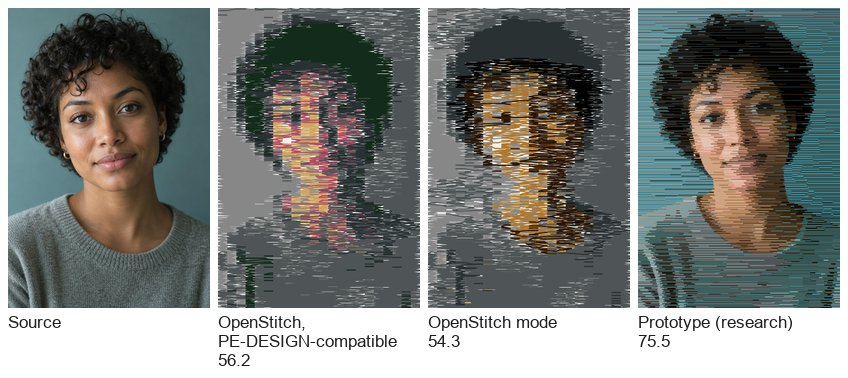
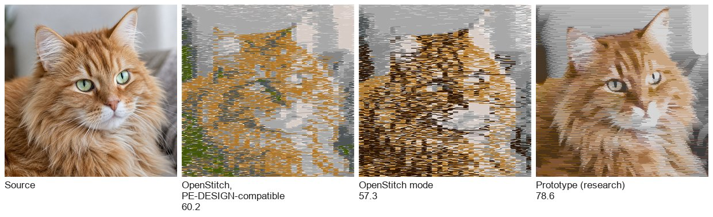
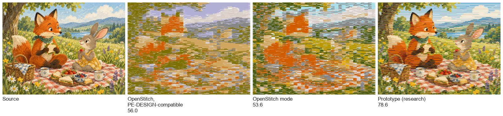
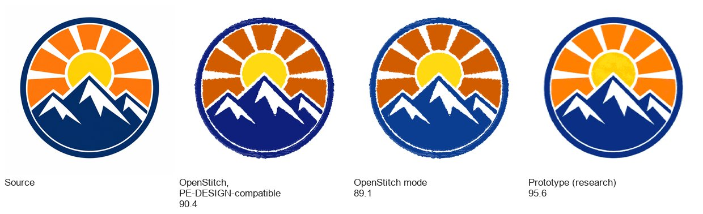
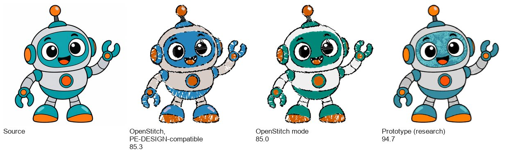
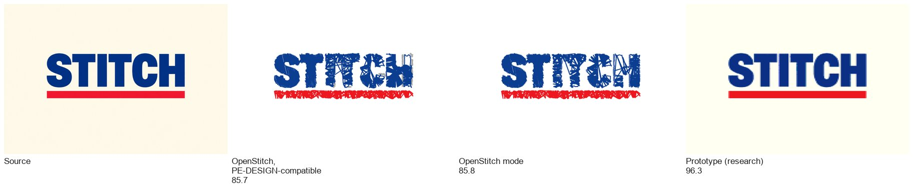
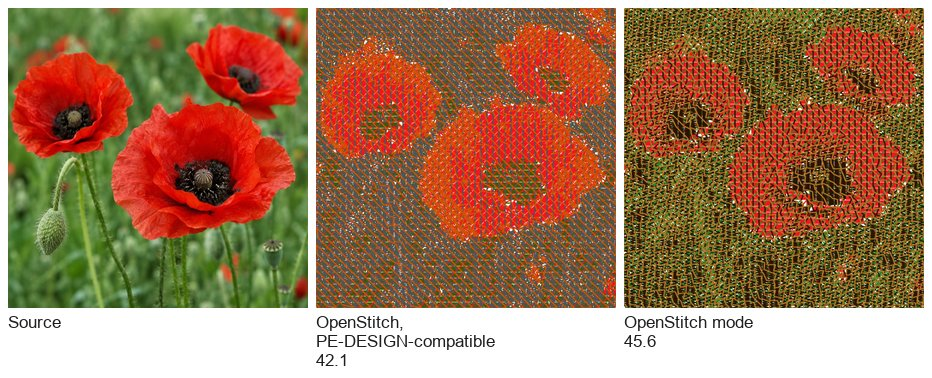
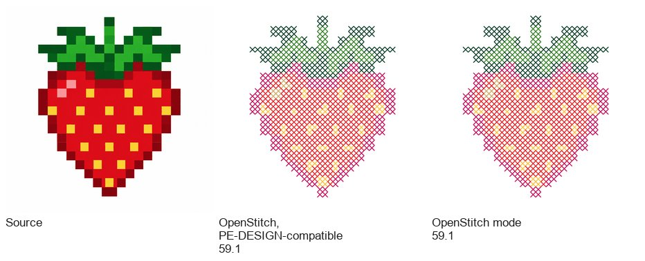

# B16.1. Image similarity: a measured plan towards 95 %

Research date: 2026-10-31. Requested by the owner: the image wizards' results, OpenStitch mode
included, "still do not resemble the source images", and the target is at least 95 %
similarity. This note:
- fixes how similarity is measured;
- measures today's tools and the ceilings each limit allows;
- ranks the causes;
- sets out a phased backlog with acceptance criteria per tool and image class.

It is research only. Nothing here is implemented. It builds on [image-digitizing.md](image-digitizing.md) (B16).

## 1. Summary

- **The metric** (agreed with the owner, section 2) is one 0–100 % score:
  - 40 % structure, MS-SSIM on lightness;
  - 40 % colour, 95 % at ΔE00 3;
  - 20 % perceptual, DISTS.

  It is computed on a thread render seen at actual size from 40 cm (S-CIELAB eye model).
- **Today, flat-thread render, PE-DESIGN-compatible mode → OpenStitch mode:** PE-DESIGN-compatible mode is OpenStitch's reimplementation of PE-DESIGN 11's method, not PE-DESIGN's own output.

  | Tool | Score |
  |---|---|
  | Auto Punch | 78.9 → 78.4 |
  | Photo Stitch 1 | 58.7 → 55.8 |
  | Photo Stitch 2 | 43.4 → 44.9 |
  | Cross Stitch | 51.3 (no OpenStitch mode) |

  On this metric OpenStitch mode is no better overall. Its CIELAB dithering lowers the 2 mm-cell colour error that B16 measured, but it adds fine noise that the structure and perceptual terms see.
- **95 % is reachable for logos, clip art and lettering**, but not with the Brother chart alone:
  - With every thread colour of the built-in brand charts and crisp regions, the ideal reaches 94.7–96.3 % (emblem, robot, lettering).
  - With the Brother chart it stops at 87–93 %.
- **95 % is not reachable for photos while the result stays sewable.**
  - A perfect-colour fill sampled at 0.5 mm scores 95–99 %, so thread itself is not the limit.
  - At PE-DESIGN's needle density (≤ 2.1 points/mm², the owner's cap), the best prototypes reach 75–79 %. Today's Photo Stitch 1 scores 54–60 %.
  - The owner set 85 % as a firm target for Photo Stitch 1 High fidelity. Reaching it needs the later phases (direction, metric-driven optimisation) to add 6–10 points that are not yet measured. Section 7 states this risk.
- **The four largest causes, by measured impact:**
  1. Photo Stitch 1 samples colour only every 3 mm along a row (−15 to −20 points).
  2. Thread choice: nearest thread to a k-means centre, from one 64-colour chart (−5 to −10).
  3. The realistic view's shading turns black thread to grey 74 and white to 238 (−9 ΔE on the realistic render; to be calibrated against a sew-out).
  4. Auto Punch leaves out a coloured background (balloon: 76 against a 92 ceiling).

## 2. The metric

Agreed with the owner, 2026-10-31 (interview questions 1, 2 and 8, research questions 1, 2 and 4):

1. **Render.** The design's stitches are drawn in sewing order as 0.4 mm thread on white fabric at
   20 px/mm.
   - **Flat render** (used until Phase 0's calibration): each stitch in its plain thread colour.
   - **Realistic render:** the app's realistic view (`workspace_ui::draw_realistic`), with an edge at 0.55× the colour, the body, and a highlight lifted 45 % towards white on the middle 60 %.
   - Phase 0 recalibrates the realistic render against a photographed sew-out. The calibrated render then becomes the scored one.
2. **Viewing.** Both the source (composited on white) and the render are area-averaged in
   linear light to 6 px/mm (about 150 dpi, the design at actual size). The long side is 100 mm, as in `tools/image_eval.py`.
3. **Eye model.** S-CIELAB (Zhang and Wandell, 1996):
   - opponent channels filtered by the eye's contrast sensitivity at 40 cm (41.9 samples per degree), reflecting at the image edges;
   - then CIELAB.
4. **Terms.**
   - **S** = MS-SSIM (Wang, Simoncelli and Bovik, 2003; 5 scales, σ 1.5) on the filtered L*.
   - **C** = max(0, 1 − ΔE00/60), from the mean CIEDE2000 between the filtered images. ΔE 3 scores 95 %.
   - **P** = 1 − DISTS (Ding et al., 2020). DISTS tolerates thread texture that is "the same texture, resampled", where pixel metrics do not. It is evaluation-only (PyTorch with the published weights) and never shipped.
5. **Score** = 0.4 S + 0.4 C + 0.2 P.
6. **Sewability** is measured beside the score, and a result that breaks a limit fails whatever it scores (section 6):
   - needle points per mm² over the design;
   - shortest stitch;
   - trims;
   - colours.

**Sanity checks:**
- The source against itself scores 100 %.
- The source box-downsampled to 1 px/mm scores ΔE 2.5 and MS-SSIM 0.95, so the metric is not over-sensitive to softness.
- An unsewn 1-pixel border no longer swamps the score. A first version clamped the eye filter at the edges and read ΔE 10.8 for a near-perfect render. Reflecting at the edges fixed it.

**Prototype:** `simmetric.py`, `sim_eval.py` (the image wizards through `stitchtool serve`, like `image_eval.py`) and `ceiling.py` (idealised fills). They are in the sessions' shared notes folder, not in the repository. Phase 0 lands them as `tools/image_similarity.py`.

## 3. Baselines

All 34 cases of `tools/image_eval.py` (Higgsfield test images, `examples/images`), defaults,
commit 79acdfe (alpha.8). Flat render. Each cell reads PE-DESIGN-compatible mode → OpenStitch mode.

| Case | Score | ΔE | MS-SSIM | DISTS |
|---|---|---|---|---|
| g01 emblem, Auto Punch | 90.4 → 89.1 | 6.2 → 8.0 | 0.96 → 0.96 | 0.20 → 0.20 |
| g02 balloon, AP | 76.0 → 78.8 | 17.1 → 14.5 | 0.83 → 0.85 | 0.28 → 0.28 |
| g05 robot, AP | 85.3 → 85.0 | 7.5 → 8.1 | 0.89 → 0.88 | 0.26 → 0.25 |
| g06 watercolour, AP | 82.7 → 82.3 | 8.5 → 7.7 | 0.86 → 0.84 | 0.29 → 0.31 |
| g08 lettering, AP | 85.7 → 85.8 | 9.3 → 9.3 | 0.95 → 0.95 | 0.30 → 0.29 |
| g11 mandala, AP | 69.7 → 67.3 | 7.8 → 7.9 | 0.57 → 0.54 | 0.41 → 0.45 |
| g13 mosaic, AP | 74.5 → 78.5 | 16.7 → 14.6 | 0.77 → 0.85 | 0.25 → 0.28 |
| g15 folk bird, AP | 84.3 → 84.6 | 12.1 → 12.1 | 0.91 → 0.91 | 0.21 → 0.20 |
| p03 storybook, AP | 70.8 → 67.2 | 13.8 → 15.5 | 0.68 → 0.59 | 0.36 → 0.31 |
| d01 noisy fruit, AP | 69.2 → 65.0 | 14.9 → 15.9 | 0.66 → 0.57 | 0.36 → 0.36 |
| p01 portrait, Photo Stitch 1 | 56.2 → 54.3 | 18.3 → 18.4 | 0.44 → 0.40 | 0.46 → 0.47 |
| p04 cat, PS1 | 60.2 → 57.3 | 13.6 → 15.8 | 0.49 → 0.45 | 0.51 → 0.51 |
| p07 fruit, PS1 | 56.9 → 55.0 | 17.2 → 17.4 | 0.45 → 0.40 | 0.48 → 0.48 |
| p03 storybook, PS1 | 56.0 → 53.6 | 17.5 → 17.2 | 0.45 → 0.39 | 0.52 → 0.52 |
| p05 dog, PS1 | 57.4 → 50.1 | 17.9 → 19.6 | 0.48 → 0.34 | 0.49 → 0.51 |
| p06 sunset, PS1 | 60.3 → 60.4 | 14.3 → 12.5 | 0.45 → 0.43 | 0.41 → 0.43 |
| p10 night street, PS1 | 45.6 → 44.1 | 22.1 → 22.2 | 0.23 → 0.20 | 0.45 → 0.45 |
| p11 high key, PS1 | 75.5 → 62.0 | 7.1 → 10.0 | 0.73 → 0.46 | 0.45 → 0.50 |
| g09 gradient, PS1 | 60.6 → 65.5 | 15.7 → 14.9 | 0.49 → 0.60 | 0.43 → 0.43 |
| p08 poppies, Photo Stitch 2 | 42.1 → 45.6 | 26.8 → 21.8 | 0.25 → 0.25 | 0.50 → 0.49 |
| g09 gradient, PS2 | 49.3 → 45.2 | 24.3 → 25.7 | 0.40 → 0.32 | 0.52 → 0.53 |
| p01 portrait, PS2 | 42.1 → 39.6 | 24.3 → 25.8 | 0.22 → 0.19 | 0.53 → 0.54 |
| p04 cat, PS2 | 46.3 → 51.5 | 23.1 → 17.7 | 0.32 → 0.36 | 0.56 → 0.55 |
| p06 sunset, PS2 | 42.0 → 46.6 | 25.4 → 22.8 | 0.21 → 0.29 | 0.48 → 0.49 |
| p07 fruit, PS2 | 38.9 → 41.1 | 27.0 → 25.9 | 0.20 → 0.23 | 0.56 → 0.55 |
| p08 poppies, PS2 CMYK | 38.7 → 32.9 | 33.9 → 33.4 | 0.30 → 0.14 | 0.54 → 0.53 |
| g07 pixel strawberry, Cross Stitch | 59.1 | 24.0 | 0.58 | 0.41 |
| g15 folk bird, CS | 48.0 | 30.2 | 0.41 | 0.41 |
| g02 balloon, CS | 58.8 | 24.1 | 0.62 | 0.49 |
| g05 robot, CS | 62.0 | 16.5 | 0.57 | 0.50 |
| g12 deer stencil, CS | 67.0 | 17.4 | 0.70 | 0.47 |
| p03 storybook, CS | 30.5 | 33.8 | 0.12 | 0.58 |
| p04 cat, CS | 33.8 | 30.6 | 0.19 | 0.66 |

Per tool, mean score:

| Tool | PE-DESIGN-compatible mode, flat | OpenStitch mode, flat | PE-DESIGN-compatible mode, realistic | OpenStitch mode, realistic |
|---|---|---|---|---|
| Auto Punch (10) | 78.9 | 78.4 | 76.5 | 76.5 |
| Photo Stitch 1 (9) | 58.7 | 55.8 | 57.2 | 55.2 |
| Photo Stitch 2 (6) | 43.4 | 44.9 | 44.3 | 46.0 |
| Cross Stitch (7) | 51.3 | 51.3 | 50.0 | 50.0 |

**Design Center** has no case in `image_eval.py` yet. Phase 0 adds g03 teapot and g04 butterfly.

## 4. Ceilings: what each limit costs

`ceiling.py` builds an idealised horizontal photo fill:
- rows 0.25 mm apart;
- colour sampled every *step* mm along each row;
- equal neighbours merged into stitches of at most 3 mm.

It varies one limit at a time. Flat render. Selected rows:

| Variant | p01 portrait | p04 cat | p03 storybook | p06 sunset | g01 emblem | g05 robot | g08 lettering | g13 mosaic |
|---|---|---|---|---|---|---|---|---|
| Exact colours, 0.5 mm | **95.1** | **97.8** | **96.7** | **98.7** | 98.3 | 97.8 | 98.2 | 98.9 |
| Exact colours, 3 mm (PS1's run pitch) | 76.1 | 76.8 | 71.6 | 90.0 | 82.1 | 80.5 | 92.0 | 84.2 |
| 10 Brother threads as today, dithered, 0.5 mm | 81.0 | 85.0 | 82.6 | 74.7 | 86.3 | 83.6 | 88.2 | 66.8 |
| 16 Brother threads by pruning, dithered | 83.4 | 85.5 | 85.8 | 79.3 | 87.0 | 85.9 | 85.1 | 72.1 |
| Whole Brother chart, dithered | 84.6 | 86.2 | 88.9 | 78.6 | 86.8 | 86.3 | 84.4 | 73.7 |
| All brands' charts, dithered | 89.5 | 93.4 | 92.7 | 89.9 | 92.3 | 93.1 | 91.4 | 80.4 |
| Whole Brother chart, nearest (no dither) | – | – | – | – | 90.3 | 92.7 | 92.8 | 87.4 |
| All brands' charts, nearest | – | – | – | – | **95.6** | **94.7** | **96.3** | 88.7 |
| 8 free colours (k-means), nearest | – | – | – | – | 97.2 | 95.8 | 97.8 | 78.5 |

With the realistic render's current shading, the exact-colour portrait falls from 95.1 to 82.6
(ΔE 1.9 → 11.4). A full field of black thread renders as grey 74 and white as 238.

**At the sewing-density cap** (≤ 2.1 needle points per mm², PE-DESIGN's Photo Stitch 1 level):

| Variant at ≈ 2.1 points/mm² | p01 | p04 | p03 |
|---|---|---|---|
| PE-like: 10 threads, 3 mm cells, dithered | 64.3 | 66.8 | 62.6 |
| 16 Brother threads, rate-constrained rows (method T3) | 72.5 | 74.5 | 75.4 |
| 16 threads from all brands, T3 | 75.5 | **78.6** | 75.8 |
| Whole Brother chart, T3 | 75.4 | 75.7 | **78.6** |

The same rate-constrained rows at higher densities:

| Density, p01 | Score |
|---|---|
| 2.7 points/mm² | 75.6 |
| 4.0 points/mm² | 78.3 |
| 6.7 points/mm² | 80.8 |

Rows 0.4 mm apart instead of 0.25 are worse at equal density (70.0 against 72.5): the rows give the vertical mixing that the cap takes from the rows.

By eye, the rate-constrained portrait is recognisable where today's Photo Stitch 1 is a
3 mm mosaic. It shows horizontal streaks, though: the switch penalty makes long single-thread
runs in mid-tones. T8 (rows that bend with the image) and T9 (metric-driven boundary moves)
target them.

**Other tools:**
- **Photo Stitch 2's four threads:** the ceiling is 74–80 (prune4/prune6, dithered at 0.5 mm, ignoring the line look).
- **Cross Stitch's 2.5 mm grid** (perfect colour blocks):

  | Image | 2.5 mm grid | 1.5 mm grid |
  |---|---|---|
  | g07 pixel strawberry | 87.4 | 90.9 |
  | g15 folk bird | 69.0 | 80.4 |
  | g05 robot | 76.5 | 83.9 |
  | p04 cat | 74.9 | 84.3 |

**What the ceilings say:**
- **Thread is not the limit.** Exact colours at 0.5 mm score 95–99 on every image.
- **Photos:**
  - Sampling resolution and needle density are the binding limits.
  - Thread choice and chart breadth come next.
  - The best sewable result is about 79 today, against a 95+ unconstrained ceiling.
- **Flat graphics:** the thread chart is the binding limit.
  - Dithering hurts flat areas (g13: 87.4 nearest against 73.7 dithered).
  - A broader chart lifts the emblem from 90 to 96.
- **Cross Stitch on photos:** 95 % is out of reach at any practical cell size. Pixel art approaches 90.

## 4.1 Visual comparison

The images in each row, left to right:
- the source;
- OpenStitch in PE-DESIGN-compatible mode;
- OpenStitch mode;
- the best prototype, where one exists.

No picture shows PE-DESIGN's own output: every image after the source is an OpenStitch render.

Every result is the flat render at viewing scale, with its composite score. The prototypes are Python experiments (section 4), not product output:
- **Photo rows:** rate-constrained rows at ≤ 2.1 needle points/mm² (T2–T5).
- **Graphics rows:** every built-in brand chart, nearest thread, no dithering.

**Photo Stitch 1, portrait** (prototype: 16 threads from all brands)

**Photo Stitch 1, cat** (prototype: 16 threads from all brands)

**Photo Stitch 1, storybook** (prototype: whole Brother chart)

**Auto Punch, emblem**

**Auto Punch, robot**

**Auto Punch, lettering**

**Photo Stitch 2, poppies** (no prototype; its four-thread ceiling is 74–80)

**Cross Stitch, pixel strawberry** (no OpenStitch mode yet; the ceiling at 2.5 mm is 87.4)

## 5. Root causes, ranked by measured impact

| # | Cause | Where | Impact (points) | Evidence |
|---|---|---|---|---|
| R1 | Photo Stitch 1 samples one colour per 3 mm along each row (`cols = width / pitch`): a 100 mm design is 33 colour columns | `photo.rs::convert` | −15 to −20 on photos | exact 3 mm against 0.5 mm: 76 against 95 (p01), 72 against 97 (p03) |
| R2 | Realistic-view shading: edge 0.55×, highlight lifted 45 %, so black renders as 74 and white as 238 | `workspace.rs::thread_shades` | −9 ΔE on the realistic render | exact portrait 95.1 flat against 82.6 shaded; needs a sew-out to know the truth |
| R3 | Palette: k-means centres snapped to the nearest thread; centres collapse onto the same thread (10 asked, 7 distinct on p01) | `palette.rs`, `perceptual.rs` | −3 to −10 | whole chart 84.6 against 10 as today 81.0 (p01); g07 70.8 against 83.5 |
| R4 | One brand's 64 colours | `openstitch-core::charts` PEC only | −4 to −8 | all brands: emblem 90.3 → 95.6, cat 86.2 → 93.4 |
| R5 | Dithering everywhere, including flat areas, adds noise that MS-SSIM and DISTS punish | `palette::dither_perceptual` | −2 to −14 on graphics; −3 on PS1 (OpenStitch against PE-DESIGN-compatible mode) | g13 nearest 87.4 against dithered 73.7; p11 PE-DESIGN-compatible 75.5 against OpenStitch 62.0 |
| R6 | Auto Punch leaves out the border colour even when it is not the fabric colour | `autopunch.rs` `skip_background` | up to −16 per image | g02 76 against a 92 ceiling: the blue sky is not sewn |
| R7 | No density/coverage model: no penetration budget, and travel and trims are not optimised against likeness | `photo.rs::fill_layer` | indirect: OpenStitch PS1 has 13 % more trims | B16 2.3 |
| R8 | Photo Stitch 2: four threads, a line screen with fabric between lines, shares from one reduced colour per thread | `screen.rs` (#129) | ceiling 74–80 against 39–51 today | prune4 ceiling, baselines |
| R9 | Cross Stitch: a 2.5 mm cell, single crosses with fabric between the diagonals, colour by modal vote | `cross.rs` | −10 to −20 on graphics against the block ceiling | g07 59 against 87; g15 48 against 69 |
| R10 | Auto Punch region outlines come from a 400 px working raster and regions under 1–3 mm² merge, so thin lines and small details are lost | `autopunch.rs`, `regions.rs` | −2 to −7 | g05 85 against 92.7 nearest ceiling; mandala MS-SSIM 0.57 |
| R11 | Fill rows at one fixed angle per object: fur, hair and petals cannot follow the image | `photo.rs`, `screen.rs` | not measured; DISTS and texture terms suggest 2–5 on fur and portraits | literature (section 6, T8) |

## 6. Techniques, with evidence, cost and fit

Each technique is evaluated with:
- its expected gain (measured where a prototype exists, estimated otherwise);
- its cost;
- its fit with the Rust codebase;
- how it keeps cross-platform determinism.

General rule for determinism:
- All new arithmetic runs in `f64` on fixed iteration orders, single-threaded per image.
- No hash-map iteration order reaches the output.
- Ties are broken by index.
- Transcendental maths in the design crate goes through `openstitch_design::fmath::Det`. `openstitch-digitize` already uses CIELAB `cbrt`/`powf` in `perceptual.rs`; T0 moves those through `Det` too.
- Any randomness (k-means seeding, sampling) uses a fixed seed and a portable PRNG such as SplitMix64, owned in-crate.

| ID | Technique | Fixes | Expected gain | Cost | Determinism |
|---|---|---|---|---|---|
| T0 | **Metric and harness:** the scorer in `tools/`, Design Center cases, sewability report (points/mm², shortest stitch, trims) | – | enables everything | S | evaluation is Python; the product is untouched |
| T1 | **Render calibration:** a test card (thread swatches at 3 densities, grey ramp, photo patch) sewn and photographed with a grey card. Fit edge/body/highlight factors and fabric show-through so the render's mean colour matches the photo. | R2 | realistic-render scores rise 5–10 points; prevents optimising against a wrong render | S + one sew-out | render constants are plain numbers |
| T2 | **Fine colour sampling with variable stitch boundaries (PS1):** sample every 0.25 mm. A stitch ends wherever the colour changes, at most 3 mm and at least 1 mm long, so the 3 mm Run Pitch becomes a maximum, not the cell size. | R1 | +8 to +12 at equal density (p01 64.3 → 72.5) | M | integer grid, f64 sums, fixed scan order |
| T3 | **Rate-constrained rows (Viterbi):** each row's thread sequence minimises Lab error + λ · colour switches (dynamic programming), with the error carried to the next row (¼, ½, ¼). λ is set by bisection to meet the needle-density cap. | R1, R5, R7 | measured in T2's figures; holds the 2.1 cap exactly | M | DP is exact; ties to the lower index; λ bisection runs a fixed 20 steps |
| T4 | **Thread selection for the image** (backward elimination from the whole chart, cost = rise in nearest CIEDE2000), replacing centre-snapping | R3 | +2 to +12 (g07 70.8 → 83.5, p01 81.0 → 83.4 at 16) | S | sampling with a fixed seed; ties by chart index |
| T5 | **Broader charts and the user's inventory:** pick from every built-in brand chart, or only from a "My Threads" list (B13) | R4 | +4 to +8 (emblem 90.3 → 95.6; cat 86.2 → 93.4) | M: B13 conversion, UI | chart data is static |
| T6 | **Dither only where the image is tonal:** a local variance/edge map (structure tensor trace, Sobel) decides per region whether to dither or fill flat with the nearest thread | R5 | +5 to +14 on graphics; avoids the p11 −13 regression | S | Sobel on integers; thresholds fixed |
| T7 | **Sew the background when it is not the fabric:** compare the border colour with the fabric colour (ΔE > 5) | R6 | g02 +10 to +15 | S | plain comparison |
| T8 | **Direction from image structure:** a structure-tensor orientation field (Kass and Witkin, 1987) smoothed at about 2 mm. Photo fill rows bend along it (streamline rows, as in hedcut and "stroke-based rendering", Hertzmann 1998); Auto Punch fill angle per region from it. The owner reports counsel's opinion that US 7,996,103 does not hold for this case (2026-10-31); record that opinion in patents.md before building. | R11 | estimate +2 to +5 on fur, hair, petals (DISTS texture term); none on flat graphics | L | `atan2` and `hypot` via `fmath::Det`; streamline integration with fixed step, RK2 in f64 |
| T9 | **Metric-driven optimisation:** after T2–T4, local search (direct binary search, Analoui and Allebach 1992; structure-aware halftoning, Pang et al. 2008) swaps run colours and moves run boundaries when the S-CIELAB-filtered error falls, within the density cap | R1, R5 | estimate +3 to +6 on photos (DBS beats error diffusion on HVS-weighted error in the halftoning literature) | L; runtime seconds to a minute at High fidelity | fixed visiting order, a fixed number of passes, no threads; Gaussian kernels precomputed as rational weights |
| T10 | **Saliency-weighted budget:** spend the penetration budget where it matters (faces, eyes, edges): spectral-residual saliency (Hou and Zhang, 2007) or an edge-density map. A face detector is out (ML). | R7 | estimate +1 to +3 on portraits, more by eye than by the metric | M | FFT-free variant (box filters) to avoid platform FFT differences |
| T11 | **Edge-aware segmentation for Auto Punch** (SLIC, Achanta et al. 2012, already B16 3.3) at a finer working raster (800 px), with the line-art keep rule for thin details | R10 | +2 to +7 on painted and cartoon images (g05 85 → 92 ceiling) | M | SLIC with fixed seeds on a grid, fixed iterations |
| T12 | **Satin outlines for dark contour lines:** a skeleton satin (B16 3.4) for the black outlines of clip art | R10 | +1 to +3 on clip art; also cleaner sew-outs | L | Zhang–Suen thinning is integer |
| T13 | **Photo Stitch 2 OpenStitch rework:** 4–6 threads chosen by T4; shares by least squares in linear light, so the lines' mix reproduces the colour, not "one thread per reduced colour"; line density from a calibrated coverage model (#129) | R8 | estimate +10 to +20 towards its 74–80 ceiling | M | linear algebra on 4–6 unknowns per cell, fixed-order solve |
| T14 | **Cross Stitch OpenStitch mode:** cell colour by mean Lab with T4's thread selection (not modal vote); optional ¾ and quarter crosses on edges; optional double crosses for coverage | R9 | +5 to +15 on graphics (g07 59 → 80s) | M | integer votes replaced by f64 means in fixed order |
| T15 | **Layered blends:** two threads overlapping at partial density to make an intermediate colour (gradient blend fills) | R3, R4 | similar to dithering by the eye model; useful only within the density cap if it replaces, not adds, layers | M | as T3 |
| T16 | **ML segmentation or matting** (B16 3.7) | background | not needed for the metric; deferred | L | model inference determinism is hard to prove; out of scope |

T2 and T3 are measured together: the "rate-constrained rows" rows of section 4. T4 is measured
("16 Brother threads by pruning"). T5 is measured ("all brands"). T6 and T7 are measured indirectly (nearest against
dithered; g02's ceiling). T8–T10, T13 and T14 are estimates from the literature and must be
measured before they are accepted.

## 7. Phased backlog

Order agreed with the owner: improvements that help every tool first, then Photo Stitch 2,
Photo Stitch 1, Auto Punch, Cross Stitch, Design Center. All work lives in the OpenStitch mode
(`compatMode: openStitch`). **PE-DESIGN-compatible mode stays exactly as it is.** Its compat specs and
captures must not change.

### Phase 0 — measurement (first, small)

| Task | Crates / files | Validation |
|---|---|---|
| T0: land the scorer as `tools/image_similarity.py`, with a `--render flat|realistic`, Design Center cases (g03, g04) and a sewability report | `tools/` | reproduces section 3 within ±0.2 points |
| T1: test card design (OpenStitch-generated `.pes`), photo protocol (grey card, fixed distance, diffuse light), owner sews and photographs it | `examples/`, docs | render's swatch colours within ΔE 3 of the photo; grey ramp monotone |
| T1: fit and apply the calibrated realistic-render constants | `openstitch-app` (`thread_shades`), `tools/` | realistic view and scorer use the same constants; screenshot specs updated |
| Move `perceptual.rs`'s `cbrt`/`powf` through a `Det`-style deterministic path and add it to the source-scan test | `openstitch-digitize`, `openstitch-design::fmath` | the scan test passes; Linux/Windows/macOS hashes of OpenStitch-mode output equal |
| A cross-platform golden test: OpenStitch-mode outputs of three test images hashed in CI on all three OSes | `openstitch-digitize` tests, CI | identical hashes |

### Phase 1 — shared colour engine (all tools)

| Task | Crates | Expected gain | Risk | Validation |
|---|---|---|---|---|
| T4 thread selection by backward elimination | `openstitch-digitize::palette`, `perceptual` | +2 to +12 | low | every tool's score ≥ before; the colour count is the user's |
| T5 multi-chart and My Threads source | `openstitch-core::charts`, B13, app dialog | +4 to +8 on graphics | medium (UI, thread-brand data) | emblem ≥ 95 with all brands |
| T6 tonal/flat map: dither only tonal regions | `openstitch-digitize::palette` | +5 to +14 on graphics; no PS1 regression | low | p11 ≥ PE-DESIGN-compatible mode; g13 ≥ 85 |
| Fidelity setting (Standard / High) in the image dialog; High raises the colour count (up to 24) and enables the costlier passes, never the density cap | `openstitch-app`, `stitchtool` params | – | low | dialog spec; parameter round-trips |

### Phase 2 — Photo Stitch 2 (largest gap)

| Task | Crates | Expected gain | Risk | Validation |
|---|---|---|---|---|
| T13 least-squares shares and T4 threads, 4–6 threads | `screen.rs`, `photo.rs` | +10 to +20 | medium: line screen look must stay | PS2 photo mean ≥ 75 |
| Coverage model calibrated on the T1 card (#129) | `screen.rs` | +2 to +5 | needs the sew-out | the card's measured coverage per density within 10 % |

### Phase 3 — Photo Stitch 1 (High fidelity, 85 % firm target)

| Task | Crates | Expected gain | Risk | Validation |
|---|---|---|---|---|
| T2 fine sampling with variable stitch boundaries | `photo.rs` | +8 to +12 | low | p01 ≥ 72 at ≤ 2.1/mm²; no stitch < 1 mm |
| T3 rate-constrained rows with a density cap | `photo.rs`, new `rows.rs` | included above; holds the cap | medium (runtime: about 1 s per image in Rust, estimated from the Python prototype's 3 s) | density report ≤ 2.1/mm² on every case |
| T8 structure-tensor direction for rows | `photo.rs`, `openstitch-design::fmath` | +2 to +5 on fur, hair | medium: sewing smooth curved rows; record counsel's opinion first | p04 cat and p01 portrait gain ≥ 2 |
| T9 metric-driven local search | new `optimise.rs` | +3 to +6 | high: runtime, determinism of a long optimisation | identical output on three OSes; ≤ 60 s per image at High fidelity |
| T10 saliency-weighted budget | `photo.rs` | +1 to +3 | low | portrait eyes visible in the owner's review |

Re-assess the 85 % target at the end of Phase 3, against section 8. If the measured mean is
below 85 % with T2–T10 in, report it with the remaining gap per image rather than lowering the
target silently.

### Phase 4 — Auto Punch

| Task | Crates | Expected gain | Risk | Validation |
|---|---|---|---|---|
| T7 sew a coloured background | `autopunch.rs` | g02 +10 to +15 | low | g02 ≥ 88 |
| T11 SLIC regions at 800 px, line-art keep | `regions.rs`, `autopunch.rs` | +2 to +7 | medium: specks and trims | specks 0, trims ≤ PE-DESIGN-compatible mode |
| T12 skeleton satin for outlines | `autopunch.rs`, `center.rs` | +1 to +3 | medium | clip-art cases ≥ 95 with T5 |
| T8 per-region fill angle from the orientation field | `autopunch.rs` | +1 to +3 on painted images | low | p03 and g06 gain |

### Phase 5 — Cross Stitch and Design Center

| Task | Crates | Expected gain | Risk | Validation |
|---|---|---|---|---|
| T14 Cross Stitch OpenStitch mode: mean-Lab cells, T4 threads, edge part-crosses | `cross.rs` | +5 to +15 on graphics | low | g07 ≥ 85; pixel art ≥ 90 at the user's cell size |
| Design Center OpenStitch mode: region colours by T4/T5 instead of the nearest PEC; line threshold from Otsu instead of a fixed value | `center.rs` | to be measured in Phase 0 | low | g03, g04 ≥ 95 |

## 8. Acceptance criteria

Composite score (section 2), on the calibrated realistic render once T1 lands (on the flat render
before), long side 100 mm, defaults of the Fidelity level named, on the Higgsfield test images
plus any added ones.

| Tool | Image class | Level | Target (owner, 2026-10-31) | Today (flat, best mode) | Measured ceiling |
|---|---|---|---|---|---|
| Auto Punch | logos, clip art, lettering (g01, g05, g08, g15) | High | **≥ 95 %** each | 84–90 | 95–96 with all brands |
| Auto Punch | painted, watercolour, mosaic, noisy (g06, g13, p03, d01) | High | ≥ 85 % | 69–83 | 80–93 |
| Photo Stitch 1 | photos (p01, p03–p07, p10, p11) | High | **≥ 85 % (firm)** | 46–76 | 75–79 measured at the cap; 95+ unconstrained |
| Photo Stitch 2 | photos | High | ≥ 75 % | 41–52 | 74–80 |
| Cross Stitch | photos | High | ≥ 75 % | 31–34 | 75 (2.5 mm) – 84 (1.5 mm) |
| Cross Stitch | pixel art, clip art | High | ≥ 90 % | 48–67 | 87–91 |
| Design Center | line art (g03, g04) | High | ≥ 95 % | not measured | not measured |
| All | all | Standard | ≥ PE-DESIGN-compatible mode's score on every image | – | – |

**Every result also passes the sewability gate.** No sewing error of any kind is permitted (owner, interview question 9). The gate:
- needle points ≤ 2.1 per mm² over any 10 × 10 mm window, at both levels (owner);
- no stitch shorter than 1.0 mm or longer than 7 mm;
- at most two thread layers anywhere;
- every jump over 7 mm trimmed;
- colours ≤ 24 at High and ≤ the user's count at Standard;
- the design passes OpenStitch's design check and loads on the owner's machine;
- sew-out spot checks on the T1 setup, one image per tool per phase.

**Determinism gate:** identical stitch output hashes on macOS, Linux and Windows for every case.

## 9. Open questions

1. **Counsel's opinion on US 7,996,103:**
   - The owner reports that their lawyer found the patent does not hold for image-derived direction here.
   - patents.md should record it: date, scope and which variant (per-pixel field with streamline rows, with or without connector tests).
   - T8 starts only after that record exists.
2. **The 85 % photo target at 2.1 points/mm²** is firm by the owner's decision. The measured prototypes reach 75–79; the rest depends on T8–T10, which are estimates. The owner declined raising the density. Re-assess at the end of Phase 3.
3. **Thread inventory:**
   - Which brands the owner and users actually stock.
   - Whether High fidelity may ask for threads the user does not own: a shopping list against "My Threads only".
4. **Calibration card:** fabric and stabiliser, and the machine the owner sews it on (hoop size limits the card).
5. **Weights:** 0.4/0.4/0.2 is a starting point. The owner's review of the side-by-side report should confirm that a higher score looks closer. If not, refit the weights to the owner's ranking of 10–20 pairs.
6. **More test images:** the owner allowed new Higgsfield images. Gaps worth filling:
   - a logo with a gradient;
   - a face at small size (50 mm);
   - a dark, low-key photo;
   - text in a photo.

   They will be added in Phase 0 with PROVENANCE entries.

## Sources

- Zhang, X., and Wandell, B. A. (1996). A spatial extension of CIELAB for digital color image reproduction (S-CIELAB). SID Digest.
- Wang, Z., Simoncelli, E. P., and Bovik, A. C. (2003). Multi-scale structural similarity for image quality assessment.
- Ding, K., Ma, K., Wang, S., and Simoncelli, E. P. (2020). [Image quality assessment: unifying structure and texture similarity](https://arxiv.org/pdf/2004.07728v2) (DISTS). IEEE TPAMI 44(5), 2022.
- Ding, K., et al. (2020). [Comparison of image quality models for optimization of image processing systems](https://arxiv.org/pdf/2005.01338).
- Sharma, G., Wu, W., and Dalal, E. N. (2005). The CIEDE2000 color-difference formula.
- Xue, W., et al. (2014). Gradient magnitude similarity deviation (GMSD).
- Pang, W.-M., Qu, Y., Wong, T.-T., Cohen-Or, D., and Heng, P.-A. (2008). [Structure-aware halftoning](https://www.cse.cuhk.edu.hk/~ttwong/papers/structurehalftone/structurehalftone.html). ACM TOG 27(3).
- Analoui, M., and Allebach, J. P. (1992). Model-based halftoning using direct binary search.
- [Efficient halftoning via deep reinforcement learning](https://arxiv.org/pdf/2304.12152) (2023), for the survey of optimisation-based halftoning and contrast-weighted SSIM.
- Kass, M., and Witkin, A. (1987). Analyzing oriented patterns (structure tensor).
- Hertzmann, A. (1998). Painterly rendering with curved brush strokes of multiple sizes.
- Hou, X., and Zhang, L. (2007). Saliency detection: a spectral residual approach.
- Achanta, R., et al. (2012). SLIC superpixels.
- Yang, K., and Sun, Z. (2018). [Random-needle embroidery image stylization](https://www.jcad.cn/article/doi/10.3724/SP.J.1089.2018.16471); [Stitch-based image stylization for thread art using sparse modeling](https://link.springer.com/10.1007/978-3-319-73603-7_39) (MMM 2018).
- Goldman, D. [US 6,947,808](https://patents.google.com/patent/US6947808), automatically generating embroidery designs from a scanned image (background only).
