# Ready-to-sew designs

Embroidery files made by OpenStitch, ready to copy to a machine: designs to try every feature,
calibration designs that help develop OpenStitch, and the compatibility checks that need a
sew-out. Each one below has a description, a preview (OpenStitch's Realistic view) and, for the
image tools, the source image. In the editor, **Help ▸ Ready-to-Sew Designs** opens this folder.

All files are PES (version 6, with the thread colours) for a single-needle Brother machine. They
were written for and are sized to the **Brother NV880E** (Innov-is 880E) and its three hoops:

| Hoop | Embroidery area | Designs |
|---|---|---|
| S | 100 × 100 mm | most designs, every calibration design and machine check |
| M | 150 × 150 mm | the monograms, the portrait and the poppies |
| L | 260 × 160 mm | the storybook picture |

Other Brother, Babylock and Bernette machines that read PES can sew them too, in a hoop at least as
large. `manifest.json` lists every file with its size, stitch count, threads and SHA-256.

## How to sew them

- **Needle:** a 75/11 embroidery needle (the kit is set up for a Schmetz 75/11). Use a fresh one
  for the calibration designs.
- **Thread:** 40 wt embroidery thread on top, 60 wt bobbin thread. The colours are Brother
  Embroidery threads, named with their catalogue codes (for example 900 Black). Any brand works;
  for the calibration designs, write down which spool you used for each colour (see below).
- **Fabric and stabiliser:** medium-weight woven cotton, hooped taut, with one layer of tear-away
  stabiliser. Use cut-away stabiliser for the photo designs (Photo Stitch 1 and 2) and for Auto
  Punch's storybook picture. Use water-soluble stabiliser for the cutwork design.
- **Loading:** copy the `.pes` file to a USB stick and choose it on the machine, or send it with
  OpenStitch's **Send Embroidery ▸ Send to USB Media**.
- **Colour changes:** the machine stops for each thread; "Threads, in sewing order" under each
  design lists them.
- **Wizards:** the appliqué design stops twice for the fabric (lay it on at the first stop, trim it
  at the second). The patch and cutwork designs sew their cutting lines as running stitches, to cut
  with scissors; the NV880E has no cutwork needles.

## Calibrating OpenStitch

The calibration designs measure what OpenStitch can only guess: how real thread covers fabric, and
what each colour looks like once sewn. They feed the Realistic view, the image-similarity scorer
and the Photo Stitch 2 coverage model (issue #129).

1. Sew `calibration/t1-swatches.pes`, `calibration/ps2-grey-ramp.pes`,
   `calibration/satin-and-underlay.pes` and the photo patch
   `image-tools/S-photo1-sunset-openstitch.pes`.
2. Photograph each one flat, straight from above, with even, diffuse daylight (no direct sun and no
   flash), and a grey card or plain white paper next to it. Fill most of the frame and keep the
   same distance for all of them.
3. Note the thread you used for each colour of the T1 card:

   | Card colour | Brother code | Thread you used (brand, colour name, code) |
   |---|---|---|
   | White | 001 | |
   | Black | 900 | |
   | Red | 800 | |
   | Blue | 405 | |
   | Yellow | 205 | |
   | Leaf Green | 509 | |

## Sending results

Open an issue on [GitHub](https://github.com/cristianonescu/OpenStitch/issues) titled
`Sew-out: <file name>`, with the photos, your machine, needle, fabric, stabiliser and threads, and
what you saw: gaps, puckering, thread breaks, loose stitches, registration. For the machine checks,
a record in [`compat/machine`](../../compat/machine/README.md) takes the same details as JSON.

## Keeping the kit current

The files are generated, never edited by hand:

```bash
cargo build --release -p stitchtool -p openstitch-app
python3 -I tools/sew_kit.py
```

`python3 -I tools/sew_kit.py --check` says whether the committed files still match what OpenStitch
writes; the stitch engine's changes make them stale.

## The designs

<!-- kit:start -->
### Calibration

For calibrating OpenStitch against real thread and fabric. Sew these first and send the photos (see *Sending results* above).

#### T1 calibration card: thread swatches and coverage ramp

[`calibration/t1-swatches.pes`](calibration/t1-swatches.pes) · 100 × 100 mm hoop · 86.9 × 68 mm · 5,167 stitches · 26 trims · about 7.8 min

Six threads (White, Black, Red, Blue, Yellow, Leaf Green) as 12 mm fills at 3.0, 4.5 and 6.0 rows/mm, then Black at 0.5, 1, 1.5, 2, 3 and 4.5 rows/mm, all without underlay; the "T1" mark is the top left. Photographed under the protocol below, it calibrates the Realistic view and the similarity scorer (image-similarity plan, T1), shows how each density covers the fabric (#129), and whether a single layer without underlay sews cleanly. The card's photo patch is the Photo Stitch 1 sunset demo in OpenStitch mode (`image-tools/S-photo1-sunset-openstitch.pes`).

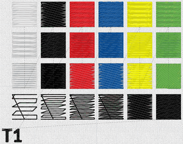

Threads, in sewing order: 001 White, 900 Black, 800 Red, 405 Blue, 205 Yellow, 509 Leaf Green.

#### Photo Stitch 2 coverage ramp

[`calibration/ps2-grey-ramp.pes`](calibration/ps2-grey-ramp.pes) · 100 × 100 mm hoop · 90 × 21.8 mm · 3,008 stitches · 1 trim · about 3.8 min

An eight-step grey ramp (`grey-ramp.png`, white to black) as Photo Stitch 2 sews it in one Black thread: how much of each grey its line screen covers, the data the Photo Stitch 2 coverage model needs (#129).

 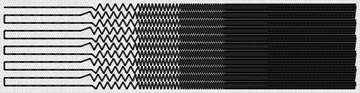

Threads, in sewing order: 900 Black.

#### Satin widths and underlay

[`calibration/satin-and-underlay.pes`](calibration/satin-and-underlay.pes) · 100 × 100 mm hoop · 81 × 79 mm · 4,526 stitches · 9 trims · about 6.1 min

Black satin columns 1, 1.5, 2, 2.5, 3, 4 and 6 mm wide and 40 mm long (OpenStitch mode keeps satin for strokes up to 2.5 mm), then two Red fills at 4.5 rows/mm, without underlay (left) and with it (right): whether narrow satins sew whole and whether the single layer holds.

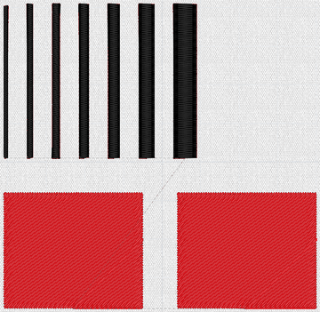

Threads, in sewing order: 900 Black, 800 Red.

### Machine checks

The compatibility specs that need a sew-out to reach the machine tier (`compat/machine`). Each file is byte for byte what `stitchtool compat` exports, so a record's `fileSha256` matches it.

#### Machine check: Region satin is a zigzag across the column

[`machine-checks/satin-zigzag-rect.pes`](machine-checks/satin-zigzag-rect.pes) · 100 × 100 mm hoop · 5 × 2 mm · 28 stitches · 1 trim · about 0.1 min

Sew this file on a Brother machine on medium-weight woven cotton with tear-away stabiliser; look for needle holes or ragged thread along the two long edges (there should be none) and record the result. The record goes in `compat/machine/stitches/satin-zigzag-rect.json` (spec `satin-zigzag-rect`).


Threads, in sewing order: 405 Blue.

#### Machine check: Machine formats carry the same stitches, trims and colour stops as PE-DESIGN 11's exports

[`machine-checks/machine-formats.pes`](machine-checks/machine-formats.pes) · 100 × 100 mm hoop · 40 × 40 mm · 248 stitches · 3 trims · about 0.5 min

Sew this file on a Brother single-needle machine (medium-weight woven cotton, tear-away stabiliser): the two Red lines must sew with one thread cut between them (no thread span across the 40 mm gap), the machine must stop once for Black, and the satin must sew its 15 mm stitches whole with no needle holes along the long edges. Record the result, the cut, and whether the machine showed the design as 40 x 40 mm. The record goes in `compat/machine/machine/machine-formats.json` (spec `machine-formats`).

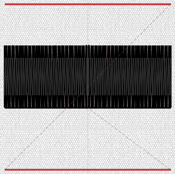

Threads, in sewing order: 800 Red, 900 Black.

#### Machine check: Shape-tool shapes start and end where PE-DESIGN 11 puts them

[`machine-checks/shape-start-points.pes`](machine-checks/shape-start-points.pes) · 100 × 100 mm hoop · 92 × 44 mm · 2,857 stitches · 8 trims · about 4 min

Sew this file on a Brother machine (medium-weight woven cotton, tear-away): seven colour stops in drawing order; each shape starts and ends at the bottom middle of its outline; every move between shapes is cut (no thread span on top). Record the result. The record goes in `compat/machine/stitches/shape-start-points.json` (spec `shape-start-points`).

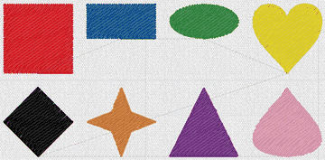

Threads, in sewing order: 800 Red, 405 Blue, #2d8f3b, #f7e41b, 900 Black, #f08a1d, #7b2f8e, #f4a6c0.

#### Machine check: Default PES is version 6 with objects and a thread table

[`machine-checks/pes-default-v6.pes`](machine-checks/pes-default-v6.pes) · 100 × 100 mm hoop · 40 × 30 mm · 64 stitches · 2 trims · about 0.2 min

Copy this file to a USB stick, load it on a Brother machine and sew it; record whether it loads, its colour changes and how it sews. The record goes in `compat/machine/pes/pes-default-v6.json` (spec `pes-default-v6`).

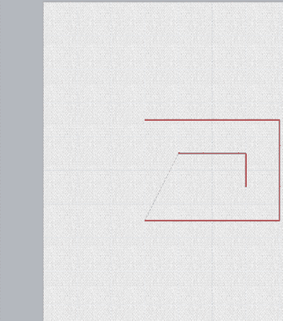

Threads, in sewing order: 800 Red, 900 Black.

### Fills and region options

Every region sew type and the fill, satin and underlay options.

#### Region sew types (1 of 2)

[`fills/region-sew-types-1.pes`](fills/region-sew-types-1.pes) · 100 × 100 mm hoop · 86 × 86 mm · 6,763 stitches · 10 trims · about 9 min

Nine region sew types, left to right, top to bottom: fill, satin, programmable fill (diamonds), motif fill (heart), piping, cross stitch, concentric circle, radial, spiral.

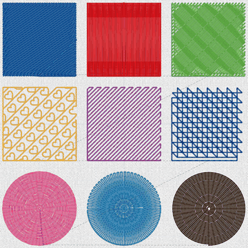

Threads, in sewing order: 405 Blue, 800 Red, 509 Leaf Green, 208 Orange, 620 Magenta, 406 Ultra Marine, 086 Deep Rose, 019 Sky Blue, 058 Dark Brown.

#### Region sew types (2 of 2)

[`fills/region-sew-types-2.pes`](fills/region-sew-types-2.pes) · 100 × 100 mm hoop · 87.9 × 86 mm · 4,924 stitches · 9 trims · about 6.6 min

Flexible spiral, stippling, net fill (square), zigzag net fill (honeycomb), decorative fill (waves), contour fill as rings and as a double spiral (beyond PE-DESIGN), programmable fill (bricks) with base sewing, motif fill (leaf).

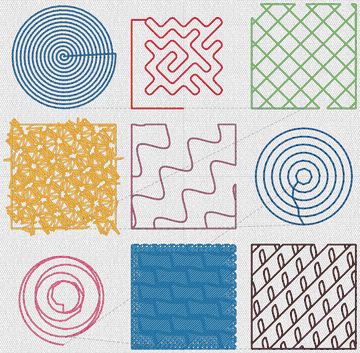

Threads, in sewing order: 405 Blue, 800 Red, 509 Leaf Green, 208 Orange, 620 Magenta, 406 Ultra Marine, 086 Deep Rose, 019 Sky Blue, 058 Dark Brown.

#### Fill and satin options

[`fills/fill-options.pes`](fills/fill-options.pes) · 100 × 100 mm hoop · 86 × 86.4 mm · 8,243 stitches · 10 trims · about 10.8 min

Fill at 45°, continuous gradation to 20 %, gradation pattern, feathered edges, Stitch Type 2 (sloped rows), OpenStitch's random stagger, frequency 0 (no stagger), Auto direction on a circle, and satin with pull compensation and split stitches.

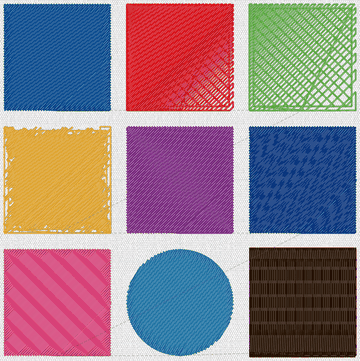

Threads, in sewing order: 405 Blue, 800 Red, 509 Leaf Green, 208 Orange, 620 Magenta, 406 Ultra Marine, 086 Deep Rose, 019 Sky Blue, 058 Dark Brown.

#### Underlay styles

[`fills/underlay-styles.pes`](fills/underlay-styles.pes) · 100 × 100 mm hoop · 86 × 86 mm · 8,412 stitches · 14 trims · about 11.2 min

No underlay, edge, zigzag, edge + zigzag, double (crossing layers), PE-DESIGN's first type (edge and rows), its second (edge and lattice), centre piping under a satin, and light underlay density.

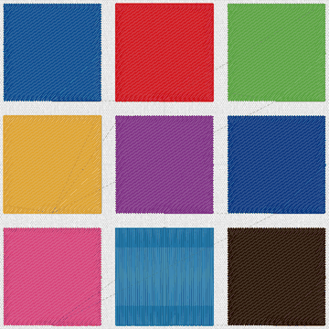

Threads, in sewing order: 405 Blue, 800 Red, 509 Leaf Green, 208 Orange, 620 Magenta, 406 Ultra Marine, 086 Deep Rose, 019 Sky Blue, 058 Dark Brown.

#### Hole sewing, engraving and embossing

[`fills/holes-and-emboss.pes`](fills/holes-and-emboss.pes) · 100 × 100 mm hoop · 86 × 86 mm · 10,746 stitches · 5 trims · about 13.7 min

Top left: hole sewing (the blue ring is sewn around the yellow centre, not under it). Then a star as an engraved line, an engraved region and an embossed region in a red fill.

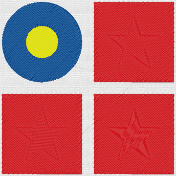

Threads, in sewing order: 405 Blue, 205 Yellow, 800 Red.

### Lines

Every line sew type.

#### Line sew types

[`lines/line-sew-types.pes`](lines/line-sew-types.pes) · 100 × 100 mm hoop · 86 × 87.5 mm · 3,557 stitches · 9 trims · about 4.9 min

Top to bottom: running, triple, zigzag, motif (wave), stem, candlewick, E stitch, V stitch, chain.

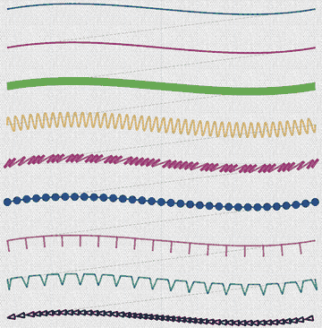

Threads, in sewing order: 405 Blue, 800 Red, 509 Leaf Green, 208 Orange, 620 Magenta, 406 Ultra Marine, 086 Deep Rose, 019 Sky Blue, 058 Dark Brown.

### Shapes and frames

The shape tools and decorative frames.

#### Shape tools

[`shapes/shape-tools.pes`](shapes/shape-tools.pes) · 100 × 100 mm hoop · 84.5 × 84 mm · 4,534 stitches · 10 trims · about 6.2 min

Preset star, heart, crescent, arrow, teardrop and hexagon; then a skeleton satin of changing width, a curved Manual Punch column, and a floral pattern inside a circle.

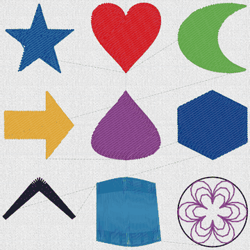

Threads, in sewing order: 405 Blue, 800 Red, 509 Leaf Green, 208 Orange, 620 Magenta, 406 Ultra Marine, 058 Dark Brown, 019 Sky Blue, 900 Black, 620 Magenta.

#### Decorative frames

[`shapes/decorative-frames.pes`](shapes/decorative-frames.pes) · 100 × 100 mm hoop · 81.6 × 56.5 mm · 1,439 stitches · 45 trims · about 4.1 min

Five Shape-tool frames (scallop, wave, zigzag, scallop oval, corners) around small circles, and the laurel frame from the decorative library.

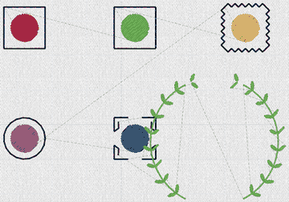

Threads, in sewing order: 800 Red, 900 Black, 509 Leaf Green, 900 Black, 208 Orange, 900 Black, 620 Magenta, 900 Black, 406 Ultra Marine, 900 Black, 509 Leaf Green.

### Lettering and monograms

The fonts, Text Transform, text on a path and monograms.

#### Lettering

[`lettering/fonts-and-text.pes`](lettering/fonts-and-text.pes) · 100 × 100 mm hoop · 71 × 89.7 mm · 3,734 stitches · 37 trims · about 6.6 min

Lato Bold and Pacifico, a Text Transform arch, and text spaced around a circle (text on a path).

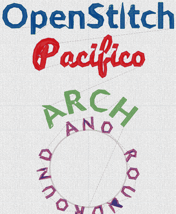

Threads, in sewing order: 405 Blue, 800 Red, 509 Leaf Green, 399 Warm Gray, 620 Magenta.

#### Monograms

[`lettering/monograms.pes`](lettering/monograms.pes) · 150 × 150 mm hoop · 124.9 × 119.7 mm · 6,184 stitches · 57 trims · about 10.7 min

The four monogram styles (block, script, diamond, circle), each in a decorative frame, for the 150 × 150 mm hoop.

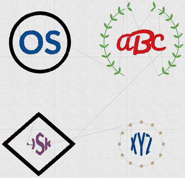

Threads, in sewing order: 900 Black, 405 Blue, 509 Leaf Green, 800 Red, 900 Black, 620 Magenta, 208 Orange, 406 Ultra Marine.

### Wizards

Appliqué, embroidered patch, cutwork and background fill.

#### Appliqué wizard

[`wizards/applique.pes`](wizards/applique.pes) · 100 × 100 mm hoop · 57.5 × 57.3 mm · 4,365 stitches · 4 trims · about 5.7 min

A heart as appliqué: material line, stop, position line, stop, tack-down, stop, covering zigzag. Lay the fabric at the first stop, trim it at the second.

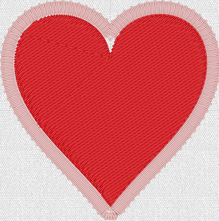

Threads, in sewing order: 800 Red, #ffc864, #ffc896, #ffc8c8.

#### Embroidered patch wizard

[`wizards/patch.pes`](wizards/patch.pes) · 100 × 100 mm hoop · 62 × 62 mm · 2,859 stitches · 3 trims · about 3.7 min

A heart with a satin border and a sewn cutting line outside it, to cut the patch out with scissors.

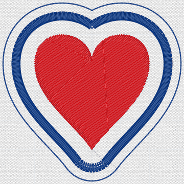

Threads, in sewing order: 800 Red, 406 Ultra Marine, 406 Ultra Marine.

#### Cutwork wizard

[`wizards/cutwork.pes`](wizards/cutwork.pes) · 100 × 100 mm hoop · 54 × 54 mm · 3,188 stitches · 6 trims · about 4.3 min

A circle cutout: stabilising run, a sewn cut line (the NV880E has no cutwork needles, so cut by hand at the stop), stabiliser run, net fill and covering satin. Use water-soluble stabiliser.

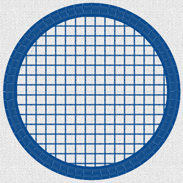

Threads, in sewing order: 405 Blue, 405 Blue, 405 Blue.

#### Background fill wizard

[`wizards/background-fill.pes`](wizards/background-fill.pes) · 100 × 100 mm hoop · 88 × 88 mm · 8,901 stitches · 3 trims · about 11.3 min

Stippling inside a circle around a heart, keeping a 3 mm gap.

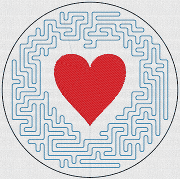

Threads, in sewing order: 019 Sky Blue, 800 Red, 900 Black.

### Image to embroidery

Each image tool on a test image, in both of its modes: PE-DESIGN-compatible mode (OpenStitch's reimplementation of PE-DESIGN 11's method) and OpenStitch mode. The source image is on the left.

#### Auto Punch, OpenStitch mode

[`image-tools/S-autopunch-balloon-openstitch.pes`](image-tools/S-autopunch-balloon-openstitch.pes) · 100 × 100 mm hoop · 90 × 67.9 mm · 8,195 stitches · 14 trims · about 11 min

`g02-balloon.png` through Auto Punch at its defaults in OpenStitch mode, fitted to the 100 × 100 mm hoop. Sew both modes of the same image to compare them on fabric.

 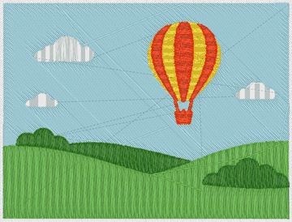

Threads, in sewing order: 001 White, 206 Harvest Gold, 017 Light Blue, 509 Leaf Green, 030 Vermillion, 515 Moss Green.

#### Auto Punch, PE-DESIGN-compatible mode

[`image-tools/S-autopunch-balloon-pe-compatible.pes`](image-tools/S-autopunch-balloon-pe-compatible.pes) · 100 × 100 mm hoop · 89.6 × 62.1 mm · 5,963 stitches · 13 trims · about 8.1 min

`g02-balloon.png` through Auto Punch at its defaults in PE-DESIGN-compatible mode, fitted to the 100 × 100 mm hoop. Sew both modes of the same image to compare them on fabric.

 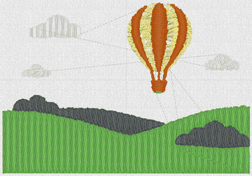

Threads, in sewing order: 001 White, 812 Cream Yellow, 509 Leaf Green, 339 Clay Brown, 704 Pewter.

#### Cross Stitch, OpenStitch mode

[`image-tools/S-cross-stitch-strawberry-openstitch.pes`](image-tools/S-cross-stitch-strawberry-openstitch.pes) · 100 × 100 mm hoop · 65 × 80 mm · 7,168 stitches · 142 trims · about 16.2 min

`g07-pixel-strawberry.png` through Cross Stitch at its defaults in OpenStitch mode, fitted to the 100 × 100 mm hoop. Sew both modes of the same image to compare them on fabric.

 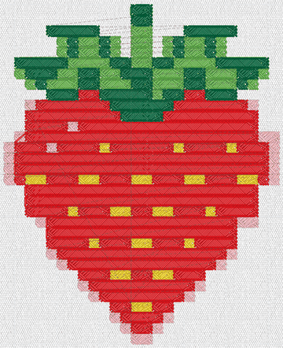

Threads, in sewing order: 206 Harvest Gold, 079 Salmon Pink, 509 Leaf Green, 800 Red, 507 Emerald Green.

#### Cross Stitch, PE-DESIGN-compatible mode

[`image-tools/S-cross-stitch-strawberry-pe-compatible.pes`](image-tools/S-cross-stitch-strawberry-pe-compatible.pes) · 100 × 100 mm hoop · 60 × 77.5 mm · 3,181 stitches · 157 trims · about 12 min

`g07-pixel-strawberry.png` through Cross Stitch at its defaults in PE-DESIGN-compatible mode, fitted to the 100 × 100 mm hoop. Sew both modes of the same image to compare them on fabric.

 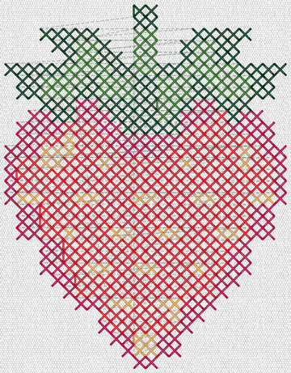

Threads, in sewing order: 208 Orange, 515 Moss Green, 800 Red, 107 Dark Fuchsia, 808 Deep Green.

#### Design Center, OpenStitch mode

[`image-tools/S-design-center-butterfly-openstitch.pes`](image-tools/S-design-center-butterfly-openstitch.pes) · 100 × 100 mm hoop · 88.8 × 74.5 mm · 3,971 stitches · 66 trims · about 8.3 min

`g04-butterfly-outline.png` through Design Center at its defaults in OpenStitch mode, fitted to the 100 × 100 mm hoop. Sew both modes of the same image to compare them on fabric.

 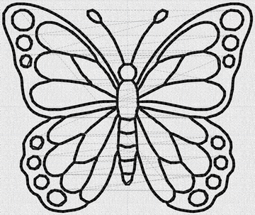

Threads, in sewing order: 900 Black.

#### Design Center, PE-DESIGN-compatible mode

[`image-tools/S-design-center-butterfly-pe-compatible.pes`](image-tools/S-design-center-butterfly-pe-compatible.pes) · 100 × 100 mm hoop · 88.2 × 74 mm · 1,152 stitches · 92 trims · about 6.2 min

`g04-butterfly-outline.png` through Design Center at its defaults in PE-DESIGN-compatible mode, fitted to the 100 × 100 mm hoop. Sew both modes of the same image to compare them on fabric.

 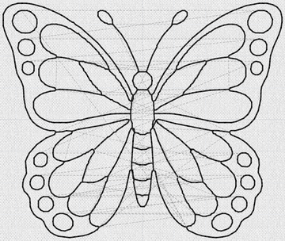

Threads, in sewing order: 900 Black.

#### Photo Stitch 1, OpenStitch mode

[`image-tools/S-photo1-sunset-openstitch.pes`](image-tools/S-photo1-sunset-openstitch.pes) · 100 × 100 mm hoop · 90 × 50.1 mm · 7,566 stitches · 383 trims · about 29.1 min

`p06-sunset.jpg` through Photo Stitch 1 at its defaults in OpenStitch mode, fitted to the 100 × 100 mm hoop. Sew both modes of the same image to compare them on fabric.

 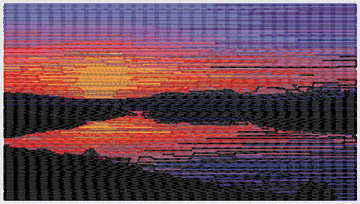

Threads, in sewing order: 001 White, 209 Tangerine, 086 Deep Rose, 612 Lilac, 607 Wisteria Violet, 030 Vermillion, 333 Amber Red, 800 Red, 614 Purple, 007 Prussian Blue, 900 Black.

#### Photo Stitch 1, PE-DESIGN-compatible mode

[`image-tools/S-photo1-sunset-pe-compatible.pes`](image-tools/S-photo1-sunset-pe-compatible.pes) · 100 × 100 mm hoop · 90 × 50.1 mm · 8,949 stitches · 317 trims · about 27.4 min

`p06-sunset.jpg` through Photo Stitch 1 at its defaults in PE-DESIGN-compatible mode, fitted to the 100 × 100 mm hoop. Sew both modes of the same image to compare them on fabric.

 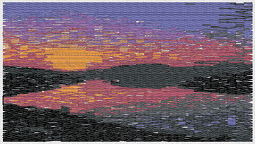

Threads, in sewing order: 001 White, 209 Tangerine, 348 Khaki, 817 Gray, 612 Lilac, 607 Wisteria Violet, 333 Amber Red, 704 Pewter, 707 Dark Gray, 900 Black.

#### Photo Stitch 1, OpenStitch mode

[`image-tools/M-photo1-portrait-openstitch.pes`](image-tools/M-photo1-portrait-openstitch.pes) · 150 × 150 mm hoop · 94.1 × 139.8 mm · 23,943 stitches · 1608 trims · about 112.3 min

`p01-portrait.jpg` through Photo Stitch 1 at its defaults in OpenStitch mode, fitted to the 150 × 150 mm hoop. Sew both modes of the same image to compare them on fabric.

 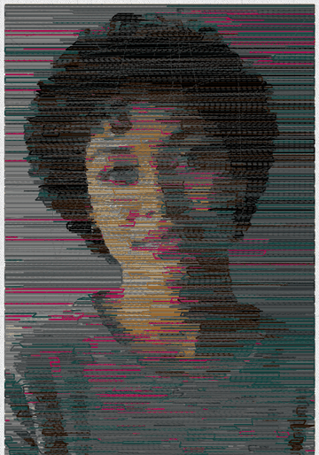

Threads, in sewing order: 001 White, 348 Khaki, 005 Silver, 817 Gray, 323 Light Brown, 704 Pewter, 107 Dark Fuchsia, 415 Peacock Blue, 707 Dark Gray, 058 Dark Brown, 900 Black.

#### Photo Stitch 1, PE-DESIGN-compatible mode

[`image-tools/M-photo1-portrait-pe-compatible.pes`](image-tools/M-photo1-portrait-pe-compatible.pes) · 150 × 150 mm hoop · 94.1 × 139.8 mm · 24,614 stitches · 750 trims · about 69.2 min

`p01-portrait.jpg` through Photo Stitch 1 at its defaults in PE-DESIGN-compatible mode, fitted to the 150 × 150 mm hoop. Sew both modes of the same image to compare them on fabric.

 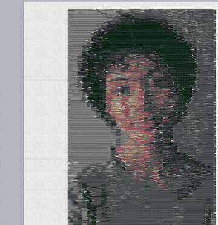

Threads, in sewing order: 001 White, 348 Khaki, 817 Gray, 333 Amber Red, 704 Pewter, 707 Dark Gray, 519 Olive Green.

#### Photo Stitch 2, OpenStitch mode

[`image-tools/M-photo2-poppies-openstitch.pes`](image-tools/M-photo2-poppies-openstitch.pes) · 150 × 150 mm hoop · 140.9 × 141 mm · 60,769 stitches · 4 trims · about 76.2 min

`p08-poppies.jpg` through Photo Stitch 2 at its defaults in OpenStitch mode, fitted to the 150 × 150 mm hoop. Sew both modes of the same image to compare them on fabric.

 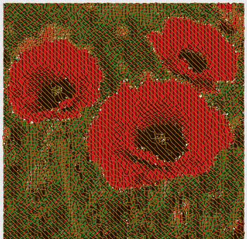

Threads, in sewing order: 515 Moss Green, 800 Red, 058 Dark Brown, 323 Light Brown.

#### Photo Stitch 2, PE-DESIGN-compatible mode

[`image-tools/M-photo2-poppies-pe-compatible.pes`](image-tools/M-photo2-poppies-pe-compatible.pes) · 150 × 150 mm hoop · 140.5 × 140.5 mm · 64,256 stitches · 4 trims · about 80.5 min

`p08-poppies.jpg` through Photo Stitch 2 at its defaults in PE-DESIGN-compatible mode, fitted to the 150 × 150 mm hoop. Sew both modes of the same image to compare them on fabric.

 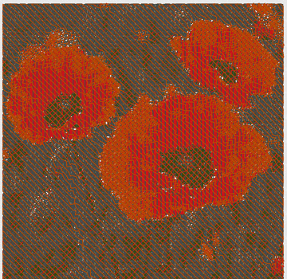

Threads, in sewing order: 517 Dark Olive, 800 Red, 704 Pewter, 339 Clay Brown.

#### Auto Punch, OpenStitch mode

[`image-tools/L-autopunch-storybook-openstitch.pes`](image-tools/L-autopunch-storybook-openstitch.pes) · 260 × 160 mm hoop · 199.1 × 150.1 mm · 119,059 stitches · 1135 trims · about 207 min

`p03-storybook.jpg` through Auto Punch at its defaults in OpenStitch mode, fitted to the 260 × 160 mm hoop. Sew both modes of the same image to compare them on fabric.

 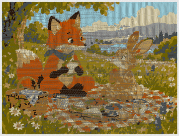

Threads, in sewing order: 017 Light Blue, 843 Beige, 005 Silver, 348 Khaki, 339 Clay Brown, 328 Brass, 323 Light Brown, 330 Russet Brown, 704 Pewter, 058 Dark Brown.

#### Auto Punch, PE-DESIGN-compatible mode

[`image-tools/L-autopunch-storybook-pe-compatible.pes`](image-tools/L-autopunch-storybook-pe-compatible.pes) · 260 × 160 mm hoop · 199.3 × 151.1 mm · 109,554 stitches · 1639 trims · about 220.9 min

`p03-storybook.jpg` through Auto Punch at its defaults in PE-DESIGN-compatible mode, fitted to the 260 × 160 mm hoop. Sew both modes of the same image to compare them on fabric.

 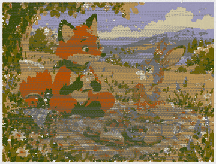

Threads, in sewing order: 843 Beige, 804 Lavender, 348 Khaki, 817 Gray, 323 Light Brown, 337 Reddish Brown, 330 Russet Brown, 517 Dark Olive.

<!-- kit:end -->
